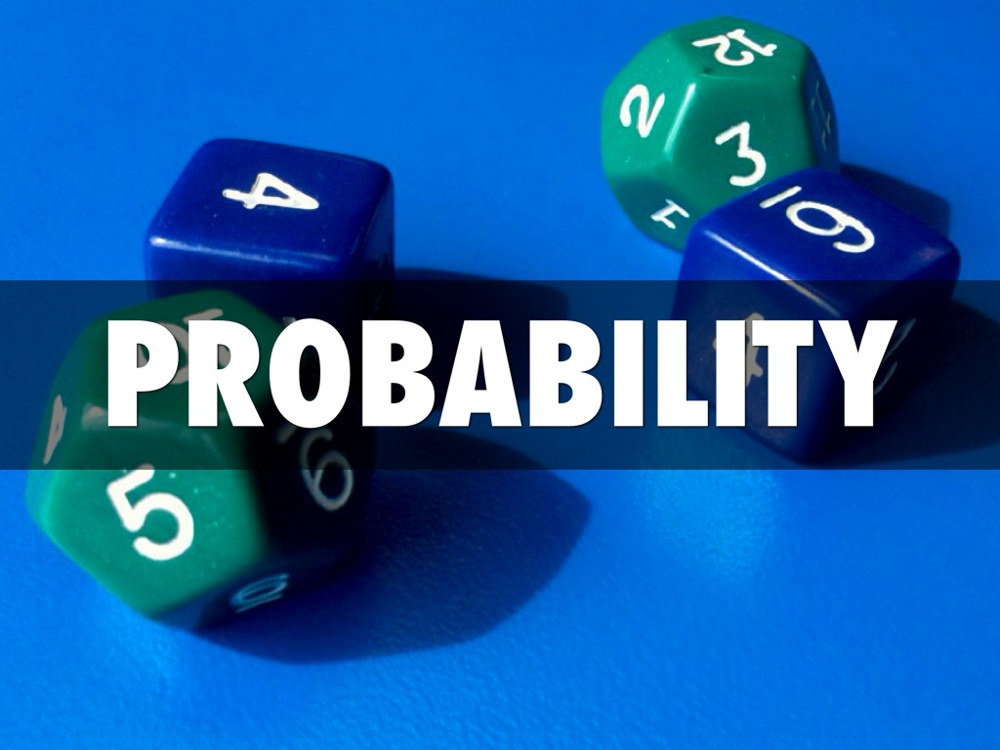

::: {dir="ltr" style="text-align: left;" trbidi="on"}
ঋণাত্মক সম্ভাবনা!

গণিত ও পরিসংখ্যান সম্পর্কে মোটামুটি ধারণা রাখেন-এমন অধিকাংশ মানুষই কথাটি শুনলে চোখ কপালে তুলে ফেলবেন। ভেংচি কাটবেন। বক্তার মানসিক অবস্থা নিয়ে প্রশ্ন তুলবেন। কারণ তারা জানেন, সম্ভাবনা (Probability) কোনো ঘটনা ঘটার আনুকূল্য প্রকাশ করে। যেমন, কারো কাছে ১০ টি বল আছে। ৫টি বল লাল হলে না দেখে একটি বল তুললে সেটি লাল হবার সম্ভাবনা $\frac{৫}{১০}$। একটিও লাল না হলে লাল বল পাওয়ার সম্ভাবনা $\frac{০}{১০}$ বা শূন্য। সবগুলো লাল হলে সম্ভাবনা হবে $\frac{১০}{১০}$, মানে এক।

অতএব, প্রচলিত ধারণা অনুসারে সম্ভাবনার মান হতে পারে ০ থেকে ১ পর্যন্ত। ০ হলে বোঝা যাবে, ঘটনাটি একেবারেই ঘটবে না। আর ১ হওয়ার মানে, সেটি ঘটবেই। নিশ্চিত। তাহলে সম্ভাবনা আবার ঋণাত্মক হয় কী করে? প্রথাবিরোধী ও অযোৗক্তি চিন্তা!

::: {style="text-align: center;"}

:::

গণিতের ইতিহাসে কিন্তু এমন বিপরীত চিন্তার প্রাচুর্য লক্ষণীয়। আলেকজান্দ্রিয়ার গ্রিক গণিতবিদ ডায়াফ্যান্টাস বলেছিলেন, 4x + 20 = 0 সমীকরণের যে ঋণাত্মক সমাধান আসে সেটি অযৌক্তিক। ১৭০০ সালেও ইউরোপে ঋণাত্মক সংখ্যাকে অপ্রয়োজনীয় মনে করা হতো। তবে চীন ও ভারতে খ্রিস্টের জন্মের কয়েক শতকের মধ্যেই ঋণাত্মক সংখ্যার প্রচলন ঘটেছিল। ভারতীয়দের সাথে সম্পর্কের সুবাদে ইসলামী আমলের গণিতবিদরাও এর সাথে পরিচিত ছিলেন। কিন্তু শূন্যের মতোই ঋণাত্মক সংখ্যাও ইউরোপে সাধুবাধ পায় অনেক পরে।
এমনকি ১৭৫৯ সালে ইংরেজ গণিতবিদ ফ্র্যান্সিস ম্যাসারস বলেছিলেন,

> ঋণাত্মক সংখ্যা একটি সমীকরণের চেহারাকেই কলুষিত করে দেয়। এগুলো একবারেই অর্থহীন।

আঠারো শতকেও সমীকরণের ঋণাত্মক সমাধানকে হিসাবের বাইরে ফেলে দেওয়া হতো। অয়লারের মতো গণিতবিদও এদেরকে অর্থহীন মনে করতেন। শেষ পর্যন্ত লিবনিজ সাহেব এই সংখ্যাদেরকে নিয়মতান্ত্রিকভাবে ব্যবহার করা শুরু করেন।

৪ থেকে ৩ বিয়োগ দিলে ১ হয়। জানি। কিন্তু ৩ থেকে ৪ বিয়োগ দিলে? এর অর্থ তো এমন যে, আমার কাছে তিনটি গরু আছে। সেখান থেকে চারটি গরু আমি কাউকে দিয়ে দিলাম। এটা কীভাবে সম্ভব? ধরুন আমার কাছে ৫০ টাকা আছে। এখান থেকে কি আমি কাউকে ১০০ টাকা দান করতে পারি? হ্যাঁ। তার জন্যে আমাকে প্রথমে ৫০ টাকা ধার করতে হবে। তার মানে ৫০ টাকা থেকে ১০০ টাকা কাউকে দিয়ে দিলে আমার কাছে মাইনাস ৫০ টাকা থাকবে। মানে আমি ৫০ টাকা দেনা থাকব। এভাবেই ঋণাত্মক সংখ্যা বাস্তব হিসাব-নিকাশের অনিবার্য অংশ হয়ে যায়। সহজ করে দেয় গণিতের কাজ।

ঋণাত্মক সংখ্যার মতোই বাধার সম্মুখীন হয়েছিল ভগ্নাংশ ও 'কাল্পনিক' সংখ্যাও। বর্তমানে এগুলো সুপ্রতিষ্ঠিত গাণিতক সংখ্যা। কোয়ান্টাম মেকানিক্স নামের পদার্থবিদ্যার সবচেয়ে গুরুত্বপূর্ণ ভাগটির শুরুতেই দেখা যায় 'কাল্পনিক' সংখ্যার পদচারণা।

একইভাবে সমূহ সম্ভাবনা দেখা যাচ্ছে ঋণাত্মক সম্ভাবনা নিয়েও। ১৯৪২ সালে নোবেল বিজয়ী তাত্ত্বিক পদার্থবিদ পল ডিরাক একটি পেপার প্রকাশ করেন। এতে তুলে ধরেন ঋণাত্মক সম্ভাবনার কথা। তিনি বলেন,

> ঋণাত্মক সম্ভাবনাকে উদ্ভট ভাবা ঠিক নয়। 

১৯৮৭ সালে নোবেলজয়ী আরেক পদার্থবিদ রিচার্ড ফাইনম্যানও এ বিষয়ে একটি পেপার প্রকাশ করেন। তিনি এখানে দেখান, ঋণাত্মক সম্ভাবনার চিন্তা মোটেও আজগুবি নয়। এই ধারণা বরং প্রয়োগ করা যায় পদার্থবিজ্ঞানের অনেকগুলো ক্ষেত্রে।

তাঁর মতে হিসাবের সুবিদার্থে আমরা যেভাবে ঋণাত্মক সংখ্যার ব্যবহার করি, সেই একক যুক্তিতে ব্যবহার করা চলে ঋণাত্মক সম্ভাবনাও। ধরুন, কারো কাছে ১০টি আপেল আছে। এখান থেকে তিনি ১০টি কাউকে দিলেন, আর ৮টি নিলেন কারো কাছ থেকে। ঋণাত্মক সংখ্যা দিয়ে একে সহজেই হিসাব করা যায়। ৫-১০ = -৫ এবং -৫+৮ = ৩। শেষ পর্যন্ত সন্তোষজনকভাবে ধনাত্মক সংখ্যাই পাওয়া গেল। যদিও মাঝখানে ব্যবহার করা হয়েছে 'অযৌক্তিক' ঋণাত্মক সংখ্যা।

এবার মনে করুন, তিনটি তল বিশিষ্ট একটি গুটিতে যথাক্রমে ১,২ ও ৩ লেখা আছে। আরও ধরুন, গুটিগুলোকে দুইটি ভিন্ন শর্ত মেনে নিক্ষেপ করা যাবে। শর্ত A ও শর্ত B। শর্ত দুটির ক্ষেত্রে সম্ভাবনার মান হবে আলাদা। ধরুন, শর্ত A-এর ক্ষেত্রে ১ পড়ার সম্ভাবনা $P_{1A}$ = ০.৩, ২ পড়ার সম্ভাবনা $P_{2A}$= ০.৬ এবং ৩ পড়ার সম্ভাবনা  $P_{3A}$ = ০.১। শর্ত B-এর ক্ষেত্রে সম্ভাবনাগুলো যথাক্রমে $P_{1B}$ =০.১, $P_{2B}$= ০.৪ ও $P_{3B}$ = ০.৫। তার মানে, বিষয়টা এ রকম:

  অবস্থা   শর্ত A   শর্ত B
  -------- -------- --------
  ০১       ০.৩      ০.১
  ০২       ০.৬      ০.৪
  ০৩       ০.১      ০.৫
  মোট      ১        ১

এবার ধরুন গুটিটিকে মোট ১০ বার নিক্ষেপ করা হলো। ৭ বার নিক্ষেপ করা হলো শর্ত A অনুসারে। বাকি ৩ বার শর্ত B অনুসারে। তার মানে A-এর সম্ভাবনা P$_A$= ০.৭ ও B-এর সম্ভাবনা P$_B$= ০.৩। মনে রাখতে হবে, একটি সিস্টেমের সবগুলো ঘটনা ঘটার মোট সম্ভাবনা এক (১) হবে। এখন গুটি নিক্ষেপ করে সম্ভাবনার তত্ত্ব অনুসারে ১ পাওয়ার সম্ভাবনা হবে ০.৭ × ০.৩ + ০.৩ ×০.১ =০.২৪।

তার মানে, a যদি শর্ত হয়, আর P$_{ia}$ যদি হয় শর্তাধীন সম্ভাবনা, তাহলে a শর্তের জন্যে i এর সম্ভাবনা হবে
P$_i$ = $\sum_aP_{ia}.P_a$
এখানে P$_a$ হলো a শর্ত পূরণ হবার সম্ভাবনা। P$_{ia}$ মানে হলো i ও a ঘটার যৌথ সম্ভাবনা। বুঝতে অসুবিধা হলে টেবিল থেকে মিলিয়ে নিন। যেহেতু প্রতিটি শর্তের জন্যে কিছু না কিছু ঘটবেই, তাই $\sum_iP_{ia}$ =1 হবে।
যদি কোনো একটি শর্ত অবশ্যই পূরণ হয়, তাহলে যদি $\sum_aP_a$\-\--(১)
হয় তাহলে $\sum_iP_i$ হবে।

(১) অনুসারে, আমরা কোনো না কোনো ফলাফল পাবই।

এবার ধরুন, কিছু শর্তাধীন সম্ভাবনা ঋণাত্মক হলো। ঋণাত্মক সংখ্যার মতোই ফাইনাল ফলকে অযৌক্তিক না বানিয়ে আমরা মাঝখানে এর ব্যবহার করতে পারি কি না দেখা যাক। এবার টেবিলটা এ রকমঃ

  অবস্থা   শর্ত A   শর্ত B
  -------- -------- --------
  ০১       ০.৩      -০.৪
  ০২       ০.৬      ১.২
  ০৩       ০.১      ০.২
  মোট      ১        ১

টেবিলটা এমনভাবে করা হয়েছে যাতে (১) অনুসারে $P_{1B}$+ $P_{2B}$+ $P_{3B}$=1  হয়। এবার তাহলে ১ পাওয়ার সম্ভাবনা হবে $P_1$ = ০.৭×০.৩+০.৩× (-০.৪) =০.৯। স্বাভাবিক ফল। $P_{2B}$ ও ১ এর বেশি (১.২) হয়েছে। এ ধারণার সাথে ঋণাত্মক সম্ভাবনার কোনো পার্থক্য নেই। এটি হলো ঘটনাটি না ঘটার ঋণাত্মক সম্ভাবনা।

একইভাবে হিসাব করে ২ ঘটার সম্ভাবনা পাওয়া যাবে $P_2$=০.৭×০.৬+০.৩×১.২ =০.৭৮।

৩ ঘটার সম্ভাবনা হবে $P_3$=০.১৩। এদের যোগফল হয় ১, যা স্বাভাবিক ফল। আবার শর্তগুলোর নিজেদের অথবা ১, ২ বা ৩ ঘটার সম্ভাবনাও ঋণাত্মক হতে পারে। তবুও ফাইনাল রেজাল্ট যৌক্তিক হওয়া সম্ভব।

তাহলে ঋণাত্মক সম্ভাবনাকে আমরা ফাইনাল রেজাল্টের জন্যে স্বাভাবিক হিসেবে মেনে না নিলেও অন্তত হিসাবের সুবিদার্থে মাঝখানে ব্যবহার করতেই পারি। এতে সম্ভাবনা তত্ত্বের কোনো বিধানের বিরুদ্ধে যাওয়া হয় না। ফাইনম্যান তাঁর পেপারে ঋণাত্মক সম্ভাবনার কিছু ব্যবহারিক উদাহরণও দেখিয়েছিলেন।

ইদানিং এ বিষয়ে নিয়মিত পেপার আসছে। মার্ক বারগিন ২০১০ সালে এক পেপারে এর প্রয়োগ দেখাতে গিয়ে একটি সুন্দর উদাহরণ দিয়েছেন। মনে করুন, আমি কোনো বানান ভুল করি না। তাহলে এ লেখায় 'কারন' ('কারণ' এর স্থলে) শব্দটি থাকার সম্ভাবনা কত? প্রচলিত সম্ভাবনা সূত্র অনুসারে উত্তর হবে ০। কিন্তু অনেক সময় টাইপিং-এ ভুল হয়। অতএব আমরা বলতে পারি, লেখায় 'কারন' শব্দটি থাকার সম্ভাবনা হবে (-০.১)। পরে এটি ঠিক করা হলে আর কোনো ভুল বানান থাকবে না। অর্থাৎ, বলা যায়, টাইপিং ভুলের আগে সম্ভাবনা ঋণাত্মক ছিল। সব ভুল দূর করার পরে সম্ভাবনা শূন্য হলো।

১৯৩২ সালে আরেক নোবেল বিজয়ী ইউজিন উইগনারও ঋণাত্মক সম্ভাবনার দেখা পান। ১৯৪৫ সালে ইংরেজ পরিসংখ্যানবিদ  মরিস বার্টলেট দেখান, ঋণাত্মক সম্ভাবনার মধ্যে কোনো গাণিতিক বা যৌক্তিক অসঙ্গতি নেই। ২০১০ সালে এস্পেন হউগ দেখান যে গাণিতকি অর্থনীতিতেও এই ধারণা কাজে লাগানো সম্ভব।

**সূত্রঃ**
1. http://cds.cern.ch/record/154856/files/pre-27827.pdf
2. https://betterexplained.com/articles/a-visual-intuitive-guide-to-imaginary-numbers/
3. https://en.wikipedia.org/wiki/Negative\_number\#First\_usage\_of\_negative\_numbers

:::
