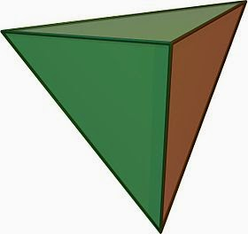
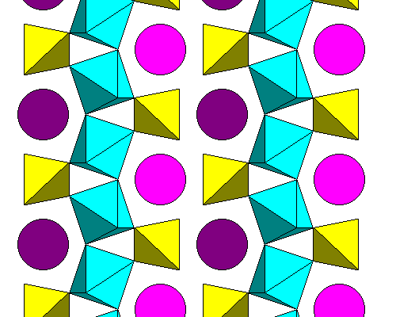
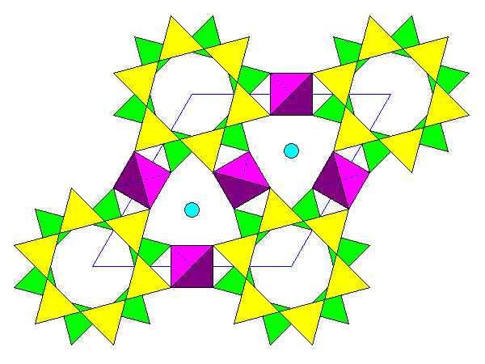
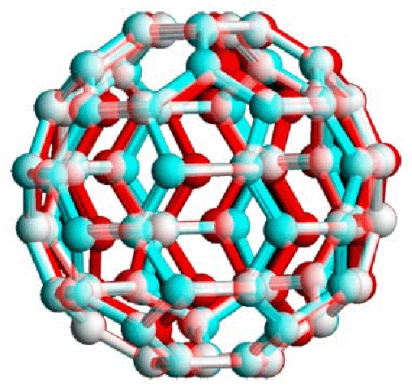
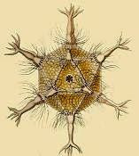
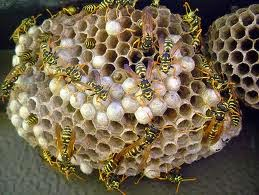

::: {dir="ltr" style="text-align: left;" trbidi="on"}
প্রকৃতি যে সুকৌশলে গণিত মেনে চলে তার আরেকটি উদাহরণ হলো প্রকৃতিতে পলিহেড্রনের ছড়াছড়ি। এই কথার প্রমাণ দেখার আগে চলুন চোখ ডুব দিয়ে নিই পলিহেড্রন শব্দটির গভীরে।

প্রাচীন গ্রিক থেকে আগত polús শব্দটি থেকে আগমণ ঘটেছে পলি (Poly) শব্দের । অর্থ হচ্ছে , 'অনেক', 'বহু" ইত্যাদি। আর শব্দটির অপর অংশ hedronও এসেছে প্রাচীন গ্রিক থেকেই। ἕδρα বা hédra থেকে আগত এই শব্দটির অর্থ 'ভিত্তি', 'তল', 'মুখ' ইত্যাদি। অর্থ্যাৎ, সহজ কথায়, যে জ্যামিতিক গঠনের অনেকগুলো তল থাকে সেটাই পলিহেড্রন। আর, এজন্যেই এর বাংলা নামটিও হয়েছে যথার্থই- **বহুতলক**।  'তল' থাকে তিন বা তার অধিক মাত্রার বস্তুর। ফলে, পলিহেড্রন অবশ্যই অন্তত ত্রিমাত্রিক হবে। দ্বিমাত্রিক গঠন, যেমন বর্গ বা আয়ত কোনোভাবেই পলিহেড্রন হবে না, কারণ এদের কোন তল নেই।

বহুতলককে দ্বিমাত্রিক বানিয়ে ফেললে আমরা পাবো বহুভূজ (Polygon)। বহুভূজদের নামের শেষে থাকে 'ভূজ' বা 'gon' কথাটি। অন্য দিকে বহুতলকদের নামের শেষে থাকে (সাধারণত) 'তলক' বা ' 'hedron' শব্দটি। তবে, কিছু পরিচিত বহুতলকের নামের শেষে হেড্রন বা তলক থাকে না, যেমন ঘনক (কিউব), পিরামিড, প্রিজম ইত্যাদি। এদের সংখ্যা অল্প।
তলের সংখ্যা অনুসারে বহুতলকদের বিভিন্ন রূপভেদ পাওয়া যেতে পারে। যেমন, টেট্রাহেড্রন বা চতুষ্কতলকে চারটি ত্রিভুজাকার তল থাকে যাদের তিনটি একই সাধারণ শীর্ষে মিলিত হয়।

  ----------------------------------
   
         চিত্রঃ টেট্রাহেড্রন
  ----------------------------------

অবশ্য 'টেট্রা' শব্দ শুনে মনে হতে পারে, ত্রিভুজ দিয়ে কেন তল বানানো হয়েছে, চতুর্ভুজ দিয়ে কেন নয়? আসলে মাত্র চারটি তলের সমন্বয়ে গঠিত বহুতলক শুধু ত্রিভুজকে তল বানিয়েই বানানো যায়। আর কোনোভাবেই মাত্র চারটি তল দিয়ে বহুতলক হয় না।

আটটি তলক নিয়ে গঠিত হয় অষ্টতলক বা অক্টাহেড্রন (octahedron)। ডোডেকাহেড্রনে থাকে ১২ টি তল। আবার আইকোসাহেড্রন (Icosahedron)-এ তল থাকে বিশটি।  বহুতলকদের সংখ্যাও কিন্তু বহুই।

প্রকৃতিতে দেখা মেলে বিভিন চিত্র-বিচিত্র বহতলকের। কোনো কোনোটাতো আবার আকার নেয় প্রচলিত তারকার মতো। চতুষতলক, ঘনক ও অষ্টলতকের প্রত্যেককেই পাওয়া যায় স্ফটিকরূপে। যেমন ক্যালসিয়াম, টাইটেনিয়াম, অক্সিজেন ও সিলিকনের যৌগ টাইটেনাইট বহুতলক স্ফটিকের বেশ ভালো একটি উদাহরণ।

  ----------------------------------
   
           চিত্রঃ টাইটেনাইট
  ----------------------------------

ছবিতে টাইটেনিয়ামের অষ্টতলক, সিলিকার চতুষতলক এবং ক্যালসিয়ামের বিচ্ছিন্ন অণু দেখা যাচ্ছে।
আবার বিরাইল ((Be~3~Al~2~Si~6~O~18~) যৌগে দেখা যায় চতুষতলকেরা (Tetrahedron) মিলে তৈরি করেছে ষড়কোণী বলয়। 

  ----------------------------------
   
          চিত্রঃ বিরাইল যৌগ
  ----------------------------------

কার্বনের নতুন আবিষ্কৃত অণু ফুলারিনেরও বহুতলকের সাথে দহরম মহরম সম্পর্ক।

  ----------------------------------
   
      কার্বনের বৃহৎ অণু ফুলারিন
  ----------------------------------

রসায়নেই শুধু নয়, বহুতলকের আধিপত্য রয়েছে জীববিজ্ঞানেও। বিংশ শতকের শুরুর দিকে আর্নেস্ট হেকেল রেডিওলেরিয়া পর্বের বেশ কিছু প্রাণির কঙ্কালের গঠনের বর্ণনা দেন। মূলত এদের গঠন ছিল সুষম বহুতলকের মত। অন্যতম একটি উদাহরণ হচ্ছে Circogonia icosahedra প্রাণির দেহ কাঠামো।

::: {.separator style="clear: both; text-align: center;"}

:::

::: {.separator style="clear: both; text-align: center;"}

:::

অন্য দিকে, আমাদের অতি পরিচিত কিন্তু অনাকাঙ্ক্ষিত ভাইরাস এইচআইভির গঠনও বহুতলাকার।
মৌমাছিদের মৌচাকের গঠনের জন্য আমরা বাহবা দেই ষড়ভূজকে। প্রকৃতপক্ষে মৌচাকে ষড়ভূজাকার মুখ থাকে। কিন্তু মৌচাকের অভ্যন্তরীণ চ্যাম্বারগুলো হয় রম্বিক ডোডেকাহেড্রন আকারের। একই ধরণের আকৃতি দেখা যায় ডালিমের অভ্যন্তরের কোষের মধ্যে, বিশেষ করে যখন কোষগুলো বড় হতে থাকে।

::: {.separator style="clear: both; text-align: center;"}

:::

ভীমরুলের কামড় খেয়েছেন কখনো? কামড় খেতে ভীষণ খারাপ লাগলেও ওদের বাসা কিন্তু দেখতে দারুণ।  আকৃতিটা হচ্ছে ষড়ভূজী প্রিজমের মতো। এটাও আরেক প্রকার বহুতলকই।

::: {.separator style="clear: both; text-align: center;"}

:::

জীবজগতে আরো বহু বহুতলক থাকলেও আমরা আপাতত চোখ বুলাই অন্য দিকে।
প্রাচীন কালে পিথাগোরাসের শিষ্যরা মনে করতেন গ্রহদের কক্ষপথ মেনে চলে বহুতলাকার আকৃতি। সপ্তদশ শতাব্দীতে জোহানেস কেপলার আরেক বিজ্ঞানী টাইকো ব্রাহের গ্রহদের গতি সংক্রান্ত সংগৃহীত উপাত্ত থেকে পিথাগোরীয়দের মতটি প্রতিষ্ঠিত করার চেষ্টা করেন। তিনি গ্রহদের কক্ষপথের আকারের সাথে বহুতলকদের আকারের মিল বের করতে সচেষ্ট হন। বলাইবাহুল্য, সে চেষ্টা সফল হয়নি। কিন্তু আজকে আমরা যে গ্রহদের গতি সম্পর্কিত কেপলারের সূত্রগুলো এত সুবিন্যস্তভাবে পাচ্ছি, তার পেছনে অবদান আছে বহুতলকদের পেছনে গবেষণার। অবশ্য সেই সময় মাত্র ৫টি গ্রহের সাথে মানুষের পরিচয় ছিল বলেই প্রাথমিক অনুমানটি তৈরি হতে পেরেছিল। পরবর্তীতে ইউরেনাস ও নেপচুন আবিষ্কৃত হবার পরে এই ক্ষেত্রে পিথাগোরীয় মতবাদটির কবর রচিত হয়ে যায়।

স্থাপত্যজগতেও বহুতলকদের রয়েছে ভালো কদর। ২০০৮ সালের সামার অলিম্পিক উপলক্ষে বেইজিং-এ নির্মিত ওয়াটার কিউবও একটি বহুতলক। অবশ্য আসলে কিউব (ঘনক) নয় বরং কিউবয়েড (Cuboid)। তাতে কি, এটাতো বহুতলকই থাকছে!

::: {.separator style="clear: both; text-align: center;"}

:::

**সূত্রঃ**
\[১\] <http://en.wikipedia.org/wiki/Polyhedron>
\[২\] [Polyhedra\_in\_Nature](http://math2033.uark.edu/wiki/index.php/Polyhedra_in_Nature)
:::
