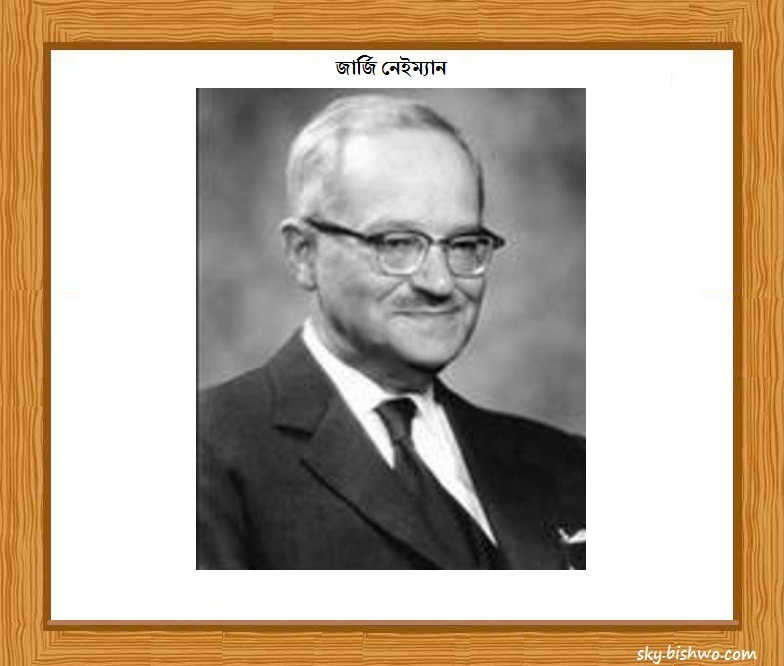

::: {dir="ltr" style="text-align: left;" trbidi="on"}
আজ ১৬ এপ্রিল। ১৮৯৪ সালের এই দিনে জন্মগ্রহণ করেন পোলিশ গণিত ও পরিসংখ্যানবিদ জার্জি নেইম্যান।

::: {style="text-align: center;"}

:::

নেইম্যানই সর্বপ্রথম পরিসংখ্যানের হাইপোথিসিস টেস্টিং (test of hypothesis) এর জগতে কনফিডেন্স ইন্টারভাল(confidence interval) এর ধারণা প্রবর্তন করেন। এছাড়াও তিনি ইগন পিয়ারসনের (কার্ল পিয়ারসনের ছেলে) সাথে যৌথভাবে নাল হাইপোথিসিস (null hypothesis) প্রস্তাব করেন।

১৮৯৪ সালে রুশ সাম্রাজ্যের এক পোলিশ ক্যাথলিক খ্রিষ্টান পরিবারে তাঁর জন্ম। বাবা- মায়ের চার সন্তানের মধ্যে তিনি ছিলেন সবার ছোট। ছোটবেলায় গির্জায় যাজকের সহকারী হিসেবে কাজ করতেন। তাঁর পরিবার ছিল খুব উচ্চবংশীয়, পূর্বপুরুষদের অনেকেই সামরিক বাহিনীতে নাম করেছিলেন।

আট বছর বয়স পর্যন্ত পড়াশোনা করেন বাসায় গৃহশিক্ষিকার কাছে। এর পর ভর্তি হন স্থানীয় জিমনেশিয়ামে। এ অল্প বয়সেই তিনি পাঁচ পাঁচটি ভাষায় কথা বলতে শিখেন। এগুলো হল পোলিশ, ইউক্রেনীয়, রুশ, ফরাসী ও জার্মান। ১৯০৯ সালে তিনি জিমনেশিয়ামের গ্র্যাজুয়েশন শেষ করেন। ১৯১২ সালে ভর্তি হন ইউক্রেনের খারকোভ বিশ্ববিদ্যালয়ে। এখানে তিনি রুশ গণিত ও সম্ভাবনাবিদ (probabilist) সের্গেই বার্নস্টাইন এর কাছে পড়ার সুযোগ পান। এখানে থাকা অবস্থায়ই পরিমাপ তত্ত্ব (measure theory) ও সমাকলনের (integration) প্রতি তাঁর তীব্র আগ্রহ তৈরি হয়।

১৯২১ সালে তিনি তাঁর দেশ পোল্যান্ডে ফিরে আসেন। ১৯২৪ সালে ওয়ারস' বিশ্ববিদ্যালয় থেকে পিএইচডি ডিগ্রি অর্জন করে। এটি পোল্যান্ডের সবচেয়ে বড় বিশ্ববিদ্যালয়। তাঁর থিসিসের বিষয় ছিল 'কৃষি ক্ষেত্রে সম্ভাবনা তত্ত্বের প্রয়োগ'।

তিনি ফেলোশিপ নিয়ে লন্ডন ও প্যারিসে কয়েক বছর সময় কাটান। এখানে এসে গাণিতিক পরিসংখ্যানের জনক কার্ল পিয়ারসন ও এমিলি বোরেলের কাছে পরিসংখ্যান শিখেন। পোল্যান্ড ফিরে এসে একটি বায়োমেট্রিক ল্যাবরেটরি প্রতিষ্ঠা করেন।

পরীক্ষণ ও পরিসংখ্যান নিয়ে অনেকগুলো বই লেখেন তিনি। বর্তমানে আমেরিকার ফুড অ্যান্ড ড্রাগ অ্যাডমিনিস্ট্রেশন (FDA) যে প্রক্রিয়ায় ওষুধের গুণাগুণ পরীক্ষা করে সে প্রক্রিয়ার উদ্ভাবক তিনিই।

১৯২৩ সালে তিনি র‍্যান্ডোমাইজড এক্সপেরিমেন্ট এর প্রস্তাব পেশ করেন এবং এ নিয়ে গবেষণা গবেষণা চালিয়ে যান। বর্তমানে বিভিন্ন ক্ষেত্রে এই প্রক্রিয়া অবলম্বন করা হয়। এর ফলে পরীক্ষণের নির্ভরযোগ্যতা বাড়ে। ১৯৩৪ সালে তিনি রয়েল স্ট্যাটিস্টিক্যাল সোসাইটিতে (Royal Statistical Society) একটি গুরুত্বপূর্ণ গবেষণাপত্র জমা দেন। এতে স্তরীভূত নমুনায়ন (stratified sampling) ও উদ্দেশ্যমূলক বাছাই (Purposive Selection) সম্পর্কে আলোচনা ছিল। এই গবেষণাপত্রই আধুনিক বৈজ্ঞানিক নমুনায়নের (sampling) ভিত্তি তৈরি করে।

১৯৩৭ সালে তিনি কনফিডেন্স ইন্টারভাল সম্পর্কিত তাঁর গবেষণাপত্রটি প্রকাশ করেন। তাঁর আরেকটি গুরুত্বপূর্ণ অবদান হল নেইম্যান- পিয়ারসন লেমা, যা হাইপোথিসিস টেস্টিং এর মূল ভিত্তি।

১৯৩৮ সালে চলে আসেন আমেরিকার বার্কলেতে। এখানেই কাটে তাঁর বাকি জীবন। তাঁর অধীনে ৩৭ জন ছাত্র পিএইচডি সম্পন্ন করেন। ১৯৬৬ সালে তিনি রয়েল স্ট্যাটিস্টিক্যাল সোসাইটির *গাই মেডাল* লাভ করেন। এর তিন বছর পর পান আমেরিকার ন্যাশনাল সায়েন্স মেডাল। এছাড়াও আরো বেশ কিছু পুরস্কার ও সম্মাননা লাভ করেন তিনি।

তিনি ১৯৮১ সালে ক্যালিফোর্নিয়ার ওকল্যান্ডে পরলোক গমন করেন।

**সূত্রঃ**
১। https://en.wikipedia.org/wiki/Jerzy\_Neyman
২। https://en.wikipedia.org/wiki/Confidence\_interval
৩। https://en.wikipedia.org/wiki/Guy\_Medal
৪। http://www-history.mcs.st-and.ac.uk/Biographies/Neyman.html
:::
