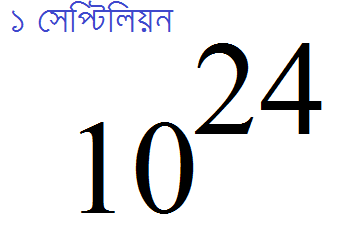

::: {dir="ltr" style="text-align: left;" trbidi="on"}
১ এর পরে ৫টি শুন্য দিলে এক লাখ, ৬টি দিলে ১০ লাখ বা ১ মিলিয়ন হয়। ৯টি শুন্য দিলে হয় ১ বিলিয়ন বা ১০০ কোটি। কিন্তু আরো বেশি দিলে? সেটাই জেনে নিই, চলুন। উল্লেখ্য, আগে সংখ্যা পদ্ধতির ব্রিটিশ ও আমেরিকান নিয়ম ভিন্ন ছিল। যেমন, আগে বিলিয়ন বলতে ব্রিটিশরা বুঝত 10^12^। কিন্তু, বর্তমানে ওরাও আমেরিকানদের পথে চলছে।

  -------------------------------------
    
   ১ সেপ্টিলিয়ন = ১ এর পরে ২৪টি শুন্য 
  -------------------------------------

::: {style="text-align: center;"}

:::

১ মিলিয়ন = 10^6 ^। অর্থ্যাৎ, ১ এর পরে ৬ খানা শুন্য।
১ বিলিয়ন = 10^9^
১ ট্রিলিয়ন =10^12^

১ কোয়াড্রিলিয়ন = 10^15^

১ কুইন্টিলিয়ন = 10^18^

১ সেক্সটিলিয়ন = 10^21^

১ সেপ্টিলিয়ন = 10^24^

১ অক্টিলিয়ন = 10^27^

১ ননিলিয়ন = 10^30^

১ ডেসিলিয়ন = 10^33^

১ উনডেসিলিয়ন = 10^36^

\-\-\-\-\-\-\-\-\-\-\-\-\-\-\-\-\-\-\-\--

১ ভিজিন্টিলিয়ন = 10^63^

১ সেন্টিলিয়ন = 10^303^

১ গুগোল (Googol) = 10^100^

১ গুগোলপ্লেক্স (Googolplex) = 10^Googol^ (10^10^100^^)

**সূত্রঃ**

১। ইংরেজি উইকিপিডিয়াঃ [বড় বড় সংখ্যাদের নাম](https://en.wikipedia.org/wiki/Names_of_large_numbers)

:::
