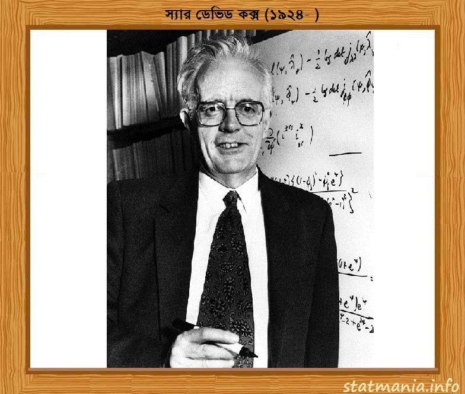

::: {dir="ltr" style="text-align: left;" trbidi="on"}
::: {style="text-align: left;"}
আজ ১৫ জুলাই। ১৯২৪ সালের এই দিনে জন্মগ্রহণ করেন বিখ্যাত ব্রিটিশ পরিসংখ্যানবিদ ডেভিড কক্স।
:::

::: {style="text-align: left;"}

:::

::: {style="text-align: left;"}
পরিসংখ্যান ও প্রায়োগিক সম্ভাবনার বহু ক্ষেত্রে তাঁর গুরুত্বপূর্ণ অবদান রয়েছে। [কোপলে পদক](https://en.wikipedia.org/wiki/Copley_Medal) ও পরিসংখ্যানের Guy Medal সহ অনেকগুলো পুরস্কারের মালিক তিনি।

+-----------------------------------------------------------------------+
|                                       |
+-----------------------------------------------------------------------+
|   ----------------------------                                        |
|   পরিসংখ্যানবিদঃ ডেভিড কক্স                                           |
|   ----------------------------                                        |
+-----------------------------------------------------------------------+
:::

::: {.separator style="clear: both; text-align: center;"}
:::

১৯২৪ সালের ১৫ জুলাই তারিখে ইংল্যান্ডের বার্মিংহামে কক্স ( (David Cox) জন্মগ্রহণ করেন। গণিত নিয়ে পড়াশুনা করেন সেন্ট জোন্স কলেজে। ১৯৪৯ সালে লিডস বিশ্ববিদ্যালয় থেকে তিনি পিএইচডি ডিগ্রি লাভ করেন। এ সময় আরেক পরিসংখ্যানবিদ হেনরি ড্যানিয়েলস ছিলেন তাঁর অন্যতম উপদেষ্টা।

তিনি ১৯৪৪ সাল থেকে ১৯৪৬ সাল পর্যন্ত রয়েল বিমান সংস্থায় কাজ করেন। ১৯৪৬ থেকে ১৯৫০ সাল পর্যন্ত ছিলেন লিডসের পশম শিল্প গবেষণা সংস্থায় এবং ১৯৫০ থেকে ১৯৫৬ সাল পর্যন্ত ক্যামব্রিজ বিশ্ববিদ্যালয়ের পরিসংখ্যান পরীক্ষাগারে নিযুক্ত ছিলেন। ১৯৫৬ থেকে ১৯৬৬ সাল পর্যন্ত তিনি লন্ডনের বার্কবেক কলেজের রিডার ও পরে অধ্যাপক পদে নিযুক্ত হন।

১৯৬৬ সালে তিনি লন্ডনের ইমপেরিয়াল কলেজের পরিসংখ্যানের প্রধানের পদ গ্রহণ করেন। পরে তিনি গনিত বিভাগের প্রধান হন। ১৯৮৮ সালে তিনি নাফিল্ড কলেজের ওয়ার্ডেন এবং অক্সফোর্ড বিশ্ববিদ্যালয় এর পরিসংখ্যান বিভাগের সদস্য হন। ১৯৯৪ সালে এসব পদ থেকে তিনি আনুষ্ঠানিকভাবে অবসর গ্রহণ করেন।

পরিসংখ্যান ও প্রায়োগিক সম্ভাবনার ক্ষেত্রে তাঁর বহু অবদানের মধ্যে সবচেয়ে বিখ্যাত হল [Proportional hazards model](https://en.wikipedia.org/wiki/Proportional_hazards_model)। সারভাইভাল বিষয়ক উপাত্ত বিশ্লেষণের ক্ষেত্রে এই মডেল ব্যাপকভাবে ব্যবহৃত হয়। যেমন, আয়ুষ্কাল বিষয়ক এক মেডিকেল গবেষণায় দেখা যায় যে রোগীর বয়স, খাদ্য অথবা নির্দিষ্ট রসায়নিক দ্রব্যের প্রভাব ইত্যাদি বিভিন্ন তথ্যের সাথে এর সম্পর্ক থাকতে পারে। এছাড়াও তাঁর নামানুসারেই [কক্স প্রসেসের](https://en.wikipedia.org/wiki/Cox_process) নামকরণ করা হয়েছে।

::: {style="text-align: center;"}

:::

বিভিন্ন জায়গা থেকে কক্স অসংখ্য সম্মানসূচক ডক্টরেট পেয়েছিলেন। এর মধ্যে উল্লেখযোগ্য হল ১৯৮৭ সালে পাওয়া হেরিওট- ওয়াট বিশ্ববিদ্যালয় থেকে পাওয়া ডিগ্রি। তাকে রয়েল পরিসংখ্যান সোসাইটির রূপার এবং সোনার "[Guy Medels](https://en.wikipedia.org/wiki/Guy_Medal)" পদকে ভুষিত করা হয়। ১৯৭৩ সালে তিনি লন্ডনের রয়েল সোসাইটির ফেলো নির্বাচিত হন। ১৯৮৫ সালে দ্বিতীয় রাণী এলিজাবেথ তাকে নাইট পদে ভূষিত করেন।

২০০০ সালে তিনি ব্রিটিশ একাডেমির সম্মানসূচক ফেলো হিসেবে নির্বাচিত হন। তিনি আমেরিকার ন্যাশনাল অ্যাকাডেমি অব সায়েন্স এর একজন বৈদেশিক সহযোগী এবং রয়েল ড্যানিশ অ্যাকাডেমি অব সায়েন্স অ্যান্ড লেটারস এর একজন বৈদেশিক সদস্য।

১৯৯০ সালে তিনি ক্যান্সার গবেষণা বিষয়ক 'Proportional hazards regression model' এর উন্নতি সাধনের জন্য kettering prize এবং স্বর্ণ পদক পেয়েছিলেন। ২০১০ সালে পরিসংখ্যানের তত্ত্বীয় এবং প্রয়োগিক বিষয়ে তার অসামান্য অবদানের জন্য তিনি রয়েল সোসাইটির কোপলে পদকে ভূষিত হয়েছিলেন।

বর্তমানে বিখ্যাত এমন বহু তরুণ গবেষককে তিনি তত্ত্বাবধান, সহযোগিতা এবং অনুপ্রেরণা দান করেছিলেন। দায়িত্ব পালন করেছেন রয়েল পরিসংখ্যান সোসাইটির বারনোউলি সোসাইটি এবং আন্তর্জাতিক পরিসংখ্যান ইন্সটিটিউট এর সভাপতি হিসেবে।

তিনি একা বা যৌথভাবে ৩০০টি বই বা গবেষণাপত্র লিখেছেন। ১৯৬৬ সাল থেকে ১৯৯১ সাল পর্যন্ত তিনি পরিসংখ্যান বিষয়ক বৈজ্ঞানিক জার্নাল [Biometrika](https://en.wikipedia.org/wiki/Biometrika) এর সম্পাদক হিসেবে কাজ করেন।

তাঁর উল্লেখযোগ্য কিছু বই হল *Planning of experiments*, *Renewal Theory*, *Analysis of binary data*, *The theory of design of experiments*, *Principles of Applied Statistics* ইত্যাদি।

১৯৪৭ সালে তিনি জয়েস ড্রুমন্ড এর সাথে বিবাহ বন্ধনে আবদ্ধ হন। তাদের চারটি সন্তান এবং দুইটি নাতি- নাতনি আছে। তিনি এখনও বেঁচে আছেন।

**সূত্রঃ**
১। https://en.m.wikipedia.org/wiki/David\_Cox\_(statistician)
২। https://en.wikipedia.org/wiki/Henry\_Daniels
:::
