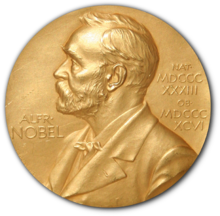
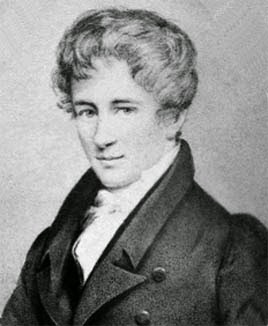
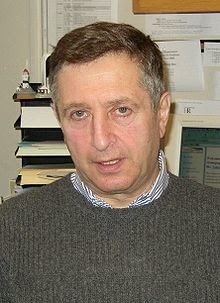

::: {dir="ltr" style="text-align: left;" trbidi="on"}
এখন আগস্ট মাস। এই মাসের ৫ তারিখে নরওয়ের ফিনয় শহরে জন্ম নেন ক্ষণজন্মা ও অসামান্য প্রতিভাধারী গণিতবিদ নিলস হেনরিক অ্যাবেল। তাঁর নামানুসারে গণিতের সবচেয়ে সম্মানজনক পুরস্কার Abel Prize দেওয়া হয়। অ্যাবেল নিয়ে জানার আগে চলুন নোবেল প্রাইজ নিয়ে একটু জেনে নিই।

**নোবেল পুরস্কার সম্পর্কে কিছু কথাঃ**
**
**

::: {.separator style="clear: both; text-align: center;"}

:::

১৮৮৮ সাল। আলফ্রেড নোবেল খবরের কাগজ পড়ছেন। একটি শিরোনামে তাঁর চোখ আটকে গেল। "মৃত্যু বণিকের মৃত্যু" (The Merchant of Death is Dead")। এখানে লেখা হয় যে আলফ্রেড নোবেল আর বেঁচে নেই। না, খবরটি তাঁর আত্মা নয়, তিনিই সশরীরেই পড়ছিলেন। তবে মারা তিনি যাননি, গিয়েছিলেন তাঁর ভাই লুডভিগ নোবেল । খবরে ভুল হয়েছিল। তবে এই ঘটনাটি নোবেলকে তাঁর সম্পর্কে মানুষের মৃত্যু-পরবর্তী অনুভূতির ব্যাপারে সতর্ক করে দিলো। তিনি তাঁর উইল বদলে দিলেন। সবাইকে অবাক করে দিয়ে তিনি তাঁর ৯৪% অর্থ নোবেল প্রাইজ পুরস্কার প্রদানের জন্যে ছেড়ে দিলেন, যা দেওয়া হবে এমন ব্যক্তিদের যাঁরা পদার্থবিদ্যা, রসায়ন, শান্তি, চিকিৎসা ও সাহিত্যে "মানবতার সর্বোত্তম কল্যাণ" সাধন করবে। (অর্থনীতি পরে অন্য দাতার দানের প্রেক্ষিতে ১৯৬৮ সালে যুক্ত করা হয়)

::: {style="text-align: left;"}
  ----------------------------------
   
       নোবেল পুরস্কারের প্রতীক 
  ----------------------------------
:::

নোবেল সাহেবের এত বিশাল দান বিশ্বাস করতে সময় লাগায় ১৮৯৫ এ করা উইল অনুমোদন পেতে ১৮৯৭ সাল হয়ে যায়। তাঁর আবিষ্কৃত ডিনামাইটের ক্ষতিকর দিক থাকায় তিনি তার প্রায়শ্চিত্ত করতে চেয়েছিলেন, চেয়েছিলেন মানবতার কল্যানসাধনকারীরা প্রাইজ পাক।

এখন বিতর্ক হলে পদার্থ বিজ্ঞান, রসায়নসহ সব শাস্রের ধারক বাহকরাই নিজেদেরকে ভোট দেবেন। কিন্তু তাঁদের কেউ কি বলতে পারবেন, তাঁদের অবদান একচেটিয়া? এটা ঠিক জ্ঞান বিজ্ঞানের শাখাগুলো পরস্পর নির্ভরশীল। কিন্তু কোন সেই শাখা যা বাকি সবার চালিকাশক্তি? অবশ্যই গণিত। আমি গণিত ভালোবাসি বলে বলছি তা নয়, এটাই তো বাস্তবতা।

**গণিতের নোবেলঃ**

::: {.separator style="clear: both;"}

:::

পুরস্কার পান আর না পান, গণিতবিদরা মানবতার প্রতি তাঁদের সেরা অবদান চিরকাল অব্যাহত রাখবেন। তবে তাঁদের অবদানের স্বীকৃতি দিতে ২০০১ সাল থেকে নরওয়ে সরকার চালু করেছে নোবেলের কাছাকাছি নামের অ্যাবেল পুরস্কার, গণিতবিদ নিলস হেনরিক অ্যাবেলের( ১৮০২-১৮২৯) নামে। গণিতে নোবেল না থাকায় এটাকেই বলা হয় 'গণিতের নোবেল'। পুরস্কারের অর্থমূল্য নরওয়ের টাকায় ৬০ লাখ ক্রোনার ( প্রায় ১০ লাখ ইউএস ডলার) বা প্রায় ৮ কোটি বাংলাদেশি টাকা।

::: {style="text-align: left;"}
  ----------------------------------
   
       অ্যাবেল প্রাইজের প্রতীক
  ----------------------------------
:::

অবিচ্ছিন্ন প্রতিসাম্য তত্বের প্রবক্তা গণিতবিদ ম্যারিয়াস সোফাস লী (১৮৪২-১৮৯৯) ১৮৮৯ সালে তাঁর মৃত্যুর কিছু আগে সর্বপ্রথম এই পুরস্কারের প্রস্তাব দেন, এটা জানতে পেরে যে আলফ্রেড নোবেলের পুরস্কার প্রদানের পরিকল্পনায় গণিতের স্থান নেই। তবে ১৯০২ সালেও রাজা ২য় অস্কার পুরস্কারটি শুরু করতে চেয়ে সুইডেন ও নরওয়ের ভাঙনের হুজুগে তা আর করতে পারেননি। আর ১৮৯৯ সালে লী এর মৃত্যুও উৎসাহে বিরতির কারণ।

২০০১ সালের মে মাসে ভাবনাটির পুনরুজ্জীবনের পর একটি ওয়ার্কিং গ্রুপের মাধ্যমে নরওয়ের প্রধানমন্ত্রী বরাবর একটি প্রস্তাবনা পাঠানো হয়। ঐ বছরেরই আগস্টে সরকার ঘোষণা করে যে ২০০২ থেকে পুরস্কার প্রদান শুরু হবে, যে সালটি হল অ্যাবেলের জন্মের দুইশতম বছর। অবশ্য ২০০৩ সাল থেকে এটি প্রদান করা হচ্ছে।

**যেভাবে নির্বাচিত করা হয়ঃ**
**
** পাঁচজন বিশ্বসেরা গনিতজ্ঞের বাছাইয়ের পর নরওয়েজিয়ান অ্যাকাডেমি অভ সায়েন্স অ্যান্ড লেটারস প্রতি বছরের মার্চে অ্যাবেল পুরস্কার প্রাপ্তের নাম ঘোষণা করে। International Mathematical Union এর অন্যতম নির্বাহী সদস্য ও বীজগাণিতিক জ্যামিতির গবেষক, নরওয়েরই গণিতজ্ঞ র‍্যাগনি পিয়েনে হচ্ছেন কমিটির প্রধান। International Mathematical Union ও the European Mathematical Society অ্যাবেল কমিটির সদস্যদের মনোনিত করে। পুরস্কারের জন্য মনোনিত ব্যক্তিকে জীবিত হতে হবে। তবে মনোনিত হবার পর মারা গেলে মরণোত্তর পুরস্কার পাবেন।

**কে ছিলেন এই অ্যাবেলঃ**
**
**

  ----------------------------------
   
        গণিতবিদ হেনরিক অ্যাবেল
  ----------------------------------

১৮০২ সালে জন্ম নেওয়া এই গণিতবিদের রয়েছে অনেকগুলো ক্ষেত্রে অগ্রবর্তী অবদান। তাঁর সবচেয়ে উল্লেখযোগ্য অবদান হল General Quintic Equation এর মূল বের করতে পারার অক্ষমতার একটি পূর্ণাংগ প্রমাণ পেশ। এটি তাঁর সময়ের অন্যতম বড় সমস্যা ছিল, যা ২৫০ ধরে জিইয়ে ছিল।

উপবৃত্তাকার ও অ্যাবেলিয়ান ফাংশনের জনক এই গণিতবিদের আয়ুষ্কাল ছিল খুবই স্বল্প, মাত্র ২৬ বছর। তাঁর সম্পর্কে ফরাসী গণিতবিদ চার্লস হারমাইটের উক্তি, "অ্যাবেল গণিতবিদদের জন্যে যা রেখে গেছেন তা তাদের ৫০০ বছর ব্যাস্ত রাখার জন্যে যথেষ্ট।" বার্লিন বিশ্ববিদ্যালয়ের প্রফেসর হিসেবে নিয়োগ পাবার কয় দিন আগে তিনি পৃথিবীর মায়া ত্যাগ করেন।

১৬ বছর বয়সে তিনি দ্বিপদী উপপাদ্যের একটি সার্বজনীন প্রমাণ পেশ করেন, যা অয়লারের ফলাফলের চেয়ে ভালো ঠেকে, কারণ অয়লারে প্রমাণ খাটতো শুধু মূলদ সংখ্যার জন্য।

**২০১৪ সালের অ্যাবেল বিজয়ীঃ**
**
**

::: {.separator style="clear: both; text-align: center;"}

:::

::: {.separator style="clear: both; text-align: center;"}

:::

এ বছর অ্যাবেল পকেটে ভরেছেন ইয়াকুভ গ্রিগোরেভিচ সিনাই। অবদান Dynamical Systems, Ergodic theory ও  Mathematical Physics এ মৌলিক অবদান।  এছাড়াও তিনি গণিতের নেমার্স প্রাইজ ও উলফ প্রাইজও জিতেছেন।

**অন্যান্য বছর অ্যাবেল প্রাপ্তদের পরিচয় ও অবদানঃ**
২০০৩ সাল থেকে নিয়মিত অ্যাবেল প্রদান করা হচ্ছে। প্রথম বছর পুরস্কার পান ফ্রান্সের নাগরিক জন পিয়েরে সেরে। তিনি টপোলজি, বীজগাণিতিক জ্যামিতি ও সংখ্যাতত্ত্ব সহ গণিতের বিভিন্ন শাখার আকৃতি দানে গুরুত্বপূর্ণ ভূমিকা রাখেন।

২০০৪ সালে এ পুরস্কার পান যৌথভাবে দু'জন গণিতজ্ঞ- ব্রিটিশ নাগরিক মাইকেল অ্যাটিয়াহ ও আমেরিকান নাগরিক ইসাডোর সিঙ্গের। তাঁরা দু'জন মিলে ইন্ডেক্স উপপাদ্য আবিষ্কার ও প্রমাণ করেন। এর মাধ্যমে টপোলজি, জ্যামিতি ও গাণিতিক বিশ্লেষণ -শাখাগুলো একীভূত হয় এবং গণিত ও তাত্ত্বিক পদার্থবিজ্ঞানের সাথে একটি সেতু-বন্ধন তৈরি হয়।
আমেরিকান গণিতবিদ পিটার ল্যাক্স পান ২০০৫ সালের অ্যাবেল। তাঁর অবদান ছিল আংশিক অন্তরক সমীকরণের তত্ত্ব, প্রয়োগ ও সমাধান প্রদান।

Harmonic analysis ও smooth dynamical systems এর তত্ত্বের উপর পূর্ণাংগ অবদান রেখে ২০০৬ সালে এই পুরস্কার পকেটে ভরেন সুইডিশ গণিতবিদ লেনার্ট কার্লসন।

সম্ভাব্যতা তত্ত্বে মৌলিক অবদানের জন্য ২০০৭ সালের পুরস্কার তুলে দেওয়া হয় ভারতীয় আমেরিকান গণিতবিদ শ্রীনিবসা ভরাধনের হাতে।

বীজগণিত ও গ্রুপ থিওরিতে যৌথ ভূমিকা রেখে জন থম্পসন ও জ্যাক টিটস ২০০৮ সালে ভাগাভাগি করেন এই পুরস্কার।

২০০৯ সালে এটি ঘরে তোলেন রুশ আমেরিকান মিখাইল গ্রমভ। তাঁর অবদান হল জ্যামিতির বৈপ্লবিক উন্নয়ন।

আমেরিকান গণিতজ্ঞ জন টেইট সংখ্যাতত্ত্বের উপর ব্যাপক ও দীর্ঘস্থায়ী প্রভাব তৈরি করতে সক্ষম হওয়ায় ২০১০ সালের পুরস্কার নিজের করে নেন। পরের বছরও তাঁর স্বদেশী জন মিলনর টপোলজি, বীজগণিত ও জ্যামিতিতে ভূমিকা রেখে নিজের পক্ষে নেন ২০১১ সালকে।

এন্দ্রে সেমেরদি লাভ করেন ২০১২ সালের অ্যাবেল। হাঙ্গেরীয় আমেরিকান এই গণিতবিদের অবদান ছিল বিচ্ছিন্ন গণিত ও তাত্ত্বিক কম্পিউটার বিজ্ঞানে।

বেলজিয়ান গণিতবিদ পিয়েরে বীজগাণিতিক জ্যামিতিতে মূখ্য ভূমিকা ও সংখ্যা তত্ত্বে প্রভাব ফেলে ২০১৩ সালে জিতে নেন গণিতের সবচেয়ে সম্মানজনক এই প্রাপ্তি।
:::
