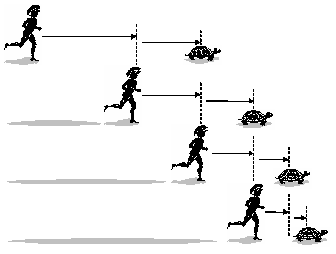

::: {dir="ltr" style="text-align: left;" trbidi="on"}
প্যারাডক্স কাকে বলে মনে আছে? যারা ভুলে গেছেন তাদের মনে করিয়ে দেই। সক্রেটিস একবার বলেছিলেন,

> 'আমি জানি যে, আমি কিছুই জানি না।' 

::: {style="text-align: left;"}
কথাটায় ভুল আছে। কারণ তিনি যে কিছুই জানেন না- এটা তো অন্তত জানেন। তাহলে কিছুই জানেন না- কথাটা সঠিক নয়। পরে অবশ্য তিনি তাঁর কথা সংশোধন করে বলেছিলেন, 'আমি শুধু এটুকু জানি যে, আমি কিছু জানি না'।
:::

::: {style="text-align: left;"}

:::

এমন স্ববিরোধী ঘটনা বা বক্তব্যকেই প্যারাডক্স বলে। তবে আবার দেখতে স্ববিরোধী কিন্তু বাস্তবে সঠিক- এমন জিনিসও প্যারাডক্সের কাতারে পড়ে। আজকে আবারও এমন একটি প্যারাডক্স আমরা দেখব।

গ্রিক দার্শনিক জেনো মনে করতেন গতি নিছকই একটি ভ্রম (Illusion), বাস্তব কিছু নয় । মূলত তাঁর অগ্রজ দার্শনিক পারমিনাইডস প্রথম বাস্তবতার দুটি বিপরীত ধারণা তুলে ধরেন। জেনো সাহেব ঐ নীতির সমর্থনেই অনেকগুলো প্যারাডক্স তৈরি করেন। কারণ ভিন্নপন্থীরা পারমিনাইডসের মতবাদের বিরুদ্ধেও তাই করেছিলেন।

জেনোর প্যারাডক্সসমূহের মধ্যে সবচেয়ে বিখ্যাত হলো "একিলিজ ও কচ্ছপ প্যারাডক্স"। আড়াই হাজার বছর আগে জেনোর প্যারাডক্স নিয়ে লেখা বইয়ের এটাই সবচেয়ে সহজে বোঝা যায় যদিও ব্যাখ্যা করা সবচেয়ে দুঃসাধ্য।

**প্যারাডক্সটি যা বলতে চায় তা হলঃ**
**
** ট্রোজান যুদ্ধের গতিমান বীর একিলিজ (Achilles) কচ্ছপের সাথে রেসে লেগেছেন। কচ্ছপ একিলিজের একটু সামনে। গ্রিক বীর কচ্ছপের চেয়ে অবশ্যই দ্রুতগামী। একটু পেছন থেকে ধাওয়া করে তাকে কচ্ছপকে ওভারটেক করতে হবে। কাজটি সহজই মনে হয়। কিন্তু একটা সমস্যা দাঁড়াল। অতিক্রম করতে হলে আগে বীরকে কচ্ছপ পর্যন্ত পৌঁছতে হবে। একিলিজ যতক্ষণে নিজের ও কচ্ছপের মধ্যকার আদি দূরত্ব পাড়ি দিয়েছেন ততক্ষণে কচ্ছপটি মাঝে আরেকটি গ্যাপ বানিয়ে ফেলেছে। নতুন গ্যাপটি আগের চেয়ে কম, কিন্তু প্রাণিটাকে ধরতে হলে বীরকে সেই দূরত্ব পার হতে হবে। তিনি সেটা করলেনও।

কিন্তু হায়! ততক্ষণে ছোট্ট এই জীবটি আরেকটি নতুন গ্যাপ তৈরি করে ফেলেছে। ফলাফল হল, একিলিজ কখোনোই কচ্ছপকে ধরতে পারবেন না, যত দ্রুতই তিনি গ্যাপ ফিল-আপ করেন না কেন কারণ, কচ্ছপটা বরাবরই নতুন গ্যাপ বানাতে থাকবে। হ্যাঁ, সেগুলো আগেরগুলোর তুলনায় ক্ষুদ্রতর হবে বটে!

  -----------------------------------
   
   একিলিজ ও কচ্ছপের দৌড় প্রতিযোগিতা 
  -----------------------------------

::: {style="text-align: center;"}

:::

জেনোর যুক্তিকে ভুল বলে উড়িয়ে দেওয়া বেশ লোভনীয়। তবে সাধারণত সেটা করা হয় অলসতা বা অস্বস্তি থেকে। অলসতা- কারণ এটা সমাধান না করেই আমরা সব সময় ভাবতে থাকি, এইতো সমাধান হয়ে গেছে। অস্বস্তির অনুভূতির কারণ হল এতো প্রাচীন এই দার্শনিকের কাছে যুক্তির মার খাওয়া।

এই প্যারাডক্সের উত্তর দিতে গিয়ে অনেকেই বলেন যেহেতু একিলিজের বেগ বেশি তাই তিনি কচ্ছপকে পার হয়ে যাবেন। কিন্তু জেনোতো ধরেই নিয়েছেন আকিলিজের বেগ বেশি। তাই এই বক্তব্য উত্তর হতে পারে না। বেগ বেশি বলেই তো গ্যাপ ক্রমাগত কমছে, কিন্তু কখোনোই জিরো হচ্ছে না।
দর্শন ও গণিতের বেশির ভাগ প্রফেসরদের মতে শুধু এই প্যারাডক্সটি নিয়েই একটা বই লিখে ফেলা যেতে পারে। অনেকে লিখেছেনও।

চলুন, সংক্ষেপে প্যারাডক্সটি ভাঙ্গার চেষ্টা করি।

জেনো প্রমাণ করতে চেয়েছিলেন পরিবর্তন ও গতি বাস্তব কিছু নয়। তাঁর অ্যারো প্যারাডক্সও সেই উদ্দেশ্যেই বানানো।
ইলিনয়েস বিশ্ববিদ্যালয়ের অধ্যাপক নিক হাগেট বলেন জেনোর মত ছিলো,

> "গতিকে অস্বীকার করা পাগলামী, তবে মেনে নেওয়া আরো কষ্টকর"।

জগৎ সম্পর্কে আমাদের ধারণা ও বাস্তবতার মধ্যে যে ফারাক প্যারাডক্সটি তাই তুলে ধরে। Enlightening Symbols বইয়ের লেখক ও মার্লবোরো কলেজের গণিতের এমিরিটাস প্রফেসর জোসেফ মাজুরের মতে "প্যারাডক্সটি হচ্ছে এমন যা স্থান, কাল ও গতি সম্পর্কে আমাদেরকে ভুলভাবে চিন্তা করায়"।

তাহলে আমাদের চিন্তার গলদ কোথায়?
গতি বাস্তব এবং সম্ভব, অবশ্যই। আর দ্রুতগামী দৌড়বিদ অবশ্যই কচ্ছপকে হারাবেন। সমস্যাটির সাথে আমাদের ইনফিনিটি বা অসীমতার ধারণার একটি যোগসূত্র আছে। একিলিজের কাজ অসম্ভব মনে হয় কারণ তাকে সসীম সময়ে অসীম সংখ্যক কাজ (গ্যাপ পূরণ) করতে হবে। কিন্তু সব অসীমের প্রকৃতি এক নয়।

ধারাদের মধ্যে অভিসারী (Convergent) ও অপসারী (Divergent) নামক দুই ধরনের ধারা রয়েছে। স্পষ্টতম অপসারী ধারা হল ১+২+৩+... এই ধারার উত্তর অসীম। একিলিজকে এই ধারার ধরণের পথ পাড়ি দিতে হলে কাজটি অসম্ভব হয়ে যেত। অর্থ্যাৎ কচ্ছপ যদি ক্রমান্বয়ে বৃহত্তর দূরত্ব তৈরি করত তখন সেটা অপসারী ধারা হত।

এবার এই ধারাটির কথা ভাবুন $\frac{১}{২}+\frac{১}{৪}+\frac{১}{৮}$+...। অসীম পর্যন্ত চললেও সিরিজটা অভিসারী, যার যোগফল হয় ১। অসীম সংখ্যক পদের যোগফল যে সসীম সংখ্যা হতে পারে এই ধারাটা তার একটি প্রমাণ, যা চমক ভাই কুমড়া থিওরি দিয়ে প্রমাণ করিয়েছিলেন। একিলিজ যদি দ্রুত দৌড়ে ক্রমান্বয়ে দূরত্ব কমান তাহলে যে ধারাটা তৈরি হয় তাও অনেকটা এই ধারাটার মত। ফলে, একিলিজ পরিমাপযোগ্য সসীম সময়ে অসীম ধারা সৃষ্টিকারী দূরত্ব পার হতে পারবেন।

ধারার এই ধারণা জেনোর আরেকটি বিভ্রান্তিকর প্যারাডক্সের জবাব দেয়। সেটা হল দ্বিবিভাজন বা Dichotomy Paradox। মনে করুন, আপনার সামনে একটি বাস আছে, যা আপনি দৌড় দিয়ে ধরতে চাও। মনে করুন, তার দূরত্ব ক। ক দূরত্বে পৌঁছতে প্রথমে আপনাকে $\frac{ক}{২}$ দূরত্বে যেতে হবে। $\frac{ক}{২}$ দুরত্বে যেতে হলে আগে $\frac{ক}{৪}$, $\frac{ক}{৪}$ যেতে $\frac{ক}{৮}$... ইত্যাদি। অর্থ্যাৎ সিকুয়েন্সটা দাঁড়ায় এমন -

{..., $\frac{১}{১৬}, \frac{১}{৮}, \frac{১}{৪}, \frac{১}{২}, ১$}

অর্থ্যাৎ জেনোর মতে যেহেতু বাসটা ধরতে অসীম সংখ্যক পথ পাড়ি দিতে হবে, সেহেতু বাস আর কোন দিনই ধরা হবে না। কিন্তু বেচারা জেনো! অসীম এই ধারা সমষ্টি সসীম। ফলে বাস ধরার স্বপ্নও অধরা থাকবে না।

এ তো আমরা অসীমকে সসীম বানালাম। কিন্তু আরেকভাবে চিন্তা করলে সব সসীমই তো আসলে অসীম। যেমন ধরুন, পরীক্ষার সময় ১ ঘন্টা। এখন, চাইলে এই ঘন্টাকে অসীম সংখ্যক ভাগে বিভক্ত করা যায়। যে কোন রাশিকেই তো ক্ষুদ্রতর এককে হিসাব করতে থাকলে তা ইনফিনিটির দিকে যেতে থাকে।

তবে, প্যারডক্সের রক্ষণভাগ এখোনও ধসেনই। Halfway to Zero বইয়ের লেখক বেঞ্জামিন অ্যালেন এর মতে গাণিতিকভাবে এটা সম্ভব যে একটা দ্রুততর বস্তু একটি কম বেগসম্পন্ন বস্তুকে চিরকাল তাড়া করবে, কিন্তু ধরতে পারবে না, যদি সঠিক প্রক্রিয়ায় দুটোরই বেগ কমতে থাকে।

এরও উত্তর মিলবে দুই ধরণের ধারার পার্থক্যের মধ্যে। $\frac{১}{২}+\frac{১}{৩}+\frac{১}{৪}+\frac{১}{৫}$+... ধারাটিকে অভিসারী মনে হলেও এটা আসলে ডাইভারজেন্ট বা অপসারী (Divergent) । একিলিজ যদি এই ধারার মতো করে কচ্ছপকে তাড়া করে বেড়ায় তবে সত্যি হার মানতে হবে। প্যারাডক্সে তেমন কোনো শর্ত নেই। তাই এবার প্যারাডক্স ঠিকই গোল খেল!

তবে, এই উত্তরে হয়তো গ্রিক দার্শনিকগণ সন্তুষ্ট হতেন না। কারণ, তাদের অনেকেই মনে করতেন চোখে দেখা বাস্তবতার চেয়ে তাদের যুক্তির ক্ষমতা বেশি।

(লেখাটি ইতোপূর্বে পাই জিরো টু ইনফিনিটি ও ব্যাপন ম্যাগাজিনে প্রকাশিত হয়েছে)  
:::
