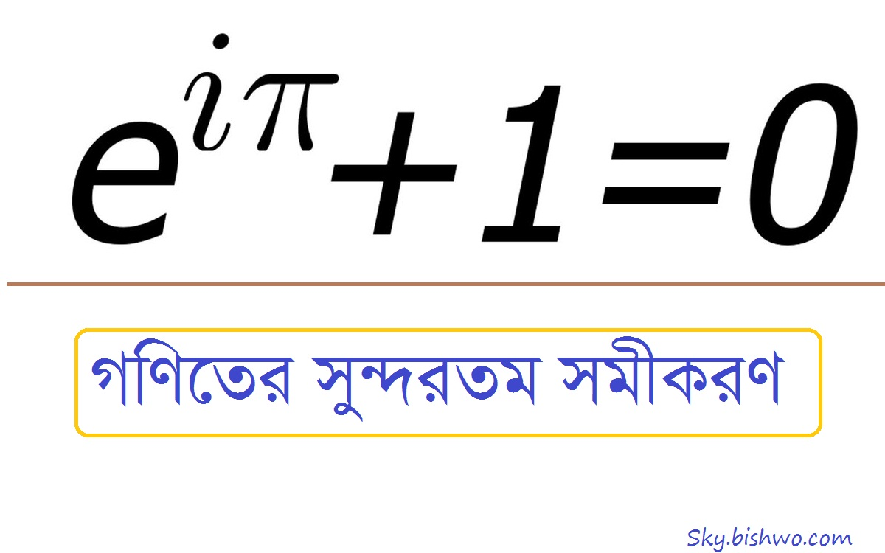
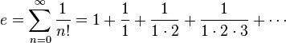
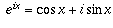
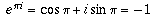
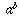
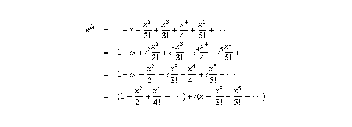
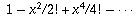
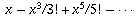

::: {dir="ltr" style="text-align: left;" trbidi="on"}
(লেখাটি এর আগে পাই জিরো টু ইনফিনিটি ম্যাগাজিনে প্রকাশিত হয়)
একবার রাণী ক্যাথেরিনের রাজসভায় দাওয়াত পেয়ে ফ্রেঞ্চ দার্শনিক ডেনিস ডিডেরট তার নাস্তিকপন্থী মনোভাবের জোর প্রচার শুরু করেন। কোন উপায় না দেখে রাণী অয়লারকে ডেকে পাঠান। অয়লার সাহেব এসে ডেনিস সাহেবের সাথে ধর্মীয় আলোচনায় যুক্ত হলেন। অয়লার এক পর্যায়ে বললেন তিনি ঈশ্বরের অস্তিত্বের একটি বীজগাণিতিক প্রমাণ দেখাবেন। ডি মরগানের ভাষ্য মতে ডেনিস সাহেব রাজী হলেন এবং অয়লার পরিপূর্ণ আত্মবিশ্বাস নিয়ে বললেন,

> "স্যার, যেহেতু $e ^{i \pi} + 1 = 0$; অতএব ঈশ্বর আছেন।"

::: {style="text-align: center;"}
রাজসভার সবাইকে হাসার সুযোগ করে দিয়ে গণিতে অপক্ক ডেনিস সাহেব সাথে সাথে প্রস্থান করেন।
:::

এই একটি সমীকরণ গণিতের চারটি শাখার মধ্যে সেতুবন্ধন তৈরি করে। e এর আবির্ভাব ক্যালকুলাস থেকে, π আসে জ্যামিতি থেকে, i এর পদচারণা জটিল সংখ্যার জগতে আর ০ ও ১ এর ব্যবহার পাটিগণিতে। অয়লার মনে করতেন গণিতের সবচেয়ে গুরুত্বপূর্ণ পাঁচটি সংখ্যার এই সম্পর্ক কোনো কাকতালীয় ব্যাপার হতেই পারে না। অতএব ঈশ্বর অবশ্যই আছেন আর তিনিই এই সম্পর্ক গড়েছেন।

এই সংখ্যাগুলো আসলেই একটু স্পেশাল।
এখানে,
e = ন্যাচারাল লগারিদমের ভিত্তি।
π = বৃত্তের পরিধি ও ব্যাসের নির্দিষ্ট অনুপাত
i = কাল্পনিক সংখ্যার একক যার মান √ (-1)
০ = যোগজ অভেদ (Additive Identity)
১ = গুনজ অভেদ (Multiplicative Identity)
এগুলো কেন বিশেষ সংখ্যা তা একটু বলে নেই।

**[e (অয়লারের সংখ্যা):]{.underline}**
**[
]{.underline}** গণিতের অন্যতম প্রয়োজনীয় ও গুরুত্বপূর্ণ একটি অমূলদ ধ্রুবক হল অয়লারের সংখ্যা e। এই e হল স্বাভাবিক লগারিদমের ভিত্তি। অর্থ্যাৎ আমরা যাকে লন বা ln বলি (Natural Logarithm) সেটা আসলে loge। এর কাছাকাছি মান হল 2.71828। এটাকে এভাবেও লেখা যায়-

::: {style="text-align: center;"}

:::

সুইশ গণিতবিদ লিওনার্দ অয়লারের নামে একে e বলা হলেও লগারিদমের আলোচনা করতে গিয়ে জন নেপিয়ার প্রথম e এর ধারণা দিয়েছেন। তাই একে নেপিয়ারের ধ্রুবকও বলা হয়।  এই e কোন র‍্যানডম নাম্বার নয়। ইতিহাসবিদদের মতে, সত্যিকার অর্থে ধ্রুবকটি বের করেছেন কোন বণিক বা ব্যাংকার। কারণ, সংখ্যাটির চক্রবৃদ্ধি সুদের সাথে সম্পর্ক রয়েছে। আরো সূক্ষ্মভাবে বললে, একক প্রাথমিক পরিমাণ থেকে চক্রবৃদ্ধিতে ১০০% হারে এবং অসীম সংখ্যক সময়কালে বর্ধনশীল যেকোনো বৃদ্ধির সর্বোচ্চ মান হতে পারে এই সংখ্যা।

সেমন ধরুন, কোনো পণ্যের দাম ছিল ১ টাকা। ১০০% বৃদ্ধিতে ১ বছরে এর দাম হবে ২ টাকা। \[চক্রবৃদ্ধির সূত্রানুযায়ী\]
এখন, হার ১০০% ই রেখে একে দুই সময়কালে ভাগ করে নিয়ে প্রতি ছয় মাস পর ৫০% করে বাড়ালে বছর শেষে দাম দাঁড়াবে ২.২৫ টাকা। অর্থ্যাৎ, কিছুটা বেশি । এভাবে সময়কালকে আরো খণ্ডিত করতে থাকলে বছর শেষে পরিমাণও বাড়তে থাকে। কিন্তু যতই বাড়ে ততই বাড়ার হার কমে অর্থ্যাৎ আগের বার তার আগের বারের চেয়ে যতটুকু বেড়েছিল এবার গত বারের চেয়ে তার চেয়ে কম পরিমাণ বেড়েছে। এটা ঠিক যেন মহাবিশ্বের সম্প্রসারণ নীতির বিপরীত যেখানে গ্যালাক্সিরা যতই দূরে সরে, ততই সরে যাবার বেগ বেড়ে যায়।

এখন, এই ক্ষেত্রে প্রথম দিকে অধিক খণ্ডায়ানের প্রতিক্রিয়া বেশি হলেও ধীরে ধীরে এ প্রভাব কমতে কমতে একটি নির্দিষ্ট সংখ্যার কাছকাছি আবর্তিত হয়। সেই সংখ্যাটিই হল 2.718 281 828......, অমূলদ ধ্রুবক।
চক্রবৃদ্ধির সাথে সম্পর্ক থাকার বদৌলতেই ধ্রুবকটি প্রথম কোনো গণিতবিদের হাতে আবিষ্কৃত না হয়ে হয়েছিল ব্যাংকারের হাতে।

[**পাই(π) **]{.underline}

যে কোনো বৃত্তের পরিধি ও ব্যাসের অনুপাত একটি ধ্রুবক সংখ্যা (π)- এ জ্ঞান চার হাজার বছর প্রাচীন। দূর্ভাগ্যজনক হলেও সত্য এত ন্যাচারাল ও নিরীহ এই ধ্রুবকটিকে দেখলেই এখনও স্কুলপড়ুয়া অনেক শিক্ষার্থী ভয় পায়।  ব্যাবীলনীয় ও মিশরীয়রা ছাড়া আর্কিমিডিস ও চীনের যু চংজি সহ অনেক বিখ্যাত গণিতবিদের গবেষণার খোরাক ছিল এই পাই। অবশেষে ১৭০৬ সালে উইলিয়াম জোন্স পাইকে প্রকাশের জন্য π চিহ্নের প্রস্তাব করেন যাকে ১৭৩৭ সালে কাজে লাগিয়ে বিখ্যাত করেন লিওনার্দ অয়লার। ফ্রেঞ্চ গণিতবিদ জর্জ বুফন সম্ভাব্যতা দিয়ে পাই এর মান বের করার সূত্র বের করেন।

[**কাল্পনিক সংখ্যার প্রতীক (i):**]{.underline}
[**
**]{.underline} i হচ্ছে কাল্পনিক সংখ্যা প্রকাশের একক। $i^2 = -1$। কাল্পনিক বলার কারণ হল বাস্তবে এমন কোনো সংখ্যা নেই যার বর্গমূল -1 (মাইনাস 1)। অন্য বাস্তব সংখ্যার মতই অবশ্য -1 এর বর্গমূল দুটি যথা i এবং -i।

**[শূন্য (০):]{.underline}**
**[
]{.underline}** 0 কে বলা হয় যোগজ অভেদ (Additive Identity)। এটা হল 'নাথিং' বা 'কিছুই না' এর গাণিতিক প্রকাশ।
এটা নিয়ে একটি কৌতুক হল, এক বন্ধু ০ আবিষ্কার করে বলল, "আমি এটা আবিষ্কার করলাম"
**২য় বন্ধুঃ** কী আবিষ্কার করলে, হে?
**১ম বন্ধুঃ** কিছুই না!
**২য় বন্ধুঃ** !!!!!!!!

একে যোগজ অভেদ বলার কারণ, ধরুণ, আপনি ক্রমান্বয়ে অনেক কিছু যোগ করবেন। যখন আপনি কিছুই যোগ করেননি তখন আপনার যোগফল ০। ভাবছেন এ আর এমন কি বিশেষত্ব! হ্যাঁ, বিশেষত্বই বটে। একটু পর বলছি। যাই হোক, একে প্রতিকের বদলে সংখ্যা হিসেবে প্রথম আবিষ্কার করেন ভারতীয়রা।

[**এক (1) :**]{.underline}
[**
**]{.underline} ১ হল গুণজ অভেদ (Multiplicative Identity)। এর বিশেষত্বের কারণ হল, ধরুন আমরা ক্রমান্বয়ে অনেকগুলো সংখ্যা গুণ করবো। তাহলে যখন একটা গুণও করিনি তখন গুণফল ১। কারণ আদি গুণফল ১ না ধরে ০ ধরলে পরবর্তীতে সব গুণফল হয়ে যাবে ০।  এটা হল এর সাথে যোগজ অভেদের তারতম্য। আর এ কারণেই লজিক্যালি 0! (0 Factorial) এর মান ১ ধরা হয়। অর্থাৎ এখনও কিছুই গুণ করা হয়নি, মানে হাতে মাত্র ১ আছে। কিন্তু 0 Factorial এর মান ০ হলে ফ্যাক্টোরিয়াল নীতিই অস্তিত্ত্ব হারাত, কারণ যে কোনো কিছুর ফ্যাক্টোরিয়াল হত ০।

**এ জন্যই যোগ-বিয়োগের ক্ষেত্রে কিছু নেই মানে ০ আর গুণ ভাগের ক্ষেত্রে কিছু নেই মানে ১।**
এখন, দেখা যাচ্ছে, এই পাঁচ সংখ্যার আসলেই বিশেষত্ব আছে।

**সম্পর্কঃ**

::: {style="text-align: center;"}
$e ^{i \pi} + 1 = 0$
:::

ছোটবেলায় সরল অঙ্কের সরল ফলাফল (এই অর্থে আসলেই সরল!) পেয়ে আমরা কিছুটা হতাশ হতাম বৈকি, এটা তাহলে তার চে' বড় হতাশা! এক দিকে গোবেচারা শূন্য আর অপরদিকে কেমন কিম্ভুতকিমাকার একটি আকৃতি!
এখন চলুন, এটার প্রমাণ দেখে ফেলি-

eiπ = -1 বা $e ^{i \pi} + 1 = 0$ হয় কেন- এই প্রশ্নটির আসল রূপ হচ্ছে আসলে eiπ দ্বারা কী বোঝায়। অর্থাৎ কোনো সংখ্যার ঘাত কাল্পনিক হওয়ার মানে কী? এটা বোঝা গেলেই সমীকরণটিও সরল অঙ্কের মতই সরল হয়ে যাবে।

ডি ময়ভারের সূত্র থেকে আমরা জানতে পারি, সকল x এর জন্য,

::: {style="text-align: center;"}

:::

এই সমীকরণ থেকে এক্সপোনেনশিয়াল ফাংশনের সাথে ত্রিকোণমিতিক ফাংশনের সম্পর্ক ধরা পড়ে।
তাহলে, x এর বদলে π বসিয়ে আমরা পাই,  । কারণ, cosπ এর মান -1 এবং sinπ এর মান 0।

**এখন কাজ হচ্ছে প্রমাণ করা যে কে**ন , যেটা থেকে বোঝা যায় e এর ঘাত একটি কাল্পনিক সংখ্যা হবার মানে কী।

সূচকের মৌলিক ধারণা মতে কোনো একটি সংখ্যার ঘাত কাল্পনিক সংখ্যা হওয়া অর্থহীন যেখানে মানে বোঝায় a কে b সংখ্যক বার নিজের সাথে গুণ করা। b ধনাত্মক হলেই কেবল সূচকের এই ধারণা মানানসই হয়। নচেৎ কোন সংখ্যাকে নিজের সাথে i বার (কাল্পনিক সংখ্যক বার) গুণ করার অর্থ কী?

অবশ্য সূচকের মূল সংজ্ঞায় b এর মান ভগ্নাংশ কিংবা ঋণাত্মক সংখ্যাও হতে পারে না। কিন্তু এর পরেও কোন সংখ্যার ঘাত ঋণাত্মক বা ভগ্নাংশ হলে আমরা তার থেকে অর্থ বের করে নিতে পারি ।
যেমন, যেহেতু ১/৩ হচ্ছে সেই সংখ্যা যাকে ৩ দ্বারা গুণ করলে ১ পাওয়া যায় সেহেতু a\^(1/3) কে অর্থপূর্ণ বলা যাবে এই বলে যে এর ঘাত 3 পর্যন্ত উঠালে a\^1 তথা a পাওয়া যাবে।
ফলে, a\^(1/3) হচ্ছে a এর ঘনমূল (Cube Root)। একইভাবে ঘাত নেগেটিভ হলে আমরা তারও অর্থ বের করতে পারি। যেমন, a\^(-2) মানে 1/(a\^2)।

তাহলে একটুখানি ঝামেলা থাকলেও ঘাত ঋণাত্মক বা ভগ্নাংশ হলে আমরা মুশকিলে পড়ি না।
দেখা যাক, কাল্পনিক সংখ্যা যে মুশকিলে ফেলে দেয় তার আসান কোথায়।
তাহলে, আমাদেরকে সূচককে বা তার ধর্মকে এমনভাবে প্রকাশ করতে হবে যাতে এর ঘাত জটিল সংখ্যা বানানো যায়।

::: {style="text-align: left;"}
এখন, e\^x এর ধারাভিত্তিক অসীম সম্প্রসারণ হল- 
:::

যেখানে n! (n factorial) মানে হল ১,....n পর্যন্ত গুণফল। ধারাটি আসে ক্যালকুলাসের টেইলর ধারা থেকে। এখন এই অসীম সমষ্টি জটিল সংখ্যার (যাতে কাল্পনিক সংখ্যা বিদ্যমান থাকে) ক্ষেত্রেও অর্থবহ হয়। আমরা যদি x এর বদলে ix বসাই,
 তাহলে, 
এখন টেইলর সিরিজ আরো বলে যে  হল cosx এর অসীম সমষ্টি এবং  হল sinx এর অসীম সমষ্টি। অতএব, ।
সমীকরণটিকে সাজিয়ে লেখা যায় eiπ +1= 0।
ফলে, অনেক জটিল সম্পর্কের সহজ রূপ আমরা পেয়ে গেলাম।সরল ফলাফল!!
**
** **
** **তথ্য সূত্রঃ**
\[১\]https://cs.uwaterloo.ca/\~shallit/euler.html
\[২\]http://scidiv.bellevuecollege.edu/Math/Euler.html
\[৩\]https://www.math.toronto.edu/mathnet/questionCorner/epii.html
\[৪\]http://arstechnica.com/civis/viewtopic.php?f=24&t=998695
\[৫\] https://brilliant.org/discussions/thread/the-discovery-of-the-number-e-2/
:::
