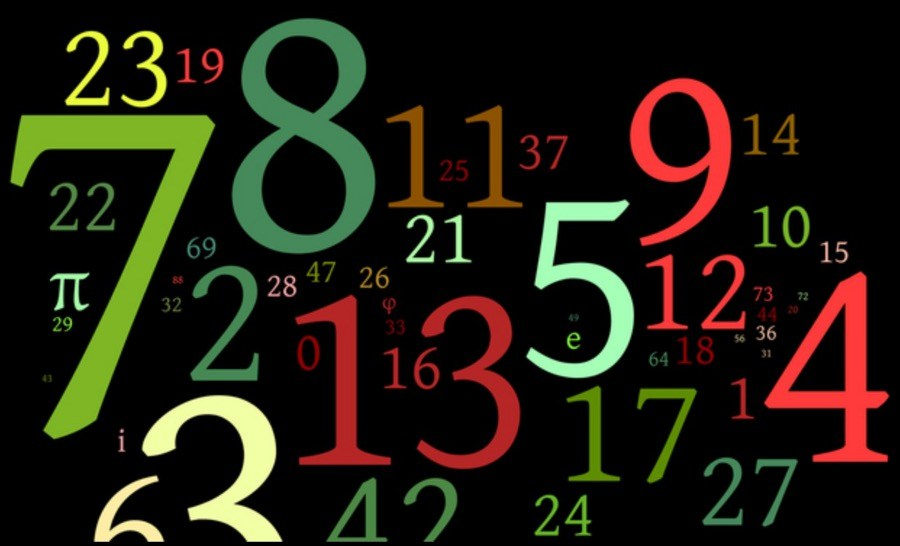

::: {dir="ltr" style="text-align: left;" trbidi="on"}
\[*লেখাটি এর আগে পাই জিরো টু ইনফিনিটি ম্যাগাজিনের জানুয়ারি, ২০১৪ সংখ্যায় প্রকাশিত হয়েছিল\]*

যদিও বাঁধাধরা নিয়ম মানতে আমাদের ভালো লাগে না, তবু নিয়মের মাঝেই রয়েছে গঠনমূলক ফলাফল। আমরা এখানে দেখব ২ থেকে ১১ পর্যন্ত সংখ্যাগুলো দ্বারা  কোন সংখ্যাগুলো বিভাজ্য। আর এই নিয়মটির কাছে হার মানবে TI-89 গ্রাফিক ক্যালকুলেটরসহ বিভিন্ন অনলাইন ক্যালকুলেটর। এমনকি আপনার ক্যালকুলেটরও হার মানতে পারে। একটা ভাগ করেই দেখুন না।

12, 347, 496, 132 কে 11 দিয়ে! আপনার ডিভাইস যদি সংখ্যাটিকে 11 দ্বারা বিভাজ্য দেখায়, তবে ক্যালকুলেটরটি ভুল! কারণ এতে রাউন্ডিং করা হয়েছে, মানে আসন্নীকৃত মান প্রদর্শিত হয়েছে। প্রকৃত ভাগফল হবে 1122499648 দশমিক 3636...36...।

::: {style="text-align: center;"}

:::

এবার মূল আলোচনায় আসি

বিঃদ্রঃ আলোচনায় বিভাজ্য বলতে নিঃশেষে বিভাজ্য বোঝানো হয়েছে।

**২ দ্বারা বিভাজ্য:**
আমরা সবাই জানি যে কোনো জোড় সংখ্যাই ২ দ্বারা বিভাজ্য। যেমন, ২, ৮, ১১৪, ৪৩২৫৬ ইত্যাদি।

**৩ দ্বারা বিভাজ্য:**
কোনো সংখ্যার অঙ্কগুলোর যোগফল যদি ৩ দ্বারা বিভাজ্য হয়, তাহলে সংখ্যাটিও ৩ দ্বারা বিভাজ্য হবে। যেমন ১৪১ এর ক্ষেত্রে ১+৪+১=৬, যা ৩ দ্বারা বিভাজ্য। তাই ১৪১ সংখ্যাটি ৩ দ্বারা বিভাজ্য। কিন্তু যেমন ধরুন ২৩৮ এর ক্ষেত্রে ২+৩+৮=১৩, যা ৩ দ্বারা বিভাজ্য নয়, সুতরাং ২৩৮ তিন দ্বারা অবিভাজ্য। অঙ্কগুলোর যোগফল বেশি বড় হয়ে গেলে (যদি যোগফল দেখে একবারে বোঝা না যায়) যোগফলের জন্যই নিয়মটি আবারও প্রয়োগ করুন।
**
** **৪ দ্বারা বিভাজ্যতা:**
কোনো সংখ্যার দশক ও এককের ঘরের অঙ্ক নিয়ে গঠিত সংখ্যা ৪ দিয়ে বিভাজ্য হলে সংখ্যাটিও ৪ দ্বারা বিভাজ্য হবে। যেমন ১১৬ এর ক্ষেত্রে ১৬, যা ৪ দিয়ে বিভাজ্য। তাই ১১৬ও ৪ দিয়ে বিভাজ্য। আবার ৫৬০ এর ৬০ যেহেতু ৪ দিয়ে বিভাজ্য, তাই ৫৬০ ও বিভাজ্য।

**৫ দ্বারা বিভাজ্যতা:**
এটাও আমরা সবাই ভালো করেই জানি এবং কাজে লাগাই। সংখ্যার এককের ঘরের অঙ্ক ০ বা ৫ হলে সেই সংখ্যা ৫ দ্বারা বিভাজ্য। যেমন, ১০৫, ৩০৬০, ৯৬৫ ইত্যাদি।

**৬ দ্বারা বিভাজ্যতা:** ৬ সংখ্যাটি ২ এবং ৩ এর গুণফল। তাই যে সংখ্যা ২ ও ৩ উভয় সংখ্যা দ্বারা বিভাজ্য হবে, সেটাই ৬ দ্বারা বিভাজ্য হবে। আরো সহজ করে বললে, সংখ্যাটি হবে জোড় এবং অঙ্কগুলোর যোগফল তিন দ্বারা বিভাজ্য হবে। জোড় না হলেই বাদ! জোড় হলেই শুধু তিন এর পরীক্ষা

ব্যাস!

যেমন, ১২০ একটি জোড় সংখ্য এবং তিন দ্বারা বিভাজ্য (কারণ ১+২+০ = ৩)। তাই ১২০ ছয় দ্বারা বিভাজ্য। একইভাবে, ৭৮০ জোড় সংখ্যা এবং ৭+৮+০=১৫, যা ৩ দ্বারা বিভাজ্য, তাই ৭৮০ ছয় দ্বারা বিভাজ্য।

**৭ দ্বারা বিভাজ্যতা:**
এককের অঙ্ককে বর্গ করে সংখ্যাটির বাকি অংশ থেকে বিয়োগ দিন। ভাগফল ৭ দ্বারা ভাগযোগ্য হলেই কেল্লাফতে!!!

যেমন, ৬৭২ হলে ৬৭-৪=৬৩। সুতরাং \$\\frac{৬৩}{৭} = ৯।

ইউরেকা! সংখ্যাটি বড় হলে একই প্রক্রিয়ার পুনরাবৃত্তি করা যাবে।

যেমন,  ৪৫১৭৮ হলে ৪৫১৭ - ৬৪ = ৪৪৫৩।
আবার ৪৪৫ - ৯ = ৪৩৬, পুনরায় ৪৩-৩৬ = ৭ যা কাঙ্খিত।

তাই কেল্লাফতে!!!

**৮ দ্বারা বিভাজ্যতা:** কোনো সংখ্যার সর্বশেষ তিন অঙ্কের সমন্বয়, মানে শতক, দশক ও এককের অঙ্কের সমন্বয় যদি ৮ দ্বারা বিভাজ্য হয়, তাহলে ঐ সংখ্যাটি ৮ দ্বারা বিভাজ্য হয়।
যেমন ৯,৬৪০ আট দ্বারা বিভাজ্য কারণ \$\\frac{৬৪০}{৮} = ৮০।

তবে এ প্রক্রিয়া ঝামেলাপূর্ণ মনে হতে পারে। কিন্তু ,মনে করুন আপনার কাছে আছে একটি বিশাল সংখ্যা 20,233,322,496। এখন 496 কেই 8 দ্বারা ভাগ দিলেই আপনি বুঝে ফেলবেন রহস্য!

**৯ দ্বারা বিভাজ্যতা:** তিন এর নিয়মের মতোই অঙ্কগুলোর যোগফল ৯ দ্বারা বিভাজ্য হতে হবে। যেমন ৭,২১৮ এর জন্য ৭+২+১+৮ = ১৮, যা ৯ দিয়ে ভাগযোগ্য।

১০,০০৬,৪৭০ এর জন্য ১+৬+৪+৭=১৮, ফলে এটি ৯ দ্বারা বিভাজ্য হতে বাধ্য।
**
** **১০ দ্বারা বিভাজ্যতা:** এটাও সবার জানা। মানে এককের ঘরে শূন্য (0) থাকতে হবে।

তবুও নিরস উদাহরণ দিচ্ছি- ১১০, ৭৬০, ১০০৩৭৭৩০ ইত্যাদি।

**১১ দ্বারা বিভাজ্যতা:** ১১ এর পরীক্ষায় পাস করতে হলে সংখ্যাটির একটার পর একটা পর্যায়ক্রমিক সংখ্যার যোগফল ও বাকী সংখ্যাগুলোর যোগফলের পার্থক্য ১১ দ্বারা বিভাজ্য হতে হবে।
উদাহরণ দেখলে বুঝতে আরেকটু সহজ হবে।

যেমন, ১০৮২৪ এর জন্যে (১+৮+৪) - (০+২) = ১৩ - ২ = ১১।
ফলে, ১০,৮২৪ এগারো দিয়ে বিভাজ্য।

একইভাবে ২৫, ৭৮৪ এর ক্ষেত্রে (২+৭+৪) - ( ৫+৮) = ১৩ - ১৩ = ০ ।

আর ০ ও তো ১১ দিয়ে ভাগ যায় (০ বার!!!)।

এবার তাহলে আলোচনা শুরুর সংখ্যাটির ময়নাতদন্ত করে ফেলি!

সংখ্যাটি হলো 12,347,496,132। সুতরাং (১+৩+৭+৯+১+২) - (২+৪+৪+৬+৩) = ২৩-১৯ = ৪ হয়, মানে ১১ দ্বারা অবিভাজ্য।

দেখা যাচ্ছে এ প্রক্রিয়াটির কাছে যন্ত্র পর্যন্ত আত্মসমর্পণ করেছে!

**সূত্র**:
১. উহকিপিডিয়া -Division algorithm
২. http://www.mathwarehouse.com/arithmetic/numbers/divisibility-rules-and-tests.php
৩. http://www.mathsisfun.com/divisibility-rules.html

[৫০ এর ছোট সব মৌলিক সংখ্যার পরীক্ষা চালাতে এ লিঙ্কে যান](http://www.mathsisfun.com/divisibility-rules.html)। 
:::
