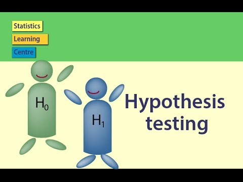

::: {dir="ltr" style="text-align: left;" trbidi="on"}
::: {style="text-align: center;"}

:::

**
** **সরল হাইপোথিসিসঃ**

θ প্যরামিটারের কোন বিন্যাস (distribution) থেকে একটি দৈব নমুনা (random sample) নেওয়া হলে যে সমগ্রক (population) থেকে নমুনাটি নেওয়া হল, কোনো হাইপোথিসিস যদি তার বিন্যাসকে এককভাবে (একটি মাত্র উপায়ে) ও সুনির্দিষ্ট করতে পারে, তবে হাইপোথিসিসটিকে সরল (simple hypothesis) বলা হয়।

**যৌগিক হাইপোথিসিসঃ**

যে হাইপোথিসিসটি সরল নয়, সেটিই হল যৌগিক হাইপোথিসিস (composite hypothesis)।

**উদাহরণঃ**
**
** মনে করি $X_1, X_2, ..., X_n$ হল সূচকীয় বিন্যাস (exponential distribution) থেকে আসা একটি দৈব নমুনা, যার প্যারামিটার হল θ। তাহলে H: θ = 3 হাইপোথিসিসটি কি সরল, নাকি যৌগিক?

**সমাধানঃ**
সূচকীয় বিন্যাস থেকে আসা চলকের (variable) সম্ভাবনা ঘনত্ব ফাংশন (probability density function) হলঃ

::: {style="text-align: center;"}
$f(x) = \frac{1}{\theta}e^{-x/\theta}$ যেখানে x ≥ 0। 
:::

H: θ = 3 হাইপোথিসিসের জন্যে ফাংশনটি হবে এ রকমঃ

::: {style="text-align: center;"}
$f(x) = \frac{1}{3}e^{-x/3}$ যেখানে x ≥ 0। 
:::

যেহেতু উল্লেখ্য হাইপোথিসিসের জন্যে আমরা বিন্যাসটিকে এককভাবে সুনির্দিষ্ট করতে পেরেছি, তাই এটি হল সরল হাইপোথিসিস।

**উদাহরণঃ**
**
** মনে করি $X_1, X_2, ..., X_n$ হল সূচকীয় বিন্যাস (exponential distribution) থেকে আসা একটি দৈব নমুনা, যার প্যারামিটার হল θ। তাহলে H: θ \> 2 হাইপোথিসিসটি কি সরল, নাকি যৌগিক?

**সমাধানঃ**

আগের মতোই এর সম্ভাবনা ফাংশন হলঃ

::: {style="text-align: center;"}
$f(x) = \frac{1}{\theta}e^{-x/\theta}$
:::

::: {style="text-align: center;"}
যেখানে x ≥ 0। 
:::

H: θ \> 2 হাইপোথিসিসের অধীনে একে এভাবে লেখা যেতে পারেঃ

::: {style="text-align: center;"}
$f(x) = \frac{1}{3}e^{-x/3}$ যেখানে x ≥ 0
:::

::: {style="text-align: center;"}

:::

আবার এভাবেও লেখা যেতে পারেঃ

::: {style="text-align: center;"}
$f(x) = \frac{1}{8}e^{-x/8}$ যেখানে x ≥ 0
:::

::: {style="text-align: center;"}

:::

বাস্তবে এখানে সম্ভাবনা ফাংশনকে অসীম সংখ্যক উপায়ে লেখা সম্ভব, একটি মাত্র উপায়ে নয়। তাই এটি যৌগিক হাইপোথিসিস।

**উদাহরণঃ**

মনে করি $X_1, X_2, ..., X_n$ হল পরিমিত বিন্যাস থেকে আসা একটি দৈব নমুনা। এর গড় (mean) μ ও ভেদাঙ্ক (variance) $σ^2$। 

তাহলে H: μ = 12 হাইপোথিসিসটি কি সরল, নাকি যৌগিক? 

**সমাধানঃ**

পরিমিত চলকের সম্ভাবনা ঘনত্ব ফাংশন হলঃ

::: {style="text-align: center;"}
$f(x)= \frac{1}{\sigma\sqrt{2\pi}} exp \left[-\frac{(x-\mu)^2}{2\sigma^2} \right]$
:::

::: {style="text-align: center;"}
যেখানে −∞ \< x \< ∞ and σ \> 0। 
:::

H: μ = 12 হাইপোথিসিসের অধীনে এর মান হলঃ

::: {style="text-align: center;"}
$f(x)= \frac{1}{\sigma\sqrt{2\pi}} exp \left[-\frac{(x-12)^2}{2\sigma^2} \right]$
:::

::: {style="text-align: center;"}
যেখানে −∞ \< x \< ∞ and σ \> 0। 
:::

এখানে এর গড় সুনির্দিষ্টভাবে উল্লেখিত আছে ঠিকই, ভেদাঙ্ক ($σ^2$) কিন্তু নেই। অতএব, এরও অসীম সংখ্যক বিন্যাস সম্ভব। ফলে পরিমিত বিন্যাসের ক্ষেত্রে H: μ = 12 হল যৌগিক হাইপোথিসিস। 

**সূত্রঃ**

১। https://onlinecourses.science.psu.edu/stat414/node/307
:::
