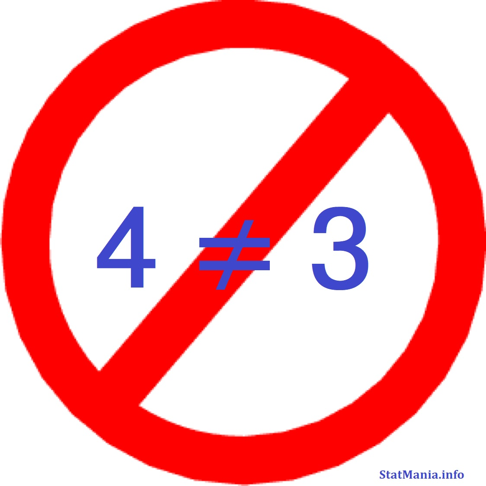

::: {dir="ltr" style="text-align: left;" trbidi="on"}
কিছু লোকের কাজ হলো, গণিতের অপপ্রয়োগ করে মানুষ চমকে দিএয় মজা নেওয়া। এ কাজ করতে গিয়ে ভুল কিছু হিসাব দেখিয়ে তাক লাগানোর চেষ্টা করা হয়। এমন একটি অপচেষ্টার মুখোশ খুলে দিচ্ছি।

::: {style="text-align: center;"}

:::

আগে ভুলটাই দেখে নিই

ধরি, a-b = c
বা, (4a - 3a)  - 4b + 3b  = 4c - 3c  ; \[b= -4b+3b লেখা যায়\]
বা, 4a -3a -4b +3b = 4c -3c
পক্ষান্তর করে, 4a - 4b - 4c = 3a - 3b - 3c
বা, 4 (a-b-c) = 3 (a-b-c)
উভউপক্ষকে (a-b-c) দ্বারা ভাগ করে,
4 = 3 !!!

এখন কথা হলো গণিত তো মিথ্যা বলে না! কিন্তু চোখের সামনেই প্রমাণ! আসলে সমস্যাটি কোথায়?

সমস্যা হলো গণিত মিথ্যা বলেনি, বলেও না। আমরাই তাকে দিয়ে মিথ্যা বলিয়েছি।
নীচের সমাধান দেখার আগে নিজে একটু চেষ্টা করুন না!

**সমাধানঃ**
আমরা ০ দ্বারা কোন সংখ্যাকে ভাগ করতে পারি না। অথচ এই ভাগটা করেই আমরা ৪ আর ৩ কে সমান করেছি।

কারণ আমরা শুরুর লাইনেই ধরেছি a- b= c  ।
তাহলে a-b-c সমান দাঁড়ায় c - c = 0।

তাই যদি হয়, তাহলে উভয়পক্ষকে কীভাবে শুন্য দ্বারা ভাগ করব? বাস্তবেও কি আমরা কোনো কিছুকে শুন্য দিয়ে ভাগ করতে পারি? কোনো বস্তুকে শুন্য বার ভাগ করতে পারি? এটা একেবারেই অর্থহীন কথা।

কিন্তু এখানে তার চেয়ে বড় কথা যেহেতু  a-b-c =0, সেহেতু
4(a-b-c) = 3 (a-b-c) লাইনটি থেকে আমরা পাই
4×0 = 3×0
বা 0=0, যা সম্পূর্ণ সঠিক। এর পরে তো সামনে যাওয়ারই পথ থাকে না। প্রমাণ আর তাহলে কীভাবে হয়।

তাহলে, গণিত মিথ্যা বলে না আসলেই।

এখানে তো দেখলাম, ভুল জিনিসকেও আমরা অনেক সময় ভুল করে মেনে নিয়ে ফেলতে পারি। উল্টোটাও ঘটে অনেক সময়। যেমন ০.৯৯৯... = ১ (প্রায় নয়, এক্কেবারে) সঠিক হওয়া সত্ত্বেও আমরা প্রথমে মেনে নিতে আপত্তি করি।

আপনারও আপত্তি আছে?

**তাহলে পড়ুন:**
☛ আপনি মানুন আর নাই মানুন ০.৯৯৯... = ১
:::
