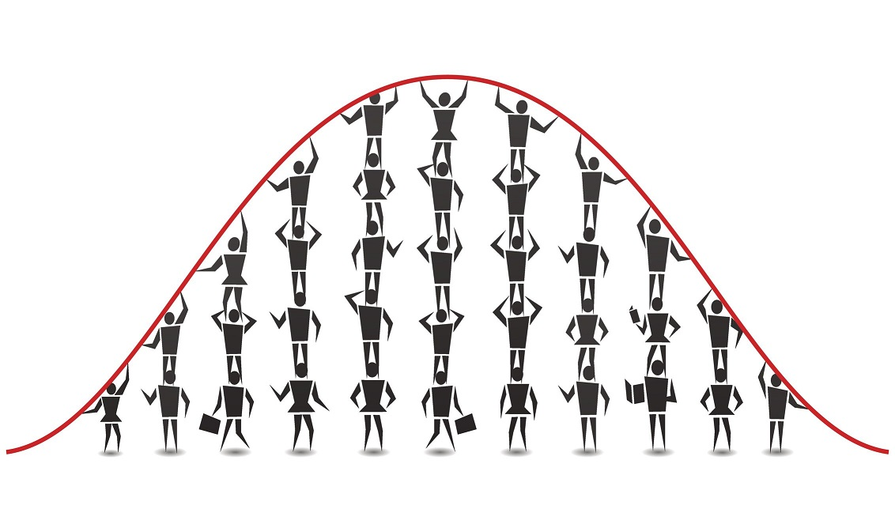
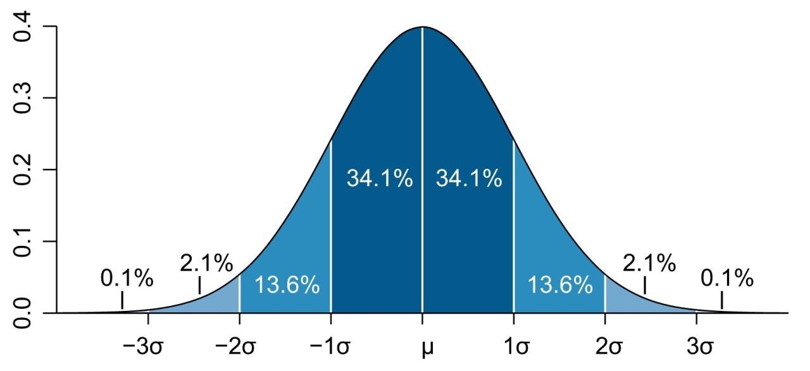

::: {dir="ltr" style="text-align: left;" trbidi="on"}
আমাদের দৈনন্দিন জীবনের অধিকাংশ ঘটনার পরিসংখ্যানের দিকে তাকালে একটি মজার ব্যাপার চোখে পড়বে। যেমন আপনি যদি কোনো ক্লাসের ছাত্রদের প্রাপ্ত নম্বরের দিকে খেয়াল করেন, তবে দেখা যাবে অনেক বেশি মার্ক পেয়েছে এমন ছাত্রের সংখ্যা খুব কম। আবার খুব কম মার্ক পেয়েছে এমন ছাত্রের সংখ্যাও খুব কম। তবে মোটামুটি মার্ক পাওয়া ছাত্রদের সংখ্যা অনেক বেশি। কোনো একটি পরিসংখ্যান থেকে পাওয়া এমন চিত্রকে গ্রাফের মাধ্যমে তুলে ধরলে যে অকৃতি পাওয়া যায় তার নামই বেল কার্ভ (bell curve)।

  ----------------------------------
   
              বেল কার্ভ
  ----------------------------------

পরিসংখ্যানের পরিভাষায় নাম পরিমিত বিন্যাস (normal distribution)। আকৃতি বেল বা ঘণ্টার মতো বলেই এর এমন নাম হয়েছে। তবে পরিসংখ্যানের দৃষ্টিতে আসলে এটি একটি সম্ভাবনা বিন্যাস (probability distribution) ।

পরিসংখ্যানে এরকম অনেকগুলো সম্ভাবনা বিন্যাস রয়েছে। তবে এদের মধ্যে সবচেয়ে কারিশমা দেখাতে সক্ষম এই বেল কার্ভ। এমনকি বিভিন্ন পরিস্থিতিতে অন্যান্য কিছু কিছু বিন্যাসও আচরণ করে এর মতো। এই বেল কার্ভের জাদু দেখানোর অন্যতম একটি হাতিয়ার হল ৬৮-৯৫-৯৯ নিয়ম। এই নিয়মের জাদু দেখার আগে একটু জানা দরকার পরিমিত ব্যবধান (standard deviation) কাকে বলে।

মনে করুন, আপনার কাছে একটি নমুনা (sample) আছে, যাতে একটি ক্লাসের ৫ জন ছাত্রের প্রাপ্ত নম্বর দেখা যাচ্ছে। ধরুন নম্বরগুলো হল (২০ এর মধ্যে) ১৪, ১৫, ১৩, ১৪, ১৫। ধরুন, আরেকবার একটি নমুনা নিয়ে পাওয়া নম্বরগুলো হল ৯, ১৬, ১৯, ৭, ১৪। প্রথম নমুনায় নম্বরগুলো খুব কাছাকাছি। এদের গড় হল ১৪.২। নম্বরগুলো গড়ের খুব কাছাকাছি অবস্থান করছে। এক্ষেত্রে আমরা বলব এদের পরিমিত ব্যবধান কম।

পরের নমুনার নম্বরগুলো অনেক বেশি ছড়িয়ে আছে। এদের গড় হল ১৩। এ নম্বরগুলো গড় থেকে অনেক বেশি ছড়িয়ে ছিটিয়ে আছে। অতএব এদের পরিমিতি ব্যবধান বেশি। তার মানে যে উপাত্ত যত বেশি ছড়িয়ে ছিটিয়ে থাকে তার পরিমিতি ব্যবধান তত বেশি।

ধরুন, উপরের প্রথম নমুনার যে মূল উপাত্ত থেকে পাওয়া গেছে পরিমিত ব্যবধান ১। আমরা আগেইে দেখেছি এদের গড় ১৪.২। এখন গড় থেকে ১ যোগ ও বিয়োগ করে পাই (১৩.২, ১৫.২)। 

৬৮-৯৫-৯৯ নিয়ম বলছে যে এই উপাত্তের প্রায় ৬৮ শতাংশ ছাত্রের নম্বর ১৩.২ থেকে ১৫.২ এর মধ্যে থাকবে। একইভাবে ২ (পরিমিত ব্যবধান) যোগ- বিয়োগ করে আমরা বলতে পারব, প্রায় ৯৫ শতাংশ ছাত্রের নম্বর থাকবে ১২. ২ থেকে ১৬.২ এর মধ্যে। পরিমিত ব্যবধান ৩ হলে আমরা বলতে পারব, প্রায় ৯৯ শতাংশ ছাত্রের নম্বর থাকবে ১১.২ থেকে ১৭.২ এর মধ্যে।

  ---------------------------------------------------------------------
                    
   বেল কার্ভের নিয়ম। $\mu$ হলো গড়, আর $\sigma$ হলো পরিমিত ব্যবধান। 
  ---------------------------------------------------------------------

::: {style="text-align: center;"}

:::

আমাদের ধরে নেওয়া নমুনা ছোট্ট ছিল বলে এই ফলাফলকে গুরুত্বহীনও মনে হতে পারে। কিন্তু ধরুন আপনার কাছে আছে দশ হাজার ছাত্রের নম্বর, যেখানে গড় হলো ৭৫ ও পরিমিতি ব্যবধান ২। তাহলে নম্বরগুলো ঠিক কত ছিল তা না জেনেও আপনি বলতে পারবেন, প্রায় ৬৮ শতাংশ ছাত্র নম্বর পেয়েছে ৭৪ থেকে ৭৬ এর মধ্যে। একইভাবে প্রায় ৯৫ শতাংশ ছাত্র নস্বর পেয়েছে ৭৩ থেকে ৭৭ এর মধ্যে। আর প্রায় ৯৯ শতাংশ ছাত্রই নম্বর পেয়েছে ৭২ থেকে ৭৮ এর মধ্যে। 

দারুণ, তাই না!

শুধু গড় দেখে আপনি যদি বলে ফেলতেন যে ছাত্রদের ফলাফল খুব ভালো, কী ভুলটাই না করতেন! দেখুন ৯৯ শতাংশের মধ্যেও কেউ ৮০ পায়নি। দেশের শিক্ষা নীতি প্রনয়ণে কি কাজেই না আসবে এই পরিমিত বিন্যাস! শুধু কি তাই? পরিমিত বিন্যাস মেনে চলে এমন যে কোনো উপাত্ত থেকেই আপনি দারুণ সব সিদ্ধান্ত নিতে পারেন। তাহলে চলুন দেখে নিই আর কোন ধরনের উপাত্ত মেনে চলে এই জাদুর বিন্যাসটি।

মনে করুন আপনি একজন প্রকৌশলী। একটি শিল্প- কারখানায় প্রস্তুতকৃত বল্টুর দৈর্ঘ্য ঠিক আছে কি না জানতে চান। সেখানে বল্টুর একটি বড় সড় নমুনা নিয়ে গড় ও পরিমিত ব্যবধান দিয়ে হিসাব করে দেখবেন কত শতাংশ বল্টু আপনার নিয়ন্ত্রিত মাত্রার মধ্যে আছে। এটা করা যাবে কারণ বিভিন্ন পরিমাপের উপাত্ত মেনে চলে পরিমিত বিন্যাস।

একইভাবে মানুষের উচ্চতা, বয়স, ওজোন ইত্যাদি মেনে চলে এই বিন্যাস। পদার্থবিদ্যার জগতেও বেল কার্ভ সরবে নাক গলায়। জেমস ক্লার্ক ম্যাক্সওয়েল দেখান যে এক ধরনের দোলকের সম্ভাবনা ফাংশন এবং ব্যাপন প্রক্রিয়ায় বিভিন্ন কণার অবস্থান বের করা যায় বেল কার্ভ দিয়ে। জীববিজ্ঞানের ক্ষেত্রে বিভিন্ন টিস্যুর দৈর্ঘ্য, উচ্চতা, ক্ষেত্রফল ও ওজোন মেনে চলে পরিমিত বিন্যাস। এছাড়াও বিভিন্ন প্রাণীর চুল, নখ, দাঁত ও নখরের দৈর্ঘ্যের ক্ষেত্রেও বলা চলে একই কথা। এমনকি মানুষের রক্ত চাপসহ বিভিন্ন শারীরিক পরিমাপ মেনে চলে এই বিন্যাস। কোনো বৈজ্ঞানিক পরীক্ষার পরিমাপের ক্ষেত্রে বিভিন্ন বার যে ভুলগুলো হবে তাও মেনে চলে বেল কার্ভ। আসলে এর প্রয়োগ বলে শেষ করা সম্ভব নয়।

এর আরও কয়েকটি দারুণ বৈশিষ্ট্য আছে।

১। এটি একটি প্রতিসম বিন্যাস। ফলে অর্ধেক মান থাকবে গড়ের ওপরে এবং অর্ধেক নিচে। আবার গড় থেকে ১ বা ২ পরিমিত ব্যবধানের ওপরে যে পরিমাণ উপাত্ত থাকবে, তার নিচেরে দিকেও প্রায় সমান পরিমাণ উপাত্ত থাকবে। পরিসংখ্যানের কাজই হল অনিশ্চিত অবস্থায় সিদ্ধান্ত নিতে সহায়তা করা। এই কাজে বেল কার্ভের এই ধর্মও বেশ কাজে আসে।

২। কোনো উপাত্ত যদি বেল কার্ভের মতো বিন্যাস মেনে না চলে তবে অনেক ক্ষেত্রেই সিদ্ধান্ত নেওয়া কঠিন হয়। কিন্তু মজার ব্যাপার হলো আপনি যে কোনো বিন্যাসের উপাত্তগুলো গড় নিন। নমুনার সাইজ যদি বড় হয় তবে দেখা যাবে এই গড়গুলো ঠিকই বেল কার্ভের মতো হচ্ছে। ফলে অনিশ্চিত অবস্থায়ও মেঘ কেটে যাচ্ছে।

৩। এছাড়াও নমুনা বড় হলে অনেক বিন্যাসই সরাসরি বেল কার্ভের মতো হয়ে যায়। গড় নিতে হয় না।

**বেল কার্ভের ইতিহাস:**

কেউ কেউ বেল কার্ভের আবিষ্কারের জন্যে ডি ময়ভারকে কৃতিত্ব দেন। ডি ময়ভার ১৭৩৮ সালে যে কথাগুলো প্রকাশ করেছিলেন তাতে অস্পষ্টভাবে পরিমিত বিন্যাসের কথা ছিল ঠিকই, কিন্তু তিনি তাঁর নিজেরই সম্ভাবনার বিন্যাস সম্পর্কে সুস্পষ্ট ধারণা ছিল না। ১৮০৯ সালে কার্ল ফ্রেডরিখ গাউস পরিসংখ্যানের অনেকগুলো গুরুত্বপূর্ণ ধারণা প্রকাশ করেন। এতে ছিল পরিমিত বিন্যাসের কথাও। আর তাই বেল কার্ভ বা পরিমিত বিন্যাসের অপর নাম গাউসিয়ান বিন্যাস।

তাঁর পরে বিন্যাসটিতে বড় অবদান রাখেন পিয়েরে ল্যাপ্লাস। অন্যান্য অবদানের মধ্যে তিনি প্রমাণ করেন যে নমুনার সাইজ বড় হলে যে কোনো সম্ভাবনা বিন্যাসের গড় বেল কার্ভের মতো হবে। এই সূত্রকে বলা হয় কেন্দ্রীয় সীমা উপপাদ্য (Central limit theorem)।

এছাড়াও এতে বিভিন্নভাবে অবদান রেখেছিলেন ম্যাক্সওয়েল, অ্যাবে ও অ্যাড্রেইন। এমনকি গ্যালিলিও ও এতে খানিকটা অবদান রাখেন। যদিও সে সময় বেল কার্ভের ধারণার প্রচলন ঘটেনি। তিনি দেখিয়েছিলেন যে কোনো পরিমাপের ভুলগুলোর পরিমাণ বেল কার্ভের মতো দেখায়।

**নোট:**
পরিমিত ব্যবধানকে সাধারণত গ্রিক বর্ণ σ দ্বারা প্রকাশ করা হয়। তবে নমুনা থেকে বের করলে σ এর বদলে ল্যাটিন বর্ণ s লেখা হয়। এর সূত্র হল:

$$\sigma = \sqrt{\frac{\sum_{i=1}^N(x_i-\mu)^2}{N}}$$

যেখানে, $\mu$ হলো গড়। N হলো মোট কয়টি মানের সংখ্যা।

**সূত্র:**
১। [অ্যাবাউট ডট কম](http://statistics.about.com/od/HelpandTutorials/a/An-Introduction-To-The-Bell-Curve.htm)
২। [উইকিপিডিয়া](https://en.wikipedia.org/wiki/Normal_distribution#History)

::: {.MsoNormal}
৩। [স্ট্যাটিসটিক্স হাউ টু](http://www.statisticshowto.com/68-95-99-7-rule/) 
:::

::: {.MsoNormal}
৪। [অনলাইন স্ট্যাট বুক](http://onlinestatbook.com/2/normal_distribution/history_normal.html)
:::
:::
