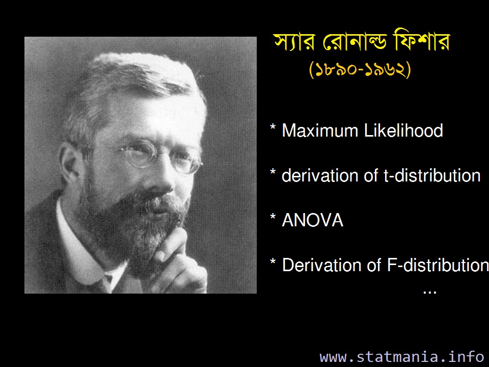

::: {dir="ltr" style="text-align: left;" trbidi="on"}
আজ ১৭ ফেব্রুয়ারি। ১৮৯০ সালের এই দিনে জন্মগ্রহণ করেন ইংরেজ পরিসংখ্যানবিদ স্যার রোনাল্ড ফিশার। অনেকের মতে তিনিই বিশ শতকের সবচেয়ে প্রভাবশালী পরিসংখ্যানবিদ।

  ----------------------------------
   
         স্যার রোনাল্ড ফিশার
  ----------------------------------

::: {style="text-align: left;"}
জন্ম লন্ডনের 'পূর্ব ফিঞ্চলে' অঞ্চলে। দুই যমজের মধ্যে একমাত্র তিনিই জীবিত জন্মগ্রহণ করেন। তখন কে জানত, সৌভাগ্য নিয়ে জীবন শুরু করা এই মানুষটিই পরবর্তীতে পরিসংখ্যানের অন্যতম ত্রাণকর্তা হবেন। 
:::

::: {style="text-align: left;"}

:::

::: {style="text-align: left;"}
ক্যামব্রিজ বিশ্ববিদ্যালয়ে গণিতে পড়াশোনা করেন। জিনতত্ত্বের প্রতি আগ্রহ থেকেই ধীরে ধীরে পরিসংখ্যানের প্রতি ভালো লাগা তৈরি। পরবর্তী জীবনে দুটো বিষয় নিয়ে অধ্যয়ন চালিয়ে যান। 
:::

:::
