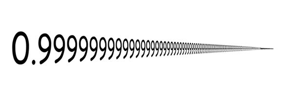

::: {dir="ltr" style="text-align: left;" trbidi="on"}
\[*লেখাটি এর আগে পাই জিরো টু ইনফিনিটি ম্যাগাজিনে প্রকাশিত*\]

এর আগে [একটি লেখায় বলেছিলাম](2016-12-4-unlike-3.html) ৪=৩ প্রমাণ করা গেলেও (?) আসলে সেটি গণিতের সাথে ফাঁকিবাজি, যা প্রকৃত নিয়ম মেনে প্রমাণ করা অসম্ভব। এখন তাহলে মনে হচ্ছে .৯৯৯... = ১ প্রমাণ করাও তাহলে একটি লুকোচুরির দাবি রাখে। কিন্তু না, উল্টোটা প্রমাণ করতেই বরং লুকোচুরির আশ্রয় নিতে হবে। শুনতে অবাস্তব লাগছে দেখেই এক হালি প্রমাণ হাজির করছি 😛

::: {style="text-align: center;"}

:::

**প্রমাণ ১: **
**বীজগাণিতিক প্রমাণ:**
**
** ধরি, x = 0.999...
তাহলে, 10 দিয়ে গুণ করে,
10x = 10 × 0.999...
বা 10x = 9.999...

বিয়োগ করে,
10x - x = 9.999... - 0.999...
বা 9x = 9.000
বা 9x = 9
বা x= 1

অথচ আমরা ধরেছিলাম, x = 0.999...
সুতরাং ০.৯৯৯... = ১
(প্রমাণিত)

**প্রমাণ ২:**
দুইটি সংখ্যা যদি একই হয়, তার অর্থ এদের মাঝখানে অন্য কোনো সংখ্যা নেই। যেমন আমি যদি প্রমাণ করতে চাই  x = y, তাহলে আমাকে দেখাতে হবে x এবং y এর মাঝে অন্য কোনো সংখ্যা নেই। এখন, বলুন তো ০.৯৯৯... এবং ১ এর মাঝের সংখ্যা কোনটি? আপনি যদি অবিচ্ছিন্ন সংখ্যা consider করেন তবু এ দুই সংখ্যার মাঝে কাউকে পাবেন না। তার মানে দুজনে আসলে একই।

এখানে মনে রাখতে হবে, ০.৯৯৯... মানে কিন্তু দশমিকের পরে অসীম পর্যন্ত ৯ যুক্ত হতে থাকবে।
তাহলে ১ এবং ০.৯৯৯... এর মাঝে সংখ্যা কোনটি? ভেবে বলুন তো। অসীম বলবেন? কিন্তু অসীম কি কোনো সংখ্যা? 😛 অসীম ($\infty$) কিন্তু বাস্তব সংখ্যা নয়।

**প্রমাণ-৩:**
**
** আমরা জানি,
$\frac{1}{9} = 0.1111111...$

এটাই যদি বিশ্বাস না হয় তাহলে ক্যালকুলেটর চেপে দেখে নিন অথবা খাতা কলম নিয়ে ভাগ করে ফেলুন।

এবার তাহলে, $9×\frac{1}{9} = 9 × 0.11111111...$ (উভয়পক্ষকে 9 দ্বারা গুণ করে)
বা, 1 = 0.9999999.........

::: {style="text-align: left;"}
**প্রমাণ ৪:**
**ধারার মাধ্যমে**
**
**
:::

আমরা লিখতে পারি,
$0.999... = 0.9 + 0.09 + 0.009 + 0.0009 + ...$
$ = \frac{9}{10} + \frac{9}{100} + \frac{9}{1000} + \frac{9}{10000} +...$

এটা একটি গুণোত্তর ধারা, যার প্রথম পদ , $a = \frac{9}{10}$
সাধারণ অনুপাত, $r = \frac{1}{10} < 1$

আমরা জানি গুনোত্তর ধারার r ১ এর ছোট হলে সমষ্টি হয়
$$ S= \frac{a}{1-r} 
={\frac{9}{10} \over {1-\frac{1}{10}}} 
=\frac{9}{10} × \frac{10}{9}   = 1$$

(না বুঝা গেলে খাতায় করে দেখুন, সিম্পল।)
তাহলে ধারা থেকেও পাচ্ছি ০.৯৯৯... = ১
লক্ষ্যণীয় ০.৯৯৯৯৯৯৯৯ লিখতে গিয়ে ডট ডট না দিলে কিন্তু তা ১ হবে না।
:::
