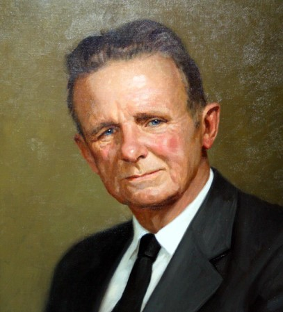
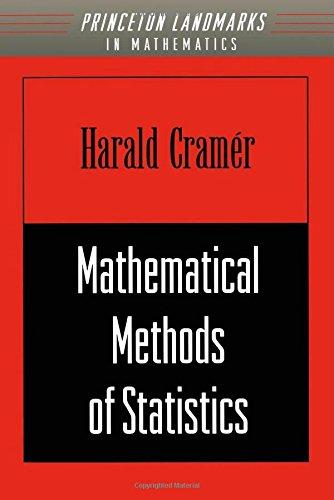

::: {dir="ltr" style="text-align: left;" trbidi="on"}
আজ ২৫ সেপ্টেম্বর। ১৮৯৩ সালের এই দিনে জন্মগ্রহণ করেন সুইডিশ গণিত ও পরিসংখ্যানবিদ হ্যারাল্ড ক্র্যামার। গাণিতিক পরিসংখ্যান ও সম্ভাবনাভিত্তিক সংখ্যা তত্ত্বের একজন বিশেষজ্ঞ ছিলেন তিনি। ব্রিটিশ গণিতবিদ জন কিংম্যান এর মতে,

>  হ্যারাল্ড ক্র্যামার হলেন পরিসংখ্যানিক তত্ত্বের অন্যতম দৈত্য। 

  ----------------------------------
   
         হ্যারাল্ড ক্র্যামার 
  ----------------------------------

জন্ম সুইডেনের স্টোকহোমে। জীবনের বেশিরভাগ সময় কেটেছে এই শহরের আশেপাশেই। ১৯১২ সালে ভর্তি হন স্টোকহোম বিশ্ববিদ্যালয়ে। পড়েন গণিত ও রসায়ন নিয়ে। ল্যাবের অভিজ্ঞতা ধীরে ধীরে টেনে আনে গণিতের দিকে। শেষ পর্যন্ত একই বিশ্ববিদ্যালয়ে মারসেল রিয়েজ এর অধীনে ডক্টরেট শুরু। এ সময় অনুপ্রাণিত হয়েছিলেন জি এইচ হার্ডির দ্বারাও। এই সেই হার্ডি, যিনি বিখ্যাত ভারতীয় গণিতবিদ রামানুজানের প্রতিভা প্রচার ও প্রকাশেও ভূমিকা রেখেছিলেন। যাই হোক, এ দুজনের পৃষ্ঠপোষকতায় ১৯১৭ সালে ক্র্যামার ডিরিকলেট ধারার ওপর পিএইচডি ডিগ্রি লাভ করেন।

পিএইচডি লাভ করার পর একই বিশ্ববিদ্যালয়ে সহকারী অধ্যাপক হিসেবে থাকেন ১৯২৯ সাল পর্যন্ত। এ সময়ের শুরুর দিকে তিনি অ্যানালিটিক নাম্বার থিওরি (সংখ্যা তত্ত্ব) নিয়ে প্রচুর কাজ করেন। এছাড়াও তিনি মৌলিক সংখ্যা (Prime number) ও যমজ মৌলিক সংখ্যার বিন্যাস নিয়ে কিছু গুরুত্বপূর্ণ অবদান রাখেন। ১৯৩৬ সালে এ বিষয়ে তাঁর সবচেয়ে গুরুত্বপূর্ণ পেপারখানা প্রকাশিত হয়।$^{[1]}$ এখানে তিনি সংখ্যা তত্ত্বে সম্ভাবনার (Probability) ভূমিকার বিবরণ দেন। এছাড়াও দেন প্রাইম গ্যাপ বা মৌলিক সংখ্যার ব্যবধানের (Prime gap) একটি হিসাব। এটি পরে *ক্র্যামার কনজেকচার* নামে পরিচিত হয়।

সম্ভাবনা তত্ত্বের দিকে আকৃষ্ট হয়েছিলেন ১৯২০ এর দশকে। সে সময় এই ক্ষেত্রটিকে গণিতের শাখা মনে করা হত না। ক্র্যামার এটা মানতে পারলেন না। ১৯২৬ সালের এক পেপারে তিনি লেখেন,

> সম্ভাবনার ধারণার ভিত্তি হওয়া উচিৎ বিশুদ্ধ গাণিতিক সংজ্ঞা, যা থেকে গাণিতিক অপারেশনের মাধ্যমেই সম্ভাবনার মৌলিক বৈশিষ্ট্য ও চিরায়ত উপপাদ্যগুলো বের করা হবে। 

১৯৩০ এর দশকে কলমোগোরভ, লেভি ও খিনচিন এর মতো গণিতবিদরা সম্ভবানার গাণিতিক রূপায়নের জন্যে কাজ করে যাচ্ছিলেন। ক্র্যামার তাঁদের কাজের প্রতি আকৃষ্ট হন। শুধু তাই নয়, নিজেও অবদানও রাখা শুরু করেন।

২য় বিশ্বযুদ্ধের পরপরই ১৯৪৬ সালে প্রকাশিত হয় তাঁর বই *ম্যাথেম্যাটিক্যাল মেথডস অব স্ট্যাটিসটিক্স*। এ বই থেকেই প্রমাণ হয়, পরিসংখ্যান চর্চা নিতান্তই একটি গাণিতিক বিশ্লেষণ।

  -----------------------------------------------------------
               
   ক্র্যামারের বিখ্যাত বই Mathematical Methods of Statistics
  -----------------------------------------------------------

::: {style="text-align: center;"}

:::

১৯২৯ সালে ক্র্যামার স্টোকহোম বিশ্ববিদ্যালয়ের নতুন প্রতিষ্ঠিত Actuarial Mathematics and Mathematical Statistics বিভাগের চেয়ারম্যান হন। এ পদে থাকেন ১৯৫৮ সাল পর্যন্ত। ১৯৫০ সালে অ্যামেরিকান স্ট্যাসটিক্যাল অ্যাসোসিয়েশন এর ফেলো নির্বাচিত হন। ১৯৫০ সাল থেকে তিনি স্টোকহোম বিশ্ববিদ্যালয়ের প্রেসিডেন্ট হিসেবেও কাজ করতে থাকেন। ১৯৫৮ সালে সুইডেনের সমগ্র ইউনিভার্সিটি সিস্টেমের আচার্য মনোনীত হন। অবশ্য অবসর নেন ১৯৬১ সালেই।

জীবনের একটা উল্লেখযোগ্য অংশ কাটান বিমা বিজ্ঞান (Actuarial science) ও বিমা গণিত নিয়ে কাজ করে করে।

১৯৬১ সালে অবসর গ্রহণের পরে গবেষণার দিকে আরও ভালোভাবে মনোনিবেশ করেন। এভাবেই পার করেন জীবনের শেষ ২০ বছর। এ সময় ইউরোপ ও অ্যামেরিকা জুড়ে ব্যাপক সফর করেন।

১৯৭২ সালে হেরিওট-ওয়াট ইউনিভার্সিটি থেকে সম্মানজনক ডক্টরেট লাভ করেন। ১৯৮৫ সালে নিজ দেশে পরলোকগমন করেন পরিসংখ্যানের অন্যতম এই 'দৈত্য'। তাঁর বয়স হয়েছিল ৯২ বছর।

**সূত্রঃ**
১। [মৌলিক সংখ্যা নিয়ে পেপার](http://matwbn.icm.edu.pl/ksiazki/aa/aa2/aa212.pdf)
২। উইকিপিডিয়াঃ [হ্যারাল্ড ক্র্যামার](https://en.wikipedia.org/wiki/Harald_Cram%C3%A9r)
:::
