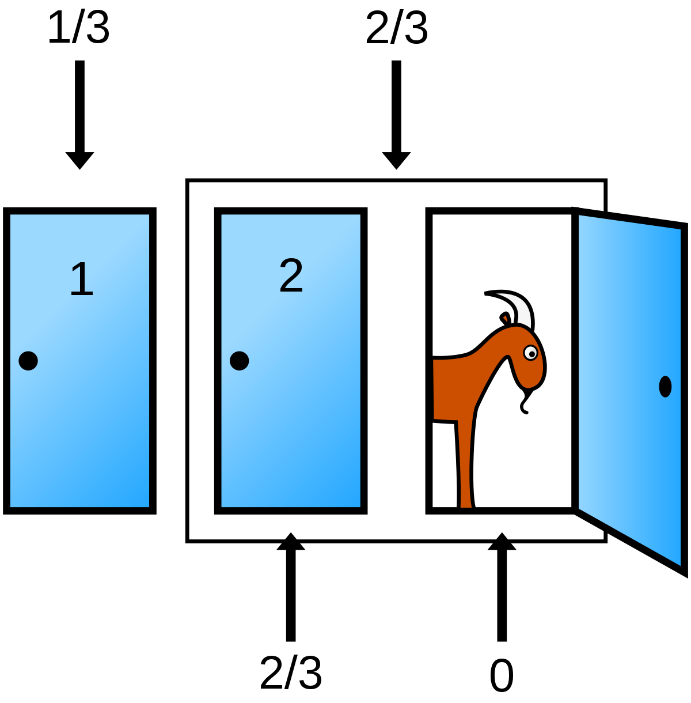
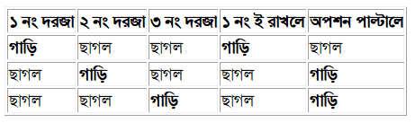
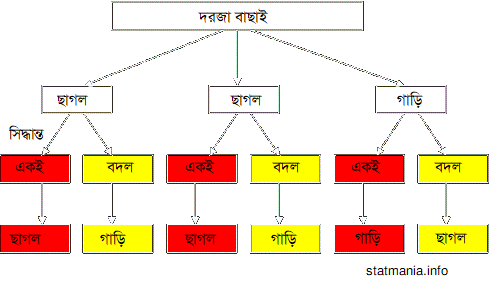

::: {dir="ltr" style="text-align: left;" trbidi="on"}
*\[লেখাটি ইতোপূর্বে পাই জিরো টু ইনফিনিটি ম্যাগাজিনে প্রকাশিত হয়েছিল\] *
*
* পরিসংখ্যানের বিভিন্ন ধাঁধা নিয়ে চিন্তা করতে গেলে অনেক সময় মাথায় চক্কর দিয়ে ওঠে। মন্টি হল প্যারাডক্স নিয়ে চিন্তা করতে গেলেই চক্করটা একটু বেশি-ই হয়ে যায়। শত শত পিএইচডি ধারী পরিসংখ্যানবিদও এর বক্তব্য শুরুতে মেনে নিতে চান না।

সমস্যাটি কী, দেখা যাক।

মনে করুন, আপনি একটি গেম শোতে আছেন। আপনার সামনে আছে তিনটি দরজা। একটি দরজার পেছনে আছে একটি গাড়ি, অপর দুই দরজার পেছনে আছে দুটি ছাগল। আপনি একটি দরজা বাছাই করলেন। ধরুন সেটি ১ নং  দরজা। এখনও কিন্তু খুলেননি। খোলার আগে হোস্ট আপনাকে আরেকটা দরজা খুলে দেখাল। ধরুন সেটা ৩ নং। সে আগে থেকেই জানত, কোন দরজার পেছনে কী আছে। ৩ নং দরজা খুলে দেখা গেল, এতে ছাগল আছে। এখন সে প্রস্তাব দিল, 'আপনি কি ১ এর বদলে ২ নং দরজা বাছাই করতে চান?' এখন সিদ্ধান্ত পাল্টালে কি আপনার লাভ হবার সম্ভবানা আছে?

::: {style="text-align: center;"}

:::

অর্থ্যাৎ ১ এর বদলে ২ নং দরজা বেছে নিলে গাড়ি পাবার সম্ভাবনা বেড়ে যাবে কিনা?

Parade ম্যাগাজিনের আস্ক মেরিলিন পাতায় কলামিস্ট মেরিলিনকে এক পাঠক প্রশ্নটি করেন। মেরিলনের উত্তর ছিল গাড়ি পাবার সম্ভাবনা বাড়াতে হলে অবশ্যই অপশন বদল করা উচিত। কারণ, অপশন বদল করলে গাড়ি জেতার সম্ভাবনা হবে $\frac{২}{৩}$, আর না করলে $\frac{১}{৩}$।
কিন্তু কথটা ঐ কলামের অধিকাংশ পাঠক মেনে নিতে পারলেন না। কেন অপশন বদল করলে লাভ হবে? সমস্যাটি প্যারেড ম্যাগাজিনে প্রকাশিত হবার পর প্রায় ১০,০০০ লোক এর বিপক্ষে মত দিলেন। এদের প্রায় ১০০০ জন আবার ছিলেন পিএইচডিধারী!

আসলে প্যারাডক্সটি স্বাভাবিক বুদ্ধির একেবারেই বিপরীত। ভাবলে মনে হয়, যে কোন একটা দরজা নিলেই হল। একটি দরজার পেছনে ছাগল দেখার পরে বাকি দুটো দরজার যে-কোনোটির পেছনে গাড়ি থাকতে পারে। তার মানে যে কোনোটির পেছনে গাড়ি থাকার সম্ভাবনা ফিফটি-ফিফটি, মানে $\frac{১}{২}$ করে।

গেম শো-টির আনুষ্ঠানিক শর্তগুলো এ রকমঃ
১. হোস্টকে অবশ্যই এমন কোন দরজা খুলবে, যা প্রতিযোগী বাছাই করেনি।
২. হোস্ট এমন দরজা খুলবে যার পেছনে ছাগল থাকবে, গাড়ি নয়।
৩. হোস্টকে অবশ্যই অপশন বদল করার অফার দিতে হবে।

কিন্তু পরিবর্তনে কীভাবে লাভ হয় আসলে?

**সরল সমাধানঃ**

প্রতিযোগীর উদ্দেশ্য হল গাড়ি জেতা। এখন জিনিস আছে মোট তিনটি- দুইটি ছাগল ও একটি গাড়ি। তাহলে দৈব চয়নে একটি দরজা খুললে গাড়ি জেতার সম্ভাবনা $\frac{১}{৩}$ এবং ছাগল জেতার সম্ভাবনা $\frac{২}{৩}$। অর্থাৎ অনুমানের উপর ভিত্তি করে একটি দরজা খুললে ছাগল জেতার সম্ভাবনা বেশি। এখন তাকে একটি দরজা খুলে দেখানো হল তাতে একটি ছাগল আছে। এখন সিদ্ধান্ত নিতে হবে আগের দরজাই খুলবে নাকি সিদ্ধান্ত বদলে অন্য দরজা খুলবে।

এবার মনে করুন, প্রতিযোগী প্রথমে ছাগল বেছেছিল। তাহলে বদল করলেই সে গাড়ি পেয়ে যাচ্ছে, কারণ খোলা দরজায় ছাগল দেখা যাচ্ছে।

অপরদিকে সে যদি প্রথমেই গাড়ি বাছাই করে থাকতো তবে বদল করলে সে পেত ছাগল। তার মানে, প্রথমে ছাগল বাছাই করলে লাভ হয় বেশি। সেক্ষেত্রে বদল করলেই গাড়ি! এখন ছাগল যেহেতু দুইটি, তাই প্রথমে ছাগল বাছাই হবার সম্ভাবনা বেশি। তার মানে বদল করলেই গাড়ি পাবার সম্ভাবনা বেশি! আশা করি স্পষ্ট হয়েছে।

**মেরিলনের সমাধানঃ**
প্যারেড ম্যাগাজিনে মেরিলিন ভস স্যাভান্ট একটি সারণির মাধ্যমে চিত্রটি তুলে ধরে খুবই সহজ ভাষায় সমাধান দিয়েছিলেন। একটি গাড়ি ও দুইটি ছাগল তিনটি দরজার পেছনে তিনভাবে বিন্যস্ত থাকতে পারে। মনে করুন, প্রতিযোগী প্রথমে ১ নং বাছাই করলনে। এবার দেখি, অপশন পাল্টালে আর না পাল্টালে কেমন রেজাল্ট হয়।

::: {style="text-align: center;"}

:::

দেখা যাচ্ছে, আমাদের চূড়ান্ত অপশন ৩ টি। এর মধ্যে অপশন পাল্টালে গাড়ি, আর না পাল্টালে ছাগল পাবার সম্ভাবনা বেশি-যথাক্রমে ২ টি করে।
আরেকটি সহজ সমাধান দেখি ডায়াগ্রামের মাধ্যমে।

  ----------------------------------
   
  ----------------------------------

  --------------------------
  মন্টি হল সমস্যার সমাধান 
  --------------------------

আমেরিকান টেলিভিশন অনুষ্ঠান লেটস মেইক আ ডিল নির্ভর এই প্যারাডক্সটির নাম দেওয়া হয় ঐ অনুষ্ঠানের প্রথম হোস্ট মন্টি হলের নামে। জীব-পরিসংখ্যানবিদ স্টিভ সেলভিন প্রথম আমেরিকান জার্নাল *দ্য আমেরিকান স্ট্যাটিসটিক্সে* সমস্যাটি পাঠান।

**সূত্রঃ**
\[১\] mathworld.wolfram.com/MontyHallProblem.html
\[২\]  en.wikipedia.org/wiki/Monty\_Hall\_problem
:::
