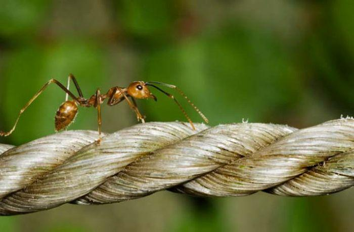

::: {dir="ltr" style="text-align: left;" trbidi="on"}
আপনাদের নিশ্চয়ই [একিলিস ও কচ্ছপের দৌড় প্রতিযোগিতার](2016-08-achilles-vs-tortoise.html) কথা মনে আছে। যেখানে কচ্ছপ গ্রিক বীরকে গতির চ্যালেঞ্জ ছুঁড়ে দিয়েছিল। কিন্তু শেষমেষ হার হয় কচ্ছপেরই। কাজটা যদিও প্র্যাকটিকেলি বড়ই সহজ ছিল, কিন্তু গণিতের অপপ্রয়োগ খাটিয়ে কচ্ছপ তাত্ত্বিকভাবে জিতে নিতে চেয়েছিল রেসটি।

এবারের লড়াইয়ে প্রাণী আছে একটিই। লড়াই করতে হবে একটি দড়ির সাথে। যে সে দড়ি নয়, সে এক রাবারের দড়ি। প্রতি মুহূর্তে এর দৈর্ঘ্য প্রসারিত হচ্ছে। এমনই এক দড়ির উপর দিয়ে পিঁপড়াটিকে পার হতে হবে।

::: {style="text-align: center;"}

:::

খুলেই বলা যাক।

শুরুতে দড়ির দৈর্ঘ্য ছিল ১ মিটার (৩ দশমিক ৩ ফুট)। পিঁপড়াটি এই রাবারের দড়িটির উপর দিয়ে প্রতি সেকেন্ডে ১ সেন্টিমিটার বেগে হেঁটে যাচ্ছে। দড়ি যদি স্বাভাবিক থাকতো, তাহলে ১ মিটার তথা ১০০ সেন্টিমিটার পথ পিঁপড়াটি ১০০ সেকেন্ডেই পার হয়ে যেত। তাহলে অবশ্য আর এই লেখাটি লেখা হতো না।

কিন্তু রাবারের দড়িটি প্রতি সেকেন্ডে ১ কিলোমিটার হারে সুষমভাবে প্রসারিত হয়ে যাচ্ছে। মানে ২য় সেকেন্ডে দড়ির দৈর্ঘ্য হবে ২ কি.মি.। ৩য় সেকেন্ডে দৈর্ঘ্য হবে ৩ কি.মি. ইত্যাদি। তবে বৃদ্ধিটা হচ্ছে সুষমভাবে। দড়ির প্রতিটা অংশে সামান্য অংশ করে বেড়ে বেড়ে।

এবার কি তাহলে পিঁপড়া কোনোদিন দড়িটি পার হতে পারবে? উত্তর হলো, হ্যাঁ পারবে।

অনেকে চোখ কপালে তুলে ভাবছেন, এই দড়ি পিঁপড়াটি পার হবে কিভাবে? এও কি সম্ভব? শুধু সম্ভবই নয়, দড়ির যে-কোনো দৈর্ঘ্যের জন্যেই এটা সম্ভব। এমনকি সম্ভব পিঁপড়ার যে-কোনো বেগের জন্যেও।

প্রাথমিকভাবে অবশ্য কাজটাকে অসম্ভবই মনে হবে। সহজ কারণ, চলার বেগের চেয়ে যদি পথের দৈর্ঘ্য বড় হয়ে যাবার বেগ বেশি হয় তাহলে আর কী-ইবা হতে পারে। কিন্তু, পিঁপড়ার পক্ষে কাজটি করা সম্ভব। তাতে কতো সময় লাগবে, তা আমরা পরে দেখবো। আগে দেখি, কীভাবে সম্ভব হবে।

চলা শুরুর পূর্ব মুহূর্তে পিঁপড়ার সামনে পুরো পথ তথা ১০০% দড়ি পড়ে আছে, যা তাকে পার হতে হবে। ১ সেকেন্ড পরে দড়ির দৈর্ঘ্য ১ কিলোমিটার প্রসারিত হয়ে গেল। ওদিকে পিঁপড়াও কিন্তু চলেছে। ফলে, আগে যেখানে পথ বাকি ছিল ১০০%, এখন কিন্তু সেই ভগ্নাংশ আরো কমে গেছে। ২য় সেকেন্ডে তার সামনে হিসাব থাকবে ২ কিলোমিটার (মানে ২,০০০ মিটার) পথ। এর একটি অংশ সে ইতোমধ্যেই পার হয়েছে। ফলে বাকি পথের দৈর্ঘ্য আর ১০০% নয় কিন্তু। অবশ্য প্রকৃতপক্ষে আরেকটু কম পাড়ি দিতে হবে। কেন, বলছি একটু পরই।

পরের সেকেন্ডে সে আরো ১ সেন্টিমিটার চলল। দড়িও প্রাসারিত হয়ে গেল আরো এক কিলোমিটার। কিন্তু খেয়াল করার বিষয় হলো দড়িটি শুধু পিঁপড়ার সামনের দিকে প্রসারিত হচ্ছে না, পেছনেও হচ্ছে। ব্যাপারটি যদি এমন হতো যে, দড়ির একেবারে শেষ প্রান্তে ১ কিলোমিটার করে নতুন দড়ি যুক্ত হচ্ছে, তাহলে কিন্তু আজীবন চললেও পথ কোনক্রমেই শেষ হতো না।

কিন্তু এক্ষেত্রে পিঁপড়ার সামনে যেমন দড়ি বেড়ে যাচ্ছে, তেমনি বাড়ছে পেছনেও। আমরা আগেই বলেছি বৃদ্ধিটা হচ্ছে সুষমভাবে। ফলে, একই সাথে সামনে পড়ে থাকা দূরত্ব যেমন বাড়ছে, তেমনি বাড়ছে ফেলে আসা পথও। আর পিঁপড়া যতোই সামনে এগোচ্ছে, ততোই ফেলে আসা পথের ক্ষেত্রে প্রসারণ বাড়ছে এবং উল্টোভাবে কমে যাচ্ছে সামনে পড়ে থাকা পথের ভগ্নাংশ।

ফলে, এক সময় পিঁপড়াটি সত্যিই দড়িটি পার হয়ে যাবে। কিন্তু একটি শর্ত আছে। প্রাণিটিকে অবশ্যই অনেক অনেক... অনেক দীর্ঘায়ু পেতে হবে। কেননা, এই পথ পাড়ি দিতে তাকে  \$2.8 x 10\^{43,429} সেকেন্ড পথ চলতে হবে।

আপনি চাইলে ২৮ এর পর ৪৩৪২৮ টি শুন্য বসিয়ে দেখতে পারেন সংখ্যাটি কতো বড় হয়। সত্যি কথা হলো, [মহাবিশ্বের বর্তমান বয়সও](http://sky.bishwo.com/2014/10/age-of-universe.html) (প্রায় ১৪ বিলিয়ন বছর) কিন্তু এতো হয়নি।

**কিন্তু কাজটিকে কেন অসম্ভব মনে হয়?**
এই কাজটিকে অসম্ভব মনে হবার দুটি কারণ থাকতে পারে।

১। দড়ি বড় হয়ে যাচ্ছে শুনে মনে হচ্ছে দড়ির শেষ প্রান্তে নতুন করে দড়ি যুক্ত হচ্ছে। বাস্তবে সম্পূর্ণ দড়িটিই প্রসারিত হচ্ছে, পিঁপড়ার সামনেও আবার পেছনেও।

২। পিঁপড়ার বেগ দড়ির প্রসারণ হারের তুলানায় নগণ্য বলে। আর এজন্যেই সময় অনেক বেশি লাগছে। এতই বেশি যে একে অসম্ভব মনে হয়ে যাচ্ছে।

এ তো সম্পূর্ণ কাল্পনিক ভাবনা। এবার চলুন এ রকমই একটু বাস্তব উদাহরণ দেখি। আমরা জানি, আমাদের এই মহাবিশ্ব ক্রমাগত প্রসারিত হচ্ছে। যতোই প্রসারিত হচ্ছে ততোই প্রসারণের হারও বেড়ে যাচ্ছে। এর ফলাফলস্বরূপ আমরা দেখি গ্যালাক্সিরা পরস্পর থেকে দূরে সরে যাচ্ছে। দূরে সরার এই বেগ  ছাড়িয়ে যাচ্ছে আলোর বেগকেও।

আলোর বেগকেও ছাড়িয়ে যাচ্ছে- কথাটি বিস্ময়কর শোনালেও সত্যি। আলোর বেগই সর্বোচ্চ সম্ভাব্য বেগ- এই কথাটি প্রযোজ্য মহাবিশ্বের অভ্যন্তরীণ স্থান ও কালের জন্যে। অন্য দিকে, মহাবিশ্বের প্রসারণ আসলে এর নিজস্ব স্থান কালের প্রসারণ। স্থানের (Space) অভ্যন্তরস্থ কোনো নিয়ম স্থান নিজে মানতে বাধ্য নয় বলেই এমনটি হচ্ছে।

আবার মূল প্রসঙ্গে আসি। কোনো গ্যালাক্সি যদি আমাদের থেকে আলোর চেয়েও বেশি বেগে দূরে সরে যায়, তাহলে ঐ গ্যালাক্সিকেকি আমরা দেখতে পাবো? প্রশ্নটা অনেকটাই পিঁপড়ার দড়াবাজির মতো যেখানে আমরা পিঁপড়ার জায়গায় আলো আর দড়ির জায়গায় প্রসারণশীল স্থানকে চিন্তা করতে পারি । আলো তার চেয়ে বেশি বেগে প্রসারিত হওয়া স্থান ভেদ করে আমাদের চোখে পৌঁছতে পারবে কিনা? একেও আগের মতোই অসম্ভব মনে হয়।

একটু আগেই আমরা দেখলাম, অপেক্ষাকৃত বেশি বেগে প্রসারমান কোন বস্তুকেও অপেক্ষাকৃত কম বেগ নিয়েও পাড়ি দেওয়া যায়। কিন্তু আলোর ক্ষেত্রে একটু সমস্যা আছে। পিঁপড়ার ক্ষেত্রে রাবার প্রসারিত হচ্ছিল ধ্রুব বেগে। কিন্তু মহাবিশ্বের প্রসারণ হার ধ্রুব নয়, সময়ের সাথে সাথে বর্ধনশীল। ফলে যথেষ্ট দূরের গ্যালাক্সির আলো পৃথিবীতে নাও পৌঁছতে পারে।  কিন্তু অপেক্ষাকৃত কম দূরত্বের গ্যলাক্সির আলো পিঁপড়ার মতোই সফল হতে পারবে।

**সূত্রঃ**
১। [লিস্টভার্স](http://listverse.com/2014/03/15/10-mind-bending-paradoxes-that-will-leave-you-stumped/)
২। [উইকিপিডিয়া](https://en.wikipedia.org/wiki/Ant_on_a_rubber_rope)
:::
