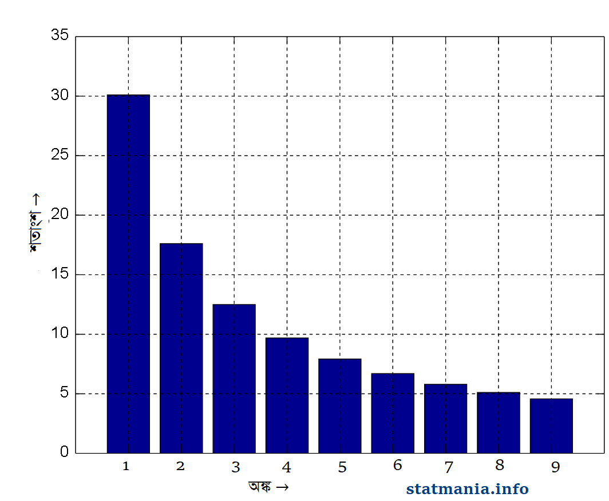
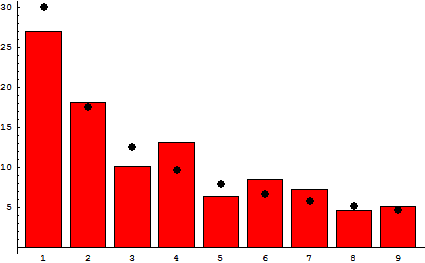

::: {dir="ltr" style="text-align: left;" trbidi="on"}
আচ্ছা, একটা প্রশ্ন করি। সংখ্যা পদ্ধতির যদিও অনেকগুলো নিয়ম আছে তবু আমরা সাধারণত ব্যবহার করি দশমিক সংখ্যা পদ্ধতি (Decimal Number System)। এ ধরনের পদ্ধতিতে ০ থেকে ৯ পর্যন্ত মোট দশটি সংখ্যা থাকে। হায়! হায়! প্রশ্নই করতে ভুলে গেলাম। প্রশ্ন হল, দৈব পদ্ধতিতে (at random) যে কোনো অঙ্কের (digit) যে কোনো একটি সংখ্যা নিলে সেই সংখ্যাটি ১ দিয়ে শুরু হবার সম্ভাবনা (Probability) কত? অথবা ৩ দিয়ে বা ৬ দিয়ে শুরু হবার সম্ভাবনাই বা কত?

নিশ্চয় ভাবছেন, এ তো ভারি সোজা কাজ। দশমিক পদ্ধতিতে অঙ্ক আছে ১০ টি। এর মধ্যে ০ দিয়েতো আর কোনো সংখ্যা শুরু হতে পারে না। তাই, সব সংখ্যাই ১ থেকে ৯ -এই অঙ্কগুলোর কোনো একটি দিয়েই শুরু হবে। অতএব, কোনো একটি সংখ্যা ১ দিয়ে শুরু হবার সম্ভাবনা ৯ এর মধ্যে ১। সম্ভাবনার ভাষায় $\frac{১}{৯}$ বা প্রায় ১১ শতাংশ। একই সম্ভাবনা প্রযোজ্য হওয়া উচিত ৩, ৬ বা অন্য যে কোন অঙ্কের জন্যেই। বড় অঙ্ক হলেই যে তার অধীনে বেশি সংখ্যা থাকবে- সম্ভাবনা তত্ত্ব অন্তত এমনটি বলে না!

তবে উল্টোটা কিন্তু বলে। সেটা কেমন?
বাস্তবে দেখা যায় ছোট অঙ্কের অধীনেই বেশি সংখ্যার অস্তিত্ত্ব। দৈবভাবে কোনো একটি সংখ্যা নিলে সেটি ১ দিয়ে শুরু হবার সম্ভাবনাই সবচেয়ে বেশি। ২ দিয়ে শুরু হবার সম্ভাবনা আরেকটু কম। ক্রমান্বয়ে সম্ভাবনা কমে যায় বড় অঙ্কের ক্ষেত্রে। তাও আবার একটি প্যাটার্নও মেনে চলে এই ঘটনাটি।বাস্তব পরিসংখ্যানের দিকে চোখ বুলালে দেখা যায়, ৯ অংকটি দিয়ে শুরু হওয়া সংখ্যার পরিমাণ ১১ শতাংশের চেয়ে অনেক কম। অথচ আমরা সম্ভাবনা তত্ত্ব খাটিয়ে শুরুতে সবার জন্যেই ১১ শতাংশ নির্ধারণ করেছিলাম। ৮ দিয়ে শুরু হয় আরেকটু বেশি সংখ্যক সংখ্যা। অন্য দিকে ১ এর দখলে রয়েছে প্রায় ৩০ শতাংশ সংখ্যা! সবচেয়ে বেশি।

এতক্ষণ বলেছিলাম, দৈবভাবে কোনো সংখ্যা নিলে তার সম্ভাবনা এই রকম স্বধর্মচ্যুতি প্রদর্শন করে। কিন্তু, ব্যাপারটি শুধু দৈব বা র‍্যান্ডম ডেটার জন্যেই যে প্রযোজ্য তা নয়। বাস্তব জীবনের বিভিন্ন হিসাব নিকাশ যেমন বিভিন্ন দেশ বা অঞ্চলের জনসংখ্যার কথা বলুন অথবা শেয়ার মার্কেট বা নদীর দৈর্ঘ্যের কথাই বলুন- সব ক্ষেত্রেই দেখা যায় ১ এর জয়জয়কার।

পদার্থিবিজ্ঞানী হয়েও কোন গণিতবিদ বা পরিসংখ্যানবিদের হাতে আবিষ্কার হবার আগেই ফ্র্যাংক বেনফোর্ড এই নিয়মটি আবিষ্কার করে ফেলেন। সালটি ছিল ১৯৩৮। তিনি দেখলেন, বড় অঙ্কদের ক্ষেত্রে সংখ্যার পরিমাণ উল্লখযোগ্যভাবে হ্রাস পেয়ে যাচ্ছে। সংখ্যার শুরুতে ১ এর আগমণ ঘটে ৩০.১ শতাংশ বার। ২ এর আবির্ভাব ঘটে ১৭ দশমিক ৬ শতাংশ বার। ৩ এর ক্ষত্রে এটা ঘটে ১২ দশমিক ৫ শতাংশ বার। এভাবে চলতে চলতে ৯ এর ভাগে পড়ে মাত্র ৪ দশমিক ৬ শতাংশ সংখ্যা।

  --------------------------------------------
        
   বেনফোর্ডের নীতি। বিভিন্ন অঙ্কের ঘটনসংখ্যা 
  --------------------------------------------

এটা কেন ঘটে? এটাকি প্রকৃতির ভারসাম্যের বিপরীত কোন কিছু। না, তা হতেই পারে না। এমন ঘটনা ঘটার পেছনেও রয়েছে খোদ গাণিতিক কারণ। আসুন ডুব দেই সেই গণিতে। মনে করুন, আমরা কোনো কারণে লটারি করব। প্রতিযোগী ৯ জন হলে আমরা ১ থেকে ৯ পর্যন্ত অঙ্ক লিখে ৯ খানা টোকেন বানাবো। এই অবস্থায় যে কোনো টোকেনধারীর বিজয়ী হবার সম্ভাবনা সমান। $\frac{১}{৯}$  বা ১১ দশমিক ১ শতাংশ।

এবার ধরা যাক, শেষ মুহূর্তে আরেকজন প্রতিযোগী যুক্ত হলেন। মানে ১০ জন হলেন। তাহলে এবার!
১ অঙ্কটি দিয়ে টোকেন নাম্বার শুরু হবে- এমন হবার সম্ভাবনা এক লাফে উঠে গেছে ১৮ দশমিক ২ পার্সেন্টে। কারণ ১০টি টোকেনের ২ খানাই ১ দিয়ে শুরু। বাড়তে বাড়তে প্রতিযোগী যদি ১১ থেকে ক্রমেই ১৯ জন হয়ে যান, ১ এর কপালও যেন অদৃশ্য [ডার্ক এনার্জির](http://sky.bishwo.com/) প্রভাবে চওড়া হয়ে যায়। ১৯ টোকেনের ক্ষেত্রে এটা দাঁড়াবে ৫৮ শতাংশ।

এবার ২ এর সুযোগ নেবার পালা। যখনি আমরা ২০ নম্বর টোকেন যুক্ত করলাম ২ এর সম্ভাবনা বেড়ে গেল এবং ১ এর সম্ভাবনা একটুখানি কমে গেল। ২৯ পর্যন্ত যেতে যেতে ২ অনেকখানি বাড়ল এবং ১ এর আধিপত্য কমতে কমতে ২ এর সাথে প্রতিযোগিতায় লিপ্ত হতে হলো।

টোকেনের প্রথম অঙ্ক তিনে পা দিতে ময়দানে উথান ঘটল তৃতীয় শক্তির! ১, ২ ও ৩ আধিপত্য ভাগাভাগি করে নিল। এভাবে আস্তে আস্তে সবাই নিজের জায়গা দখল করল। কিন্তু ১ একটু বেশিই বুদ্ধিমান। সে যখন নিজের বিপদ বুঝতে পারলো, আবার নতুন চাল চেলে পদার্পণ করলো তিন অঙ্কের জগতে। আবারো বাড়িয়ে ফেললো নিজের সম্ভাবনা। দেখাদেখি, অন্যরাও তাই করতে শুরু করলো। কিন্তু অন্যরা কাছাকাছি আসলেই ১ প্রবেশ করে নতুন অঙ্কের জগতে, সবার আগে আগে।

ফলে, আমরা যখন অনেক বেশি সংখ্যা হিসেব করবো, তখন ১ অন্যদের তুলনায় অনেক এগিয়ে থাকে। যেমন, ১ চার অঙ্কের ঘরে প্রবেশ করলে অন্যদের সেখানে আসতে আরো ১ হাজার করে সংখ্যার নদী পাড়ি দিতে হয়। ১ লক্ষের ঘরে, কোটি বা বিলিয়ন, কোয়াড্রলিয়নের ঘরে প্রবেশ করলে অন্যদের সেখানে আসতে কতো সময় লাগে, চিন্তার ভার আপনার।

কয়েকটি ক্ষেত্রে বেনফোর্ডের নীতিটি প্রযোজ্য নয়। যেমন মানুষের উচ্চতা বা ওজোনের ক্ষেত্রে। অর্থ্যাৎ, মূলত যেসব ক্ষেত্রে মানের নির্দিষ্ট সীমা থাকবে তাতে এই নিয়ম ফল দেবে না। এছাড়াও কাজ হবে না দুই অঙ্কের সংখ্যার ক্ষেত্রেও। জানেনইতো,  সম্ভাব্যতার অন্যতম একটি  নিয়ম হচ্ছে যত বেশি নমুনা (Sample) নেওয়া হবে, প্রকৃত সম্ভাবনা প্রত্যাশিত সম্ভাবনার ততো কাছকাছি আসবে।এটাও মেনে চলে সেই নিয়ম।

কিন্তু, আর প্রায় সব ক্ষেত্রেই এই নিয়মটি খাটে ভালোমতোই। ফলে ডেটায় ভুল বের করতে এই নীতিটিও কাজে লাগানো হয়। নিয়মের সাথে গরমিল হলেই বোঝা যায় এটা প্রকৃত উপাত্ত নয়। বরং কেউ বানিয়ে নিয়েছে। অন্য আরও অনেক কিছুর সাথে সাথে এই নিয়মটি আরও  প্রযোজ্য বিদ্যুৎ বিল, রাস্তা নম্বর, মৃত্যু হার এবং বিভিন্ন বৈজ্ঞানিক ও গাণিতিক ধ্রুবকের ক্ষেত্রেও।

আরেকটি কথা, এই সূত্রটি যে শুধু দশ ভিত্তিক তথা দশমিক সংখ্যা পদ্ধতির জন্যেই সীমাবদ্ধ- এমন কোন কথা নেই। এটি ১৬ ভিত্তিক হেক্সাডেসিমাল সংখ্যার ক্ষেত্রেও ভালো খাটে।

  ---------------------------------------------------------------------------------------------------------------------------------------------------------------------------------------------------------------
                                                                                         
   ২৩৭ টি দেশের জনসংখ্যার ক্ষেত্রে ১ থেকে ৯ পর্যন্ত অঙ্কগুলোর শতাংশের হিসাবে দখল। কালো বিন্দুগুলো দ্বারা বোঝানো হচ্ছে বেনফোর্ড নীতির পূর্বানুমান (Prediction)। দুটোর পার্থক্য পরিসংখ্যানের স্বাভাবিক একটি রীতি। 
  ---------------------------------------------------------------------------------------------------------------------------------------------------------------------------------------------------------------

**
সূত্র:**
\[১\] [লিস্টভার্স](http://listverse.com/2014/03/15/10-mind-bending-paradoxes-that-will-leave-you-stumped/)
\[২\] [উইকিপিডিয়া](https://en.wikipedia.org/wiki/Benford%27s_law)
:::
