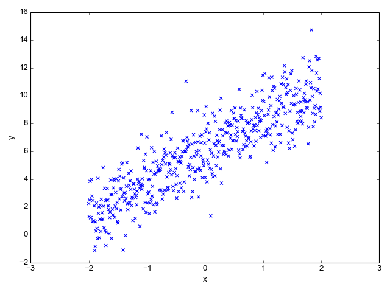

::: {dir="ltr" style="text-align: left;" trbidi="on"}
***লিখেছেনঃ** [ড. রহমতুল্লাহ ইমন](http://www.statmania.info/search/label/rimon?max-results=10)*
(লেখকের অনুমতি নিয়ে [ফেসবুক টাইমলাইন](https://www.facebook.com/rahmatullah.imon/posts/10210341221980076) থেকে পুনঃপ্রকাশিত)

তারুণ্য আমাদের পরম আরাধ্য। বয়সকে আটকে রাখতে কত বিচিত্র প্রচেষ্টাই না আমাদের! কত ধরনের গবেষণাই না চলছে নিজেকে চিরসবুজ চিরসতেজ করে রাখতে? সুযোগ থাকলে আমরা অনেকেই হয়তো ফিরে পেতে চাইতাম আমাদের শৈশব। আবার আমরা যখন শিশু ছিলাম তখন কেবল একটাই স্বপ্ন- কবে আমি বড় হব?

চিন্তা নেই, আপনাদের জন্য পরিসংখ্যান নিয়ে এসেছে সহজ সমাধান! যদি বয়স বাড়াতে চান বেশি করে সবজি খান আর বয়স কমাতে চাইলে খান মাংস ঘি দুধ ডিম। কী, বিশ্বাস হচ্ছে না আমার কথা? অনেকের চোখ উঠেছে কপালে? আসুন আপনাদের ঘুরিয়ে নিয়ে আসি একটি গবেষণার পাতা থেকে।

সম্ভবত ২০০৩ সালের ঘটনা। ছাত্রছাত্রীরা উপস্থাপন করছে তাদের *এমএসসি*'র গবেষণা প্রজেক্ট। একটি পরীক্ষা বোর্ডে প্রফেসর সুশান্ত কুমার ভট্টাচার্যের সাথে বসেছি আমি। ভাল মন্দ সবরকম কাজই আছে সেখানে। আমরা মূলত খেয়াল করছি বেশি যে ছেলেমেয়েটি নিজে নিজেই কাজ করেছে না ফাঁকি দিয়ে ঘরে বসে ফিল্ড ওয়ার্ক সেরেছে অথবা অন্য কাউকে দিয়ে কাজটি করিয়ে নিয়েছে। চলছিল ভালোই।

হঠাৎ একজন ছাত্র তার গবেষণার ফলাফল ব্যাখ্যা করতে গিয়ে বলল সবজি বেশি খেলে বয়স বাড়ে আর ঘি মাংস দুধ ডিম বেশি খেলে বয়স কমে যায়। চমৎকার সব গ্রাফিক্স- নানা ধরনের আকর্ষণীয় বিশ্লেষণ। কোন সন্দেহ নেই ছেলেটি অনেক খেটেই প্রজেক্টটি সম্পন্ন করেছে। সুশান্ত স্যার তাকে ঠিক এই পর্যায়েই থামিয়ে দিলেন,

> এই তুমি কী বললে? সবজি বেশি খেলে বয়স বেড়ে যাবে আর ঘি মাংস দুধ ডিম এগুলো বেশি খেলে বয়স কমে যাবে?

'জি, স্যার', ছেলেটি থতমত খেয়ে উত্তর দিল।

> মানে? এই কথার মানে কী? বয়স আবার বাড়ে-কমে ক্যামনে? এই ধরো যার বয়স এখন ৩০, বেশি সবজি খেলে কি তার বয়স হয়ে যাবে ৫০? আর যার বয়স ৫০ বেশি ঘি মাংস ডিম খেলে তার বয়স হয়ে যাবে ২০?

ছেলেটি এবার বিপদ বুঝতে পারল। মুহূর্তের ভেতর তার ব্যাগে থাকা গাদা গাদা কম্পিউটার আউটপুট আমাদের সামনে মেলে ধরে বলল।
'স্যার বিশ্বাস করেন আমি কিছুই বানিয়ে লিখিনি, SPSS থেকে যা রেজাল্ট পেয়েছি তাই এখানে লিখেছি।'

না, তার সততা নিয়ে আমাদের মনে সন্দেহের কোনো অবকাশ ছিল না। আমি তার কম্পিউটার আউটপুট উলটে পালটে দেখলাম। নির্ভরণ বিশ্লেষণের (Regression analysis) ব্যাপক এস্তেমাল করেছে সে তার কাজে। ব্যাখ্যাকারী (explanatory) বা স্বাধীন (independent) চলক হিসেবে সে ব্যবহার করেছিল একটি নকল (dummy) চলক যা ছিল ঐ খাবারগুলো। মাংস, ঘি, ডিম, দুধকে প্রকাশ করা হয়েছিল ১ দিয়ে আর সব্জিকে ০ দিয়ে। ব্যাখ্যাত (explained) বা অধীন (dependent) চলক ছিল বয়স।

SPSS থেকে প্রাপ্ত ফলাফলে স্পষ্টভাবেই দেখা যাচ্ছিল যে বয়সের ওপর মাংস, ঘি, ডিম, দুধের প্রভাব ছিল ঋণাত্মক এবং তা ৫% সংশয়মাত্রায় (level of significance) খুবই তাৎপর্যপূর্ণ। আবার যখন অধীন চলককে ঠিক রেখে স্বাধীন চলকের মাংস, ঘি, ডিম, দুধকে প্রকাশ করা হয়েছিল ০ দিয়ে আর সব্জিকে ১ দিয়ে তখন দেখা গেল বয়সের ওপর সব্জির প্রভাব ছিল ধণাত্মক এবং তা ৫% সংশয়মাত্রায় খুবই তাৎপর্যপূর্ণ। আর এ থেকেই ছেলেটি এই সিদ্ধান্তে পৌঁছে যে সবজি বেশি খেলে বয়স বেড়ে যাবে আর ঘি মাংশ দুধ ডিম এগুলো বেশি খেলে বয়স কমে যাবে।

  -------------------------------------------------------------------------------------------------
                                  
   নির্ভরণ বিশ্লেষণে এমন গ্রাফ পাওয়া গেলে বোঝা যায়, স্বাধীন চলকের মান বাড়লে অধীন চলকের মানও বাড়ে। 
  -------------------------------------------------------------------------------------------------

::: {style="text-align: center;"}

:::

আচ্ছা, বয়স তো একটি সময়ের হিসাব। সময় কি কারও ওপর নির্ভর করে? যদি আমরা টাইম মেশিনে চাপতে পারতাম তাহলে না হয় ভিন্ন কথা। বয়স বা সময় কোনো কিছুর ওপরেই নির্ভর করে না তাই কোনভাবেই একে অধীন চলক হিসেবে বিবেচনা করার সুযোগ নেই। উপস্থাপনা শেষে ওকে ল্যাবে নিয়ে গেলাম। বললাম তোমার উপাত্তগুলো দাও। বসলাম ঐ SPSS-এই। এবার শুধু পালটে নিলাম চলকগুলো। বিভিন্ন ধরনের খাবারের তথ্য সম্বন্ধীয় নকল চলকটিকে ধরে নিলাম অধীন চলক আর বয়সকে স্বাধীন চলক।

অধীন চলকের মান যেহেতু শুধু ০ আর ১ সেই হেতু এখানে রৈখিক নির্ভরণ মডেলের পরিবর্তে লজিস্টিক নির্ভরণ মডেল ব্যবহার করতে হল। এবারও ৫% সংশয়মাত্রায় খুবই তাৎপর্যপূর্ণ ফলাফল পাওয়া গেল। তবে এবার মাংস, ঘি, ডিম, দুধ খাবার ওপর বয়সের প্রভাব পাওয়া গেল ঋণাত্মক, আর সবজি খাবার ওপর বয়সের প্রভাব পাওয়া গেল ধনাত্মক। এবারের ফলাফল কি অর্থপূর্ণ হল? হ্যাঁ, অবশ্যই। এই গবেষণার ফলাফল বলছে, মানুষের বয়স যখন কম থাকে তখন সে মাংস, ঘি, ডিম, দুধ বেশি খায় আর যখন তার বয়স বেড়ে যায় সে বেশি খায় সবজি। ছেলেটির গবেষণার সব কিছুই ঠিক ছিল, শুধু স্বাধীন আর অধীন চলকের স্থান ওলট পালট হওয়ায় কী হাস্যকর ফলাফলই না পাওয়া গিয়েছিল!

এ খবর আমাদের বিভাগ ছাড়িয়ে চলে এসেছিল বাইরে। সন্ধ্যায় ক্লাবে বাংলা বিভাগের প্রফেসর সফিকুন্নবী সামাদীর সাথে দেখা। আমাকে দেখেই একগাল হেসে বললেন কি হে, তোমরা নাকি বয়স কমাবার ফর্মুলা আবিষ্কার করে ফেলেছ? আমি নিশ্চিত ছেলেটি পরে সহপাঠীদের কাছ থেকে নানা ধরনের বিদ্রূপের শিকার হয়েছিল। কিন্তু এটি কি শুধু তারই ত্রুটি? সে একজন শিক্ষানবিশ, তার ভুল ত্রুটি হতেই পারে। কিন্তু প্রত্যেক প্রজেক্টের একজন করে তত্ত্বাবধায়ক থাকেন যারা বিভাগের শিক্ষক। তাদেরও তো কিছু দায়িত্ব কর্তব্য আছে। ছেলেটির তত্ত্বাবধায়ক যদি একটু মনোযোগ দিয়ে তার কাজটি দেখতেন তাহলে এমন বিপত্তি হত না।

এই ঘটনা থেকে আমাদের সবার জন্য শিক্ষণীয় রয়েছে অনেক কিছুই। যে কোনো গবেষণায় 'কমন সেন্স' এর কোনো বিকল্প নেই। কম্পিউটারের ওপর আমাদের অতি নির্ভরতা কমাতে হবে। এখনও এটা একটা নির্বোধ যন্ত্র বৈ কিছু নয়। আপনি যেভাবে চালাবেন এটা সেভাবেই চলবে। আর এই কম্পিউটার প্যাকেজের যুগে আপনি কিছু উপাত্ত ঢুকিয়ে এ বোতাম সে বোতামে টিপ দিলে নানা ধরনের ফলাফল আসবেই। আমরা অবশ্যই কম্পিউটার ব্যবহার করব, ব্যাপকভাবেই তা করব। কিন্তু আপনাকেই নির্ধারণ করে দিতে হবে আপনি কী চান? কম্পিউটার জানে না কোনটি স্বাধীন আর কোনটি অধীন চলক। এর ব্যত্যয় ঘটলে এমন হাস্যকর অর্থহীন পরিসংখ্যানে ভরে উঠবে আমাদের চারিপাশ।

***লেখক*:** *অধ্যাপক, গাণিতিক বিজ্ঞান বিভাগ, বল স্টেট ইউনিভার্সিটি, যুক্তরাষ্ট্র*
:::
