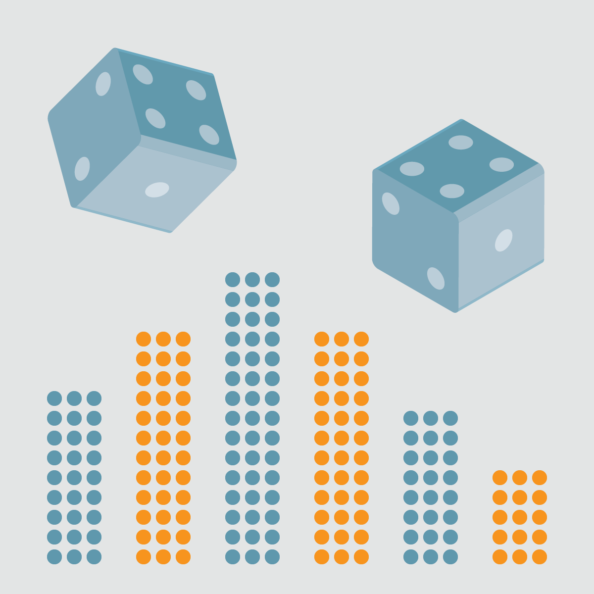

::: {dir="ltr" style="text-align: left;" trbidi="on"}
::: {dir="ltr" style="text-align: left;" trbidi="on"}
*লিখেছেনঃ [ড. রহমতুল্লাহ ইমন](../authors/stat-mania.html)*
(লেখকের অনুমতি সাপেক্ষে [ফেসবুক টাইমলাইন](https://www.facebook.com/rahmatullah.imon/posts/10210320656665956) থেকে পুনঃপ্রকাশিত)

জুয়া পৃথিবীর আদিমতম খেলা। যদিও প্রায় প্রতিটি ধর্মেই জুয়া খেলাকে পাপ বলা হয়েছে তারপরেও এর প্রতি মানুষের আকর্ষণ দিন দিন বাড়ছে বৈ কমছে না। ক্রিকেটের নামে আইপিএল বা বিপিএল-এ যা হচ্ছে এটা জুয়া ছাড়া আর কিছু নয়। বাংলাদেশের পান সিগারেটের দোকানে পর্যন্ত বেটিং এর কার্ড পাওয়া যাচ্ছে- ভাবাই যায় না।

যে সময়ের কথা বলছি সেটা সপ্তদশ শতাব্দির মাঝামাঝি। সমগ্র বিশ্বে বিশেষ করে ইউরোপে জুয়া তখন অভিজাতদের খেলা। পোলোর মত বেশ কিছু খেলা রাজাদের মধ্যেই সীমাবদ্ধ। এমনকি যে ক্রিকেট আজ বাংলাদেশের আপামর জনসাধারণের খেলায় পরিণত হয়েছে একসময় তা ছিল শুধুই লর্ডদের খেলা, সাধারণ মানুষের এই খেলায় অংশ নেয়া তো দূরের কথা, খেলার মাঠে দর্শক হিসেবেও প্রবেশাধিকার ছিল না। কোনো কোনো জুয়াতে তো মাথাই কাটা পড়ত বিজিতের। আর খেলা যেহেতু রাজ রাজাড়াদের সেখানে পুরষ্কারের মূল্যও ছিল অনেক বেশি। পুরষ্কার হিসেবে থাকত রাজ্য, মূল্যবান মণি মানিক্য, এমনকি রাণীও। যে রাজার শতাধিক রাণী আছে তিনি দু চারজন রাণীর ওপর বাজি ধরবেন এতে আর অবাক কী? ইউরোপে জুয়ার তীর্থস্থান ছিল মন্টি কার্লো। এখন যেমন লাস ভেগাস তখন ছিল মন্টি কার্লো। সেখানে খেলা ছিল জুয়াড়িদের পরম আরাধ্য। আর কত নতুন খেলার উৎপত্তিই না হয়েছে এই শহরে। আর এভাবে একদিন জুয়া খেলা থেকেই উদ্ভব হল সম্ভাবনা তত্ত্বের, যাকে আমরা বলে থাকি পরিসংখ্যানের হৃৎপিণ্ড।

::: {style="text-align: center;"}

:::

তো সে সময়ের এক খেলাকে কেন্দ্র করে বাঁধল বিপত্তি। দু'জন খেলোয়াড় খেলছে একে অপরের বিরুদ্ধে। যিনি প্রথম ৪ টি ম্যাচ জিতবেন তিনি হবেন এই খেলায় বিজয়ী। খেলায় কোন ড্র এর সুযোগ নেই, ড্র হলে টাইব্রেক করে ম্যাচের নিষ্পত্তি হবে। আর যিনি বিজয়ী হবেন পুরষ্কারের পুরো অর্থই পাবেন তিনি। সে আমলে এটাই ছিল রীতি। এখন যেমন বিজয়ী ও বিজিত উভয় দলের জন্যই আছে প্রাইজমানি, চ্যাম্পিয়নের পাশাপাশি রানার আপও পুরষ্কার পান, তখন এসবের বালাই ছিল না। লুজার ইজ এ লুজার। খেলায় হেরেছিস আবার টাকা চাস, লজ্জা নেই তোর?

আবার খেলায় ফিরে আসি। ধরা যাক খেলোয়াড় দুজনের নাম A এবং B। A জিতেছে ১ম, ২য় ও ৪র্থ ম্যাচ আর B জিতেছে ৩য় ম্যাচ। অর্থাৎ A যখন ৩-১ এ এগিয়ে আছে তখন অনিবার্য কারণ বশত খেলাটি পরিত্যক্ত হল। যেহেতু খেলায় কেউ বিজয়ী হয়নি আয়োজকেরা পুরষ্কারের অর্থ দুই খেলোয়াড়ের মাঝে ভাগ করে দেবার সিদ্ধান্ত নিলেন। এক্ষেত্রে ন্যায্য ভাগাভাগিটা কেমন হবে? যেহেতু A ৩-১ এগিয়ে আছেন তাই আয়োজকেরা এই ফলাফলের ওপর ভিত্তি করে পুরস্কারের মোট অর্থ ৪ ভাগ করে A কে ৩ ভাগ আর B কে ১ ভাগ দেবার সিদ্ধান্ত নিলেন। গণিতের আনুপাতিক নিয়ম অনুসারে এটাই ন্যায্য ভাগ।

B এই ভাগ মেনে নিলেন, কিন্তু আপত্তি জানালেন A। যদিও তিনি খেলায় বিজয়ী হননি, আর ১ টা ম্যাচ জিতলেই তিনি হয়ে যেতেন পুরো টাকার মালিক। তিনি যেন বিজয়ের একটা গন্ধ পেতে শুরু করেছিলেন। তাঁর মন কিছুতেই এই ভাগাভাগি মানছিল না। গণিতের হিসাবে এই ভাগ ঠিক আছে, কিন্তু কোথায় কী যেন ঠিক নেই, তাঁর আরও বেশি পাওয়া উচিত। তিনি দ্বারস্থ হলেন আরেকজন বিখ্যাত জুয়াড়ি এবং সৌখিন গণিতবিদ শোভার ডি মিরির (Chevalier de Méré) কাছে। ডি মিরি প্রথমে এর কোনো গুরুত্ব দিলেন না। A চলে গেলেন প্রখ্যাত গণিতবিদ ব্লেইস প্যাসকাল (Blaise Pascal) এর কাছে। প্যাসকালও প্রথমে একে গুরুত্ব দিতে চাননি। ভাগ তো ঠিকই আছে- A ৪ খেলায় জিতেছে ৩ টা ম্যাচ, B জিতেছে ১টা। তাহলে চারভাগের ৩ ভাগ আর ১ ভাগ ঠিকই তো আছে।

কিন্তু A তবুও নাছোড়বান্দা। অতঃপর ডি মিরি, প্যাসকাল এবং আরও একজন প্রথিতযশা গণিতবিদ পিয়ের ডি ফারমা (Pierre de Fermat) বিষয়টি নিয়ে গভীরভাবে ভাবতে শুরু করলেন। তাঁরা যেভাবে এর সমাধান করেছিলেন তা একটু জটিল। সবার সহজে বোঝার জন্য এর একটা সরল পাঠ এখানে উপস্থাপন করছি।

আমরা জানি যে ৪ টা ম্যাচ হবার পর খেলাটি পরিত্যক্ত হয়েছিল। কিন্তু যদি খেলাটি নির্বিঘ্নে চলতে পারত তাহলে কী হতে পারত এর ভবিষ্যত ফলাফল? দুইজন খেলোয়াড় খেলছে সর্বোচ্চ ৪ টি ম্যাচ জেতার জন্য এবং এখানে ড্রয়ের কোন সুযোগ নেই। একজন খেলোয়াড় যদি টানা ৪ ম্যাচ জেতে তাহলে ৪ ম্যাচ পরেই খেলা শেষ, কিন্তু এর অন্যথাও তো হতে পারে। তবে যাই হোক কোনভাবেই এই খেলা ৭ ম্যাচের বেশি গড়াবে না, কেননা ৭ ম্যাচ শেষে কেউ না কেউ অবশ্যই ৪ ম্যাচ জিতে যাবে এবং সেই হবে বিজয়ী। আলোচ্য খেলাটিতে ৪ টি ম্যাচ হয়ে গিয়েছিল অর্থাৎ আর হতে পারত সর্বোচ্চ ৩ টি ম্যাচ।
এখন এক নজরে দেখে নেয়া যাক এই ৩ ম্যাচে কী কী ফলাফল হতে পারত এবং তাতে কার জেতার সম্ভাবনা ছিল কতটা? (টেবিল বুঝতে হলে মনে করে দেখুন, বলা হয়েছিল, ৩য় ম্যাচ B জিতেছিল। সেই হিসেবেই সাজানো হয়েছে।)

  যা হতে পারত   চূড়ান্ত ফলাফল   বিজয়ী
  ------------- --------------- -------
  AAA           AABAA           A
  AAB           AABAA           A
  ABA           AABAA           A
  ABB           AABAA           A
  BAA           AABABA          A
  BAB           AABABA          A
  BBA           AABABBA         A
  BBB           AABABBB         B
:::

৩ টি খেলায় ৮ ধরনের ভিন্ন ভিন্ন ফলাফল আসতে পারত। এক্ষেত্রে আমরা দেখতে পাচ্ছি যে প্রথম ৪ টি ফলাফলে ৫ম ম্যাচেই খেলা শেষ হয়ে যেত এবং A ৪-১ ব্যবধানে জয়লাভ করত। এর পরের ৩ টি ফলাফল বলছে খেলাটি চলত ৬ষ্ঠ ম্যাচ পর্যন্ত এবং তাতে A ৪-২ ব্যবধানে জিতে যেত। ৭ম ফলাফল বলছে খেলা গড়াতে পারত ৭ম ম্যাচ পর্যন্ত এবং এখানেও বিজয়ী হত A ৪-৩ ব্যবধানে। ৮ম ফলাফল বলছে খেলাটি ৭ম গেমেই নিষ্পত্তি হত এবং কেবলমাত্র এই খেলাতেই জয় ছিনিয়ে নিতে পারত B ৪-৩ এই ব্যবধানে।

যেহেতু ৮ টি সম্ভাব্য পরিস্থিতিতে ৭ টিতে জয় পেত A আর ১ টিতে B, মোট অর্থের ৮ ভাগের ৭ ভাগ পাওয়া উচিৎ A এর, আর বাকি ১ ভাগ B এর। অর্থাৎ A আগে যেখানে ৭৫ ভাগ পেতেন এখন সেখানে পাচ্ছেন ৮৭.৫% অর্থ। এই নতুন বন্টনে B এর ভাগ কিন্তু অর্ধেক কমে গেল আর তা যুক্ত হল A এর ভাগের সাথে। পুরস্কার যখন মোটা অংকের তখন এই বাড়তি ভাগও বিশাল একটা ব্যাপার।

তা A আর B কে কত পেয়েছিল তা ইতিহাসের খাতায় জমা থাক, আমরা তো পেয়ে গেলাম এক বিশাল হীরকখনি- পরিসংখ্যানের হৃৎপিণ্ড সম্ভাবনাতত্ত্ব। সম্ভাবনার উৎপত্তিস্থল হিসেবে আলাদা মর্যাদা পেল মন্টিকার্লো। এই মুহূর্তে পরিসংখ্যানে সবচে বেশি ব্যবহৃত প্রতিরূপক (simulation) পদ্ধতির নামকরণ করা হয়েছে মন্টিকার্লোর নামেই। আর সম্ভাবনার ডানায় চেপে আমরা আজ বিচরণ করছি ভবিষ্যতের অজানা ভুবনে। সম্ভাবনাতত্ত্ব আজ পরিণত হয়েছে জ্ঞানবিজ্ঞানের টাইমমেশিনে।

***লেখক*:** *অধ্যাপক, গাণিতিক বিজ্ঞান বিভাগ, বল স্টেট ইউনিভার্সিটি, যুক্তরাষ্ট্র*
:::
