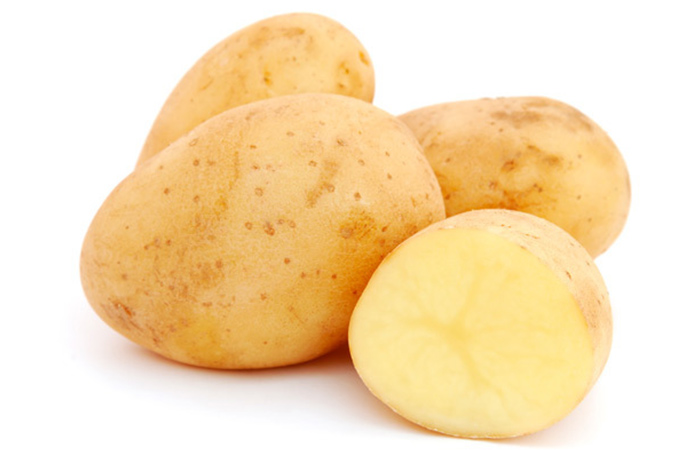

::: {dir="ltr" style="text-align: left;" trbidi="on"}
যারা জানেন না, তাদেরকে আগে কানে কানে বলে দিচ্ছি প্যারাডক্স কী জিনিস। অভিধানের ভাষায় পরস্পর স্ববিরোধী ঘটনা বা বক্তব্যকে প্যারাডক্স বলে। অনেক সময় অবশ্য সত্য ঘটনাকেও প্যারাডক্স মনে হতে পারে। মনে করা হয়, এর আদি দৃষ্টান্ত পাওয়া যায় চীনে।

চীন দেশে একবার এক লোক বল্লম ও ঢাল বিক্রি করছিল। সে দাবী করল, আমার কাছে এমন এক বল্লম আছে যা যে কোন কিছু ভেদ করতে পারে। সে আবার দাবী করল, আমার কাছে এমন এক ঢাল আছে, যা যে কোনো কিছু ঠেকিয়ে দিতে পারে। এ শুনে এক বুদ্ধিমান কিশোর গিয়ে তাকে বলল,

> আমি যদি এই বল্লম দিয়ে এই ঢালে আঘাত করি, তাহলে কী হবে?

এ থেকেই *জিজিয়াং মাওদুং* বা 'স্ব-বিরোধী' (Self-contradictory) পরিভাষাটির উদ্ভব।

আবার, আপাত দৃষ্টিতে অসম্ভব বলে মনে হয় অথচ সত্য- এমন ঘটনাও প্যারাডক্স।

আজ আমরা এমন একটি প্যারাডক্স নিয়েই কথা বলব।

আচ্ছা, বলুন তো আলুতে কত ভাগ পানি থাকে?
হ্যাঁ, ৭৯ ভাগ।

কিন্তু সেটা ভুলে গিয়ে ধরা যাক, আলুর ওজোনের ৯৯ শতাংশই হলো পানি। এবার মনে করুন, আপনি এ রকম ১০০ কেজি আলু কিনে বাসায় নিয়ে আসলেন। যেহেতু একটু গবেষণা প্রিয়, তাই আপনি আলুগুলোকে স্টক করে রাখার চেয়ে গবেষণার স্যাম্পল বানিয়ে দিনভর ঘরের বাইরে রেখে দিলে। যতক্ষণ না আলুতে পানি শুকিয়ে পারসেন্টেজ ৯৯% থেকে ৯৮% না হলো, ততক্ষণ বাইরেই রেখে দিলে। এবার, একটু হিসাব নিকাশ করে বলুন দেখি, এই পরিমাণ পানি হারানোর পর আলুগুলোর ওজোন (ভর) কত হলো?

::: {style="text-align: center;"}

:::

উত্তর যদি হয় ৫০ কেজি, তাহলে হিসাব সঠিক।

মনে হয়, আমার কথাটি মানা যাচ্ছে না। এই জন্যেই তো শিরোনাম দিয়েছি 'প্যরাডক্স'।

কিন্তু যা তা বললেই তো হবে না, যুক্তিও থাকতে হবে। তাই প্রমাণের ভার নিজের কাঁধেই রাখলাম।

প্রমাণ দেখব তিনটে। ১ ও ২ নং যুক্তিতে না বুঝলে বা না মানতে চাইলে (যদিও তার কোনো কারণ নেই) ৩ নং প্রমাণ দেখুন। এটা একটু বেশি গাণিতিক।

**প্রমাণ ১:**
আগে পানি বাদে ওজোন (শুধু আলুর ওজোন) ছিল ১ কেজি। কারণ ১০০ এর ১% হলো ১। এখন শুধু আলু আছে ২%। বাকি ৯৮% পানি। এখন বের করতে হবে ১ কেজি কত কেজির ২%। হুম, ৫০। কারণ, ১০০ এর ২% তো ২। তার মানে, ৫০ এর ২% হলো ১।

অতএব, উত্তর ৫০ কেজি।

**প্রমাণ ২:**

আগে ৯৯ কেজি ছিল পানি। ১ কেজি ছিল শুধু আলু। তার মানে অনুপাত হলো ১:৯৯।
পানি ৯৮% হয়ে গেলে শুধু আলু হয়ে গেল ২%। এখন অনুপাত তাহলে ২:৯৮ বা ১:৪৯।

এখন শুধু আলুর ওজোন যেহেতু ১ কেজিই থাকল, তার মানে বাকি ৪৯ কেজি হলো পানি। যোগফল ৫০ কেজি।

**প্রমাণ ৩:**

প্রতিটি আলুতে পানির পরিমাণ ৯৯%। % চিহ্ন উঠিয়ে লিখলে হয় ০.৯৯।
তাহলে, ১০০ টি আলুতে পানির পরিমাণ ০.৯৯ × ১০০।

মনে করি, পানি কমার পর আলুগুলো সব মিলিয়ে 'ক' পরিমাণ পানি হারালো।
তাহলে, এখন আলুর ওজোন (১০০ - ক)। যেহেতু শুরুতে ওজোন ছিল ১০০ কেজি।

আগের মতোই, (১০০-ক) পরিমাণ আলুতে পানির পরিমাণ ০.৯৮ × (১০০-ক)।
আর, এই দুই ওজোনের পার্থক্যই হল ক।
তাহলে, ০.৯৯ × ১০০ - ০.৯৮ × (১০০ - ক)  = ক
বা, ৯৯ - (৯৮ - ০.৯৮ক) = ক
বা, ৯৯ - ৯৮ + ০.৯৮ক = ক
বা, ১ + .৯৮ক = ক
বা, ক - ০.৯৮ ক = ১
বা, ০.০২ ক = ১
বা, ক = $\frac{১}{০.০২}$
       = ৫০
অতএব, হারানো পানির ওজোন ৫০ কেজি। তাহলে বাকিও আছে (১০০-৫০) = ৫০ কেজি।
এখানে কিন্তু কোনো চাতুরি নেই, যেভাবে চাতুরী করে [১ =২ ইত্যাদি](http://www.statmania.info/2016/12/4-unlike-3.html) প্রমাণ করা হয়।

**সূত্রঃ** [উইকপিডিয়া](https://en.wikipedia.org/wiki/Potato_paradox)
:::
