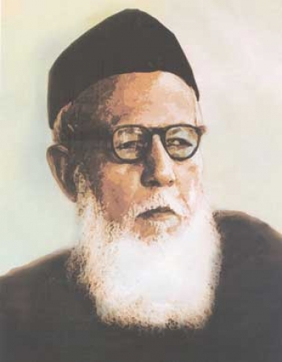

::: {dir="ltr" style="text-align: left;" trbidi="on"}
***লিখেছেনঃ** [ড. রহমতুল্লাহ ইমন](http://cms.bsu.edu/academics/collegesanddepartments/math/facultyandstaff/tenuretrackfaculty/imonrahmatullah)*
(লেখকের অনুমতি সাপেক্ষে [ফেসবুক টাইমলাইন](https://www.facebook.com/rahmatullah.imon/posts/10210176595624520) থেকে পুনঃপ্রকাশিত)

এলাকাভেদে একটি মূল ভাষার আঞ্চলিক ভাষায় বিভিন্নতা আসতেই পারে। কিন্তু একটি শাস্ত্রের ভাষা কি অঞ্চল ভেদে ভিন্ন হতে পারে? এমন বিরল ঘটনা ঘটেছে পরিসংখ্যানের ভাগ্যে। আপনি যদি অন্যতম প্রধান বাংলাভাষী অঞ্চল ভারতের পশ্চিম বাংলার কোন শিক্ষিত মানুষকে *পরিসংখ্যান* শব্দটি বলেন তবে নিশ্চিতভাবেই তিনি অবাক বিস্ময়ে আপনার মুখের দিকে চেয়ে রবেন। কেননা শব্দটি তাঁর কাছে খুব একট পরিচিত নয়। খুব অবাক হচ্ছেন তাই তো? কেমন শিক্ষিত লোক যে পরিসংখ্যান শব্দটি শুনেই হোঁচট খাচ্ছে? আচ্ছা, এবার যদি আমি আপনার কাছে রাশিবিজ্ঞান সম্বন্ধে জানতে চাই? আমি নিশ্চিত আপনাদের অনেকেই এবার একে অপরের সাথে মুখ চাওয়াচাওয়ি করছেন। অনেকেই হয়তো শব্দটি জীবনে প্রথমবারের মত শুনলেন। আর যারা আগে শুনেছেন তারাও খুব স্বস্তি বোধ করছেন না। অথচ শব্দটি পশ্চিম বাংলার কাউকে জিজ্ঞাসা করুন, সবাই বুঝে যাবেন যে এটা Statistics এর পরিভাষা। আমাদের দুই বাংলায় কেন দুটি ভিন্ন পরিভাষা ব্যবহৃত হচ্ছে এটা বুঝতে হলে বাংলায় পরিসংখ্যান চর্চার ইতিহাসটিও জেনে নিতে হবে।

অবিভক্ত ভারতবর্ষে পরিসংখ্যানের পঠন পাঠন প্রথম শুরু হয় কলকাতায়। ঢাকার বিক্রমপুরের কৃতী সন্তান প্রশান্ত চন্দ্র মহলানবিসকে বলা হয় ভারতের পরিসংখ্যানের জনক। পদার্থবিদ্যার ছাত্র মহলানবিস ইংল্যান্ডে উচ্চশিক্ষা নেবার সময় পরিসংখ্যানের জনক বলে খ্যাত স্যার রোনাল্ড ফিশারের সংস্পর্শে আসেন এবং বিষয়টির প্রতি আকৃষ্ট হয়ে পড়েন। পরবর্তীতে তিনি এই বিষয়টি আয়ত্ত করার জন্য আবারও ইংল্যান্ড যান। দেশে ফিরে তিনি প্রেসিডেন্সি কলেজে পদার্থবিদ্যায় অধ্যাপনা করলেও তাঁর ধ্যানজ্ঞান ছিল পরিসংখ্যান। ১৯৩১ সালে তিনি প্রতিষ্ঠা করেন পরিসংখ্যান পঠন পাঠন ও গবেষণায় বিশ্বের অন্যতম শ্রেষ্ঠ প্রতিষ্ঠান Indian Statistical Institute। মহলানবিস Statistics এর বাংলা করেন রাশিবিজ্ঞান এবং এভাবেই নতুন প্রতিষ্ঠানটির নাম হয় ভারতীয় রাশিবিজ্ঞান সংস্থা।

এই প্রতিষ্ঠান থেকেই ১৯৩৮ সালে রাশিবিজ্ঞানে ডিপ্লোমা করেন বাংলাদেশে পরিসংখ্যানের জনক বলে খ্যাত কাজী মোতাহার হোসেন। হোসেন ঢাকা বিশ্ববিদ্যালয়ে পদার্থবিদ্যার ছাত্র ছিলেন। এখানে পড়ার সময় তিনি বিশ্বখ্যাত পদার্থবিদ সত্যেন বোসের সংস্পর্শে আসেন। বোস হোসেনকে পরিসংখ্যান পড়তে উদ্বুদ্ধ করেন। তাঁরই অনুপ্রেরণায় হোসেন কলকাতায় এসে মহলানবিসের কাছে অধ্যয়ন করেন। ডিপ্লোমা শেষে তিনি ঢাকা বিশ্ববিদ্যালয়ে ফিরে এসে পরিসংখ্যান পঠন পাঠনে নতুন একটি বিভাগ প্রতিষ্ঠা করেন। এসময় তিনি রাশিবিজ্ঞান শব্দটির পরিবর্তে Statistics এর নতুন বাংলা নামকরণ করেন পরিসংখ্যান। পরবর্তীতে তিনি পরীক্ষণ নকশা (Design of Experiments) এর ওপর পিএইচডি ডিগ্রি অর্জন করেন, যার পরীক্ষক ছিলেন **স্যার রোনাল্ড ফিশার**। স্যার ফিশার হোসেনের শৃঙ্খলবদ্ধ নিয়ম (Hussin's Chain Rule) এই কাজটি দেখে এতই মুগ্ধ হয়েছিলেন যে উচ্ছ্বসিত কন্ঠে তাঁর প্রশংসা করেছেন এবং মন্তব্য করেছিলেন যে,

> হোসেন এমন কিছু কাজ করেছেন যা আমি নিজেও করতে পারতাম না।

প্রশান্ত চন্দ্র মহলানবিস ও কাজী মোতাহার হোসেন শুধু নামকরা পরিসংখ্যানবিদই ছিলেন না, তাঁরা দুজনেই ছিলেন বাংলা ভাষায় সুপণ্ডিত। মহলানবিস ছিলেন আচার্য জগদীশচন্দ্র বসু ও প্রফুল্ল চন্দ্র রায়ের সরাসরি ছাত্র এবং নেতাজি সুভাষ চন্দ্র বসু ও বিজ্ঞানী মেঘনাদ সাহার বন্ধু। তবে এ ক্ষেত্রে কিছুটা হলেও হয়তো এগিয়ে ছিলেন কাজী মোতাহার হোসেন। তিনি বিদ্রোহী কবি কাজী নজরুল ইসলামের ঘনিষ্ট বন্ধু ছিলেন। নজরুল মোতাহারকে আদর করে বলতেন 'মোতি হার'। সাহিত্যে হোসেনের দক্ষতা দেখে **নজরুল মন্তব্য করেছিলেন** যে,

>  মোতিহার যদি বিজ্ঞান চর্চা না করে সাহিত্যচর্চা করতেন তাহলে কবি সাহিত্যিকদের ভাত মারা যেত। 

কাজী মোতাহার হোসেন কাজী আব্দুল ওদুদ, সৈয়দ আবুল হোসেন ও আবুল ফজলের সাথে মিলে ১৯২৬ সালে "মুসলিম সাহিত্য সমাজ" গড়ে তোলেন। এই সংগঠনের পক্ষ থেকে তিনি কিছুকাল *শিখা* নামক পত্রিকা সম্পাদনা করেন। তিনি ছিলেন বাংলা একাডেমির একজন অন্যতম প্রতিষ্ঠাতা। কাজী মোতাহার হোসেন বিজ্ঞান, সাহিত্য, সংস্কৃতির উপর অনেক বই ও প্রবন্ধ লিখেছেন। তাঁর লেখা বইগুলোর মধ্যে সঞ্চয়ন, নজরুল কাব্য পরিচিতি, সেই পথ লক্ষ্য করে, প্লেটোর সিম্পোজিয়াম, গণিত শাস্ত্রের ইতিহাস, পরিসংখ্যান শব্দকোষ, আলোক বিজ্ঞান, নির্বাচিত প্রবন্ধ অন্যতম।

  ------------------------------------------
       
   বহু প্রতিভার অধিকারী কাজী মোতাহার হোসেন 
  ------------------------------------------

::: {style="text-align: center;"}

:::

বাংলা ভাষার ওপর তাঁর এতটাই দখল ছিল যে তাঁকে বাংলা বানান ও লিপি সংস্কার কমিটির সদস্য করা হয়েছিল। অসাম্প্রদায়িক ধ্যান ধারণায় বিশ্বাসী এবং সেই আলোকে দেশের শিক্ষা, সাহিত্য ও সংস্কৃতির সুদৃঢ় ভিত গড়ে তোলার জন্য তিনি লেখনী পরিচালনা করেন। বাংলাকে রাষ্ট্রভাষা করার পক্ষে বিভিন্ন কর্মকাণ্ডের মাধ্যমে গুরুত্বপূর্ণ ভূমিকা পালন করেন। শিক্ষার সর্বস্তরে বাংলা ভাষা চালুর দাবীতে পঞ্চাশ ও ষাটের দশকে পূর্ব বাংলায় যে আন্দোলন গড়ে উঠেছিল তিনি ছিলেন তার একজন দৃঢ় পৃষ্ঠপোষক। বক্তৃতা, বিবৃতি ও প্রবন্ধাদি প্রকাশ করে এ সব আন্দোলনে গতিদান করেন। ১৯৬১ সালে প্রতিক্রিয়াশীল বুদ্ধিজীবীদের বিরোধিতার মুখে ঢাকায় রবীন্দ্র জন্মশত বার্ষিকী পালনে সাহসী ভূমিকা পালন করেন তিনি। ১৯৬৭ সালে পাকিস্তানের শাসকগোষ্ঠী বাঙালি সংস্কৃতি খর্ব করার জন্য রেডিও টেলিভিশন থেকে রবীন্দ্রসঙ্গীত প্রচার বন্ধের যে পদক্ষেপ নিয়েছিল তার বিরুদ্ধেও তীব্র প্রতিবাদ জ্ঞাপন করেন।

বহুমুখী প্রতিভার অধিকারী কাজী মোতাহার হোসেন ছিলেন একজন আন্তর্জাতিক খ্যাতিসম্পন্ন দাবা খেলোয়াড়। বাংলাদেশে দাবা খেলার পথিকৃৎ হিসেবে তাকে সম্মানিত করা হয়। উপমহাদেশের অন্যতম শ্রেষ্ঠ দাবাড়ু হিসেবে ১৯২৯ থেকে ১৯৪৭ পর্যন্ত অবিভক্ত বাংলা এবং ১৯৪৮ থেকে ১৯৬০ পর্যন্ত পাকিস্তানে একক চ্যাম্পিয়ন ছিলেন তিনি। দাবা খেলায় তার অনন্য অবদানের কথা স্মরণ করে বাংলাদেশ দাবা ফেডারেশনের উদ্যোগে কাজী মোতাহার হোসেন স্মৃতি আন্তর্জাতিক দাবা প্রতিযোগিতা নিয়মিতভাবে অনুষ্ঠিত হয়।

প্রশান্ত চন্দ্র মহলানবিস Statistics এর বাংলা করেন রাশিবিজ্ঞান। কাজী মোতাহার হোসেন এই অনুবাদটি গ্রহণ করেননি। না, এখানে ব্যক্তিগত বিরোধের কোন অবকাশ ছিল না, বরং তাঁদের পারস্পরিক আন্তরিকতার কথাই ছিল সর্বজনবিদিত। হোসেন ভাবতেন রাশিবিজ্ঞান শব্দটি দিয়ে Statistics কে পরিপূর্ণ ভাবে বোঝানো সম্ভব হয় না। রাশিবিজ্ঞান শব্দটির আক্ষরিক ইংরেজি করলে তা হয় Data Science। Data Science হাল আমলে Statistics এর একটি অতি গুরুত্বপূর্ণ শাখা হিসেবে বিবেচিত হচ্ছে। কিন্তু তার ব্যাপ্তি Statistics এর মতো ব্যাপক নয়। আর সেকারণেই হোসেন একটি নতুন বাংলা শব্দের উদ্ভব করেন। **পরি+সংখ্যা+অনট(অন) = পরিসংখ্যান** অর্থাৎ সংখ্যা সম্পর্কিত বিজ্ঞান।

পরিসংখ্যান শুধুমাত্র সংখ্যা নিয়ে কাজ করে না, কিন্তু যখন বলা হয় সংখ্যা সম্পর্কিত বিজ্ঞান তখন তার ব্যাপ্তি Statistics কে ধারণ করে। যা হোক, আমাদের দুই বাংলায় Statistics এর পরিভাষা হিসেবে রাশিবিজ্ঞান ও পরিসংখ্যান শব্দ দুটির ব্যবহার লক্ষ্য করা গেলেও আন্তর্জাতিক মহলে পরিসংখ্যান শব্দটিই স্বীকৃতি লাভ করেছে। আন্তর্জাতিক পরিসংখ্যান সংস্থা (International Statistical Institute) ২০১০ সালে বিভিন্ন ভাষায় Statistics শব্দটির যে তালিকা প্রকাশ করেছে তাতে Statistics এর পরিভাষা হিসেবে পরিসংখ্যানকে ব্যবহার করা হয়েছে। আমাদের পশ্চিম বাংলার অনেক বন্ধুকেই আজকাল দেখছি পরিসংখ্যান শব্দটি ব্যবহার করতে। না, শুধুমাত্র বিতর্ক সৃষ্টির জন্য নয়, অর্থের বিচারেই একদিন Statistics এর পরিভাষা হিসেবে পরিসংখ্যান ফিরবে সবার মুখে মুখে।

***লেখকঃ** অধ্যাপক, ম্যাথেম্যাটিক্যাল সায়েন্সেস,  [Ball State University](http://cms.bsu.edu/)*। 
:::
