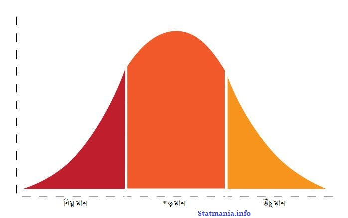

::: {dir="ltr" style="text-align: left;" trbidi="on"}
*লিখেছেনঃ [ড. রহমতুল্লাহ ইমন](../authors/stat-mania.html)*
(লেখকের অনুমতি সাপেক্ষে ফেসবুক থেকে পুনঃপ্রকাশিত)

এ জগতে কত রকম পিতাই তো আছেন। আপনি হতে পারেন সন্তানের জন্মদাতা পিতা, পালক পিতা, দত্তক পিতা, স্ত্রীর সন্তান সেই সূত্রে পিতা সাধারণ ভাষায় যাকে বলে সৎ পিতা। আবার যারা একটি জাতির মাঝে জাতিসত্ত্বার জন্ম দিয়ে থাকেন তাঁদের বলা হয় জাতির পিতা। এমনকি এই জগতের যিনি অধীশ্বর তাঁকেও বলা হয় জগৎ পিতা। কিন্তু এত পিতার ভিড়েও কেউ কখনো পরিসংখ্যানিক পিতা (statistical father) এই শব্দটি শুনেছেন কি?

যত রকম পিতাই থাকুক না কেন পিতা বলতে জন্মদাতা পিতাকেই বোঝানো হয়ে থাকে। পিতা হবার আনন্দ, উত্তেজনা আর তৃপ্তি যে কতটা তা যারা বাবা না হয়েছেন তাদের বোঝানো বেশ কষ্টের। তবে এ মধুর তৃপ্তি বেদনায় পর্যবসিত হয়ে যায়, যখন সন্তানের পিতৃত্ব নিয়ে সন্দেহ সংশয় জাগে পিতার মনে। হাল জামানায় ডিএনএ বা আরও অনেক পরীক্ষার মাধ্যমে পিতৃত্ব নিশ্চিত করা যায় কিন্তু অতীতে বিষয়টি এত সহজ ছিল না।

মূল ঘটনায় আসি। সময়কাল ১৯৪৬। ব্রিটিশ সেনাবাহিনীর মেজর হ্যাডলাম তাঁর স্ত্রীকে তালাক দেবার অভিপ্রায়ে আদালতে এক মামলা ঠুকে দিলেন। হ্যাডলাম দ্বিতীয় বিশ্বযুদ্ধে অংশ নিয়েছিলেন। যুদ্ধে যাবার ৩৪৯ দিন পর তাঁর স্ত্রী একটি সন্তানের জন্ম দেন। সাধারণভাবে একটি সন্তান জন্মানোর সময়কাল ৯ মাস ১০ দিন অর্থাৎ ২৮০ দিন। সেক্ষেত্রে ৩৪৯ দিনের ব্যবধান মেজর হ্যাডলামের কাছে খুবই দীর্ঘ মনে হয় এবং তিনি সন্দেহ প্রকাশ করেন যে তিনি এই সন্তানের জনক নন।

দীর্ঘ শুনানি শেষে বিচারক অভিমত দেন যে ৩৪৯ দিনের ব্যাবধান দীর্ঘ হলেও অসম্ভব নয়। আর সে কারণে তিনি মেজর হ্যাডলামের আবেদনটি খারিজ করে দেন। এর কিছুদিন পর আরেকজন ব্রিটিশ মেজর একই রকম অভিযোগ নিয়ে দ্বারস্থ হন আরেকটি আদালতে। এক্ষেত্রে মেজর তার স্ত্রীকে ছেড়ে গিয়েছিলেন ৩৪০ দিন আগে। এক্ষেত্রে অবশ্য বিচারক সন্তান জন্মের জন্য ৩৪০ দিন অবিশ্বাস্যরকম দীর্ঘ বিবেচনায় মেজরকে অনুমতি দেন বিবাহ বিচ্ছেদের। আরেকটি মামলায় এক ব্যক্তি স্ত্রীকে ত্যাগ করার অনুমতি পান যেখানে ব্যবধান ছিল ৩৩১ দিনের।

বিবাহ বহির্ভূত প্রেম, পরকীয়া, অবৈধ সন্তানের জন্ম এসব চটকদার ঘটনা সবসময়েই মিডিয়ার কাছে বাড়তি আকর্ষণ লাভ করে থাকে। ব্রিটিশ সংবাদপত্রের পাতার বড় অংশ জুড়ে স্থান পেতে থাকে এসব 'চাটনি' খবর। সেই সাথে আরেকটি শব্দ খুবই জনপ্রিয় হয়ে ওঠে- বহির্মান বা outlier। পরিসংখ্যানের পরিভাষায় একেবারেই অস্বাভাবিক মানের কোনো উপাত্তকে বলা হয় বহির্মান। সন্তান জন্ম দেবার সময় হিসেবে এই ৩৩১ দিন, ৩৪০ দিন, ৩৪৯ দিন বহির্মান কি না এই প্রশ্নগুলো উঠতে থাকে ব্রিটিশ সংবাদপত্রের পাতায় পাতায়। আর এর মাধ্যমেই বহির্মান শব্দটি জনপ্রিয় হয়ে উঠতে থাকে।

জনান্তিকে বলে রাখি বার্মিংহাম বিশ্ববিদ্যালয়ে আমার পি এইচ ডি গবেষণার মূল প্রতিপাদ্যই ছিল এই সব বহির্মান সনাক্তকরণ এবং এর প্রতিকার। আর সে কারণেই এই অধম রহমতউল্লাহ ইমন হ্যাডলাম মিঞা বিবি এবং অন্যান্য যুধ্যমান দম্পতিদের কাছে ঋণী।

আবার মূল গল্পে ফেরা যাক। সময়টা দ্বিতীয় বিশ্বযুদ্ধের অব্যবহিত পরে। হাজার হাজার সৈন্য গিয়েছেন যুদ্ধে- তাদের অনেকের স্ত্রীই সন্তান জন্ম দিয়েছেন। কেউ কেউ হয়তো বেশ দেরিতে। এই নিয়ে সৃষ্টি হচ্ছে সন্দেহ, অবিশ্বাস। মামলার পর মামলা আসছে আদালতে আর যেহেতু বিচারবোধ ছাড়া পিতৃত্ব নির্ধারণের কোনো স্বীকৃত পথ জানা নেই বিচারকেরাও দিয়ে যাচ্ছেন একের পর এক সাংঘর্ষিক রায়। আর এগুলো সামলাতে হিমশিম খাচ্ছেন আপিল আদালত।

এক মামলার রায় অন্য মামলায় রেফারেন্স হিসেবে ব্যবহৃত হয়। ৩৩১ দিন যদি সন্তান জন্ম দেবার ক্ষেত্রে অস্বাভাবিক ব্যবধান হয় তবে ৩৪৯ দিন স্বাভাবিক হয় কীভাবে? উপায়ন্তর না দেখে ব্রিটিশ কোর্ট অফ জাস্টিস শরণাপন্ন হলেন ব্রিটিশ মেডিক্যাল অ্যাসোসিয়েশন এবং রয়্যাল স্ট্যাটিসক্যাল সোসাইটির। পিতৃত্ব নির্ণয়ের একটি গ্রহণযোগ্য পদ্ধতি খুঁজে বের করতেই হবে।

শুরু হল দক্ষ যজ্ঞ। ১৯৫০ সালে ব্রিটিশ মেডিক্যাল অ্যাসোসিয়েশন এবং রয়্যাল স্ট্যাটিসক্যাল সোসাইটি সন্তানসম্ভবা ১৩,৬৩৪ জন মহিলাকে নিবিড় পর্যবেক্ষণে রেখে তাদের সন্তান জন্মের সময় নির্ধারণ করলেন। পরিসংখ্যানবিদদের জন্য বিশেষ সন্তোষের কারণ ছিল এই যে জন্মসময়গুলো একটি আয়তলেখ (histogram) এর মাধ্যমে উপস্থাপন করলে দেখা গেল এটি পরিমিত নিবেশন (normal distribution) এর রূপ নিয়েছে। আয়তলেখের ঠিক কেন্দ্রেই ছিল গড় মান ৪০ সপ্তাহ বা ২৮০ দিন। আর এ কথাও অনেকেরই জানা যে উপাত্ত যখন পরিমিত নিবেশনে বিন্যস্ত থাকে তখন গড় থেকে ৩ পরিমিত ব্যবধান (standard deviation) নিয়ে কোন সীমানা নির্ধারণ করলে তা উপাত্তের ৯৯.৭% অর্থাৎ প্রায় পুরোটাই ধারণ করে থাকে।

  --------------------------------------
     
   পরিমিত নিবেশন বা বেল কার্ভের চেহারা।
  --------------------------------------

সন্তান জন্মের গড় সময়কালের সাথে ৩ পরিমিত ব্যবধান বিস্তার নিলে তা ৩৬০ দিন পর্যন্ত বিস্তৃত হতে পারে। পরিসংখ্যানের এই তত্ত্বের ওপর ভিত্তি করেই হাউজ অফ লর্ডস ১৯৫১ সালে আইনজারি করে দিলেন যে স্বামী-স্ত্রীর মিলনের ৩৬০ দিনের মধ্যে যেসব শিশুর জন্ম হবে স্বামীকে সেই শিশুর পিতৃত্ব মেনে নিতে হবে। ডি এন এ পদ্ধতিতে সন্তানের পিতৃত্ব নির্ধারণের রীতি চালু হবার আগ পর্যন্ত এটাই ছিল সন্তানের পিতৃত্ব নির্ধারণের আইনগত পন্থা। মনে যত দ্বিধা দ্বন্দ্বই থাকুক না কেন সন্তানের পিতৃত্ব আপনাকে স্বীকার করে নিতেই হবে। বাস্তবে যাই হোক না কেন পরিসংখ্যানের মাধ্যমে বনে যাওয়া এসব পিতাদের ক্ষেত্রে তখন এক বিশেষ অভিধা জুটেছিল- পরিসংখ্যানিক পিতা।

***লেখকঃ** অধ্যাপক, ম্যাথেম্যাটিক্যাল সায়েন্সেস, বল স্টেট ইউনিভার্সিটি। *

**আরও পড়ুনঃ**
☛ [বেল কার্ভের জাদু](2016-12-bell-curve.html)
:::
