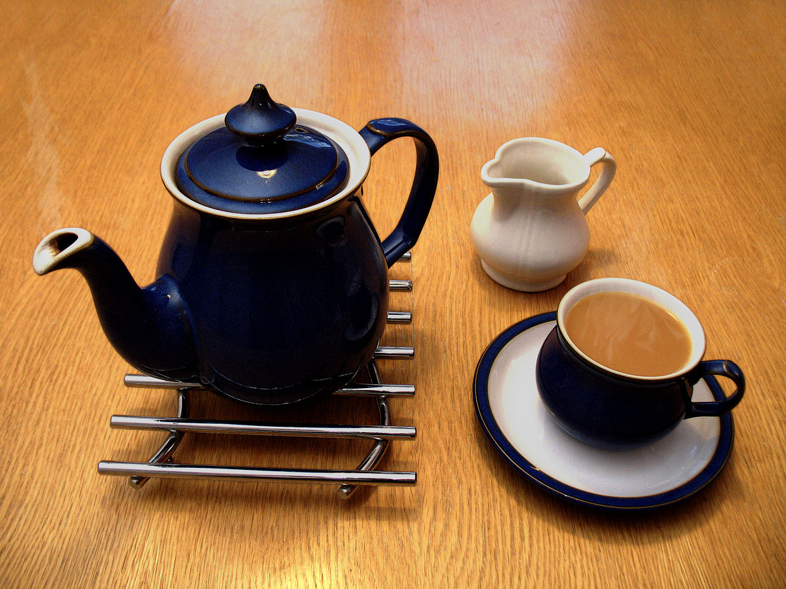
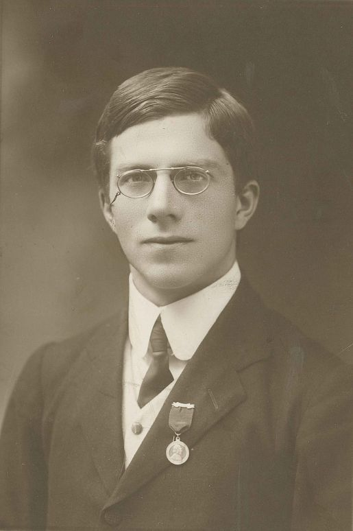

::: {dir="ltr" style="text-align: left;" trbidi="on"}
*লিখেছেনঃ [ড. রহমতুল্লাহ ইমন](../authors/stat-mania.html)*

[আচ্ছা](https://www.facebook.com/rahmatullah.imon/posts/10210450360348467), আপনি কি এক কাপ চায়ে চুমুক দিয়েই বলে দিতে পারেন সেখানে আগে চা ঢেলে পরে দুধ মেশানো হয়েছে না আগে দুধ ঢেলে পরে কেতলি থেকে ঢালা হয়েছে চা? খুব কঠিন একটি ব্যাপার নিঃসন্দেহে। অথচ এমন দক্ষতা আছে- এই দাবি করে জগদ্বিখ্যাত হয়ে আছেন একজন মহিলা। না, এটা তাঁর দক্ষতার গুণে নয়, তাঁর এই দাবির সত্যতা প্রমাণ করতে গিয়ে সৃষ্টি হয়েছে পরিসংখ্যানের অন্যতম প্রধান একটি শাখা- পরীক্ষণ নকশা (design of experiments)।

::: {.separator style="clear: both; text-align: center;"}
:::

::: {.separator style="clear: both; text-align: center;"}

:::

১৯১৯ সালের কথা। পরিসংখ্যানের জনক বলে খ্যাত স্যার রোনাল্ড ফিশার তখন গবেষণা করছেন রথামস্টেড গবেষণা কেন্দ্রে। একদিন সকালে চা খাচ্ছেন এমন সময় সেখানে হাজির হল এক তরুণী। নাম তার মুরিয়েল ব্রিস্টল। মনোবিজ্ঞান বিষয়ে পিএইচডি করছে। ফিশারকে চা খেতে দেখেই সে বলে উঠল আমি কিন্তু চায়ে চুমুক দিয়েই বলে দিতে পারি কাপে আগে চা ঢেলে পরে দুধ মেশানো হয়েছে না আগে দুধ ঢেলে পরে চা ঢালা হয়েছে।

ফিশার তখনই কিছু বললেন না, কিন্তু বিষয়টা তাঁর মাথায় ঘুরপাক খেতে লাগল। মেয়েটির সত্যিই কি এমন দক্ষতা রয়েছে না এটা শুধু বাত কি বাত। তিনি মেয়েটিকে পরীক্ষা করার সিদ্ধান্ত নিলেন। কিন্তু কীভাবে পরীক্ষা করা হবে? এর জন্য চাই একটি ছক বা নকশা। তিনি ৮ কাপ চা বানালেন। ৪ কাপে আগে ঢাললেন দুধ আর বাকি ৪ কাপে আগে ঢাললেন চা। এবার তিনি কাপগুলো এলোমেলো করে সাজালেন যাতে মুরিয়েল বুঝে উঠতে না পারে কোন কাপ চা কীভাবে বানানো হয়েছে। এই এলোমেলো করে সাজানো কাপ থেকেই দৈবায়ন (randomness) এর ধারণাটি এসেছিল।

  --------------------------------------------------------------------------------------------------------------------------------------------------------------------------------------------------------------------------------------------------------------------------------------------------------------------------------------------------
                                                                                                                                                           
   *পরিসংখ্যানবিদ রোনাল্ড ফিশার। ১৯৩১ সালের ছবি।* **সূত্রঃ** [ম্যাথব্লগ ডট অর্গ](https://www.google.com/url?sa=i&rct=j&q=&esrc=s&source=images&cd=&cad=rja&uact=8&ved=0ahUKEwjY3Z6R2PXWAhUEK48KHV5SDNUQjhwIBQ&url=https%3A%2F%2Fmathblog.com%2Fseparating-the-math-and-the-mathematician%2F&psig=AOvVaw3u9Wrvbw52Q5LeMlvVcgPY&ust=1508261953990134)
  --------------------------------------------------------------------------------------------------------------------------------------------------------------------------------------------------------------------------------------------------------------------------------------------------------------------------------------------------

তো, মুরিয়েলকে বলা হলো, মুরিয়েল সেখান থেকে ৪ কাপ চা পান করবে এবং বলবে কোন কাপ চা কীভাবে বানানো হয়েছে। এখন প্রশ্ন হল কত কাপ চা সঠিকভাবে বানানো হয়েছে বলতে পারলে ফিশার মুরিয়েলের দাবি মেনে নেবেন? ৪ কাপই সঠিক বলতে পারলে তো কোনো কথাই নেই, কিন্ত এর থেকে কম হলেও ফিশার তা মেনে নেবেন কেননা তিনি যে পরীক্ষণটিকে সেভাবেই সাজিয়েছেন। ৮ কাপ চা থেকে ৭০ ভাবে ৪ কাপ চা চয়ন করা যায়। আর প্রতি ক্ষেত্রেই মুরিয়েলের উত্তর হয় সঠিক হবে অথবা ভুল হবে। অর্থাৎ এখানে দুটি মাত্র সম্ভাবনা আছে। মুরিয়েলের উত্তর ৪টিই ভুল হতে পারে, হতে পারে ১টি ঠিক ৩টি ভুল, ২টি ঠিক ২টি ভুল, ৩টি ঠিক ১টি ভুল, অথবা ৪টিই সঠিক।

পরিসংখ্যানের ছাত্রছাত্রীরা কিন্তু এর মাঝেই একটি বিষয় ধরে ফেলেছেন। আর তা হল মুরিয়েলের উত্তরকে একটি দ্বিপদী নিবেশনে (binomial distribution) বিন্যস্ত করা যায়। সেই সাথে এই কথাটিও বলে রাখা দরকার যে এর আগে পরিসংখ্যানে [পরিমিত নিবেশনের](2016-12-bell-curve.html) ব্যবহার হয়েছে, ব্যবহার হয়েছে কাই-বর্গ, স্টুডেন্টের t, কিন্তু ফিশারই প্রথম পরিসংখ্যানে দ্বিপদী নিবেশনের ব্যবহার ঘটালেন এমন মজার এক সমস্যার সমাধান করতে গিয়ে।

মুরিয়েলের সম্ভাব্য উত্তরগুলির বিন্যাস কেমন হতে পারে তা সাজালেন ফিশার নীচের এই ছক অনুসারে।
**\[দ্রঃ × = উত্তর ভুল হয়েছে এবং √ = উত্তর সঠিক হয়েছে\] **

  সঠিক উত্তরের সংখ্যা   বিন্যাসের ধরন                              ঘটন সংখ্যা
  --------------------- ------------------------------------------ ------------
  ০                     ××××                                       ১×১ = ১
  ১                     ×××√, ××√×, ×√××, √×××, ...               ৪×৪ = ১৬
  ২                     ××√√, ×√×√, ×√√×, √×√×, √√××, √××√, ...   ৬×৬ = ৩৬
  ৩                     ×√√√, √×√√, √√×√, √√√×, ...               ৪×৪ = ১৬
  ৪                     √√√√                                       ১×১ = ১
                        মোট                                        ৭০

সাধারণভাবে আমরা কোনো সম্ভাবনা ৫% এর নীচে নেমে গেলে তা অগ্রহণযোগ্য বলে বিবেচনা করি। এখানে অন্তত ১ কাপ চা সঠিকভাবে বলতে পারার সম্ভাবনাই (১৭/৭০=) ২৪.৩%। তাই ফিশার মুরিয়েলকে বললেন যে সে যদি এক কাপ চায়ের কথাও সঠিকভাবে বলতে পারে তবে তিনি মুরিয়েলের এই বিশেষ ক্ষমতার কথা মেনে নেবেন। বাস্তবে যা হয়েছিল তা হল মুরিয়েল শুধু যে নির্বাচিত ৪ কাপের কথাই সঠিকভাবে বলেছিল তাই নয়, সে একে একে ৮ কাপ চা-ই পান করেছিল এবং তার সবগুলো উত্তরই ছিল সঠিক। অবিশ্বাস্য!

ড. মুরিয়েল ব্রিস্টল কীভাবে এই অদ্ভুত ক্ষমতা অর্জন করেছিলেন তা নিয়ে অনেকের কৌতূহল থাকলেও শেষ অবধি এই ঘটনা পরিসংখ্যানের জগতে এক মাইলফলক হয়ে রইল। পরিসংখ্যানের রত্নভান্ডারে যুক্ত হল পরীক্ষণ নকশার মত এক মাণিক্যের।

*\[লেখক: অধ্যাপক, গাণিতিক বিজ্ঞান বিভাগ, বল স্টেট ইউনিভার্সিটি, যুক্তরাষ্ট্র\] *
:::
