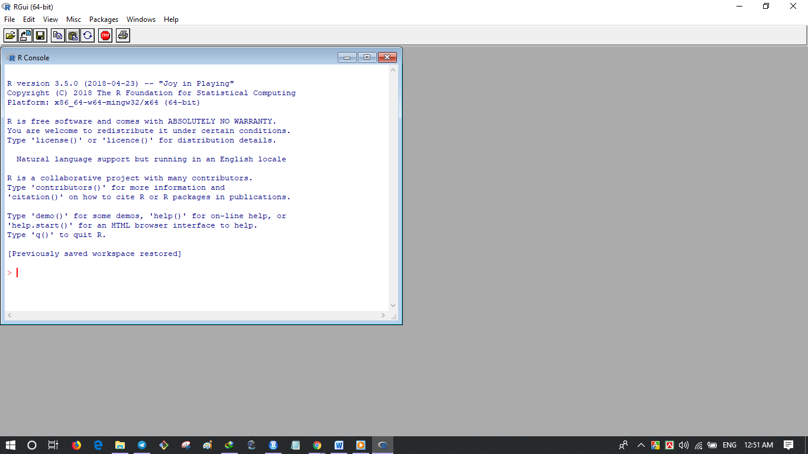
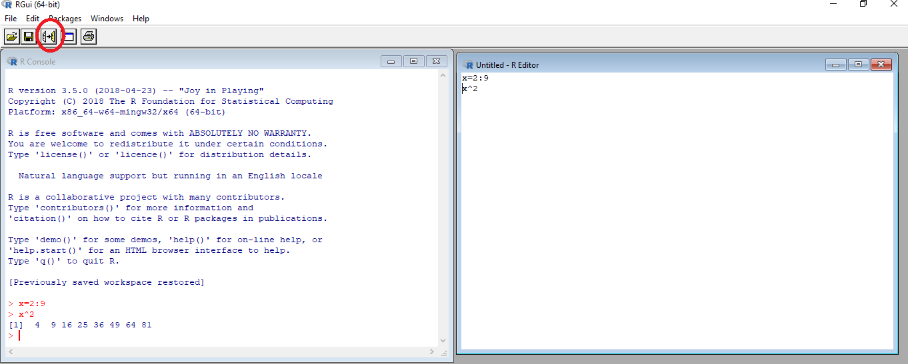
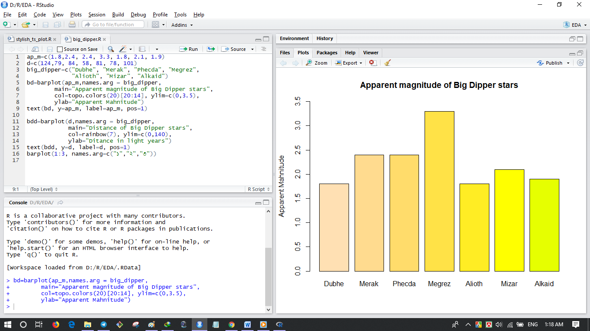

::: {dir="ltr" style="text-align: left;" trbidi="on"}
R প্রোগ্রামিংকে বলা হয় সকল কাজের কাজী। পরিসংখ্যান ও ডেটা সায়েন্স এর কাজের জন্যে এর যাত্রা শুরু হলেও প্রতিনিয়ত এর ব্যাবহারের পরিসর বেড়েই চলছে। R দিয়ে কত কী করা যায় তার মোটামুটি একটা তালিকা [এখানে পাওয়া যাবে](https://cran.r-project.org/web/views/)। আর [এখানে পাওয়া যাবে বড় বড় প্রতিষ্ঠানে](https://www.listendata.com/2016/12/companies-using-r.html) কারা কী কাজে R প্রোগ্রামিং ব্যাবহার করেন তার তথ্য।

**আরও পড়ুন**
☛ [কেন শিখবেন R প্রোগ্রামিং?](https://www.statmania.info/2018/05/r-for-data-science.html)

::: {.separator style="clear: both; text-align: center;"}

:::

**R প্রোগ্রামিং ইনস্টলেশন**
R এর ওয়েবসাইট থেকে প্রথমে সফটওয়্যারটি ডাউনলোড করে নিন। R যেহেতু ওপেনসোর্স সফটওয়্যার, তাই আপনাকে কোনো টাকা-পয়সা খরচ করতে হবে না। প্রথমবারের মতো ডাউনলোড করতে চাইলে [এই লিঙ্কটি](https://cran.r-project.org/bin/windows/base/) ব্যবহার করলে সুবিধা হবে।
ডাউনলোড হওয়া ফাইল ইনস্টল করে এমন একটি উইন্ডো দেখতে পাবেন।

  ----------------------------------------------------------------------------------------------------------------------------------------------------------------------------------------------------------------------------------------------------------------------------------
                                                                                                                           
   R প্রোগ্রামিং ইন্টারফেস। বড় করে দেখতে [ক্লিক করুন](https://blogger.googleusercontent.com/img/b/R29vZ2xl/AVvXsEiDYNgMU_cZ_1D1b74ovO1VEZPL3-rPV4GB6f52Dmoryf6M0i2bQAao4G1ZpX-fV5AbNe04ZuIntAX8Z9FhkwVPdasVtbJ8QHDT_x9_yVHM9PZuRCFfYqP5fEEthjpiFp7xp6B2IL771AA/s1600/r-window.png) 
  ----------------------------------------------------------------------------------------------------------------------------------------------------------------------------------------------------------------------------------------------------------------------------------

এবার কোড লিখে লিখে enter বাটন চাপলেই কোড সাথে সাথে রান হয়ে যাবে।
যেমন
1+2 লিখে enter দিলেই দেখাবে 3।
বেসিক কাজগুলো এভাবে enter লিখে লিখেই করা যায়।

আরও ভালোভাবে করতে হলে ওপরের মেনু বার থেকে File \> New script অংশে ক্লিক করুন। এবার এখানে কোড লিখতে থাকুন। এন্টার চাপলেও কোড রান হবে না। রান করতে হলে কন্ট্রোল এবং R বাটন এক সাথে চাপুন (ctrl+R)। যে লাইনে মাউসের কার্সর থাকবে সে লাইন রান হবে এতে। একাধিক লাইন রান করতে হলে মার্ক/হাইলাইট করে ctrl+R চাপতে হবে।

  -------------------------------------------------------------------------------------------------------------------------------------------------------------------------------------------------------------------------------------------------------------
                                                                                                                
   বড় করে দেখতে [ক্লিক করুন](https://blogger.googleusercontent.com/img/b/R29vZ2xl/AVvXsEhw_ddfxmA3fRo4z76ZhHdq-Fu3_fukaPtKeJJjpW7W_1Zlg1_AAREB1cgU8Euc8aWFKouYZpZegDQlLT9axPuL30cAAkATvXyk51YcFUKPPKtULiD5pNvTGKn1io2yu0nES0v3eyFbVB8/s1600/r-script-use.png) 
  -------------------------------------------------------------------------------------------------------------------------------------------------------------------------------------------------------------------------------------------------------------

আবার ওপরের লাল চিহ্নিত বাটনে ক্লিক করেও রান করা যাবে।

কিছু সময় প্রোগ্রামিং করার পর চাইলে স্ক্রিপ্টটা সেভ করে রাখতে পারেন।
☛ File \> Save / Save as
অথবা ctrl + S চাপুন।

আবার আগে করা কাজও শুধু শুধু আবার না করে লোড করে নিতে পারেন।
☛ File \> Open script...

**RStudio**
তবে প্রোগ্রামিং এর কাজগুলো আরও দারুণভাবে গুছিয়ে করতে হলে আপনাকে RStudio ব্যবহার করতেই হবে। এটাও ওপেনসোর্স সফটওয়্যার। [নিয়ে নিন এখান](https://www.rstudio.com/products/rstudio/download/) থেকে।

::: {.separator style="clear: both; text-align: center;"}

:::

এটায়ও বেসিক R এর মতো সব করা যাবে। তবে বাড়তি পাওয়া যাবে অনেক অনেক কিছু। সেটা ব্যবহার করতে করতেই বুঝতে পারবেন।
:::
