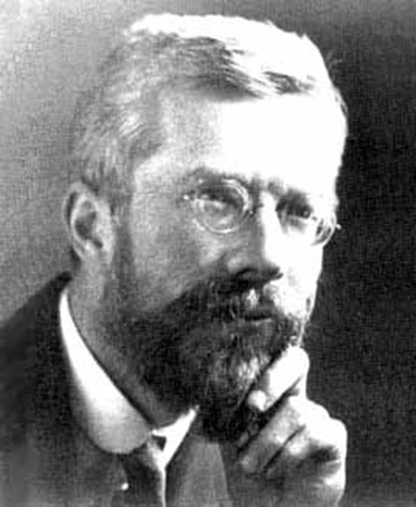

::: {dir="ltr" style="text-align: left;" trbidi="on"}
*লিখেছেনঃ [তোফায়েল আজম](http://www.statmania.info/search/label/azam?max-results=9)*

ঢাকা বিশ্ববিদ্যালয়ের পরিসংখ্যান বিভাগের ছাত্র ও অ্যালামনাইদের কাছে অন্যতম শ্রদ্ধার নাম [কাজী মোতাহার হোসেন](http://www.statmania.info/2017/09/qazi-motahar-hossain.html) স্যার। বাংলাদেশে পরিসংখ্যানের ভিত্তি স্থাপন থেকে শুরু করে পরিসংখ্যানে গবেষনার প্রবাদ পুরুষ হিসেবেই তাকে সবাই শ্রদ্ধার চোখে দেখি।

বাংলাদেশে পরিসংখ্যানের প্রবর্তক মোতাহার হোসেন স্যারের সাথে আধুনিক পরিসংখ্যান বিদ্যার জনক রোনাল্ড ফিশার এর অদ্ভুত মিল। দুইজনই মারাত্মক ব্রিলিয়ান্ট। এতে কোন সন্দেহ কখনো কেউ প্রকাশ করতে পারেনি। অল্প বয়েস থেকেই দুজনই গাণিতিক দৃষ্টির ব্রিলিয়ান্ট ছিলেন।

**☛ আরও পড়ুনঃ**
[রাশিবিজ্ঞান, পরিসংখ্যান ও কাজী মোতাহার হোসেন](http://www.statmania.info/2017/09/qazi-motahar-hossain.html)

  ----------------------------------
   
            রোনাল্ড ফিশার 
  ----------------------------------

দুজনের মধ্যে সবচেয়ে বড়ো মিল ছিল- দুজনই পদার্থবিজ্ঞানের লোক ছিলেন। ঢাকা বিশ্ববিদ্যালয়ে ছিলেন কাজী মোতাহার হোসেন স্যার আর ক্যাম্ব্রিজের এস্ট্রনমির গ্র্যাজুয়েট ছিলেন আর এ ফিশার (১৮৯০-১৯৬২) । পদার্থবিজ্ঞান নিয়ে কাজ করার সময়টায় দুজনই সংখ্যা নিয়ে গবেষণার প্রয়োজনীয়তা অনুভব করেন। ফিশার মশাই উনার জীবনের প্রথম যে পেপার পাবলিশ করেন সেটা স্বাভাবিক ভাবেই ছিল আধুনিক পরিসংখ্যানের জন্য অন্যতম ধাপ- Method of maximum likelihood।

Fisher এরপর কাজ করতে থাকেন W. S. Gosset এর সাথে। বিষয়- Equation of Standard Deviation। এই গবেষণা করতে গিয়েই তিনি Sample mean আর Population mean এর মাঝে দৃশ্যমান পার্থক্যকে গানিতিক ও গঠনমুলক রুপ দান করেন। পরিসংখ্যানের বাস্তব ব্যাবহার নিয়ে এরপর কাজ করতে থাকেন মুলত ছোট ছোট Sample নিয়ে। তখন তিনি Degrees of freedom এর সঙ্গায়ন করেন এবং আরো গভীর গবেষণায় হাত দেন।

ফিশার ব্যক্তিগত ভাবে মারাত্মক গোঁয়ার আর কাজের বেলায় ছিলেন পারফেকশনিস্ট। ভুল করার অপছন্দ থেকেই আরো জোরেসোরে কাজ শুরু করেন সংখ্যান নানান দিক নিয়ে।

১৯১৪ সালে আর্মিতে যোগ দেয়ার জন্য চেষ্টা করেন। কিন্তু ছোটবেলা থেকেই দৃষ্টিত্রুটিতে ভোগা ফিশার আর্মি থেকে রিজেক্টেড হবার পর হাই স্কুলে অংক ও পদার্থ বিজ্ঞান নিয়ে পড়ানো শুরু করার সময় পরিসংখ্যানে চালিয়ে যাওয়া কাজ তখনকার সময়ের বিখ্যাত পরিসংখ্যানবিদ কার্ল পিয়ারসনের নজরে আসেন। ১৯১৭ সালে পিয়ারসন পেপার পাবলিশ করেন ফিশারের কাজের উপর। মূলত ফিশারের method of maximum likelihood এর সমালোচনা সম্বলিত। অল্প নাম ওয়ালা ফিশার বিখ্যাত পিয়ারসনের সমালোচনার জবাব দেন কিন্তু পিয়ারসন তাতে তেমন গা না দিয়ে ফিশারের পরবর্তী অনেক থিওরী ও গবেষণাকে প্রত্যাখ্যান করেন।

সেই সময়টায় ফিশার সংখ্যার এই জগতটায় বাচ্চা, কিন্তু পিয়ারসন স্বনামধন্য। পিয়ারসনের প্রভাবে রয়েল সোসাইটি থেকে ফিশারের প্রায় সব পেপার সরিয়ে নেয়া হয়। কিন্তু পারফেকশনিস্ট ফিশার তাঁর গবেষনা চালিয়ে যান, এবং তার তত্ত্বের পক্ষে প্রমাণ দেন। পিয়ারসন যদিও পরবর্তীতে ফিশারকে তার সাথে কাজ করার জন্য চাকরী অফার করেন, কিন্তু গোঁয়ার ফিশার পিয়ারসনের আগের বিরোধীতার জের ধরে আর সেই চাকরীতে যোগ দেননি! (পরিসংখ্যানের দুই রাইভাল!)

ফিশার তখন পরিসংখ্যানবিদ হিসেবে কাজ শুরু করেন Rothamsted Experimental Station-এ। কাজ করেন কৃষি বিষয়ক গবেষণা নিয়ে এবং Analysis of variance তত্ত্ব দেন এবং কৃষি বিষয়ক গবেষনার ফলাফল হিসেবেই পরবর্তিতে আমরা পাই তার বিখ্যাত Statistical Methods for Research Workers।

১৯১৭তে বিবাহ এবং সংসারী জীবন যাপন করতে থাকা ফিশার পরবর্তীতে কাজ করেন Natural selection and population genetics নিয়ে এবং লিখেন Genetical Theory of Natural Selection। এই বইটায় অবশ্য উনার প্রিয়তমা পত্নি Ruth Eileen লিখতে সাহায্য করেন।

Rothamsted এ কাজ করার সময় ম্যাক্সিমাম লাইকলিহুড এবং সাইন্টিফিক এক্সপেরিমেন্ট থেকে ছোট স্যাম্পল নেবার প্রসেসের উপর আরো দুইখানা গবেষণা প্রকাশ করেন। সেখান থেকেই sample statistic আর population values এর ধারনা স্পষ্ট হতে থাকে। এই দুই পেপার থেকেই বাকি গবেষকেরা নানান ধরনের variations আর প্রিসাইজ এস্টিমেশনের ধরনা পেতে থাকেন।

পিয়ারসন রিটায়ার্ড করার পরে যদিও ফিশার কেম্ব্রিজের চাকরীটা গ্রহন করেন, কিন্তু যুদ্ধটা চলতেই থাকে। এর প্রভাব কেম্ব্রিজ পরিসংখ্যান বিভাগেও পড়ে বৈকি।

দ্বিতীয় বিশ্বযুদ্ধের সময় গবেষণায় বেঘাত ঘটলেও পরবর্তিতে তিনি গবেষণা চালিয়ে যান পরিসংখ্যানের নানান দিক নিয়ে।

সারা জীবনে একটার পর একটা ফেলোশীপ, Iowa state university তে শিক্ষকতা, রয়েল স্ট্যাটিস্টিক্স সোসাইটি থেকে তিনটা মেডেল, ডারউইন মেডেল, কোপলে মেডেল, বিভিন্ন বিশ্ববিদ্যালয় থেকে সম্মান্সূচক ডিগ্রী, ২০টার অধিক ইন্সটিটিট ও একাডেমির সম্মানসূচক সদস্য ১৯৫২ সালে কুইন এলিজাবেথ থেকে নাইট ব্যাচেলর উপাধী গ্রহণ করেন।

ফিশারের গোঁয়ার্তুমি আর পারফেকশনিস্ট আচরণের জন্য আজকের পরিসংখ্যানের এই আধুনিক রূপ। পরবর্তীতে অনেকেই ফিশারের গবেষণার উপর এবং তাঁর দেখানো পথে অভুতপূর্ব কাজ করেছেন। ফিশার পরবর্তী পরিসংখ্যানে তাঁর অভূতপূর্ব অবদানের জন্যই তাঁকে আধুনিক গবেষণার জনক হিসেবে বিবেচনা করা হয়। :)

আজ এই গোঁয়ার লোকটার জন্মদিন। আমাদের সকল কষ্টের(!) জনক এই পদার্থবিদ পরিসংখ্যানের জনককে শুভ জন্মদিন! :)

**তথ্যসূত্রঃ **
১। http://mnstats.morris.umn.edu/intro.../history/.../RAFisher.html
২। https://en.wikipedia.org/wiki/Ronald\_Fisher

*লেখকঃ টিচিং অ্যাসিস্টেন্ট ও পিএইচডি শিক্ষার্থী, ইউনিভার্সিটি অব কেন্টাকি। লেখকের সব লেখা [এখানে](http://www.statmania.info/search/label/azam?max-results=9)।*
:::
