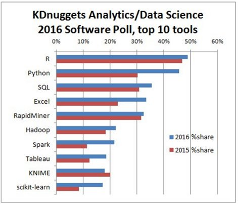
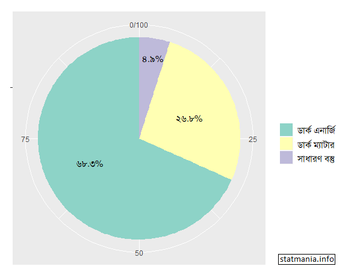
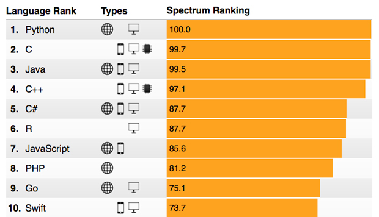

::: {dir="ltr" style="text-align: left;" trbidi="on"}
বর্তমান পৃথিবী ডেটা বা তথ্য উপাত্ত দিয়ে ভরপুর। সমাজ বা রাষ্ট্রের কার্যকরী পরিকল্পনা ও উন্নয়নের জন্যে চাই বিভিন্ন রকম উপাত্তের সঠিক বিশ্লেষণ। যে কোনো প্রতিষ্ঠান, হোক সেটা আর্থিক, সামাজিক বা গবেষণাধর্মী, সেটাকে ভালোভাবে পরিচালনা ও লক্ষ্যে পৌঁছানোর জন্যে চাই উপাত্ত বিশ্লেষণের মাধ্যমে সঠিক সিদ্ধান্ত গ্রহণ। সেবাদানকারী প্রতিষ্ঠানগুলোকে উপাত্ত ঘেঁটে বুঝতে হয়, কোন পণ্যের বাজার কেমন, মানুষ কোন দিকে ঝুঁকছে ইত্যাদি। গুগোল, ফেসবুকের মতো প্রতিষ্ঠানগুলোর ব্যাবসার অন্যতম বড় উপাদান উপাত্ত বিশ্লেষণ করে ব্যবহারকারীদের আগ্রহ ও ঝোঁক-প্রবণতা অনুমান করা। অ্যামাজন ডট কম, উবার, গুগোলের বিজ্ঞাপন সেবা অ্যাডসেন্স, কিংবা অ্যাপলের সিরি সব কিছুই উপাত্ত বিশ্লেষণের ওপর নির্ভরশীল।  বৈজ্ঞানিক গবেষণার জন্যেও একইভাবে উপাত্তের সঠিক ও গ্রহণযোগ্য ব্যাখ্যা-বিশ্লেষণ প্রয়োজন।

::: {.separator style="clear: both; text-align: center;"}

:::

এই যে কাজগুলো, এগুলোর জন্যে বর্তমানে জ্ঞানের নতুন একটু শাখাই গড়ে উঠেছে। নাম ডেটা সায়েন্স। পরিসংখ্যানের ধারণা ও প্রয়োগ নির্ভর জ্ঞানের নতুন এই শাখাটি চাকরির বাজারে ক্রমশ পেছনে ফেলে দিচ্ছে অন্য সব পেশাকে। হার্ভার্ড বিজনেস রিভিউ ম্যাগাজিনের ২০১২ সালের অক্টোবর সংখ্যায় বলা হয়, 'একুশ শতকের সবচেয়ে আকর্ষণীয় চাকরি হল ডেটা সায়েন্স'। জব রিভিউ সাইট গ্লাসডোর এর একটি জরিপ অনুসারে, ইতোমধ্যে অ্যামেরিকার সেরা পেশার তালিকায় এক নম্বরে স্থান পেয়েছে পেশাটি। আইবিএম এর এক জরিপ অনুসারে শুধু ২০১৫ সালেই অ্যামেরিকায় এই ফিল্ডে সাড়ে তেইশ লাখ চাকরি দেওয়া হয়।

ডেটা সায়েন্সের এ বিশাল ক্ষেত্রটিতে কাজের জন্যে রয়েছে কাড়ি কাড়ি সফটওয়্যার। রয়েছে প্রোগ্রামিং ল্যাঙ্গুয়েজ, স্ট্যাটিস্টিক্যাল প্যাকেজ। অনেকে তো মাইক্রোসফট এক্সেলেই অনেক উপাত্ত বিশ্লেষণ করে ফেলেন। আরেকটু ভালো করতে চাইলে কেউ কেউ আবার SPSS, Stata, Minitab কিংবা SAS এর আশ্রয় গ্রহণ করেন। কেউ কেউ আবার জাভা, পাইথনের মতো প্রোগ্রামিং কাজে লাগিয়েও করেন ডেটা সায়েন্সের কাজ।

তবে সবকিছুকে ছাপিয়ে ডেটা সায়েন্সের জগতে সকল কাজের কাজি হয়ে দাঁড়িয়েছে একটি প্রোগামিং ল্যাঙ্গুয়েজ। নামটি বেশ ছোট: R। রস ইহাকা ও রবার্ট জেন্টেলম্যান নামের দুজন পরিসংখ্যানবিদ এর উদ্ভাবক। কম্পিউটারের হেন কাজ নেই যা ল্যাঙ্গুয়েজটি করতে পারে না। ওয়ার্ড ডকুমেন্ট তৈরি, প্রেজেন্টনেশনের স্লাইড কিংবা পিডিএফ বানানো থেকে শুরু ম্যাপ আঁকা এমনকি ভিডিও এডিটিং সব কিছুতে ওস্তাদ এই ল্যাঙ্গুয়েজ। তবে এর মূল পরিচয় এটি একটি পরিসংখ্যানিক সফটওয়্যার। গ্রাফ এঁকে উপাত্তের চেহারা বোঝা কিংবা বিশ্লেষোণের মাধ্যমে সুন্দর মডেল দাঁড় করানো বা পূর্বাভাস দেওয়া সব কিছুতেই এর জুড়ি মেলা ভার।

সব মিলিয়ে R এর জনপ্রিয়তাও দিন দিন বেড়ে চলছে। নীচের গ্রাফটিতে একটু চোখ বুলালেই বিষয়টি সহজে বোঝা যায়।

  -------------------------------------------------------------------------------------------------
                                  
   চিত্র ১: ২০১৫ ও ২০১৬ সালে উপাত্ত বিশ্লেষণের কাজে প্রোগ্রামিং/পরিসংখ্যানিক ল্যাঙ্গুয়েজের ব্যবহার
  -------------------------------------------------------------------------------------------------

কিন্তু R কেন এত জনপ্রিয়? এর পেছনের কারণগুলোতে একটু চোখ বুলিয়ে নেয়া যাক।
প্রথমত, R একটি ফ্রি সফটওয়্যার। Matlab, SPSS কিংবা SAS এর মতো লাইসেন্স ক্রয়ের কোনো বিষয় নেই। যে কেউ ডাউনলোড করে ব্যবহার করতে পারেন। শুধু তাই নয়, এর সোর্স কোডও সবার জন্যে উন্মুক্ত। আপনি চাইলে কোড বদলে একে মডিফাইও করে নিতে পারেন। সাইজও খুব ছোট। মাত্র ৫০ এমবির কাছাকাছি। যেখানে Matlab এর সাইজ ৮ থেকে ১১ জিবি। অন্য দিকে পরিসংখ্যানিক বিশ্লেষণের জন্যে R ই সবচেয়ে পূর্ণাঙ্গ টুল। এর কাজকে একটু সুশৃঙ্খল উপায়ে করার জন্যে রয়েছে আরেকটি সফটওয়্যার R স্টুডিও। দারুণ এই টুলটিও সম্পূর্ণ ফ্রি।

প্রোগ্রামিং/সফটওয়্যার ব্যবহার করতে গেলে মাঝে-মধ্যে সমস্যায় আটকে যাওয়া অস্বাভাবিক নয়। কিন্তু বেশিরভাগ ফ্রি সফটওয়্যারের অসুবিধা হল, সহজে বিভিন্ন সমস্যায় সমাধান পাওয়া যায় না। অথবা সমাধান পেতে হলে গুণতে হয় অর্থ। কিন্তু এখানে সে অসুবিধাও নেই। সমাধানের জন্যে প্রস্তুত আছেন লাখ লাখ ব্যবহারকারীরাই। Stackoverflow কিংবা Quora সহ অসংখ্য ব্লগ ও ফোরামে যে কোন সমস্যা নিয়ে প্রশ্ন করলেই জবাব পাওয়া যায়। দীর্ঘ দিন ধরে R জনপ্রিয় থাকার কারণে বর্তমানে বেশিরভাগ সাধারণ সমস্যার জবাব গুগোলে সার্চ করলে নিমিষেই মিলে যায়। মানে, বেশিরভাগ সমস্যা আগে থেকেই সমাধান হয়েই আছে।

R এর অন্যতম প্রধান একটি সুবিধা হলো অসংখ্য প্যাকেজের উপস্থিতি। ধরুন, আপনি প্রাণপরিসংখ্যান নিয়ে কাজ করতে চান। তাহলে আপনাকে শুধু survivalপ্যাকেজটি লোড করতে হবে। বার ডায়াগ্রাম কিংবা পাই চার্টগুলোকে দৃষ্টিনন্দন করে উপস্থাপন করতে চাইলে আপনার জন্যে ggplot2 নামের প্যাকেজটি। সব মিলিয়ে সুন্দর করে উপাত্ত উপস্থাপনের জন্যে R এর বিকল্প পাওয়া কঠিন। (নীচের চিত্রে R দিয়ে বানানো একটু পাই চার্ট দেখানো হলো।) ডেটাবেজ নিয়ে কাজ করতে চাইলে রয়েছে sqldf। সুন্দর সুন্দর ম্যাপ বানাতে চাইল কাজে আসবে ggmap, maptools সহ অনেকগুলো প্যাকেজ। আর এগুলোও সব কিন্তু বিনামূল্যেই পাওয়া যাবে। এরকম প্যাকেজের সংখ্যা বর্তমানে ১০ হাজারের ওপরে। এগুলো মূল সফটওয়্যারের সাথে না দেয়ার উদ্দেশ্য সফটওয়্যারটি যাতে ভারী না হয়ে যায়। দরকারের সময় ২/৩ ক্লিকেই বা এক লাইন কোড লিখেই লোড করে ফেলা যায় নির্দিষ্ট প্যাকেজটি। নতুন নতুন কাজের জন্যে নিয়মিত নতুন প্যাকেজ উদ্ভাবনের কাজ এখনও চলছেই। এমনকি আপনি নিজেও চাইলে প্যাকেজ বানিয়ে উন্মুক্ত করে দিতে পারেন।

  ----------------------------------
   
       R দিয়ে বানানো পাই চার্ট 
  ----------------------------------

শুধু উপাত্ত বিশ্লেষণের টুল হিসেবেই নয়, অন্যান্য কাজেও ভাগ বসাতে বসাতে R জনপ্রিয় ল্যাঙ্গুয়েজগুলোর তালিকায় ছয়ে স্থান করে নিয়েছে। এখানে (নীচের চিত্র) তুলনা করার সময় মনে রাখতে হবে ডেটা সায়েন্স এর কাজের বাইরে কম্পিউটারের বিশাল একটি ক্ষেত্র রয়েছে। অন্য দিকে ওয়েবসাইট নির্মাণের অন্যতম জনপ্রিয় ভাষা পিএইচপিও কিন্তু R এর পেছনে পড়ে আছে।

  -----------------------------------------------------------------------------------------------------
                                    
   আইট্রিপলই (IEEE) এর স্পেকট্রাম ম্যাগাজিনের ২০১৭ সালের জরিপ অনুসারে বিভিন্ন প্রোগ্রামিং এর র‍্যাংকিং
  -----------------------------------------------------------------------------------------------------

R এর অন্যতম বড় সুবিধা হল, এর ব্যবহারের জন্যে বড় মাপের প্রোগ্রামার হতে হবে না। অল্প কিছু বিষয় শিখে নিয়েই করা যায় অনেক বেশি বিশ্লেষণ। শেখার জন্যে অনলাইনে অসংখ্য টিউটোরিয়ালের (টেক্সট ও ভিডিও দুই সংস্করণেই) পাশাপাশি রয়েছে দারুণ দারুণ অনেক বই। R এর নিজস্ব হেল্প সেকশনেও অনেক কিছু সহজে শিখে নেওয়া সম্ভব।

বিজনেজ অ্যানালাইসিস এর জগতে R এর দক্ষতা বুঝতে পেরে অধিকাংশ প্রচলিত সফটওয়্যারই R এর সাথে সাথে সমন্বয় করে কাজ করার ব্যবস্থা করছে। এছাড়াও এক্সেল, SPSS, Stata, Microsoft Access, Oracle, MySQL কিংবা SQLite দিয়ে বানানো ডেটাবেজও R খুব সহজে পড়ে নিয়ে কাজ করতে পারে।

R এ বানানো গ্রাফ ও ছবি খুব সহজেই ভালো রেজুলেশনের ছবি ও পিডিএফ আকারে সংরক্ষণ করা যায়। উইন্ডোজ, ম্যাকিন্টশ বা লিনাক্স যে কোনো অপারেটিং সিস্টেমেই আর সমান তালে কাজ করতে পটু।

বিজনেস অ্যানালিটিক্স-এ R এর গ্রহণযোগ্যতার কারণে গুগোল, আইবিএম, ফেবসুক, মজিলা, বিং এর মতো প্রতিষ্ঠানগুলো উপাত্ত বিশ্লেষণে ব্যাপকভাবে R ব্যবহার করছে। ক্রিকেট বা ফুটবলের পরিসংখ্যান ঘেঁটে প্রয়োজনীয় ও আকর্ষণীয় তথ্য বের করে আনা ও সেই মাফিক পরিকল্পনা সাজাতেও বর্তমানে R এর ভূমিকা রয়েছে। সব মিলিয়ে R জানা মানে গর্ব করার মতো একটি জিনিসই জানা!

সূত্রঃ
ইডিএক্স ব্লগ, কম্পিউটার ওয়ার্ল্ড ডট কম, ইনফোওয়ার্ল্ড ডট কম, ওয়াশিংটন পোস্ট, আইবিএম ডট কম, স্ট্যাকওভারফ্লো, অ্যানালিটিক্স ট্রেইনিংস ডট কম।

-   https://blog.edx.org/the-importance-of-data-science-in-the-21st-century
-   analyticstrainings.com/?p=101
-   https://www.computerworld.com/article/2921176/business-intelligence/great-r-packages-for-data-import-wrangling-visualization.html
-   https://www.analyticsvidhya.com/blog/2016/10/18-new-must-read-books-for-data-scientists-on-r-and-python/
-   https://www.infoworld.com/article/2940864/application-development/r-programming-language-statistical-data-analysis.html
-   http://sharpsightlabs.com/blog/r-recommend-data-science/
-   https://www.washingtonpost.com/news/on-leadership/wp/2016/01/20/glassdoor-ranks-the-25-best-jobs-in-america-2/
-   https://www-01.ibm.com/common/ssi/cgi-bin/ssialias?htmlfid=IML14576USEN&
-   https://stackoverflow.blog/2017/10/10/impressive-growth-r/
-   https://www.kdnuggets.com/2015/05/r-vs-python-data-science.html
:::
