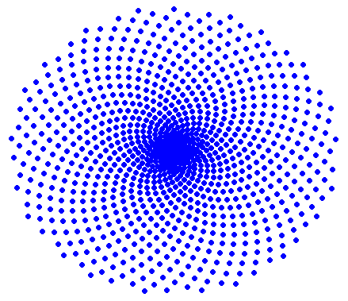
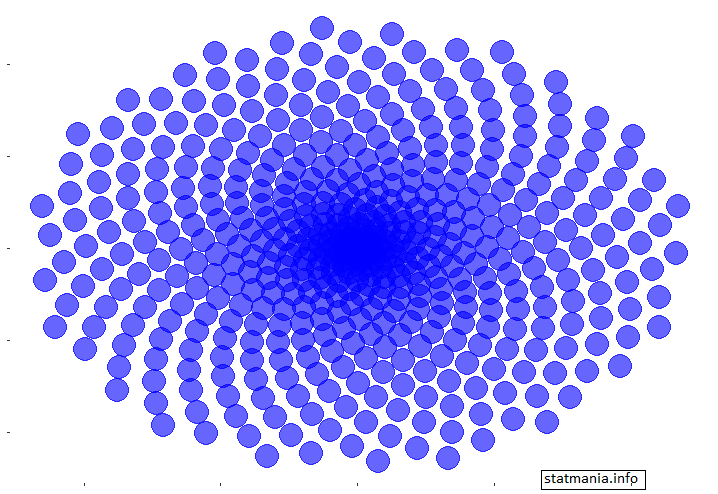
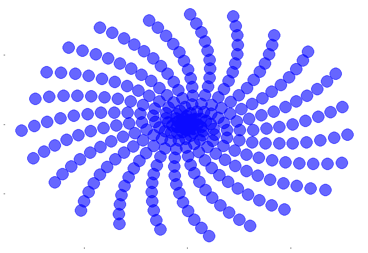

::: {dir="ltr" style="text-align: left;" trbidi="on"}
শুধু যে ডেটা অ্যানালিটিক্সের [সিরিয়াস কাজেই](https://www.statmania.info/2018/05/r-for-data-science.html) R কারিশমা দেখায় এমন না। হাসতে-খেলতে মনের খোরাক যোগানোরও নানান উপাদান পাওয়া যাবে এর মধ্যে।

ggplot2 প্যাকেজ দারুণ সব ডিজাইন আঁকা যায়। তবে প্যাকেজের ভেতরে না গিয়েও বেশ দারুণ প্লট তৈরি করা যায়। যেমন, কোনো প্যাকেজ ছাড়াই আমরা এটা আঁকতে পারি।

::: {.separator style="clear: both; text-align: center;"}

:::

এর কোড খুবই সরল। ভবিষ্যতে আমরা এর খুঁটিনাটি ব্যাখ্যা করব ইনশাআল্লাহ।

```r
angle <- pi*(3-sqrt(5))
n <- 1000
t <- angle*(1:n)
x <- sin(t)
y <- cos(t)
plot(x*t,y*t, pch=16, col="blue")
```

R এর অন্যতম বিখ্যাত প্যাকেজ হলো ggplot2। এর মাধ্যমেই আমরা নীচের ফুলটি এঁকে ফেলতে পারি।

  ----------------------------------
   
     R প্রোগ্রামিং দিয়ে আঁকা ফুল 
  ----------------------------------

এর জন্যে প্রথমেই ggplot2 প্যাকজেটি লোড করতে হবে।

> library(ggplot2)

আর যদি প্যাকেজটি আগে ইনস্টল করা না থাকে তবে ইনস্টল তো করে নিতেই হবে।

> install.packages("ggplot2")

ফুলের আকার-আকৃতির জন্যে প্রথমে কিছু ফর্মুলা লিখে নিতে হচ্ছে। এরপরেই পাওয়া যাবে কাঙ্খিত সেই বাহারি ফুল!

```r
angle=pi*(3-sqrt(5))
n=500
t=angle*(1:n)
x=sin(t)
y=cos(t)
df=data.frame(t,x,y)
library(ggplot2)
p=ggplot(df, aes(x*t,y*t))
p+geom_point(size=8, alpha=0.6, color='blue')+
theme(title=element_blank(),
text=element_blank(),
panel.grid = element_blank(),
panel.background = element_rect(fill='white'))
```

চাইলেই আপনি আরও হাজার রকম ফুল আঁকতে পারেন। শুধু ওপরের angle টাই পাল্টে দেখুন না! যেমন এইটুকু শুধু পাল্টালাম। ফলাফল নিজেই দেখুন।

```r
angle=pi*(5-sqrt(10))
n=700
```

আবার এই কোড কী করল দেখুন!

```r
angle=2.73*(3-sqrt(4))
n=300
```

  ----------------------------------
   
     R প্রোগ্রামিং দিয়ে আঁকা ফুল
  ----------------------------------
:::
