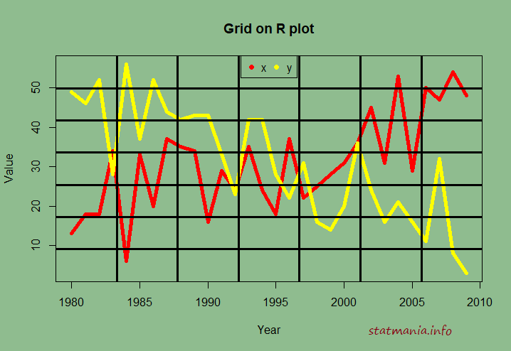
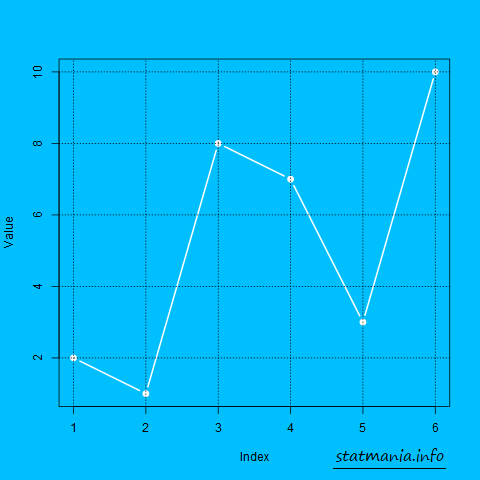

::: {dir="ltr" style="text-align: left;" trbidi="on"}
R এর গ্রাফগুলোতে এমনিতে গ্রিড থাকে না। কিন্তু চাইলে করা যাবে না, এমন কিছু R-এ খুঁজে পাওয়া দুষ্কর। আমরা আজকে নীচের গ্রাফটি আঁকার উপায় দেখব।

::: {.separator style="clear: both; text-align: center;"}

:::

বরাবরের মতোই আগে লাগবে ডেটা। তো কিছু ডেটা বানিয়ে নেই। 

> x=sample(30)+1:30
> y=sample(30)+30:1
> df=data.frame(x,y)
> df.ts=ts(df,start=1980)

একটি টাইম সিরিজ ফরম্যাট বানিয়ে নিলাম। এবার চাইলে প্লটের ব্যাকগ্রাউন্ড সেট করে নিতে পারি। না করলেও দুনিয়া ধ্বংস হয়ে যাবে না। আপনার ইচ্ছা! 

> par(bg="\#8FBC8F")

এখানে \#8FBC8F হলো হেক্স কোডে লেখা কালার। আপনি [এ সাইট থেকে আরও নানান ধরনের কালার](https://www.w3schools.com/colors/colors_picker.asp) বসাতে পারেন। চাইলে আপনি red, blue ইত্যাদিও দিতে পারেন। 

x ও y চলকে বসানোর জন্য দুই রকম কালার ঠিক করে রাখি। 

> color= c("red","yellow")

এবার প্রাথমিক প্লটখানা এঁকে ফেলি। এতে কিন্তু কোনো গ্রিড নেই। 

> ts.plot(df.ts, gpars=list(col=color), lwd=5,
>         ylab="Value", xlab="Year", main="Grid on R plot")

এবারই আমাদের মূল কাজ। মানে গ্রিড। 

> grid(7,7, col="black", lwd=3, lty='solid')

7, 7 বোঝাচ্ছে যে x ও y অক্ষ বরাবর যথাক্রমে কয়টি করে লাইন আঁকা হবে। লাইনের রঙ, লাইনের প্রস্থ সবই চেঞ্জ করতে পারবেন ইচ্ছা মতো। 

আরও নানান উপায় দেখতে হেল্প ফাইল দেখে নিন। 

> ?grid

এবার প্লটে লিজেন্ড দিয়ে বুঝিয়ে দেওয়া যাক কোন লাইনটা কোন চলকের। 

> legend("top", legend=names(df), ncol=2, col=color, pch=19)

তবে সবচেয়ে ভালো grid() ফাংশনের ভেতরে কিছুই না লিখলে। এতে করে y অক্ষের সাথে দাগগুলো নিজে নিজেই মিলে যাবে। দেখতে ও বুঝতেও হবে সহজ। অবশ্য প্লট ব্যাকগ্রাউন্ড সেট করলে কালার ম্যাচিং না হলে কালার যুক্ত করা যেতে পারে।

> par(bg="\#00bfff")
> plot(sample(10,6), pch=19, col="white", type="b", lwd=2,
>      ylab="Value")
> grid()

[এটায় কালার মিলছে](https://www.w3schools.com/colors/colors_picker.asp) না। তাই গ্রিডের কালার দিয়ে দিলাম।

> par(bg="\#00bfff")
> plot(sample(10,6), pch=19, col="white", type="b", lwd=2,
>      ylab="Value")
> grid(col="black")

  ----------------------------------
   
          R প্লটে অটো গ্রিড 
  ----------------------------------

এখানে আমরা প্লট করার জন্য ১০টি ভ্যালু থেকে ৬টি ভ্যালু স্যাম্পল নিয়েছি। তাই একই কোড রান করলেও গ্রাফটি এটা থেকে আলাদা আসার সম্ভাবনাই বেশি।

**আরও পড়ুন **
☛  [স্মুথ প্লট আঁকবেন কীভাবে](2018-06-smooth-r.html) 
:::
