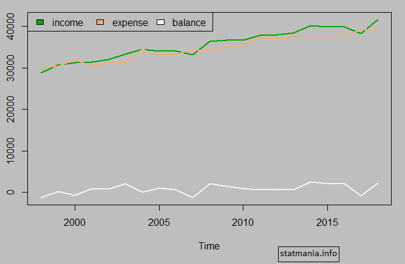
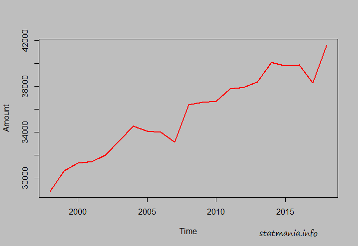
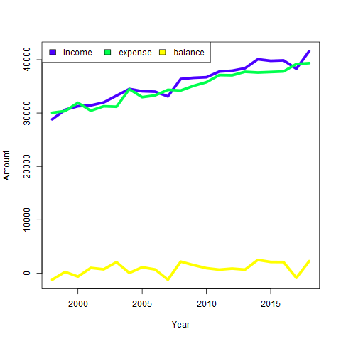

::: {dir="ltr" style="text-align: left;" trbidi="on"}
আমরা নীচের ছবির মতো একটি গ্রাফ আঁকতে চাই। যেখানে একই গ্রাফে অনেকগুলো টাইম সিরিজ ডেটা থাকবে।

  ----------------------------------
   
   একই গ্রাফে অনেকগুলো টাইম সিরিজ 
  ----------------------------------

তো প্রথমেই আঁকার জন্যে আমাদের কাছে কিছু ডেটা থাকতে হবে। আপাতত আমরা নিজেরাই কিছু ডেটা বানিয়ে নিচ্ছি। আপনি চাইলেই এক্সেল বা CSV (কমা সেপারেটেড ভ্যালু) ফাইল থেকেও ডেটা লোড করতে পারেন।

> x=seq(30000,40000,500)+rnorm(mean=500, sd=1000,n=21)
> y=seq(29000,39000,500)+rnorm(mean=500, sd=1000,n=21)
> z=x-y
> df=data.frame(income=x, expense=y, balance=z)

এখানে আমরা df নামে একটি ডেটা ফ্রেইম তৈরি করলাম। আপনি চাইলে head(df) লিখে ডেটা ফ্রেইমের চলকগুলোর প্রথম ৬টি করে মান দেখে নিতে পারেন। এবার আমাদেরকে এই ডেটাকে টাইম সিরিজ ফরম্যাটে রূপ দিতে হবে। একটি চলক (variable) নিয়ে প্লট করার উপায়টা আগে একটু দেখে নেই। 

> x.ts=ts(x, end=2018)

ts ফাংশন x চলকটিকে টাইম সিরিজ ফরম্যাটে রুপান্তর করল।  ?ts কমান্ডের সাহায্যে আপনি ts ফাংশনের আরও নানান অপশন দেখে নিতে পারেন। যেমন ডেটা কোন বছর শুরু হল, সেটা জানা থাকলে start=year অপশন ব্যবহার করতে পারেন। 

এবার আমরা একে প্লট করব

> plot(x.ts) 

এটা খুব একটা সুন্দর হবে না। তার চেয়ে আরও কিছু attribute যোগ করলে ভাল হয়। 

> plot(x.ts, col=3, lwd=2, ylab="Amount")

lwd এর কাজ হলো লাইন কতটা মোটা বা চিকন হবে তা ঠিক করা। lwd=1 দিলে সবচেয়ে চিকন হবে। আরও ভাল করতে চাইলে একটা ব্যাকগ্রাউন্ড যোগ করতে পারেন।

> par(bg="gray")
> plot(x.ts, col="red", lwd=2) 

  ----------------------------------
   
     একটি চলকের টাইম সিরিজ গ্রাফ 
  ----------------------------------

এবার আমরা একই গ্রাফে আমাদের df ডেটাফ্রেইমের ৩টা চলক একত্রে আঁকবো। তাহলে একে আগে টাইম সিরিজ ফরম্যাট করা যাক। চেঞ্জ করে নতুন নাম দিলাম df.ts।

> df.ts=ts(df, end=2018)

এবার একে প্লট করে ফেলি।

> ts.plot(df.ts, gpars=list(col=topo.colors(3)), lwd=2,
>         ylab="Amount")

খেয়াল করুন, এখানে আমরা plot ফাংশনের বদলে ts.plot ব্যবহার করলাম। 

topo.colors এর কাজ হলো অটোম্যাটিক কালার করে নেওয়া। ভেতরে ৩ মানে ৩টি কালার হবে। যেহেতু আমাদের চলক ৩টি। অটো কালার করার আরও অনেক উপায় আছে। যেমন terrain.colors(3), rainbow(3), heat.colors(3)। আবার ম্যানুয়ালিও কালার করা যাবে। 

> ts.plot(df.ts, gpars=list(col=c("green",'Blue','Yellow'), lwd=2))। 

এবার legend দিয়ে বোঝাতে হবে কোন কালারের কী মানে। 

> legend("topleft", legend=names(df), fill=terrain.colors(3), ncol=3)

ts.plot কমান্ডে col অপশনে যেটা থাকবে এখানে fill এর জায়গায় সেটাই দিতে হবে। ncol মানে লিজেন্ড বক্স এর কলাম কয়টি হবে। প্লট দেখে সুবিধামতো লিজেন্ড এর পজিশন ঠিক করতে হবে। topleft এর বদলে top, bottom, right, left বা এদের যে কোন রকম কম্বিনেশন ব্যাবহার করা যাবে। 

legend এর ভেতরের legend এর মানে হলো কালারগুলোর নাম কী কী হবে। ওপরের কোডে আমরা সরাসরি ডেটাফ্রেইমের কলাম নেইম দিয়ে দিয়েছি। চাইলে ইচ্ছামতো অন্য কিছুও দেওয়া যায়। 

> legend("topleft", legend=c("red","green","yellow"), fill=terrain.colors(3), ncol=3)

আরেকটি অপশনাল কাজ বাকি। প্লটের ব্যাকগ্রাউন্ড একটু চেঞ্জ করে নিলে আরেকটু দৃষ্টিনন্দন হতে পারে। এটা আমাদের মোটামুটি ফাইনাল কাজ। 

> par(bg="gray")
> ts.plot(df.ts, gpars=list(col=topo.colors(3)), lwd=5, ylab="Amount", xlab="Year")
> legend("topleft", legend=names(df), fill=topo.colors(3), ncol=3,)

::: {.separator style="clear: both; text-align: center;"}

:::

এই প্লটটা স্বাভাবিকের মতো এবড়োথেবড়ো নয়। 

**পড়ে নিন তাহলে **

☛ [কীভাবে মসৃণ প্লট আঁকবেন?](https://www.statmania.info/2018/06/smooth-r.html)
:::
