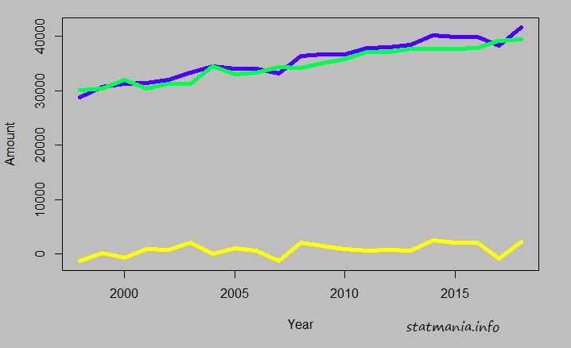
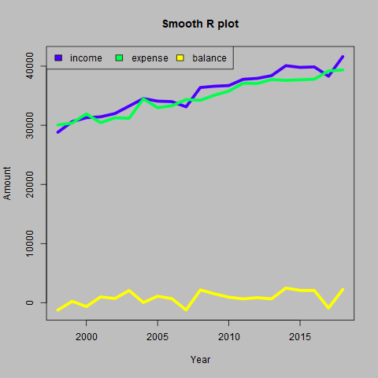

::: {dir="ltr" style="text-align: left;" trbidi="on"}
R এ আঁকা গ্রাফগুলো সাধারণত একটু এবড়োথেবড়ো হয়। অনেক সময়ই দেখতে অতটা সুন্দর হয় না। যেমন এই গ্রাফটি দেখুন।

  ----------------------------------
   
   R প্রোগ্রামিং: টাইম সিরিজ গ্রাফ 
  ----------------------------------

এই ছবিটা কিছুটা এবড়োথেবড়ো। অনেক সময় আরও অনেক বেশি এবড়োথেবড়োও হয়।

সামান্য কিছু কোড করেই একে অনেকটা উন্নত করে নেওয়া যায়।

> png(filename="output.png", type="cairo")
> \#see ?png for more detail
> \# Code to plot
> dev.off()

filename অংশে আপনি যে লোকশনে সেভ করতে চান, সেটা ও ফাইলের নাম উল্লেখ করবেন। উপরের কোডে output নামে একটি png ফাইলে ছবিটা সেভ হবে। আর এটা সেভ হবে আপনার working directory তে। আপনার বর্তমান ওয়ার্কিং ডিরেক্টরি দেখুন।

> getwd()

চাইলে আবার পাল্টেও নিতে পারেন।

> setwd("D:/R")

**উদাহরণ**
**
** আমরা নীচের বানানো ডেটা ব্যবহার করব।

> x=seq(30000,40000,500)+rnorm(mean=500, sd=1000,n=21)
> y=seq(29000,39000,500)+rnorm(mean=500, sd=1000,n=21)
> z=x-y
> df=data.frame(income=x, expense=y, balance=z
> df.ts=ts(df, end=2018)

এবার smooth করার জন্য কাজ। এখানে par(bg="gray") অংশটি অপশনাল। ব্যাকগ্রাউন্ড সেট করার জন্য বসানো হয়েছে।

> png(filename="myplot.png", type="cairo")
> par(bg="gray")
> ts.plot(df.ts, gpars=list(col=topo.colors(3)), lwd=5, ylab="Amount", xlab="Year", main="Smooth R plot")
> legend("topleft", legend=names(df), fill=topo.colors(3), ncol=3,)
> dev.off()

উপরের ছবিটাই এখন মসৃণ হয়ে এমন হয়ে যাবে।

  ----------------------------------
   
            smooth R প্লট
  ----------------------------------

**আরও পড়ুন **

☛ [বাহারি ফুলের ডিজাইন](https://www.statmania.info/2018/06/floweR.html)

☛ [একই প্লটে অনেকগুলো টাইম সিরিজ গ্রাফ](https://www.statmania.info/2018/06/multiple-ts-plot.html)
:::
