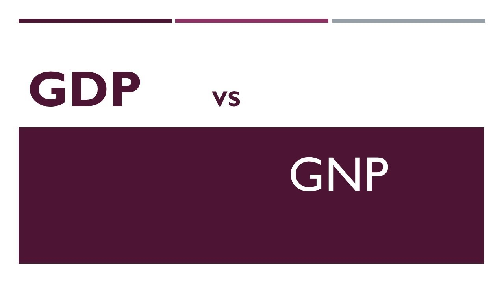

::: {dir="ltr" style="text-align: left;" trbidi="on"}
জিডিপি ও জিএনপি। দুটোই অর্থনীতির গুরুত্বপুর্ণ বিষয়। দুটোই একটি অর্থনীতিতে উৎপাদিত সবগুলো পণ্য ও সেবার (goods and services) বাজার মূল্য পরিমাপ করার চেষ্টা করে। তাহলে পার্থক্যটা কোথায়? পার্থক্যটা হলো ব্যাখ্যায়। 

::: {style="text-align: center;"}

:::

জিডিপির পূর্ণ রূপ হলো Gross Domestic Product (GDP)। বাংলায় বলা হয় মোট অভ্যন্তরীণ উৎপাদন। একটু চিন্তা করলেই বোঝা যাবে অভ্যন্তরীণ শব্দটিই এখানে জিডিপির মূল ব্যাখ্যা। কোনো একটি দেশের সীমানার অভ্যন্তরে একটি নির্দিষ্ট সময়ে যে পণ্য ও সেবাগুলো তৈরি হবে, সেগুলোর মোট বাজার দরই হলো জিডিপি। দেশের অর্থনীতির শক্তি যাচাই করা হয় এর মাধ্যমেই। অনেক সময় বিনিয়োগকারীরা দেখেন, যে দেশে তারা বিনিয়োগ করতে যাচ্ছেন, তার জিডিপি যথেষ্ট ভালো কি না। নীতিমালা প্রণয়নের জন্যে সরকারকেও জিডিপি নিয়ে কাজ করতে হয়। 

তাহলে জিএনপি কী হতে পারে? অনেকের কাছে এটা ইতোমধ্যে স্পষ্ট হয়ে গেছে। অবশ্য এটা মনে হওয়াও অস্বাভাবিক নয় যে জিডিপির মতো দারুণ একটি পরিমাপ থাকতে অর্থনীতির শক্তি পরীক্ষার জন্য আর কিছুর কি প্রয়োজন হতে পারে?

আসলে এমন দেশ খুঁজে পাওয়া দুষ্কর যেখানে সব মানুষই নিজের দেশে থাকেন। দেশের অর্থনীতে তো সেইসব প্রবাসীদের অনেকও ভূমিকা রাখেন। কিন্তু জিডিপেতে সেই হিসেবটা আসেনি। সেই কাজটি করে জিএনপি বা Gross National Product (GNP)। বাংলায় বলে মোট বা স্থুল জাতীয় উৎপাদন। এটি হিসেব করে যে দেশের সকল মানুষ বা দেশীয় সকল প্রতিষ্ঠান পৃথিবীর যে কোন প্রান্তে বসেই মোট কী পরিমাণ উৎপাদন করল। যেমন ধরুন, বাংলাদেশি একটি প্রতিষ্ঠান কাজ করছে জার্মানিতে। তাহলে এটি যে পরিমাণ বাজারমূল্যের উৎপাদন করবে, সেটিও জিএনপিতে যোগ হবে। 

**জিএনপি কি জিডিপির চেয়ে কম হতে পারে?**

সাধারণত হয় না। তবে অনেক সময় হতেই পারে। যদিও ব্যাপারটাকে অসম্ভব মনে হচ্ছে। অসম্ভব মনে হবার কারণ হলো জিএনপিতে তো বেশি সংখ্যক মানুষ বা প্রতিষ্ঠানের উৎপাদনের হিসেব আসছে। কিন্তু একটু ভালো করে খেয়াল করলেই দেখা যাবে, জিডিপির সংজ্ঞায় ছিল দেশের সীমানা। আর জিএনপির সংজ্ঞায় আছে দেশীয় সব মানুষ বা প্রতিষ্ঠান। এ কারণে দেশের সীমানার ভেতরে থেকেও কিছু মানুষ বা প্রতিষ্ঠান জিএনপির হিসেবে আসবে না। কারণ সেই মানুষ বা প্রতিষ্ঠানগুলো ভিন্ন দেশীয়। ফলে তাদের উৎপাদনের হিসেব চলে যাচ্ছে ভিন্ন দেশের জিএনপিতে। 

জিডিপি বেশি হবে নাকি জিএনপি সেটা তাই নির্ভর করে দেশে বিদ্যমান দেশীয় ও বিদেশী প্রতিষ্ঠানের উৎপাদনের অনুপাতের উপর। 

চীনের কথাই ধরুন। পাব্লিক ডেটা প্ল্যাটফর্ম Knoema-এর হিসেব অনুসারে দেশটির জিডিপি জিনপির চেয়ে ৩০ হাজার কোটি ডলার বেশি। কারণ হলো দেশটিতে বিদেশি প্রতিষ্ঠানের কাজ অনেক বেশি। আবার ঠিক উল্টো কারণে যুক্তরাষ্ট্রের জিনপি জিডিপির চেয়ে ২৫ হাজার কোটি ডলার বেশি। 

**জিডিপি ভালো না জিএনপি ভালো?**

দুটি পরিমাপ প্রায় একই কাজ করলেও জিডিপির ব্যবহারই বেশি। সে তুলনায় জিএনপির ব্যবহার কম। তবে অর্থিনীতির সঠিক চিত্র তুলে ধরতে দুটোরই ব্যবহার হওয়া উচিত। 

এদিকে বিশ্ব ব্যাংক ও জাতিসংঘ আরেকটি পরিমাপ ব্যবহার করার প্রতি জোর দেয়। এটি তাদের মানব সূচকের (Human Development Index) ওপর ভিত্তি করে তৈরি। নাম জিএনআই বা মোট জাতীয় আয় (Gross National Income)। তবে জিডিপি ও জিএনপি উৎপাদন পরিমাপ করলেও নাম থেকেই বোঝা যাচ্ছে জিএনআই আসলে পরিমাপ করে ইনকাম বা আয়। 

*সূত্রঃ*

১। [ইনভেস্টোপিডিয়া](https://www.investopedia.com/ask/answers/030415/what-functional-difference-between-gdp-and-gnp.asp)

২। উইকিপিডিয়া: [Knoema](http://knoema/) 
:::
