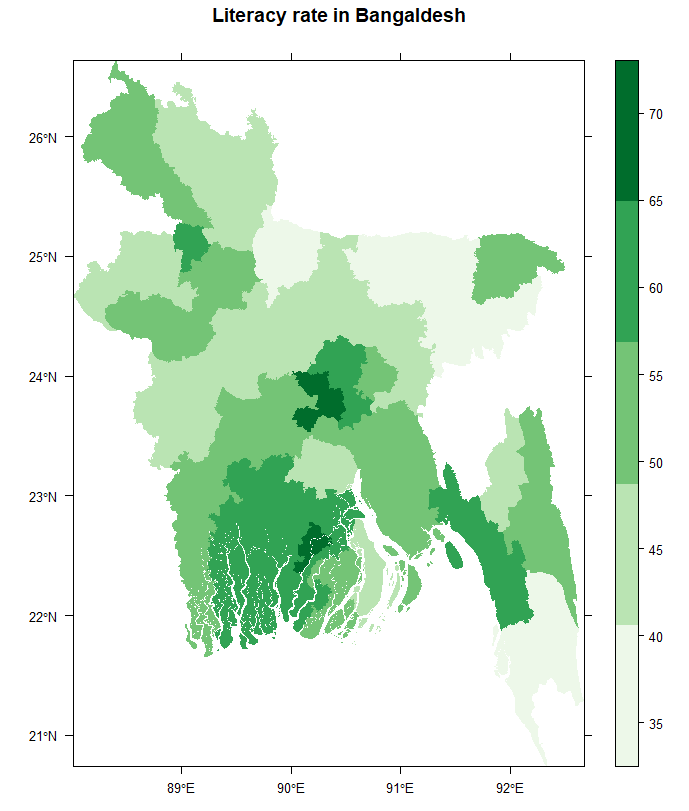
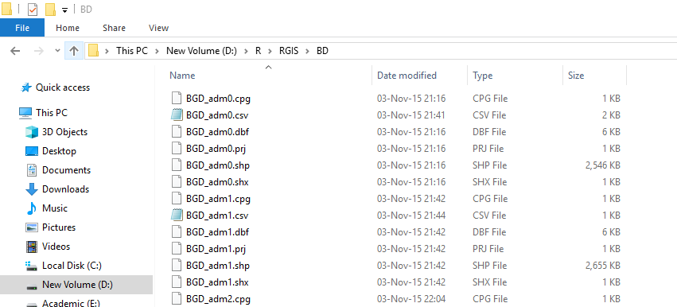
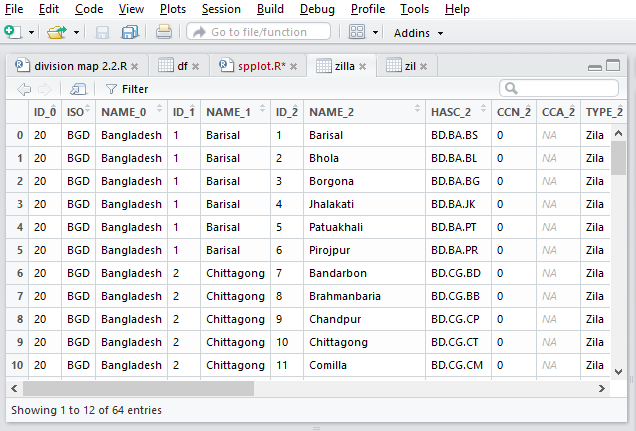
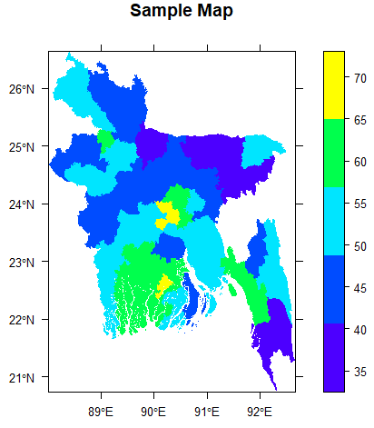

::: {dir="ltr" style="text-align: left;" trbidi="on"}
::: {style="text-align: center;"}

:::

ইংরেজি উইকিপিডিয়ার [বাংলাদেশ পেইজের এজুকেশন](https://en.wikipedia.org/wiki/Bangladesh#Education) সেকশনে শোভা পাচ্ছে আমার আঁকা এই ম্যাপটি। ম্যাপটিতে বাংলাদেশের বিভিন্ন এলাকার স্বাক্ষরতার চিত্র তুলে ধরা হয়েছে। এমন একটি ম্যাপ R-এ আঁকা অকল্পনীয় রকম সহজ। এটা নিয়েই আজকের পোস্ট।

প্রথম কাজ ম্যাপ আকাঁর জন্য প্রয়োজনীয় শেইপ ফাইল (shape file)। R এর plot ফাংশন দিয়ে শুরুতে আমরা এই ফাইলের একটি অংশই প্লট করব। বাংলাদেশের জন্য বানানো শেইপ ফাইলটি আপনাকে ডাউনলোড করে নিতে হবে। এটা পাওয়া যাবে [এই লিঙ্কে](https://gadm.org/download_country_v3.html)। লিঙ্ক থেকে Shapefile টি ডাউনলোড করে নিন।

**☛** [এখানে ক্লিক করেও](https://biogeo.ucdavis.edu/data/gadm3.6/shp/gadm36_BGD_shp.zip) ডাউনলোড করতে পারেন।
:::

::: {dir="ltr" style="text-align: left;" trbidi="on"}

:::

::: {dir="ltr" style="text-align: left;" trbidi="on"}
কোনো লিঙ্ক কাজ না করলে [এখানে](https://geodata.ucdavis.edu/gadm/) গিয়ে সর্বশেষ ভার্শনের rds ফাইল নামিয়ে নিন। 

একটি জিপ ফাইল ডাউনলোড হবে। ফাইলটাকে আনজিপ করে নিন। আনজিপ করে এমন একটি ফোল্ডার পাবেন।

::: {.separator style="clear: both; text-align: center;"}

:::

এই ফোল্ডারে আসলে বিভিন্ন আলাদা আলাদা ম্যাপ আঁকার ফাইল আছে। যেমন আলাদা করে বিভাগের ম্যাপ আঁকতে চাইলে দরকার হবে BGD\_adm1 ফাইলটি। জেলাগুলোও দেখাতে চাইলে BGD\_adm2 ফাইলটি। আর উপেজেলাগুলোও আলাদা করে দেখাতে চাইলে লাগবে BGD\_adm3 ফাইলটি।

**☛ লক্ষ্য করুন **
*ভার্সনভেদে ডাউনলোড করে আনজিপ করা ফাইলের নাম আলাদা হতে পারে। যেমন একটি ক্ষেত্রে এটির নাম gadm36\_BGD\_2। *

একটি বিষয় বুঝে নেওয়া ভাল। Shapefile আসলে অনেকগুলো আলাদা ফাইলের সমন্বয়। যেমন, BGD\_adm1 নামে অনেকগুলো ফাইল আছে। একই নামের সবগুলো ফাইল একই ফোল্ডারে থাকলে তবেই কেবল ফাইলটি কাজ করবে। তার মানে এই নয় যে ঐ ফোল্ডারে অন্য ফাইল থাকা যাবে না। আমাদের এই ফোল্ডারেই কিন্তু চারটি ম্যাপ আঁকার ফাইল আছে।

এবার ম্যাপটিকে R-এ পড়াতে হবে। এজন্য "rgdal" নামে একটি প্যাকেজ লাগবে। R এর প্যাকেজ ইনস্টল করার মতো সহজ কাজ দুনিয়াতে আর নেই। ইনস্টল ও লোড করে নিন।

**☛ **টিপস: [Rstudio](http://rstudio.com/) ব্যবহার করলে কাজটি সহজ হবে। না থাকলে ইনস্টল করে নিন। শুধু ম্যাপিং-ই না, R এর করা কাজগুলো হাজারো উপায়ে সহজতর হয়ে যাবে। Rstudio তে কোড run করতে Ctrl+Enter চাপুন।

> install.packages("rgdal")
> library(rgdal)

এবার Shapefile টিকে লোড করার পালা।

> zilla=readOGR("D:/R/RGIS/BD", layer="BGD\_adm2")

খেয়াল করুন, এখানে "D:/R/RGIS/BD" হলো BGD\_adm2 ফাইলটি যে ফোল্ডারে আছে তার লোকেশন। আপনি ফাইলগুলো যেখানে রাখবেন সেই ফোল্ডারের লোকেশন এখানে লিখতে হবে। আর layer অংশটিতে কিছু করা লাগবে না। অবশ্য আপনি যদি উপজেলার ম্যাপ আঁকতে চান, তাহলে BGD\_adm3 লিখতে পারেন।

**☛ ***layer এর জায়গায় ফোল্ডারের ফাইল থেকে সঠিক নামটি বসাতে হবে।*

এবার "zilla" অবজেক্টটি প্লট করে দেখুন। বাংলাদেশের ম্যাপ পেয়ে যাবেন।

> plot(zilla, col="green")

কিন্তু আমরা তো শুধু এটা চাই না। আমরা চাই, অন্য একটু ক্রাইটেরিয়ার ভিত্তিতে আলাদা আলাদা জেলায় আলাদা আলাদা কালারিং হবে। তাহলে প্রতিটা জেলার সেই তথ্যটা লাগবে। আমরা আপাতত চাই বাংলাদেশের স্বাক্ষরতার হারের ভিত্তিতে রং-এর তারতম্য। এই কাজটি করার জন্য আমাদের sp প্যাকেজটি লাগবে। 

> install.packages("sp")
> library(sp)

বাংলাদেশের প্রতিটি জেলার স্বাক্ষরতার হার আমাদেরকে zilla অবজেক্টটিতে যোগ করতে হবে। তার আগে ৬৪টি জেলার তথ্য zilla অবজেক্টে-এর সাথে মিলিয়ে সাজিয়ে নিতে হবে। এখানেই Rstudio না থাকলে একটু সমস্যা হবে। zilla অবজেক্টে জেলাগুলোর ক্রম দেখার জন্য Rstudioতে View(zilla) কোড রান করলে ID\_2 ও NAME\_2 কলামে যথাক্রমে জেলার ক্রম ও নাম দেখা যাবে। এই ক্রম অনুসারেই আপনাকে স্বাক্ষরতার তথ্য লিপিবদ্ধ করতে হবে। 

::: {.separator style="clear: both; text-align: center;"}

:::

কাজটি আপনি অনেকভাবে করতে পারেন। ৬৪টি জেলার হার একটি এক্সেল ফাইলে বসিয়ে ফাইলটিকে .csv আকারে সেইভ করে নিতে পারেন। আবার এক্সেল ফাইল সরাসরি পড়াতেও পারেন। এক্ষেত্রে *readxl* প্যাকেজ ব্যবহার করতে পারেন। আবার চাইলে সরাসরি R এর মধ্যেই হারগুলো নিয়ে একটি ভেক্টর বানিয়ে নিতে পারেন। যেমনঃ

> literacy=c(61.24, 43.24,...) 

আপাতত আমরা csv ফাইল বানিয়ে রেখেছি। এটাই Rকে দিয়ে পড়াচ্ছি। [এখান থেকে ডাউনলোড করে নিন](https://drive.google.com/file/d/1TUbifVh_TcA7v0Xn4QvWpBuQKet3xdCO/view?usp=sharing)। 

> literacy=read.csv("D:/R/RGIS/literacy.csv")

"D:/R/RGIS/literacy.csv" অংশটিতে ফাইলটি যে ফোল্ডারে রেখেছেন তার পূর্ণ লোকেশন লিখতে হবে। 

এবার এটাকে আমরা zilla-এর সাথে যুক্ত করব। zilla অবজেক্টি ডেটা ফ্রেইম না হলেও ডেটা ফ্রেইমের কিছু নিয়ম এখানে খাটে। সেই কৌশলই আমরা কাজে লাগাব। 

> zilla\$literacy=literacy

Rstudio-তে View(zilla) রান করলে একেবারে ডান পাশের কলামে literacy দেখা যাবে। 

::: {.separator style="clear: both; text-align: center;"}

:::

এবার আমরা প্রায় প্রস্তুত। তাহলে ম্যাপটা এঁকেই ফেলি! 

> spplot(zilla, "literacy",col.regions=topo.colors(5),
>        cuts=4, col='transparent', main='Sample Map',
>        scales=list(draw=T))

বাহ! এইমাত্র আপনি সফল একজন ম্যাপ আর্টিস্ট হয়ে গেলেন। পাওয়া গেল ম্যাপটি।

::: {style="text-align: center;"}

:::

**এই কোডটির ব্যাখ্যা**

Shapefile টিকে রাখতে হবে একদম শুরুতে (আমরা এখানে যাকে zilla নামে সেইভ করেছি)। তারপরেই যে কলামের তথ্যের ভিত্তিতে প্লট করতে চাই তার নাম (যেমন আমাদের এখানে literacy)। col.regions= অংশে হবে কালারগুলোর নাম। R প্রোগ্রামিং-এ কালার বসানোর অনেক উপায় আছে। topo.colors(5) হলো এমন একটি উপায়। যেখানে ৫টি কালার সেট হয়ে যাবে। আপনি চাইলে c("red", "green", ...) এভাবেও বসাতে পারেন। আবার heat.colors(5) বা terrain.colors(5) বসিয়েও দেখতে পারেন।

**আরও পড়ুন **
**☛ **[R প্রোগ্রামিং: প্লট কালারিং এর ৯ উপায়](https://www.statmania.info/2018/07/r-colors.html)

**☛ ** [আরও সহজ ম্যাপিং](https://www.statmania.info/2020/04/ggplot2-map.html)

col.regions অংশে যতগুলো আলাদা কালার বসিয়েছেন cuts অংশে তার ১ কম সংখ্যা বসবে। আপাতত এটা জানাই যথেষ্ট। আরও জানতে হলে ?spplot রান করে জেনে নিতে পারেন। 
:::
