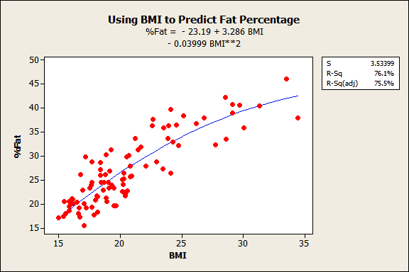

::: {dir="ltr" style="text-align: left;" trbidi="on"}
রিগ্রেশন অ্যানালাইসিসের বড় একটি সমস্যা হলো লিনিয়ার ও নন-লিনিয়ার রিগ্রেশন মডেল আলাদা করে চিনতে পারা। সাধারণ ডেটা অ্যানালাইসিস বা মেশিন লার্নিং অ্যালগোরিদম প্রয়োগ করা-দুই ক্ষেত্রেই লিনিয়ার ও নন-লিনিয়ার মডেল চেনা খুব জরুরি।

বিষয়টি বলার আগে রিগ্রেশন (regression) আমরা কেন করি বা কী কাজে সে সম্পর্কে একটু বলে নেই।

একটি দৈব চলককে (random variable) আরেকটি চলকের মাধ্যমে প্রেডিক্ট বা অনুমান করার জন্য আমরা রিগ্রেশন মডেল ব্যবহার করি। রিগ্রেশনের মাধ্যমে প্রতিটি স্বাধীন (independent) চলক অধীন (dependent) চলককে কতটুকু প্রভাবিত করে সেটা জানা যায়। আর অধীন চলক সম্পর্কে অনুমানও করা হয় এই তথ্য কাজে লাগিয়েই।

যেমন ধরা যাক, আমরা জানতে চাই, মানুষের মাসিক আয় বাড়লে মাসিক খরচের কী অবস্থা হয়। অর্থাৎ কতটুকু আয় বাড়লে গড়ে কতটুকু খরচ বাড়ে। এবার ধরা যাক, দুটো চলকের সম্পর্ক তুলে ধরার জন্য আমরা একটি মডেল চিন্তা করলাম। যেটা এ রকম:
$$Y=\alpha + \beta X + \epsilon$$
এখানে Y হলো অধীন চলক। মানুষের আয়। আর X হলো স্বাধীন চলক। মাসিক খরচ। আর $\epsilon$ হলো ভ্রান্তি পদ (error term)। এই পদটি থাকার কারণ হলো আমরা আয় থেকে খরচ পুরোটা অনুমান করতে পারব না। অনুমান একটু এদিক-ওদিক হবে। $\epsilon$ এই "এদিক-ওদিক" বিষয়টিই দেখে। আর $\alpha$ ও $\beta$ নিয়ে একটু পরে বলছি।

এখানে আমাদের হাতে অনেকগুলো X ও Y এর মান থাকবে। যেমন ধরুন
\\begin{array}{\|c\|c\|}
\\hline
X, & Y \\\\ \\hline
৩০০০০ & ২৫০০০\\\\ \\hline
৫০০০০ & ৪৩০০০ \\\\ \\hline
১০০০০০ & ৮৬০০০\\\\ \\hline
৫৫০০০ & ৪৯০০০ \\\\ \\hline
৭৫৯০০ & ৬৭৫৫০\\\\ \\hline
...& ...\\\\ \\hline
\\end{array}
এবার এই টেবিলের মানগুলো ব্যবহার করে আমরা উপরের মডেলের $\alpha$ ও $\beta$র মান পাব।  এখানে $\alpha$ ও $\beta$ হলো মডেলের প্যারামিটার (parameter)। $\alpha$ মানে হল X না থাকলে Y এর মান কত হবে। যেমন আমাদের মডেলে এর মানে হলো আয় না থাকলেও কত খরচ হবে। $\alpha$ এর মান সব সময় যৌক্তিক নাও হতে পারে।যেমন ধরুন X ও Y যদি হয় যথাক্রমে তুলা ও সুতার পরিমাণ, তাহলে $\alpha$ মানে হবে সুলা ছাড়াই কতটুকু সুতা পাওয়া যাবে। এই উদাহরণে এটার বাস্তব কোনো ভিত্তি নেই। তাই এক্ষেত্রে $\alpha$কে মডেল থেকে বাদ দিতে হবে।

আর $\beta$ মানে হলো X এক একক বাড়লে Y কতটুকু বাড়বে বা কমবে। যেমন উপরের মডেলে যদি আমরা $\beta$র মান পাই ০.২৫, তাহলে এর মানে হবে আয় ১ টাকা বাড়লে গড়ে খরচ বাড়বে ২৫ পয়সা।

**এবার আজকের আলোচনার মূল বিষয়।**
উপরে আমরা যে মডেলটা করলাম এটাকে বলে সিম্পল লিনিয়ার বা সরল রৈখিক রিগ্রেশন (simple linear)। কিন্তু এখানে X এর উপর যে-কোনো পাওয়ার থাকতে পারত। $\beta$ ও X এর সম্পর্কের রূপ হতে পারত কিম্ভুতকিমাকার।

তাহলে কীভাবে বুঝব কোন মডেলটা লিনিয়ার বা রৈখিক (linear) আর কোনটা নন-লিনিয়ার?

এখানে আরেকটি বিষয় মাথায় রাখতে হবে। রিগ্রেশনের ক্ষেত্রে মডেলকে লিনিয়ার বা নন-লিনিয়ার বলা হয় প্যারামিটারের সাপেক্ষে। গাণিতিকভাবে দেখলে নীচের সমীকরণটি নন-লিনিয়ার।
$$Y=\alpha + \beta X^2$$
কারণ X এর পাওয়ার এক (১) নয়। কিন্তু এই সমীকরণের সাথে $\epsilon$ যোগ করে রিগ্রেশন মডেল বানালে সেটি হবে লিনিয়ার মডেল।

**তাহলে কখন নন-লিনিয়ার চিনব কীভাবে? **
তার জন্য আগে লিনিয়ার মডেল চিনতে হবে। একটি মডেল লিনিয়ার হবে যদি মডেলের প্রতিটি পদ হয় ধ্রুবক হয়, অথবা একটি প্যারামিটার ও একটি স্বাধীন চলকের (X) গুণফল হয়। আর সাথে ভ্রান্তি পদ তো থাকবেই। অতএব লিনিয়ার মডেলের সাধারণ রূপ হলো এ রকম:
$$Y=\alpha + \beta _1 X_1 + \beta _2 X_2 +\beta _k X_k + \epsilon \tag{1}$$
X এর পাওয়ার কম-বেশিও হতে পারে। কিন্তু প্যারামিটারের সাথে সম্পর্ক এই সমীকরণের মতো হলেই কেবল তাকে আমরা লিনিয়ার রিগ্রেশন বলব। এখন X এর জায়গায় যদি $X^2$ বা $X^3$ থাকে তাতেও লিনিয়ারই হবে। মানে নীচের মডেলও লিনিয়ার:
$$Y=\alpha + \beta _1 X_1 + \beta _2 {X_2}^2 + \epsilon$$
অনেকে আবার বলে থাকেন প্যারামিটারের ওপর পাওয়ার একের বেশি হলে নন-লিনিয়ার হবে। যেমন:
 $Y=\alpha + {\beta _1}^2 X_1 + \beta _2 {X_2}^2 + \epsilon$
কিন্তু এটি আসলে লিনিয়ার-ই। খেয়াল করে দেখুন $\beta$ এর উপর পাওয়ার হলেও পাওয়ার করে পাওয়া মান একটি ধ্রুবক-ই হবে। সেই ধ্রুবককে আমরা $\gamma$ বলতে পারি। ফলে সমীকরণ কিন্তু সেই "$X \times$" ধ্রুবক-ই হলো। ফলে এটিও লিনিয়ার-ই।

তার মানে লিনিয়ার রিগ্রেশনেও সরল রেখার বদলে কার্ভও পাওয়া যেতে পারে। নীচের ছবিতে শরীরের চর্বি ও বিএমআই (BMI = Body Mass Index) এর জন্য মডেল দেখানো হয়েছে। মডেল করা হয়েছে লিনিয়ার রিগ্রশন দিয়েই।

  ----------------------------------------------------------------------------------------------------------------------------------------------------------------------------------------------------------------------------------------------------------------------------------------------------------------------------------------------
                                                                                                                                                         
   এ ছবিতে BMI ও চর্বির পরিমাণের সম্পর্কের নন-লিনিয়ার (অরৈখিক) রূপ দেখে মনে হতে পারে নন-লিনিয়ার রিগ্রেশন করতে হবে। আসলে এই অরৈখিক সম্পর্কের জন্যেও লিনিয়ার রিগ্রেশন যথেষ্ট। ছবির সোর্স: [MiniTab](http://blog.minitab.com/blog/adventures-in-statistics/how-to-predict-with-minitab-using-bmi-to-predict-the-body-fat-percentage-part-1) ব্লগ। 
  ----------------------------------------------------------------------------------------------------------------------------------------------------------------------------------------------------------------------------------------------------------------------------------------------------------------------------------------------

**এবার তাহলে নন-লিনিয়ার মডেল কারা?**
খুব সহজ। যে মডেলে উপরের ১ নং সমীকরণের মতো আকৃতি থাকবে না তারাই নন-লিনিয়ার। মানে লিনিয়ার মডেল মূলত এক রকম হলেও নন-লিনিয়ার মডেল নানা আকৃতিতে থাকতে পারে।

নিচে এমন কিছু উদাহরণ দেওয়া হলো।
\$Y=\\theta \_1 \\times X\^{\\theta \_2} + \\epsilon\\\\
Y=\\theta \_1 + (\\theta \_1 -\\theta \_2) \\times e\^{\\theta \_3 \\times {\\theta \_4}}  + \\epsilon\\\\
Y=\\sqrt{\\beta \_1 + \\beta \_2 X} + \\epsilon\\\\
Y=\\sqrt{\\beta \_1 + \\beta \_2 X\^2} + \\epsilon
\$

নন-লিনিয়ার রিগ্রেশনের এমন হাজারও উপায় থাকতে পারে। 

শেষ একটি বিষয়। উপরে আমরা দেখলাম, লিনিয়ার মডেলেরও কার্ভ থাকতে পারে। তাহলে কখন আমরা নন-লিনিয়ার মডেল ব্যবহার করব? এটা নিয়ে ভবিষ্যতে বিস্তারিত লিখব ইনশাআল্লাহ। আপাতত [এই লেখাটি পড়তে](http://blog.minitab.com/blog/adventures-in-statistics-2/linear-or-nonlinear-regression-that-is-the-question) পারেন। 

**সূত্র**
১। [মিনিট্যাব ব্লগ](http://blog.minitab.com/blog/adventures-in-statistics-2/what-is-the-difference-between-linear-and-nonlinear-equations-in-regression-analysis)
২। Johnson, J., Econometric Methods, 3rd Edition. 
:::
