::: {dir="ltr" style="text-align: left;" trbidi="on"}
R-এ অধিকাংশ কাজই একাধিক উপায়ে করা যায়। নান্দনিক গ্রাফিক্সের জন্য কালার বড় ভূমিকা পালন করে। R-এ প্লট কালার করা যায় অন্তত ৯ উপায়ে। চলুন জেনে নেওয়া যাক সে উপায়গুলো।

ও, আচ্ছা। প্লট করার জন্যে তো হাতে কিছু ডেটা লাগবে। আগে ডেটা বানিয়ে নিই তাহলে।

> x=rexp(1000)
> y=(rnorm(1000)

আর R এর ডিফল্ট ফন্ট আমার পছন্দ না। তাই ফন্টটা একটু পালটে নিচ্ছি। এটা অপশনাল। না করলেও দুনিয়া ধ্বংস হয়ে যাবে না।

> par(family="serif")

তাহলে এবার আসল কাজে আসা যাক! মনে রাখতে হবে R-এ কমেন্ট শুরু হয় \# চিহ্ন দিয়ে। মানে \# চিহ্নের পরের কোড রান হবে না। 

**১। কালার সিকুয়েন্স **

::: {.separator style="clear: both; text-align: center;"}
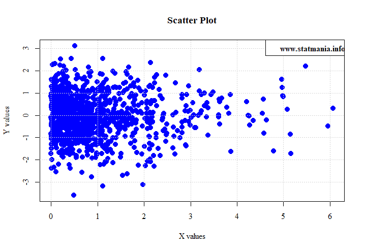
:::

> plot(x, y, col=4, pch=16, cex=1.4, main="Scatter Plot",
>      xlab="X values", ylab="Y values")
> grid() \# optional

এখানে plot ফাংশনের col ছাড়া বাকি আর্গুমেন্টগুলো অপশনাল। প্লটের নান্দনিকতার স্বার্থেই যোগ করা। যাই হোক, এখানে খেয়াল করুন, আমরা শুধু একটি সংখ্যা বসিয়ে দিয়েছি। R-এ প্রায় প্রতিটি সংখ্যার বিপরীতে একটি করে কালার আছে। আপনি চাইলে এখানে 4,5,10, 25, 36- যাই ইচ্ছে বসিয়ে দেখতে পারেন। 

আবার কখনও একই সাথে অনেকগুলো কালারের প্রয়োজন হলে col=1:10 বা c(1,2,4,6,7,3) ফরম্যাটেও লিখতে পারেন। চেক করেই দেখুন না!

আবারও মনে করিয়ে দেই। উপরের grid কমান্ডটি কিন্তু অপশনাল। এটা আসলে প্লটে বক্স আঁকে। \# দিয়ে অপশনাল কথাটা বলা আছে।

**২। কালার নেইম **

এক্ষেত্রে আমরা সরাসরি কালারের ইংরেজি (সাধারণত) নাম বসিয়ে দেব।

> plot(x, y, col="blue", pch=16, cex=1.4, main="Scatter Plot",
>      xlab="X values", ylab="Y values")

একই প্লট পাওয়া গেল। এখানেও চাইলে আপনি একাধিক কালার ব্যবহার করতে পারেন একই প্লটে। Scatter প্লটের ক্ষেত্রে একাধিক কালার আপাতত দরকার না হলেও হিস্টোগ্রামে দরকার হতে পারে। যেমনঃ

> hist(x, col=c("blue", "grey"))
> box() \#optional
> grid() \#optional

::: {.separator style="clear: both; text-align: center;"}
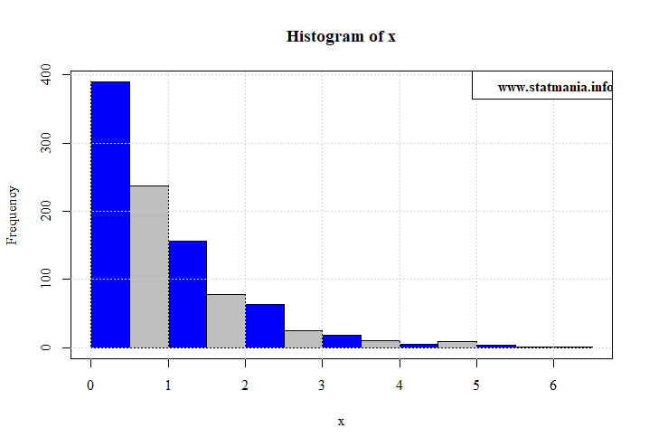
:::

এক্ষেত্রে যেটা দরকার, তা হলো সবগুলো কালারের নাম জানা। সেটাও সহজ। প্রথমত, [এই লিঙ্ক থেকে](http://www.stat.columbia.edu/~tzheng/files/Rcolor.pdf) R-এর সবগুলো কালার নেইম পাবেন। অফলাইনে ব্যবহার করতে ডাউনলোড করে নিতে পারেন। আরও সহজে নামগুলো দেখতে চাইলে colors() কোড ব্যবহার করুন। তবে এক্ষেত্রে কোন কালারের চেহারা কেমন সেটা বোঝা যাবে না। সেটা বোঝা যাবে পিডিএফ ফাইলটা থেকে (লিঙ্কের)।

৩। অটো কালার ১ (topo.colors(10))

::: {.separator style="clear: both; text-align: center;"}
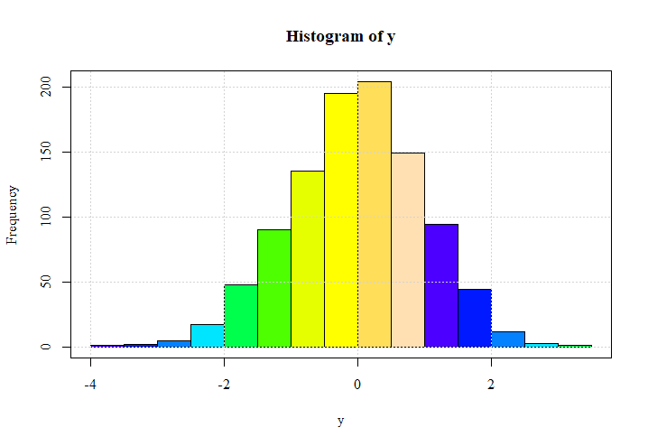
:::

> hist(y, col=topo.colors(10))
> grid() \#optional
> box() \#optional

যতটা আলাদা কালার চাই, ব্র্যাকেটের ভেতরে সেটা উল্লেখ করে দিতে হবে। 

৪। অটো কালার ২

::: {.separator style="clear: both; text-align: center;"}
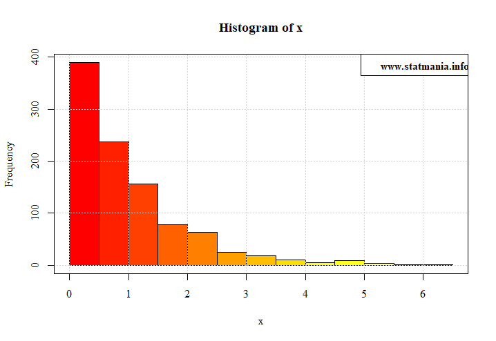
:::

> hist(x, col=heat.colors(12))
> grid() \#optional
> box() \#optional

এক্ষেত্রেও যতটা আলাদা কালার চাই, ব্র্যাকেটের ভেতরে সেটা উল্লেখ করে দিতে হবে। 

৫। অটো কালার ৩

::: {.separator style="clear: both; text-align: center;"}
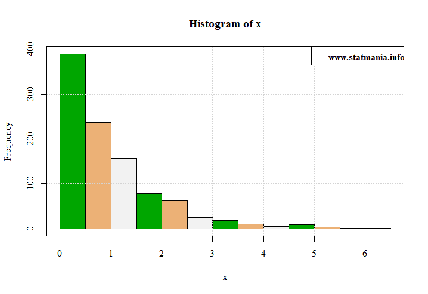
:::

> hist(x, col=terrain.colors(3))
> grid() \#optional
> box()\#optional

এক্ষেত্রেও যতটা আলাদা কালার চাই, ব্র্যাকেটের ভেতরে সেটা উল্লেখ করে দিতে হবে। 

**৬। হেক্সাডেসিমাল কোড**

::: {.separator style="clear: both; text-align: center;"}
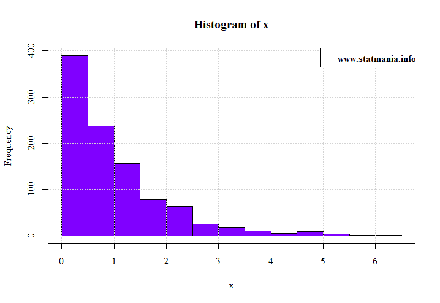
:::

[এই সাইট ভিজিট করুন](https://www.w3schools.com/colors/colors_picker.asp)। অথবা hexadecimal colors লিখে সার্চ দিলে আরও নানান সাইট পাওয়া যাবে। এখান থেকে হেক্সাডেসিমাল কোডটি বা কোডগুলো বসিয়ে দিতে পারেন। 

> hist(x, col="\#80ff00")
> grid() \#optional
> box()\#optional

৭,৮। Rgb ও hsl কালার কোড

::: {.separator style="clear: both; text-align: center;"}
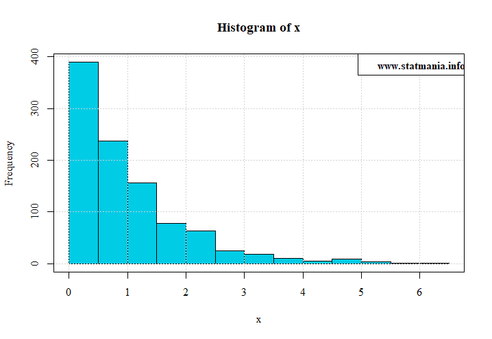
:::

উপরে দেওয়া লিঙ্কেই বাকি দুটি কালার কোডও পাবেন। এ দুটোতে সামান্য জটিলতা আছে। লিঙ্কে যেভাবে আছে ঠিক সেভাবে দিলে হবে না। rgb() ফাংশনের ভেতরে ৩টি সংখ্যা দিতে হবে। rgb মানে আসলে রেড, গ্রিন ও ব্লু। অতএব, ভেতরে যথাক্রমে লাল, সবুজ ও নীলের অনুপাত বসাতে হবে। প্রতিটি সংখ্যা হবে ০ থেকে ১ এর মধ্যে। ০ ও ১ দেওয়া যাবে। 

> hist(x, col=rgb(0,0.8,0.9))
> grid() \#optional
> box()\#optional

আর hsl কোডে আরেকটু জটিলতা আছে। এটাকে ব্যবহার করতে চাইলে [এই টিউটোরিয়াল পড়ুন](https://stackoverflow.com/questions/28562288/how-to-use-the-hsl-hue-saturation-lightness-cylindric-color-model)। 

৯। সেরা কৌশল 

এতক্ষণ যেগুলো বললাম এগুলোর অনেকগুলো থেকেই অনেক সময় সেরা কম্বিনেশন বাছাই করা কঠিন। যেমন নীচের ম্যাপটি আঁকতে চাই। ম্যাপটি আঁকার বিস্তারিত [কোড আছে এখানে](2018-07-bd-map-literacy-rate-with-r.html)। 

::: {.separator style="clear: both; text-align: center;"}
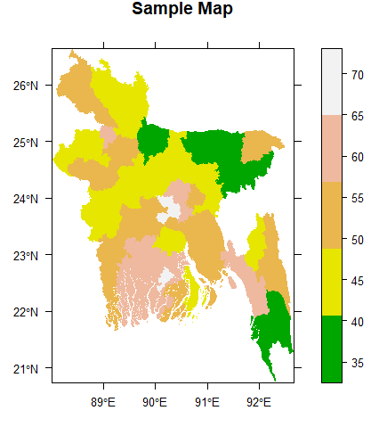
:::

> spplot(zilla, "literacy",col.regions=terrain.colors(5),
>        cuts=4, col='transparent', main='Sample Map',
>        scales=list(draw=T))

এখানে terrain.colors(5) ভালো কাজ করেছে। তবে কালারের সিকুয়েন্স ধরে রাখতে পারেনি। 

::: {.separator style="clear: both; text-align: center;"}
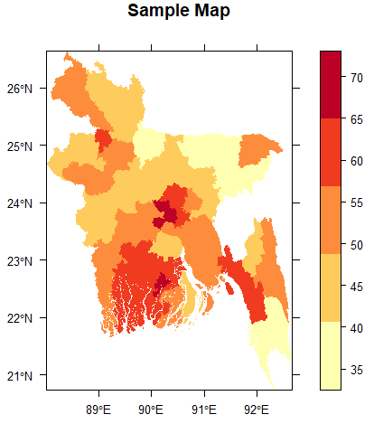
:::

কিন্তু এটায় দেখুন, মান বাড়ার সাথে কালার গাঢ় হয়েছে। অথবা নীচের হিস্টোগ্রাম দেখুনঃ

::: {.separator style="clear: both; text-align: center;"}
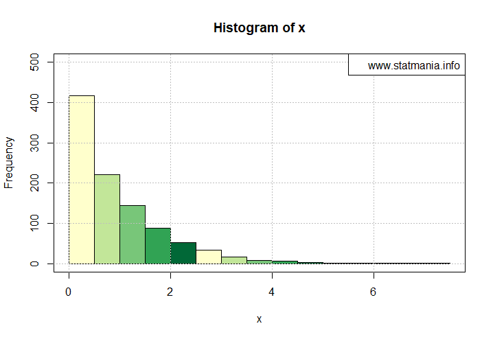
:::

নানান ক্ষেত্রেই এটার প্রয়োজন অনুভব করবেন। এক্ষেত্রে একটি প্যাকেজ লাগবে। নাম RColorBrewer। ইন্সটল করে লোড করে নিন। 

> install.packages("RColorBrewer")
> library(RColorBrewer)

এবার আবার হিস্টোগ্রাম আঁকি। 

> hist(x, col=brewer.pal(n=5, name='YlGn'), ylim=c(0,500))

এখানে n এর জায়গায় যতগুলো কালার চান সেটা বসাবেন। আর name এর জায়গায় কী বসাবেন সেটার উপরই বির্ভর করছে কালার কেমন হবে। নীচের ছবিতে দেখে নিন কোডগুলো। বড় করে দেখতে [এখানে ক্লিক করুন](https://blogger.googleusercontent.com/img/b/R29vZ2xl/AVvXsEg0dEPzUwlc9o7lfVj8EsC5xNRgh5aj7n5j4b7vOVGnQtsXEcPuOeGQ76gw6lpH6roXfTqQ8PhoFBKdGmBXTCJ3mHLc9tT3g8_KyV-Pd_rm23kqMw72mLYddmweU56d42t1r1O7spJ1wbA/s1600/Rcolors.png)। 

::: {style="text-align: center;"}
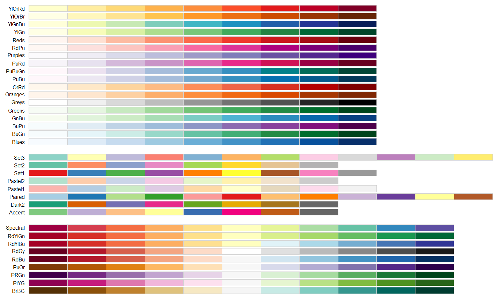 
:::

আপনাকে আর পায় কে। দৃষ্টিনন্দন প্লট এঁকে তাক লাগিয়ে দিন বসকে!

এর বাইরে আপনি আরও কিছু জানলে কমেন্টে অবশ্যই জানাবেন।
:::
