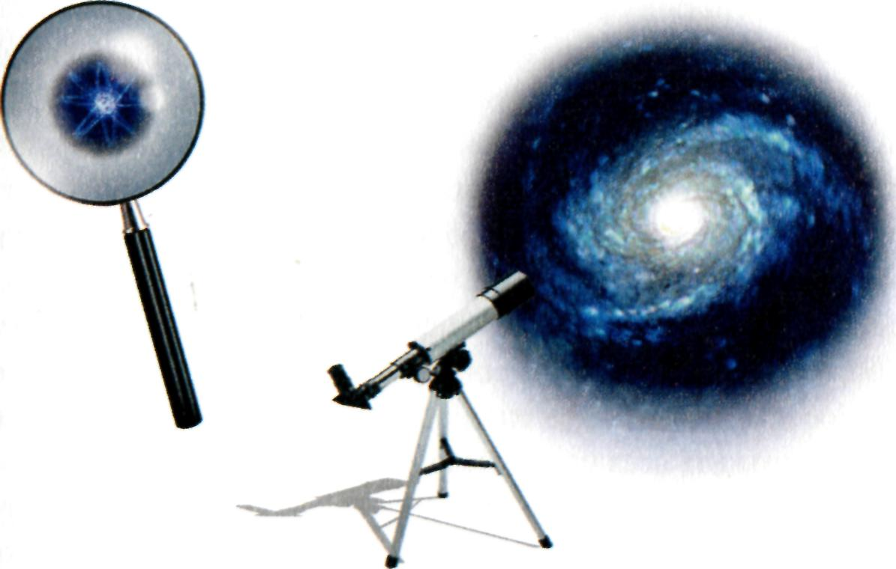

::: {dir="ltr" style="text-align: left;" trbidi="on"}
*\[স্টিফেন হকিং এর লেখা ও আব্দুল্যাহ আদিল মাহমুদ অনূদিত [অ্যা ব্রিফার হিস্ট্রি অব টাইম](https://www.facebook.com/brieferhist) বই অবলম্বনে\]  *

বিজ্ঞানী হতে হলে জানতে হবে বিজ্ঞান বা বৈজ্ঞানিক তত্ত্ব কাকে বলে।

::: {.separator style="clear: both; text-align: center;"}

:::

::: {.separator style="clear: both; text-align: center;"}
:::

সোজা কথায় বললে, থিওরি বা তত্ত্ব হচ্ছে একটি মডেল বা নমুনা, অথবা সেই নমুনার কোন সীমিত অংশবিশেষ এবং এমন এক গুচ্ছ নিয়ম বা সূত্র, যে সূত্রগুলো পর্যবেক্ষণে প্রাপ্ত তথ্যকে মডেলের মাধ্যমে ব্যাখ্যা করতে পারবে। এই তত্ত্ব থাকে আমাদের মস্তিষ্কে এবং এর অন্য রকম কোনো বাস্তবতা নেই (বাস্তবতার সংজ্ঞা যা হয় হোক)।

একটি তত্ত্বকে ভালো বলা হয় যদি এর মধ্যে দুটো গুণ পাওয়া যায়। **এক, অনেকগুলো পর্যবেক্ষণকে এটি অল্প কথায় সঠিকভাবে ব্যাখ্যা করতে পারবে**। দুই, একে ভবিষ্যত পর্যবেক্ষণের ফলাফল সম্পর্কে সুনির্দিষ্ট পূর্বাভাস \[১\] দিতে হবে। অ্যারিস্টটল এমপেডোক্লেসের এই তত্ত্ব  মেনে নিয়েছিলেন যে জগতের সবকিছু মাটি, বায়ু, আগুন ও পানি- এই চারটি উপাদান দিয়ে তৈরি। তত্ত্বটি যথেষ্ট সরল ছিল, কিন্তু এটি কোনো সুনির্দিষ্ট পূর্বাভাস দিতে পারেনি। অন্য দিকে, নিউটনের মহাকর্ষ তত্ত্বটি উপস্থাপন করা হয় আরো সরল ভাবে। এই তত্ত্বে বস্তুরা একে অপরকে তাদের ভরের সমানুপাতিক ও তাদের মধ্যবর্তী দূররত্বের বর্গের ব্যস্তানুপাতিক বলে আকর্ষণ করে। তত্ত্বটি দেখতে সরল হলেও এটি অনেক নিখুঁতভাবে সূর্য, চন্দ্র এবং গ্রহদের গতির পূর্বাভাস দিতে পারে।

যে কোনো ভৌত তত্ত্বই (physical theory)এই অর্থে অস্থায়ী যে এটি শুধুই একটি অনুমান। একে কখোনই পুরোপুরি প্রমাণ করা যাবে না। পরীক্ষার ফলাফলের সাথে হাজারবার মিলে গেলেও আপনি কখোনই নিশ্চিত করে বলতে পারবেন না এটি পরের বার বিপরীত ফলাফল দেবে না। উল্টো দিকে একটি তত্ত্বকে ভুল বলার জন্যে এর বিপক্ষে একটি মাত্র পর্যবেক্ষণই যথেষ্ট। বিজ্ঞানের দার্শনিক কার্ল পপার যেমন জোর দিয়ে বলেছেন,

> একটি ভালো তত্ত্বের বৈশিষ্ট্য হচ্ছে, এতে এমন অনেকগুলো পূর্বাভাস থাকবে যাদেরকে পর্যবেক্ষণের মাধ্যমে ভুল বা মিথ্যা প্রমাণ করার সুযোগ থাকবে। 

যখনি নতুন কোনো পরীক্ষার সাথে এর পূর্বাভাস মিলে যাবে, তত্ত্বটি বেঁচে যাবে। কিন্তু কখনো নতুন কোনো পর্যবেক্ষণ এর সাথে না মিললে আমাদেরকে তত্ত্বটিকে পরিত্যাগ বা সংস্কার করতে হবে।

বাস্তবে দেখা যায় নতুন তত্ত্ব আসলে আগের তত্ত্বেরই পরিবর্ধন মাত্র। উদাহরণ হিসেবে বলা যায় বুধ গ্রহের গতির কথা। নিউটনের মহাকর্ষ তত্ত্বের পূর্বাভাসের সাথে এর গতির সামান্য ভিন্নতা দেখা দেয়। আইনস্টাইনের সার্বিক আপেক্ষিক তত্ত্ব নিউটনের তত্ত্বের চেয়ে কিছুটা ভিন্ন অনুমান প্রদান করে, যা পর্যবেক্ষণের সাথে ঠিক ঠিক মিলে যায়। নিউটনের তত্ত্বের জায়গায় নতুন এই তত্ত্বের জায়গা করে নিতে এটি গুরুত্বপূর্ণ ভূমিকা রাখে। তবু এখনও আমরা বাস্তবে নিউটনের তত্ত্বই বেশি ব্যবহার করি, কারণ আমাদের দৈনন্দিন জীবনের প্রয়োজনীয় ক্ষেত্রে দুটো থিওরির পার্থক্য সামান্য। নিউটনের তত্ত্বের আরেকটি সুবিধা হল এটি আইনস্টাইনের সূত্রের চেয়ে অনেক সরল।

বিজ্ঞানের চূড়ান্ত লক্ষ্য হচ্ছে এমন একটি তত্ত্ব প্রদান করা,  যা সমগ্র মহাবিশ্বকে ব্যাখ্যা করতে পারবে। অবশ্য অধিকাংশ বিজ্ঞানীই বাস্তবে সমস্যাটিকে দুই ভাগে বিভক্ত করে কাজ করেন। প্রথমত, কিছু সূত্র আমাদেরকে বলছে যে সময়ের সাথে সাথে মহাবিশ্বের কীরূপ পরিবর্তন ঘটছে। (আমরা যদি কোনো একটি সময়ে মহাবিশ্বের অবস্থা জানি, এই ভৌত সূত্রগুলো আমাদের বলবে পরবর্তী কোনো সময়ে মহাবিশ্ব কী অবস্থায় থাকবে।) দ্বিতীয় প্রশ্নটি হল মহাবিশ্বের আদি অবস্থা নিয়ে। কেউ কেউ মনে করেন, বিজ্ঞানের উচিত শুধু প্রথম অংশটি নিয়ে কাজ করা। তাদের মতে, মহাবিশ্বের আদি অবস্থার বিষয়টি অধিবিদ্যা\[২\] বা ধর্মের আলোচ্য বিষয়। তাদের মতে, সর্বশক্তিমান ঈশ্বর মহাবিশ্বের সূচনা নিজের যেভাবে ইচ্ছা সেভাবেই করেছেন\[৩\]। তা হলেও হতেও পারে, কিন্তু সেক্ষেত্রে ঈশ্বর মহাবিশ্বকে কোনো অনির্দিষ্ট প্রক্রিয়াতেই বিবর্তিত হতে দিতেন। কিন্তু বাস্তবে দেখা যাচ্ছে তিনি একে কিছু নির্দিষ্ট নিয়মের অধীন করেছেন, যা কিছু সূত্র মেনে চলছে। কাজেই মহাবিশ্বের আদি অবস্থাও কিছু নিয়ম মেনে চলছিল মনে করাটাই যুক্তির দাবি।

মহাবিশ্বের সবকিছুকে একই তত্ত্বে গেঁথে ফেলা কঠিন একটি কাজ। ফলে আমরা একে ভেঙে অনেকগুলো আংশিক তত্ত্ব তৈরি করি। এই আংশিক তত্ত্বদের প্রতিটি কিছু নির্দিষ্ট পর্যবেক্ষণের ব্যাখ্যা ও পূর্বাভাস দিতে পারে। এর আওতার বাইরের বিষয়গুলো সম্পর্কে এটি নীরব থাকে অথবা তাদেরকে কিছু সংখ্যা দ্বারা প্রকাশ করে। খুব সম্ভব, এটি একটি ভুল পদ্ধতি। যদি মৌলিক জায়গাটিতে মহাবিশ্বের সবকিছু অন্য সব কিছুর উপর নির্ভরশীল হয়, তাহলে এদেরকে আংশিকভাবে মূল্যায়ন করে পূর্ণাঙ্গ সমাধানে পৌঁছা সম্ভব নাও হতে পারে। তবুও, আমরা অতীতে কিন্তু এটাই করে এসেছি।

উদাহরণ হিসেবে আবারও বলব নিউটনের মহাকর্ষ তত্ত্বের কথা। এটি বলছে, দুটো বস্তুর মধ্যে ক্রিয়াশীল মহাকর্ষ বল বস্তুদ্বয়ের একটিমাত্র নিজস্ব বৈশিষ্ট্যের উপর (ভর)নির্ভরশীল\[৪\]। বস্তু কী দিয়ে তৈরি তার উপর এই বল নির্ভর করে না। কাজেই গ্রহদের কক্ষপথের হিসাব বের করার জন্য এদের এবং সূর্যের গঠন ও উপাদানের জন্যে আমাদের আলাদা কোনো তত্ত্বের প্রয়োজন নেই।

বর্তমানে মহাবিশ্বের ব্যাখ্যায় বিজ্ঞানীরা দুটি মৌলিক আংশিক তত্ত্ব কাজে লাগাচ্ছেন। এরা হল জেনারেল থিওরি অব রিলেটিভিটি বা সার্বিক আপেক্ষিক তত্ত্ব ও কোয়ান্টাম মেকানিক্স। এই দুটি তত্ত্ব বিংশ শতাব্দীর প্রথমার্ধের বুদ্ধির জগতের এক বিরাট অর্জন। সার্বিক আপেক্ষিক তত্ত্ব মহাকর্ষ বল ও মহাবিশ্বের বড় দৈর্ঘ্যের কাঠামোকে (Large scale structure) ব্যাখ্যা করে। মাত্র কয়েক মাইল থেকে শুরু করে অন্তত এক হাজার কোটি কোটি কোটি (১ এর পরে ২৪ টি শুন্য) মাইল তথা পর্যবেক্ষণযোগ্য মহাবিশ্বের আকারের সমপরিমাণ অংশ এই তত্ত্বের আওতায় আছে। অন্য দিকে কোয়ান্টাম মেকানিক্স কাজ করে এক ইঞ্চির এক লক্ষ কোটি ভাগের এক ভাগের মতো অত্যন্ত ক্ষুদ্র দৈর্ঘ্যের জগতে।

  ------------------------------------------------------------------------------------------------------------------------------------------------------------------------------------------------------------------------------------------
                                                                                                       
   পরমাণু থেকে মহাবিশ্ব। \[বিংশ শতকের প্রথমার্ধ পর্যন্ত নিউটনীয় পদার্থবিদ্যার সূত্রগুলো কাজ করত শুধু দৈনন্দিন জীবনের ক্ষেত্রগুলোতে। এরপরে এসে পদার্থবিদ্যার পরিধি বিস্তৃত হয়ে পৌঁছায় মহাবিশ্বের ক্ষুদ্রতম থেকে বৃহত্তম চৌহদ্দি পর্যন্ত। \] 
  ------------------------------------------------------------------------------------------------------------------------------------------------------------------------------------------------------------------------------------------

এই দুটি তত্ত্ব আবার একে অপরের বিরোধী- এদের দুটোই যে ঠিক হবে সেটি সম্ভব নয়। বর্তমানে পদার্থবিদ্যার একটি প্রধান লক্ষ্য হচ্ছে নতুন একটি তত্ত্ব প্রদান করা, যা এই দুটো তত্ত্বকে একীভূত করে কোয়ান্টাম গ্র্যাভিটি নামে কমন একটি তত্ত্বের জন্ম দেবে। এখনও এমন তত্ত্ব প্রস্তুত করতে হয়নি। হতে পারে, আমরা এখনও এর থেকে বহু দূরে আছি। কিন্তু এই তত্ত্বের কী কী বৈশিষ্ট্য থাকা উচিত তার অনেকগুলোই ইতোমধ্যে জানা সম্ভব হয়েছে।

এখন আমরা যদি বিশ্বাস করি যে মহাবিশ্ব এলোমেলোভাবে নয় বরং চলছে কিছু নির্দিষ্ট নিয়ম মেনে, তাহলে এই আংশিক সূত্রগুলোকে অবশ্যই একটি পূর্ণাংগ একীভূত তত্ত্বে রূপদান করতে হবে, যা ব্যাখ্যা দেবে মহাবিশ্বের সব কিছুর। কিন্তু এরকম একটি একীভূত তত্ত্বের সন্ধানে নামলে একটি সঙ্কটের মুখে পড়তে হয়। ওপরে উল্লিখিত বিজ্ঞানের এই চিন্তা- ভাবনাগুলোতে ধরে নেওয়া হচ্ছে যে আমরা বুদ্ধিমান জীব, যারা স্বাধীনভাবে মহাবিশ্বকে দেখছি ও তা থেকে সিদ্ধান্ত নিচ্ছি। যদি এটা সঠিক হয়ে থাকে, তাহলে আমরা উন্নতি করতে করতে একদিন মহাবিশ্বের কার্যকরী নিয়মগুলোর কাছাকাছি পৌঁছতে পারব বলে মনে করা খুবই স্বাভাবিক।

*অনুবাদকের নোটঃ*
১। যেমন আইনস্টাইনের জেনারেল থিওরি অব রিলেটিভিটি বা সার্বিক আপেক্ষিক তত্ত্ব। ১০০ বছর আগে এর মহাকর্ষ তরঙ্গের পূর্বাভাস ২০১৬ এসে প্রমাণিত হয়। ফলে এটি ভালো তত্ত্ব হিসেবে আরো জোরালো স্বীকৃতি লাভ করে।
২। অধিবিদ্যা (Metaphysics) হল দর্শনের একটি শাখা। অন্য অনেক কিছুর মতো এরও জনক এরিস্টটল। বিশ্বের অস্তিত্ব, আমাদের অস্তিত্ব, সত্যের ধারণা, বস্তুর গুণাবলী, সময়, স্থান, সম্ভাবনা ইত্যাদি এর আলোচ্য বিষয়।
৩। অর্থ্যাৎ,তাদের মতে নির্দিষ্ট কোনো সূত্র প্রয়োগ করে মহাবিশ্ব সৃষ্টি করা হয়নি, তাই সেই আদি অবস্থার ব্যাখ্যা দেবার মত কোনো নির্দিষ্ট সূত্রের ব্যাখ্যা খোঁজা অনর্থক।
৪। মহাকর্ষ বল বস্তুদের দূরত্বের উপরও নির্ভরশীল- এটা ঠিক, কিন্তু দূরত্বতো আর বস্তুর নিজস্ব কোনো বৈশিষ্ট্য নয়।
৫। কারণ আমরাওতো মহাবিশ্বেরই একটি অংশ।
:::
