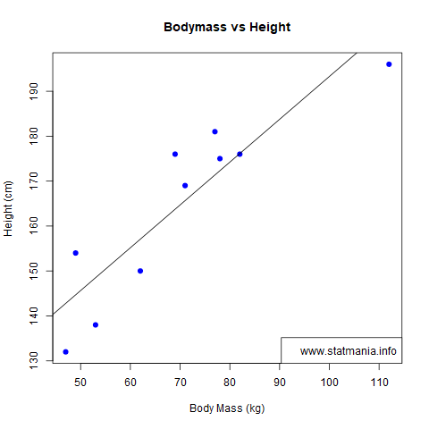

::: {dir="ltr" style="text-align: left;" trbidi="on"}
একটি দৈব চলকের উপর অন্য এক বা একাধিক দৈব চলকের প্রভাব পরিমাপ করতে ও সেই তথ্য কাজে লাগিয়ে প্রেডিকশন করতে রিগ্রেশন ব্যবহার করি আমরা। তবে রিগ্রেশন মডেল লিনিয়ার করব নাকি নন-লিনিয়ার করব সেটা খুব বড় এক প্রশ্ন। সমস্যাটি আরও প্রকট এই কারণে যে লিনিয়ার মডেলেও অনেক সময় সরলরেখার বদলে বক্র রেখা দেখা যেতে পারে।

রিগ্রেশনের করার আগেই দুটি চলকের সম্পর্ক বোঝার জন্য আমরা সাধারণত বিক্ষেপণ চিত্র (scatter plot) আঁকি। যেমন আমরা নীচের একটি বিক্ষেপণ চিত্র দেখছি যেখানে দেহের ওজোনের সাথে উচ্চতার সম্পর্ক দেখানো আছে।

  -------------------------------------------------------------------------------------------------------------------
                                           
   শরীরের ওজোন ও উচ্চতার সম্পর্ক দেখিয়ে আঁকা Scatter plot বা বিক্ষেপণ চিত্র। সাথে রয়েছে লিনিয়ার রিগ্রেশন মডেল লাইন। 
  -------------------------------------------------------------------------------------------------------------------

**আরও পড়ুন**
[রিগ্রেশন লাইন কীভাবে আঁকবেন? ](http://www.statmania.info/2018/07/r-regression-line.html)

http://blog.minitab.com/blog/adventures-in-statistics-2/linear-or-nonlinear-regression-that-is-the-question

[Jim](https://nl.hideproxy.me/go.php?u=hqZulNEthsvdNwnOLfFxWykE984vQmecxO5h77nu%2FMDw2NoZHo3IFj0QKa9DkGeAN8u1GSt6jgeQ5jC%2FzAdUpeIXscmb&b=5&f=norefer)
:::
