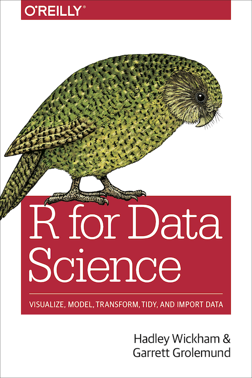

::: {dir="ltr" style="text-align: left;" trbidi="on"}
ডেটা সায়েন্সের অন্যতম জনপ্রিয় প্রোগ্রামিং ল্যাংগুয়েজ R। জনপ্রিয়তা পেছনে অন্যতম বড় একটি কারণ এর বিশাল ইউজার কমিউনিটি। আর অনলাইনে রয়েছে ল্যাংগুয়েজটি শেখার প্রচুর পরিমাণ রিসোর্স। এ রকম কিছু রিসোর্স নিয়ে বলছি। এর বাইরেও ভালো রিসোর্স থাকা অসম্ভব নয়।

**অনলাইন কোর্স**
**১। DataCamp: [Introduction to R](https://www.datacamp.com/courses/free-introduction-to-r)**

ডেটা সায়েন্সের জন্যে অনলাইন কোর্সের সবচেয়ে বড় মাধ্যম ডেটা ক্যাম্প। এখানে R একেবারে প্রাথমিক পর্যায় থেকে শুরু করতে Introduction to R কোর্সটি খুব ভালো ভূমিকা রাখতে পারে। একজন বিগিনার হিসেবে R সম্পর্কে যা যা জানা দরকার তার সবই এখানে আছে। তার ওপর কোর্সটি করা যাবে বিনা মূল্যেই। এই কোর্সে ছয়টি চ্যাপ্টার আছে। এগুলোতে যথাক্রমে ভ্যারিয়েবল টাইপ, অ্যাসাইনমেন্ট, ভেক্টর, ম্যাট্রিক্স, ফ্যাক্টর, ডেটা ফ্রেইম ও লিস্ট শেখানো হয়।

::: {.separator style="clear: both; text-align: center;"}

:::

ডেটাক্যাম্পের বড় একটি সুবিধা হলো এখানে বেশিরভাগ ক্ষেত্রেই টেক্সট বা ভিডিও টিউটোরিয়ালের বদলে প্র্যাকটিসের মাধ্যমে শেখানো হয়। প্রতিটি সেকশনে নির্দেশনা অনুসারে আপনার নিজেকে কোড লিখে সফলভাবে সাবমিট করে তবেই পরের সেকশনে যেতে হবে। তবে এই কোর্সটাকে R এর বিশাল রত্মভাণ্ডারের দরজা বলা যায়। R এর সঠিক প্রয়োগ করতে হলে আরও আরও রিসোর্সের সহায়তা নিতে হবে। ডেটাক্যাম্পেই শুধু R নিয়েই প্রায় ১০০ কোর্স আছে। তবে প্রথমটি ছাড়া বাকি প্রায় সবগুলোরই অ্যাক্সেস পেতে ডলার গুণতে হবে আপনাকে।

**ডেটাক্যাম্প**: [R এর সব কোর্সের লিঙ্ক](https://www.datacamp.com/courses/tech:r)

**২। Coursera**
এখন পর্যন্ত অনলাইন কোর্সের সবচেয়ে বড় মাধ্যম Coursera। এখানে ডেটা সায়েন্স নিয়ে বেশ কিছু কোর্স আছে। তার একটির একাংশে আছে [R Programing](https://www.coursera.org/learn/r-programming/home/welcome) নামে R নিয়ে একটি মোটামুটি পূর্ণাঙ্গ কোর্স। কোর্সটি জনস হপকিন্স ইউনিভার্সিটির প্রফেসরদের দ্বারা পরিচালিত। এতে আগের কোর্সটির কন্টেন্ট এর পাশপাশি লুপ ও সিমুলেশনও আছে। কোর্সটি ৪ সপ্তাহের। প্রতি সপ্তাহেই আছে অ্যাসাইনমেন্ট। এগুলো করতে করতে R অনেকটাই সহজ হয়ে উঠবে।

Courseraয় প্রায় সব কোর্সই টাকা দিয়ে করতে হয়। তবে প্রায় যে-কোনো কোর্সেই Financial aid এর জন্যে অ্যাপ্লাই করা যায়। এটায়ও করা যায়। অ্যাপ্লিকেশনের ১৫ দিন পরে অনুমোদন হলো কি না জানা যায়। হলে তখনই শুরু করা যায়। তবে অ্যাপ্লিকেশন রিজেক্ট হবার নজির আমি দেখিনি কখনও।

**৩। [Essential R](https://newonlinecourses.science.psu.edu/stat484/sites/onlinecourses.science.psu.edu.stat484/files/filepicker/EssentialR/index.pdf) (পেন স্টেইট ইউনিভার্সিটি) **
এটা ওদের অনলাইন কোর্সের জন্যে করা হলেও খুবই হেল্পফুল। পাশাপাশি ওদের R এর অনলাইন [কোর্সটাও](https://newonlinecourses.science.psu.edu/stat484/node/203/) চেখে দেখার মতো।

**আরও কোর্স**
১। EDX: [The Analytics Edge](https://www.edx.org/course/the-analytics-edge)
২। EDX: [Statistics and R](https://www.edx.org/course/statistics-and-r)

**বই**
**
** **১। R Programming for Data Science, Roger Peng**
 এই বইটি মূলত Coursera'র কোর্সের আলোকে করা। এটা পড়লেই কোর্সের প্রায় সব কিছু জানা হয়ে যাবে।

**২। R in a Nutshell, Joseph Adler**
নাটশেল বলা হলেও আসলে বইটির কলেবর বেশ বড়। পিডিএফে ৭২২ পৃষ্ঠা! তবে ধাপে ধাপে R বিশেষজ্ঞ হতে এর জুড়ি নেই।

**৩। R for Data Science: IMPORT, TIDY, TRANSFORM, VISUALIZE, AND MODEL DATA**
**Hadley Wickham & Garrett Grolemund**
**
** বইটির অন্যতম লেখক হ্যাডলি উইকাম। বর্তমান সময়ের সবচেয়ে প্রভাবশালী ডেটা সায়েন্টিস্ট। R এত জনপ্রিয় হবার পেছনে আছে এই মানুষটির অবদান আমার মতে সবচেয়ে বেশি। tidyr, ggplot2, dplyr, readr, devtools, roxygen2 এর মতো জনপ্রিয় R প্যাকেজগুলোর ডেভেলপার তিনি। ডেটা সায়েন্সের কোনো প্রোজেক্ট R দিয়ে একদম শুরু থেকে শেষ পর্যন্ত করতে যা যা লাগবে তার সব এই বইতেই আছে। বইটির একটি বড় অংশ অনলাইনেই পড়া যায়। [এই লিঙ্ক থেকে](http://r4ds.had.co.nz/)।

::: {.separator style="clear: both; text-align: center;"}

:::

**৪। ggplot2: Elegant Graphics for Data Analysis; Hadley Wickham**
যে প্যাকজটির জন্যে হ্যাডলি সবচেয়ে বিখ্যাত সেটি হলো ggplot2। দারুণ সব গ্রাফিক্স আঁকতে এই প্যাকেজের জুড়ি নেই। ggplot2 এর সব খুঁটিনাটি নিয়েই এই বই।

**৫। Machine Learning with R, Brett Lantz**
মেশিন লার্নিং এর কাজগুলো কত দারুণভাবে R দিয়ে করা যায় তা জানা যায় এই বইটি পড়লে। শুরুর দিকে R এর বেসিক বিষয়গুলোও দারুণভাবে উঠে এসেছে।

**৬। Introduction to visualising spatial data in R**

এটা ফ্রিতে ডাউনলোড করা যায় [এই লিঙ্ক থেকে](https://cran.r-project.org/doc/contrib/intro-spatial-rl.pdf)। জিওগ্রাফিক ডেটা অ্যানালাইসিস ও ম্যাঁপ আঁকা শুরু করতে এটার জুড়ি নেই।

**আরও কিছু বই**
১। Advanced R, Hadley Wickham
২। Applied Predictive Modeling, Max Kuhn and Kjell Johnson
৩। Hands-On Programming with R, Garrett Grolemund
৪। R Graphics Cookbook, Winston Chang
৫। **Machine Learning for Hackers**, Drew Conway and John Myles White
৬। Machine Learning Mastery With R, Jason Brownlee

এই বইটার কন্টেন্ট আমার খুব নজর কেড়েছে।

**অনলাইন টিউটোরিয়াল**
১। [R tutorial](https://www.listendata.com/p/r-programming-tutorials.html): listendata.com
শুধু এখানে যে আছে শেষ করতে পারলেই R এর বিশেষজ্ঞদের সাথে পাল্লা দেওয়া যাবে।

২। [টিউটোরিয়াল পয়েন্ট](https://www.tutorialspoint.com/r/index.htm)
এখানে একেবারে বেসিক থেকে ধারাবাহিকভাবে সবে কিছু আলোচনা করা আছে।

৩। [GIS in R by Nick Eubank](http://www.nickeubank.com/gis-in-r/)
R দিয়ে ম্যাপ আঁকতে ও জিওগ্রাফিক ডেটা অ্যানালাইসি শিখতে।

**আরও কিছু ওয়েবসাইট**
১। [R graph gallery](https://www.tutorialspoint.com/r/index.htm)
২। [Variance explained](http://varianceexplained.org/RData/code/code_lesson1/)

এছাড়াও R এর ইউজার কমিউনিটি খুব শক্তিশালী বলে প্রোগ্রামিং করতে করতে সমস্যায় পড়ে গেলে সমাধান পাওয়া যায় খুব সহজে। কারণ, আপনি আজ যে সমস্যায় পড়লেন, আরও লাখ লাখ মানুষ অনেক বছর আগেই সে সমস্যায় পড়েছেন। সমধানও পেয়েছেন। সমস্যা নিয়ে গুগোল সার্চ দিলেই সমধানগুলো চোখে পড়বে। সম্ভবত সবচেয়ে বড় অবদান রাখে [Stackoverflow](https://stackoverflow.com/questions/tagged/r) ওয়েবসাইটটি।

এখানে r ট্যাগযুক্ত প্রশ্নোত্তরগুলো চর্চা করতে থাকলে ক্রিয়েটিভিটি লাফিয়ে লাফিয়ে বৃদ্ধি পাবে।

**এবার একটু নিজেদের কথা বলি।** আমাদের এই সাইটেও  R নিয়ে কিছু টিউটোরিয়াল আছে। আপাতত খুব সামান্যই। তবে [জিওগ্রাফিক ম্যাপিং এর আর্টিকেলটি](2018-07-bd-map-literacy-rate-with-r.html) বিশেষভাবে উল্লেখযোগ্য। অন্যান্য আর্টিকেলগুলো পাওয়া যাবে [এই লিঙ্কে](../tags.html#tag=r)।

ভালো থাকুন!
:::
