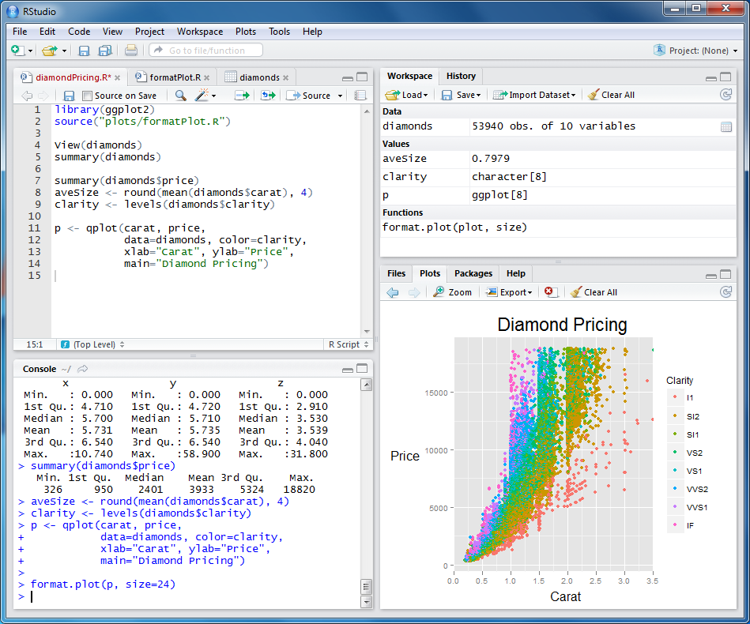

::: {dir="ltr" style="text-align: left;" trbidi="on"}
::: {style="background-color: white; margin-bottom: 6px;"}
আজকাল খুব প্রয়োজন না পড়লে R ছাড়া অন্য কোন ল্যাঙ্গুয়েজ ব্যবহারই হচ্ছে না। ক্ষেত্র বিশেষে SAS.
:::

::: {.separator style="clear: both; text-align: center;"}

:::

::: {style="background-color: white; margin-bottom: 6px;"}

:::

::: {style="background-color: white; margin-bottom: 6px;"}
মডেল ফিট করতে হবে? Rstudio তে কিছু কোড লিখ।
:::

::: {style="background-color: white; margin-bottom: 6px;"}
গ্রাফ, টেস্ট, ডাটা ক্লিনিং? Rstudio তে লিখ।
:::

::: {style="background-color: white; margin-bottom: 6px;"}
সুন্দর সুন্দর দৃষ্টিনন্দন চিত্র বানাতে মন চায়? Rstudio তে বানাও। 
:::

::: {style="background-color: white; margin-bottom: 6px;"}
হোমওয়ার্ক করতে হবে? বড় বড় ম্যাথ ইকোয়েশন? Rstudio তে টাইপ কর। 
:::

::: {style="background-color: white; margin-bottom: 6px;"}
রিপোর্ট লিখতে হবে? মাইক্রোসফট ওয়ার্ড দিয়ে কিছু হয়? Rstudio তে লিখ।
:::

::: {style="background-color: white; margin-bottom: 6px;"}
pdf বানাতে হবে? Rmarkdown এর নাম শুনেছ? 
:::

::: {style="background-color: white; margin-bottom: 6px;"}
প্রেজেন্টেশন স্লাইড বানাতে হবে? Powerpoint বাচ্চাদের কাজ, এখন R presentation আছে না! 
:::

::: {style="background-color: white; margin-bottom: 6px;"}
অনলাইন ব্লগ লিখতে হবে? Rstudio তে লিখ।
:::

::: {style="background-color: white; margin-bottom: 6px;"}
চমৎকার app বানাতে ইচ্ছে হয়? Rstudio আছে না!
:::

::: {style="background-color: white; margin-bottom: 6px;"}

:::

::: {style="background-color: white; margin-bottom: 6px;"}
একটা ল্যাঙ্গুয়েজ দিয়ে প্রয়োজনীয় সব কিছু করতে পারলে জীবন কত সহজ হয়ে যায়! আই উইশ একটু মন দিয়ে পোলাপাইন Rstudio তে R ব্যবহার করা শিখত! তাছাড়া সবকিছু কেন ক্লাসে স্যারদের কাছেই শিখতে হবে? গুগুল আছে কী করতে? বিশ্বের সবচেয়ে বড় লাইব্রেরী হাতের মুঠোয় নিয়েও যদি না হয়, তবে ইহা দুঃখজনক! বড়ই দুঃখজনক!
:::
:::
