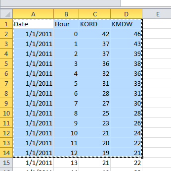

::: {dir="ltr" style="text-align: left;" trbidi="on"}
কাজটা করার অনেকগুলো উপায় আছে। সবচেয়ে ভালো উপায় হলো readxl প্যাকেজ ব্যবহার করা। তবে এমন যদি হয় যে শুধু অল্প কিছু ডেটা লাগবে, মানে অল্প কয়টি row আর কলাম, তাহলে? এক্ষেত্রে প্যাকেজ ব্যবহার করে করা বা ফাইলকে csv বানিয়ে কাজ করা বেশ সময়সাপেক্ষ। আমরা চাই ১ সেকেন্ডে করে ফেলতে।

::: {.separator style="clear: both; text-align: center;"}

:::

যেমন ধরুন, আমরা এ রকম একটা এক্সেল ডেটাকে R-এ নিয়ে আসতে চাই।

  ----------------------------------
   
             এক্সেল ডেটা 
  ----------------------------------

প্রথমেই আমরা R-এ সামান্য একটু কাজ করে রাখি। নীচের ফাংশনটি এক্সিকিউট করাতে হবে।

> excelr \<- function(header=TRUE,...) {
>   read.table("clipboard",sep="\\t",header=header,...)
> }

এই ফাংশনটা কিন্তু বারবার রান করাতে হবে না। এক সেশনে বা Rstudio এর এক প্রোজেক্টে একবার রান করালেই হবে। আর অবশ্যই excelr এর বদলে R এর নিয়ম মেনে যে-কোনো নাম দিতে পারেন। নামটা মনে রাখলেই হবে।

এবার এক্সেলে গিয়ে নির্দিষ্ট অংশটিকে হাইলাইট করে কপি করতে হবে। রাইট ক্লিক দিয়ে copy বা ctrl + C চাপুন। এটা তাহলে কম্পিউটারের ক্লিপবোর্ডে থাকবে।

এবার R-এ এসে নীচের কোড রান করার। যতবার কপি করা দরকার হবে, শুধু এক্সেলে কপি করে এটা রান দিলেই কেল্লাফতে!

> new\_data \<- excelr()

ব্যস! এক্সেলের ডেটাটুকু new\_data নামে একটি ডেটাফ্রেইমে সেইভ হয়ে যাবে। তবে মনে রাখতে হবে, শুরুতে ফাংশনের নাম যেটা দিয়েছেন এখানেও সেটাই দিতে হবে।

চাইলে Rstudio তে View() ফাংশন কাজে লাগিয়ে দেখে নিতে পারেন কী পেলেন!

নিশ্চয়ই ভাবছেন, তাহলে উল্টো কাজটা কীভাবে হবে? R থেকে এক্সেলে কীভাবে নেব? এটাও আগেরটার মতোই সহজ কাজ। মনে করুন, আপনি my\_data অংশটিকে এক্সেলে নিয়ে যেতে চান। তাহলে আগের মতোই আগে একটা ফাংশন রান করে রাখুন।

> write.excel \<- function(x,row.names=FALSE,col.names=TRUE,...) {  write.table(x,"clipboard",sep="\\t",row.names=row.names,col.names=col.names,...)

> }

এবার রান করুন
write.excel(dat)

এবার এক্সেলে গিয়ে Ctrl+V চাপুন। বা মাউসে রাইট ক্লিক করে paste অপশনে ক্লিক করুন। আবার চাইলে এটাকে সরাসরি ওয়ার্ড ফাইলেও পেস্ট করতে পারেন।

 **সূত্র**
১। [R-Bloggers](https://www.r-bloggers.com/copying-data-from-excel-to-r-and-back/)
:::
