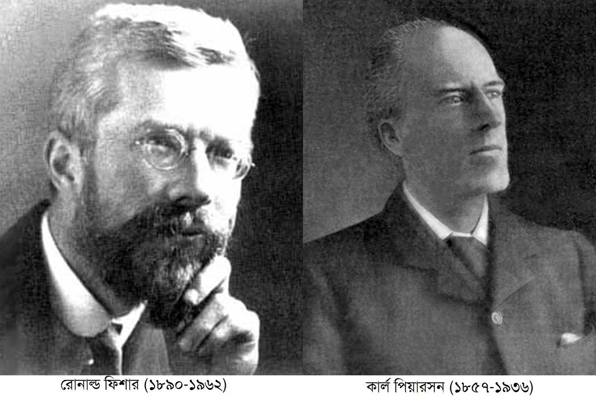

::: {dir="ltr" style="text-align: left;" trbidi="on"}
পরিসংখ্যান নিয়ে কথা বলতে গেলে এই দুজন মানুষের কথা আসবেই। দুজনেই ইংরেজ। বয়সে পিয়ারসন বড়। জন্ম ১৮৫৭ সালে। ফিশারের জন্মসাল ১৮৯০। কার্ল পিয়ারসনকে বলা হয় গাণিতিক পরিসংখ্যানের জনক। লন্ডনের ইউনিভার্সিটি কলেজে তিনিই বিশ্বের প্রথম কোনো পরিসংখ্যান বিভাগ প্রতিষ্ঠা করেন। অন্য দিকে ফিশারকে বলা হয় আধুনিক পরিসংখ্যানিক বিজ্ঞানের জনক। এছাড়াও তাকে বলা হয় বিংশ শতকের সবচেয়ে গুরুত্বপূর্ণ পরিসংখ্যানবিদ।

::: {.separator style="clear: both; text-align: center;"}

:::

::: {.separator style="clear: both; text-align: center;"}

:::

::: {.separator style="clear: both; text-align: center;"}

:::

**আরও পড়ুন**
[রোনাল্ড ফিশার কে ছিলেন?](2018-02-ronald-fisher.html)

তবে পরিসংখ্যানের মহান এই দুই দিকপালের মধ্যে সম্পর্ক একেবারেই খারাপ ছিল। শুরুটা পিয়ারসনই করেছিলেন। ফিশার তখন সবে তরুণ গবেষক। পিয়ারসন আগে থেকে কিছু না বলে ফিশারের কাজের সমালোচনা শুরু করে দিলেন। ফিশারও মারাত্মক রেগে গেলেন। তার মনে হলো, পিয়ারসন আসলে ফিশারের গবেষণা বুঝতেই পারেননি। আসলে তো তিনি পিয়ারসনের কাজেরই উন্নতি সাধন করছিলেন।

ফিশার ছিলেন একটু রাগী। আর পিয়ারসন ছিলেন আবেগপ্রবণ ও কলহপ্রিয়। কারও জন্যেই ব্যাপারটা সুবিধার ছিল না। ১৯২৯ সালে ফিশার রয়েল সোসাইটিতে যোগ দেন। এবার তার কাজ আরও বেগবান হলো। অনেকগুলো বিষয়ে পেপার লিখতে শুরু করলেন। কিছু কিছু পেপার এত নতুন ও অসাধারণ ধারণা নিয়ে আসতে যে পেপারের রেফারিরা সেগুলো রিভিউ করতে রাজি হতেন না। কারণ আর কিছুই নয়, তারা নিজদেরকে ওই বিষয়গুলো রিভিউ করার অযোগ্য মনে করতেন।

ওদিকে পিয়ারসন তখন *[বায়োমেট্রিকা](https://en.wikipedia.org/wiki/Biometrika)*র মতো জার্নালের সম্পাদক। তিনি আবার জার্নালটির সহ-প্রতিষ্ঠাতাও। সেই সময় এটিই ছিল পরিসংখ্যানের সেরা জার্নাল। এই ক্ষমতা ব্যবহার করে তিনি ফিশারের বিরুদ্ধে লাগলেন। ফিশারের পেপার পেলেই নাকচ। এমনকি তিনি ব্যক্তিগত আক্রমণ করে এটাও বলে বসলেন যে নিজের অদক্ষতার মাধ্যমে ফিশার নাকি পরিসংখ্যান পেশাটার সুনাম নষ্ট করছেন। সে সময় যুক্তরাজ্যের পরিসংখ্যানের জগতে পিয়ারসন সবচেয়ে বড় নাম। ফলে অন্য জায়গায়ও ফিশার প্রায় একই রকম আচরণ পেতে শুরু করলেন। রয়েল পরিসংখ্যান সোসাইটিও ফিশারের পেপার ছাপতে অস্বীকৃতি জ্ঞাপন করল। কী আর করা! ফিশার সোসাইটির পদই ছেড়ে দিলেন।

এভাবে চলল কিছু দিন। আস্তে আস্তে পিয়ারসনের প্রভাব কমে এল। আর ফিশার হয়ে উঠলেন প্রভাবশালী। ১৯৩৬ সালে পিয়ারসন মারা গেলেন। তত দিনে তার প্রভাব এতই কমে গেছে যে মানুষ তাকে প্রায় ভুলেই গিয়েছে। অথচ ফিশার তখন ক্যারিয়ারের সেরা সময় অতিক্রম করছেন।

পিয়ারসনের ছেলের নাম ইগন পিয়ারসন। ইগন কিন্তু বাবার মতো হিংসুক ছিলেন না। নম্র-ভদ্র স্বভাবের মানুষ। কিন্তু ফিশারের সাথে বাবার আচরণের ফল এসে পড়ল তাঁর ওপর। ফিশার ইগনের সাথে দূর্ব্যবহার করতে থাকেন। ফিশার কখনোই আর তার সাথে সহজ আচরণ করেননি। যদিও ইগন অনেকবার সে চেষ্টা করেছিলেন। শেষ পর্যন্ত ইগন আরেক পরিসংখ্যানবিদ নেইম্যানের সাথে মিলে হাপোথিসিস টেস্টিং এর দারুণ এক রূপ দেন, যা ফিশারের পদ্ধতির চেয়ে সরল। একেই আমরা নেইম্যান-পিয়ারসন লেমা হিসেবে চিনি। স্বভাবতই ফিশার এতে ক্ষেপে যান।

তবে আরেক ইংরেজি পরিসংখ্যানবিদ উইলিয়াম গসেট দুজনের সাথেই সুসম্পর্ক রক্ষা করে চলেছিলেন। এতে করে তাঁর অনেক গবেষণার কাজ সহজ হয়েছিল। মারামারির চেয়ে যে বোঝাপড়া ভালো তারই এক উজ্জ্বল হয়ে থাকলে গসেট!

সূত্র: *The Lady Tasting Tea* by David Salsburg
:::
