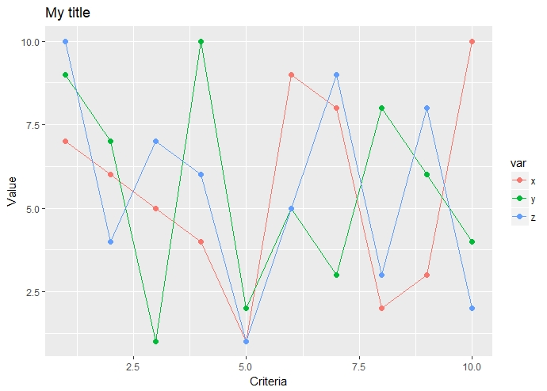
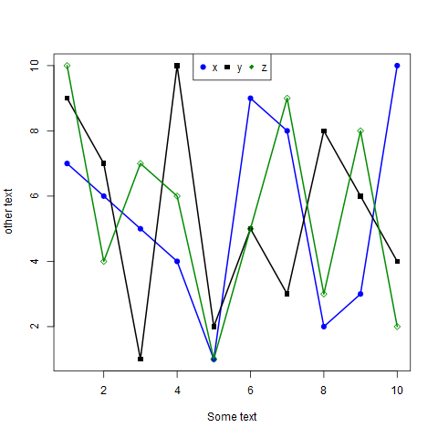

::: {dir="ltr" style="text-align: left;" trbidi="on"}
হুম, আমরা নীচের চিত্রটিই আঁকতে চাই। এতে প্রয়োজন হবে R এর অন্যতম জনপ্রিয় প্যাকেজ ggplot2। হ্যাঁ, প্যাকেজ ছাড়াই আপনি এমন গ্রাফ আঁকতে পারেন। তবে দেখতে সেটা এতটা দৃষ্টিনন্দন নাও হতে পারে।

  -------------------------------------------
       
   R প্রোগ্রামিং প্যাকেজ ggplot2 এর কারসাজি 
  -------------------------------------------

তাহলে প্যাকেজটি না থাকলে ইনস্টল করে নিন। library ফাংশন দিয়ে লোড করতেও ভুলবেন না কিন্তু!

> install.packages("ggplot2")
> library(ggplot2)

বরাবরের মতোই আগে একটি ডেটা লাগবে। বানিয়ে নেই তাহলে। 

> x \<- sample(10)
> y \<- sample(10)
> z \<- sample(10)

তবে এটাকে ggplot2 পরিচ্ছন্ন (tidy) ডেটা বলতে রাজি না। তাহলে ডেটাকে পরিশুদ্ধ করে নেই। পরিচ্ছন্ন ডেটা সম্পর্কে আরও জানতে [এই লিঙ্কটা](https://en.wikipedia.org/wiki/Tidy_data) ঘুরে আসুন। রেফারেন্সে থাকা লিঙ্কগুলোয়ও ঢুঁ মেরে আসতে পারেন। 

যাই হোক, পরিচ্ছন্ন হবে এভাবে:

> dt \<- data.frame(var=rep(c("x","y","z"), each=10), val=c(x,y,z),
>                  crit=1:10)

উল্লেখ্য, এটা আমি নিজের মতো করে বানিয়েছি। tidy করার ফর্মাল উপায়ের জন্যে *t[idy](https://tidyr.tidyverse.org/)*[ প্যাকেজে *gather*](https://tidyr.tidyverse.org/) নামে একটা ফাংশন আছে। আপনার ইচ্ছা আপনি কীভাবে করবেন। নিয়ম মেনে করাই ভাল। যাই হোক, সামনে যাওয়া যাক। বড় কোড দেখে ঘাবড়াবেন না! কোডের শেষের তিন লাইনই অপশনাল। করলে ভালো, না করলে নাই। 

> ggplot(data=dt, aes(crit, val, color=var))+
>   geom\_line()+geom\_point(size=2)+
>   xlab("Criteria")+
>   ylab("Value")+
>   ggtitle("My title")

আমরা পেয়ে গেলাম উপরের গ্রাফের মতো গ্রাফ। 

চাইলে কাজটি আপনি ggplot2 ব্যবহার না করেও করতেই পারেন। এর আগে আমরা [টাইম সিরিজ ডেটার জন্যে](https://www.statmania.info/2018/06/multiple-ts-plot.html) এমন গ্রাফ দেখেছিও। তবে এবার দেখব যে-কোনো রকম ডেটার জন্যে। 

ধরে নিলাম আগের x, y, z চলক তিনটা স্টোর করা আছে। 

এবার আগে তিনটা কালার বানিয়ে রেখে দেই। 

> col \<- c("blue", "black", "green4")

এবার একে একে তিনটা চলক প্লট করা:

> plot(x, col=col\[1\], pch=19, xlab="Some text", ylab="other text")
> lines(x, col=col\[1\])
> points(y, col=col\[2\], pch=15)
> lines(y, col=col\[2\])
> points(z, col=col\[3\], pch=18)
> lines(z, col=col\[3\])
> legend("topright", legend=c("x", "y", "z"), col=col, pch=c(19,15,18),
>        ncol=3)

পাওয়া গেল গ্রাফখানি

  ---------------------------------------------------------------------------------------------------------------------------------------------------------------------------------------------------------------------------------------------------------------------------------------------------
                                                                                                                                   
   বেইজ R দিয়ে মাল্টিপল লাইন প্লটিং। বড় করে দেখতে [ক্লিক করুন এখানে](https://blogger.googleusercontent.com/img/b/R29vZ2xl/AVvXsEjnD7qyXuG3Mw8EZwwhqi9y2EUEhLWcrkG1TXwoUVtJ9AQQNCQn2UOfbqJVpfl6QZ317bB-ml0g_F8plQ14jEL4LuuYWQP1wD3NubGyOEEfXfDT7SlDPbVHwyjxTdqZ4u5M7HYJGILyOeA/s1600/multi_line.png)।
  ---------------------------------------------------------------------------------------------------------------------------------------------------------------------------------------------------------------------------------------------------------------------------------------------------

এই কোডটিকে নানানভাবে কাস্টোমাইজ করে প্লট আরও সুন্দর করে নিতে পারেন। তবে আমার মতে ggplot-ই ভালো। নিজে নিজে সব করতে গেলেই ঝামেলা বাঁধে। আমার খুব প্রিয় একটা কথা হলো:

> Everything that can be automated should be automated.

আরও পড়ুন:

☛ [প্লট কালারিং এর ৯ উপায়](https://www.statmania.info/2018/07/r-colors.html)

☛ [ম্যাপ আঁকার সহজতম উপায়](https://www.statmania.info/2018/07/bd-map-literacy-rate-with-r.html)

☛ [প্লট স্মুথ করবেন কীভাবে](https://www.statmania.info/2018/06/smooth-r.html)

:::
