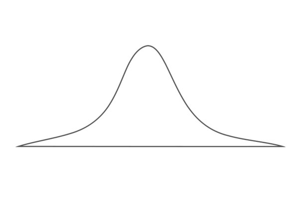

::: {dir="ltr" style="text-align: left;" trbidi="on"}
> Statisticians do not wait for the moment, they generate it

সত্যিই তাই। তবে মোমেন্টের মৌলিক সূত্র থেকে মান বের করতে গেলে বেশ কিছু জটিল (i) সূত্র মুখস্ত (?) রাখতে হয়। এই সূত্র দেখেই অনেকের মাঝে stat phobia বা পরিসংখ্যান-ভীতি তৈরি হয়।
তার আগে একটু দেখে রাখি এই মোমেন্ট জিনিসটা কী কাজে লাগে। অনেক কাজে লাগে। পরিসংখ্যানে মোমেন্ট বা ভ্রামকের ভূমিকা খুব মৌলিক। মনে করুন, আপনার কাছে কিছু ডেটা বা উপাত্ত আছে। এই উপাত্তকে বুঝতে, তা থেকে পূর্বাভাস দিতে ও বুঝে সিদ্ধান্ত নিতে চাচ্ছেন। তাহলে আপনাকে জানতে কোন প্রসেস থেকে ডেটা এসেছে। সেই প্রসেসটা বুঝে ফেললে ওপরের কাজগুলো খুব সহজ হয়ে যাবে।

খুব সহজ একটি উদাহরণ চিন্তা করি। মনে করুন, আপনার কাছে ১০০ জন শিক্ষার্থীর প্রাপ্ত নম্বর আছে। এখন, অন্য অনেক ডেটার মতো এই ডেটা পরিমিত বিন্যাস মেনে চলবে। কথাটি অপরিচিত হলে এই [লেখাটায় ঢুঁ মেরে](2016-12-bell-curve.html) আসতে পারেন। তার মানে, বিভিন্ন নম্বরের ব্যবধানের বিপরীতে ও ঐ ব্যবধানের মধ্যে থাকা নম্বরের সংখ্যা নিয়ে গ্রাফ আঁকলে এমন একটা জিনিস পাওয়া যাবে।

::: {.separator style="clear: both; text-align: center;"}

:::

::: {.separator style="clear: both; text-align: center;"}

:::

::: {.separator style="clear: both; text-align: left;"}
https://math.stackexchange.com/questions/190531/what-is-the-use-of-moments-in-statistics
:::

:::
