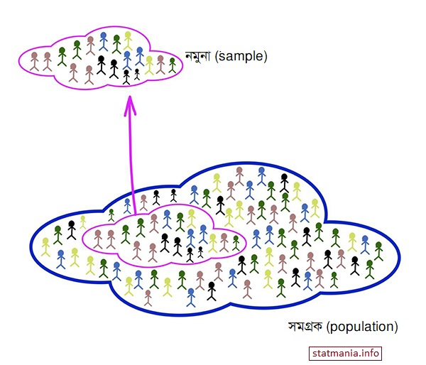

::: {dir="ltr" style="text-align: left;" trbidi="on"}
যে-কোনো গবেষণা বা স্টাডি পরিচালনা করতে গেলেই দরকার হয় ডেটা। ডেটা সংগ্রহ করতে গেলেই প্রশ্ন দাঁড়ায়, কত সাইজের স্যাম্পল নেব? লাখ টাকার প্রশ্ন। **আক্ষরিক অর্থেই লাখ টাকার প্রশ্ন।** কারণ আপাত দৃষ্টিতে সরল এই প্রশ্নটির জবাব আসলে অনেক জটিল। আর জটিল হিসাবটি সহজ করে দিয়ে পরিসংখ্যানবিদরা আসলেই লাখ লাখ টাকা কামান।

অনেকের কাছে মনে হতেই পারে, ইচ্ছা মতো যে-কোনো একটা সাইজের স্যাম্পল নিলেই তো হলো। এতে কী আর আসে-যায়?
অনেক কিছু আসে যায়। আপনার স্যাম্পল (sample) বা নমুনা যদি খুব ছোট হয়, তবে সেটা থেকে পাওয়া ফলাফলের ওপর ভরসা রাখা মুশকিল। কেউ কেউ বলবেন, ওকে, তাহলে ভুল এড়াতে বড়সড় একটা স্যাম্পল নিয়ে নেব। কিন্তু বুঝতে হবে বড় স্যাম্পল নিতে গেলে আপনার বিপুল পরিমাণ অর্থ, সময় ও লোকবল অপচয় হবে। অথচ হয়ত আসলে অত বড় স্যাম্পল নেবার কোনো দরকারই ছিল না। যেমন, আপনি ভাবলেন, আমার অনেক টাকা আছে। নিয়ে নিলাম দশ হাজার সাইজের একটি স্যাম্পল। অথচ এমন হওয়া অসম্ভব নয় যে দশ হাজার সাইজের স্যাম্পল নিয়ে যে ফল পাবেন, মাত্র ৪০০ সাইজের স্যাম্পলও প্রায় একই পরিমাণ নির্ভুল ফল দেবে। কেন তাহলে বোকার মতো সময় আর শিক্ত ক্ষয় করবেন?

::: {.separator style="clear: both; text-align: center;"}

:::

আজকে আমরা স্যাম্পল সাইজ পরিমাপের একবারে সাধারণ একটা উদাহরণ দেখব। ধরা যাক, আমার দেখতে চাই ঢাকার আরামবাগ এলাকায় কত শতাংশ মানুষের ডায়াবেটিস রোগ আছে? আমরা ধরে নিচ্ছি এক্ষেত্রে সরল দৈব নমুনায়ন (simple random sampling) পদ্ধতি কাজ করবে। এর মানে হলো আমরা যে মানুষদেরকে তথ্য নেবার জন্য বাছাই করব, বাছাইকৃত হবার সম্ভাবনা তাদের প্রত্যেকের ক্ষেত্রে সমান। ধরুন, আরামবাগ এলাকায় ১০,০০০ মানুষ আছেন। হয়ত আমরা স্যাম্পল নেব ৪০০ সাইজের। এখন এই ৪০০ জনের মধ্যে আসার সম্ভাবনা দশ হাজার মানুষের সবার জন্য সমান। অন্য কথায়, প্রত্যেকের সম্ভাবনা $\frac{১}{১০০০০}$।

এখন আমরা কত সাইজের নমুনা নেব? এর উত্তর জানতে হলে তার আগে আরেকটি প্রশ্নের উত্তর পেতে হবে। আমরা কতটা নির্ভুল পরিমাপ চাচ্ছি। ধরা যাক, আমরা যে পরিমাপ পাব, বাস্তব হার (ডায়াবেটিসের) সেটার ৫ শতাংশ এদিক-ওদিক হলেও কিছু মনে করব না। এর মানে হলো, ধরা যাক, আমরা স্যাম্পল নিয়ে হিসাব করে পেলাম ৩৫ শতাংশ। তাহলে সত্যিকার ডায়াবেটিস রোগীর হার (P) ৩০ থেকে ৪০ শতাংশের মধ্যে থাকবে।

এখানে আরেকটা কথা বলে না রাখলেই নয়। এই যে বললাম, ৩০ থেকে ৪০ এর মধ্যে থাকবে এটা পুরোপুরি নিশ্চিত কিছু নয়। তবে স্যাম্পল বড় হলে এর চেয়ে বেশি এদিক-সেদিক হবে না বলে আশা করা যায়। সাধারণভাবে বলা চলে ৫ শতাংশ ভুল মানে হলে প্রতি ২০টা নমুনার মাত্র একটায় ফল ৩০ থেকে ৪০ এর বাইরে চলে যাবে।

স্যাম্পল সাইজের হিসাবকে আরেকটু সরল করার জন্যে আমরা আরও ধরে নিচ্ছি শতাংশের পরিমাপটা পরিমিত বিন্যাস মেনে চলে। কথাটি অপরিচিত হলে [এই লেখাটায় ঢুঁ মেরে](2016-12-bell-curve.html) আসতে পারেন। এছাড়াও আমরা আপাতত [FPC](https://en.wikipedia.org/wiki/Standard_error#Correction_for_finite_population) (Finite population correction) কে বিবেচনা থেকে বাদ দিচ্ছি।

যেহেতু আমরা ধরে নিলাম p পরিমিত বিন্যাস মেনে চলবে, তাহলে [এই লেখা](2016-12-bell-curve.html) অনুসারে p সত্যিকার হারের (P) ২ পরিমিত ব্যবধানের ($\sigma$) মধ্যে থাকবে। ২ পরমিত ব্যবধানে থাকবে বলার কারণ হলো ৫ শতাংশ এদিক-সেদিক মেনে নিয়েছি বলে। মাত্র এক শতাংশেরও কম এদিক-সেদিক মেনে নিতে চাইলে পরিমিত ব্যবধান নেব ৩ পর্যন্ত। যাই হোক, আপাতত আমরা জানলাম, আমাদের পরিমাপ $P \pm 2 \sigma$ এর মধ্যে থাকবে। ২০ বার পরিমাপ করলে একবার এর বিপরীত হয়ে যেতে পারে।

আবার আমরা জানি, $\sigma _p = \sqrt{\frac{PQ}{n}}$।

এখানে $Q = 100- P$ আর $n$ হলো আমাদের কাঙ্খিত স্যাম্পল সাইজ।

এখন, আগের কথা অনুসারে $\sigma _p$ এর দ্বিগুণ সমান 5 হবে। যেহেতু আমরা 5 শতাংশ কম-বেশি হওয়া মেনে নিয়েছি।

তাহলে,  $2 \sqrt{\frac{PQ}{n}} = 5$

বা, $n = \frac{4PQ}{25}$

এবার আমরা স্যাম্পল সাইজ বের করার একটা ফর্মুলা পেয়ে গেলাম। কিন্তু একটি সমস্যা রয়ে গেছে। স্যাম্পল সাইজ বের করতে গেলেই এই সমস্যার মুখে পড়তে হয়। এখানে $n$ বের করতে গেলে $P$ জানা দরকার হচ্ছে। অথচ $P$ জানার জন্যেই $n$ নিয়ে এত কিছু। ব্যাপারটা অনেকটা এই রকম। আপনি বাসার ছাদে বসে আছেন। নামতে হলে মই লাগবে। অথচ মইটা খাড়া করা নেই। তার মানে মই খাড়া করার জন্যে আপনাকে নামতে হবে। আহা! নামতে পারলে তো আর মইয়ের দরকারই হতো না। তাহলে উপায়?

উপায় আছে। অন্য কাউকে দিয়ে যেমন মইটা দাঁড় করিয়ে নেওয়া যায়, তেমনি অন্য কোনো উপায়ে $P$ জানারও বুদ্ধি বের করতে হবে। আগের তথ্য থেকে বা অন্য কোনোভাবে আমাদেরকে $P$ সম্পর্কে একটা মোটামুটি অনুমান তৈরি করে নিতে হবে। যেমন আমরা ধরে নিতে পারি আরামবাগে ডায়াবেটিস রোগীদের হার ৩০ শতাংশ থেকে ৬০ শতাংশের বাইরে হবে না। সেক্ষেত্রে $P = 30$ বা $60$ হবে। আপনি যুক্তি দেখাতেই পারেন, $P$ যদি ৮০, ৯০ হয়ে যায় তাহলে তার দায় কে নেবে?

আসলে সেটার দায় নেওয়া কঠিন কিছু না। উপরের সূত্রে খেয়াল করুন। P এর মান ৩০ ধরলে Q হবে ৭০। গুণফল হবে ২১০০। আর এদের মান যথাক্রমে ৮০ আর ২০ হলে গুণফল দাঁড়ায় ১৬০০, যা আগের চেয়েও ছোট। তার মানে $P$ আর $Q$ এর পার্থক্য যত বেশি হবে আমাদের তত ছোট স্যাম্পল লাগবে। তার মানে সবচেয়ে বড় স্যাম্পল লাগবে যদি $P$ আর $Q$ সমান হয়। মানে দুটোই ৫০। আর সেক্ষেত্রে $PQ$ হবে 2500।

তাহলে স্যাম্পল সাইজ, $n = \frac{4 \times 2500}{25} = 400$

তার মানে এক্ষেত্রে ৪০০ সাইজের স্যাম্পল নেওয়ায় যথেষ্ট। আর সত্যিকারের $P$ যদি ৩০ হয় (৭০ হলেও একই কথা) তাহলে লাগবে ৩৩৬ সাইজের স্যাম্পল। নিরাপদ থাকতে চাইলে ৪০০ নিয়ে ফেলাই যায়।

আপাতত এই $n$ দিয়েই কাজ চালানো যায়। তবে সমগ্রক (সকল মানুষের সংখ্যা) যদি ৮,০০০ এর কম হয় তবে আগে বাদ দিয়ে রাখা FPC নিয়েও চিন্তা করা দরকার হবে। আর বাকি ক্ষেত্রে ৪০০ দিয়েই মোটামুটি ঠিকঠাক কাজ চলবে। বাকি অনুমানগুলো সঠিক না হলে কীভাবে কী করা লাগবে সেটা আমরা অন্য কোনো সময় দেখব, ইনশাআল্লাহ।

সূত্র: Sampling Techniques (3rd edition) by William G. Cochran
:::
