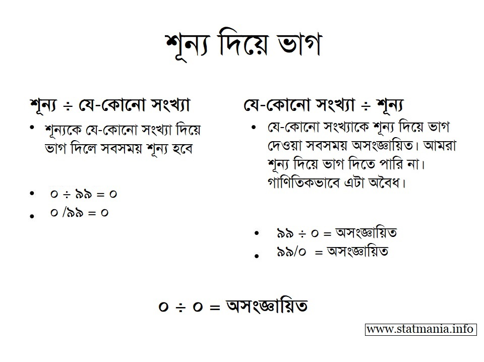

::: {dir="ltr" style="text-align: left;" trbidi="on"}
[এর আগের লেখায়](https://www.statmania.info/2019/03/division-by-0.html) আমরা দেখেছিলাম, কোনো সংখ্যাকে শূন্য দিয়ে ভাগ দেওয়া যায় না। দিতে গেলে আসে অদ্ভুত সব ফলাফল। ১ = ১০০ ইত্যাদি। ওখানে আমরা $\frac{০}{০}$ নিয়ে কিছু বলিনি। এবার এটা দেখা যাক!

::: {style="text-align: center;"}

:::

এখানেও ০-এর কাছাকাছি সংখ্যাদেরকে নিয়ে ভাগ করে দেখি।
$$\frac{০.১}{০.১}=১$$
আবার, একই উত্তর পাব ০.০১ নিলেও। কারণ,
$$\frac{০.০১}{০.০১}=১$$
একইভাবে,
$$\frac{০.০০০১}{০.০০০১}=১$$
এবং
$$\frac{০.০০০০০১}{০.০০০০০১}=১$$

তার মানে, মনে হচ্ছে $\frac{০}{০}$ হয়ত ১-ই হবে। কারণ, ঋণাত্মক সংখ্যা নিলেও একই ফল আসবে। 

::: {style="text-align: center;"}
$\frac{-০.১}{-০.১}=১$, $\frac{-০.০১}{-০.০১}=১$, $\frac{-০.০০০১}{-০.০০০১}=১$ এবং $\frac{-০.০০০০০১}{-০.০০০০০১}=১$
:::

অতএব, মনে হচ্ছে যথেষ্ট শক্তিশালী যুক্তি পাওয়া গেছে। $\frac{০}{০}=১$ ই হওয়া উচিৎ। 

কিন্তু এবার মুদ্রার উল্টো পিঠটা একটু দেখি। ০-কে ০ দিয়ে ভাগ না দিয়ে ক্রমেই ০-এর কাছাকাছি সংখ্যা দিয়ে ভাগ করি। [এই কাজটা আমরা আগেও](https://www.statmania.info/2019/03/division-by-0.html) করেছি। 

::: {style="text-align: center;"}

:::

::: {style="text-align: center;"}
::: {style="text-align: left;"}
$$\frac{০}{০.১}=০$$
:::

::: {style="text-align: left;"}
আবার, একই উত্তর পাব ০.০১ নিলেও। কারণ, 
:::

::: {style="text-align: left;"}
$$\frac{০}{০.০১}=০$$
:::

::: {style="text-align: left;"}
একইভাবে,
:::

::: {style="text-align: left;"}
$$\frac{০}{০.০০০১}=০$$
:::

::: {style="text-align: left;"}
এবং 
:::

::: {style="text-align: left;"}
$$\frac{০}{০.০০০০০১}=০$$
:::

::: {style="text-align: left;"}

:::

::: {style="text-align: left;"}
::: {.separator style="clear: both; text-align: center;"}

:::

তার মানে, যতই ছোট সংখ্যা দিয়ে ভাগ করব, মান পাব ০-এর তত কাছাকাছি। তাহলে, আগের মতো একই যুক্তিতে বলা যায়, $\frac{০}{০}$ এর মান হবে ০। এই যুক্তি আগের যুক্তির (যেখানে ভাগফল ১ হয়েছিল) চেয়ে কোনো অংশে কম দুর্বল নয়। 
:::

::: {style="text-align: left;"}

:::

::: {style="text-align: left;"}
এবং আগের মতোই, ০-কে ঋণাত্মক সংখ্যা দ্বারা ভাগ করলেও একই অবস্থা হবে। তাহলে কোনটা ঠিক? ০, নাকি ১? 
:::

::: {style="text-align: left;"}

:::

::: {style="text-align: left;"}
ফলাফল আসলে যে-কোনো অশূন্য সংখ্যাকে শূন্য দিয়ে ভাগ করার মতোই। $\frac{০}{০}$-কে সংজ্ঞায়িত করার উপায় নেই। ফলে, (কোনোকিছু÷০) এর মতোই $\frac{০}{০}$ও অসংজ্ঞায়িত। 
:::

::: {style="text-align: left;"}
:::

::: {style="text-align: left;"}
তবে গণিতের আরও গভীরে প্রবেশ করলে $\frac{০}{০}$ কে অনির্ণেয় (indeterminate) বলা হয়। সেটাও আমরা দেখব ইনশাআল্লাহ।
**
** **আরও পড়ুন:**
:::

::: {style="text-align: left;"}
☛ [শূন্য দিয়ে ভাগ দিলে কী সমস্যা?](https://www.statmania.info/2019/03/division-by-0.html)
:::
:::
:::
