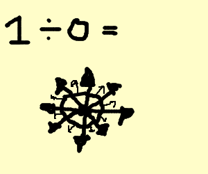
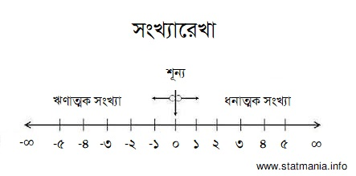

::: {dir="ltr" style="text-align: left;" trbidi="on"}
প্রথমে একটি মজার ফলাফল দেখি। চাতুরী খাটিয়ে দেখানো যায় ১ = ০। বা ১ = ১০০। অথবা আপনি যা চান তাই। এটা দেখানোর অনেকগুলো উপায়। অবশ্যই সবগুলো উপায় ভুল।

::: {style="text-align: center;"}

:::

এর মধ্যে অন্যতম সহজ একটি উপায় এমন-

ধরি,
$$\begin{eqnarray} 
x &=& 0      \nonumber \\ 
& \implies & x (x-1)=0 \nonumber \\ 
&\implies &(x-1)=0    \nonumber \\ 
&\implies &x=1   \nonumber 
\end{eqnarray}$$
আমরা পেলাম x = 1, অথচ শুরুতে x = 0 ধরে নিয়েছিলাম।
মানে এখন ০ এবং ১ সমান। এখানে দ্বিতীয় লাইনে (x-1) এর বদলে (x-100) ধরলে 100 = 0 দেখানো যাবে। দেখানো যাবে অন্য যে-কোনো কিছুই। কিন্তু এটা আসলে ভুল।

ভুলটা হয়েছে তৃতীয় লাইনে। যেখানে আসলে আমরা উভয়পক্ষকে x দিয়ে ভাগ করেছি। কিন্তু x মানে আগেই ০ ধরে নিয়েছিলাম। আর ০ দিয়ে ভাগ দেবার নিয়ম নেই।

কিন্তু কেন? দিলে ক্ষতি কী? সেটাই আমরা দেখার চেষ্টা করব।

গণিতের গভীরে যাবার আগে প্রথমে একটু কমন সেন্স কাজে লাগাই। ভাগ দেওয়ার মানে আসলে কী? ধরুন, আপনার কাছে ২০টি আম আছে। ৫ জন বন্ধু এগুলো ভাগ করে খেতে চান। সবাইকে সমান আম দিলে সবাই $\frac{২০}{৫} = ৪$  টি করে পাবে। কিন্তু যদি বাকি ৪ বন্ধু খেতে না চায়, তাহলে একজনই ২০টি আম পেয়ে যাবে। কারণ, $\frac{২০}{১} =২০$।

এবার একটু ভাবুন: কেউই যদি খেতে না চায়, তাহলে কী হবে? ২০ টি আম ০ জন মানুষের কাছে কীভাবে বণ্টন করা যাবে? একটু ভাবুন। ভাগের ধারণাটাই কাজ করছে না।

আরেকভাবে দেখুন। ভাগ কিন্তু আবার গুণ করে মিলিয়ে নেওয়া যায়। $\frac{২০}{৫} = ৪$। এর মানে হলো, ৪-কে ৫ দিয়ে গুণ করলে ২০ পাওয়া যাবে। এবার $\frac{২০}{০}$ ভাগফলটি দেখুন। এটা সমান ধরুন 'ক' পাব। তার মানে 'ক'-কে ০ দিয়ে গুণ করলে ২০ পাওয়ার কথা। এবার একটু গভীরভাবে ভাবুন। এমন কোনো সংখ্যা আছে কি, যাকে ০ দিয়ে গুণ করলে ২০ পাব? ২০ এর বদলে অন্য যে-কোনো সংখ্যা (০ ছাড়া) নিয়ে ভাবলেও একই কথা পাওয়া যাবে।

আসলে শূন্য দিয়ে কোনো (অশূন্য) সংখ্যাকে ভাগ দিলে কত পাওয়া যাবে তার সুনির্দিষ্ট কোনো সংজ্ঞা নেই। অন্য কথায় এই মানটি হবে অসংজ্ঞায়িত। এই কথাটির আরেকটি মানে হলো শূন্যকে কোনো কিছু দিয়ে ভাগ দিলে কত হবে তার কোনো মান গণিতবিদরা নির্দিষ্ট করতে পারেননি। এর জন্য কোনো ভাল উত্তর ঠিক করতে পারেননি তারা। এমন না যে এটা তাদের দুর্বলতা। বিষয়টিই আসলে এমন। 

যেমন ধরুন, আমরা কোনোকিছুকে শূন্য দিয়ে ভাগ দিলে যা হতে পারে সেটাকে ধরলাম 'ক'। এখন তাহলে $\frac{৯}{০}$ এর যে মান হবে, $\frac{১০০}{০}$ এর মানও তাই হবে। তাহলে তো মেনে নিতে হয় ৯ আর ১০০ সমান! এই অদ্ভুত ভাগটি করলে এমন অদ্ভুত সব ফলই আসবে। যেগুলো স্ত্যি হলে গণিতের ভিত্তিটাই ধসে পড়ে।

তবুও ধরা যাক, আমরা (কোনোকিছু ÷ ০) এর একটি মান বের করতেই চাই। তাহলে কী ঘটে দেখা যাক। সহজভাবে চিন্তা করতে আমরা ১-কে শূন্য এর কাছাকাছি বিভিন্ন সংখ্যা দিয়ে ভাগ করে দেখি।

-   ১-কে ০.১ দিয়ে ভাগ করলে পাব ১০

-   ১-কে ০.০১ দিয়ে ভাগ করলে পাব ১০০

-   ১-কে ০.০০০১ দিয়ে ভাগ করলে পাব ১০,০০০

-   ১-কে ০.০০০০০১ দিয়ে ভাগ করলে পাব ১০০,০০,০০

একটা বিষয় নিশ্চয়ই খেয়াল করেছেন। আমরা ০-এর যত কাছের সংখ্যা দিয়ে ভাগ দিচ্ছি, ভাগফল তত বেশি হচ্ছে। একই ব্যাপার ঘটবে আমরা ১-এর বদলে অন্য কোনো সংখ্যাকে ভাগ দিতে থাকলে। যেমন ১ এর বদলে ৭-কে ভাগ দিলে হত যথাক্রমে ৭০; ৭০০; ৭০,০০,০০ ও ৭০, ০০, ০০, ০০। 

তার মানে শূন্য দিয়ে ভাগ দিলে আমরা অনেক বিশাল একটি সংখ্যা পাব। যাকে অন্য অর্থে বলা চলে অসীম। এর জন্য একটি চিহ্নও আছে বটে। চিহ্নটা হলো ∞। অনেক সময় আমরা গাণিতিক কাজ করতে গিয়ে ব্যবহার করিও (সতর্কতার সাথে)। কিন্তু (কোনোকিছু ÷ ০) এর মান ∞ ধরে নিলে সমস্যা আছে। কারণ হলো এই কোনোকিছু যদি ঋণাত্মক হয়, তাহলে উত্তর আর ∞ হয় না। দেখুন না! 

-   ১-কে - ০.১ দিয়ে ভাগ করলে পাব - ১০
-   ১-কে - ০.০১ দিয়ে ভাগ করলে পাব - ১০০
-   ১-কে - ০.০০০১ দিয়ে ভাগ করলে পাব - ১০,০০০
-   ১-কে - ০.০০০০০১ দিয়ে ভাগ করলে পাব - ১০০,০০,০০

তার মানে ঋণাত্মক সংখ্যাকে শূন্য দিয়ে ভাগ দিলে আমরা পাব অনেক ক্ষুদ্র একটু সংখ্যা। এখানে কিন্তু মাথায় রাখতে হবে কোনো সংখ্যা যত বড় হবে, তার আগে ঋণাত্মক চিহ্ন দিয়ে দিলে সেটি তত ছোট হয়ে যাবে। 

::: {style="text-align: center;"}

:::

  ---------------------------------------------------------------------------------------------------------------------------------------------------------------------------------------------------------------
                                                                                         

   উপরের আলোচনা গ্রাফে বসালে এমন হয়। দেখুন x এর মান ধনাত্মক দিক থেকে ০-এর দিকে যেতে থাকলে $\frac{1}{x}$ এর মান ∞ এর দিকে যেতে থাকে। আবার ঋণাত্মক দিক থেকে ০-এর দিকে যেতে থাকলে $\frac{1}{x}$ এর মান -∞ এর দিকে যেতে থাকে।
                                                  ছবি: *[উইকিপিডিয়া কমন্স](https://en.wikipedia.org/wiki/Division_by_zero#/media/File:Hyperbola_one_over_x.svg)*।
  ---------------------------------------------------------------------------------------------------------------------------------------------------------------------------------------------------------------

এখন তাহলে (ঋণাত্মক সংখ্যা ÷ ০) এর মান আমরা ধরতে পারি ঋণাত্মক অসীম (-∞)। খেয়াল করুন, ধনাত্মক বা ঋণাত্মক, দুই ক্ষেত্রেই আমরা ভাগ দিতে দিতে ০-এর কাছাকাছি যাওয়ার চেষ্টা করেছি। কিন্তু দুই ক্ষেত্রে ফল এসেছে আলাদা। একবার পাচ্ছি ∞। আবার পাচ্ছি -∞। দুটো সংখ্যার মধ্যে সর্বোচ্চ দূরত্বের উদাহরণ এই দুটি সংখ্যা। থুক্কু! এদেরকে গণিতে সংখ্যা হিসেবে গণ্যই করা হয় না। এর আসলে শুধুই 'অনেক বড়' বা 'অনেক ছোট' ধারণাগুলো প্রকাশ করার একটি উপায় মাত্র। 

অসীম ও ঋণাত্মক অসীমকে সংখ্যারেখায় বসিয়ে দেখি-

::: {.separator style="clear: both; text-align: center;"}

:::

তার মানে কী দাঁড়াল? (কোনোকিছু ÷ ০) এর কোনো ভাল উত্তর আমরা পাচ্ছি না। এ জন্যেই আগে বলেছি, এই না পাওয়ার বিষয়টি গণিতবিদদের কোনো দুর্বলতা নয়। এই ভাগফলটিই এমন। তাই গণিতবিদরা এর নাম দিয়েছেন অসংজ্ঞায়িত।

এ কারণেই কৌতুকবিদ স্টিভেন রাইট বলেছিলেন, "*ব্ল্যাক হোলে ঈশ্বর শূন্য দিয়ে ভাগ দিয়েছেন* ।" এটি বলার কারণ আসলে ব্ল্যাক হোলে ভেতরে পদার্থবিদ্যার সূত্রগুলো ভেঙে পড়ে। ওখানে ঠিক কী ঘটে তা সঠিক করে বলার উপায় নেই। যেভাবে বলার উপায় নেই শূন্য দিয়ে ভাগের ভাগফল।

**সূত্র**
১। [খান অ্যাকাডেমি](https://www.khanacademy.org/math/algebra/introduction-to-algebra/division-by-zero/v/why-dividing-by-zero-is-undefined)
২। [উইকিপিডিয়া](https://en.wikipedia.org/wiki/Division_by_zero)
:::
