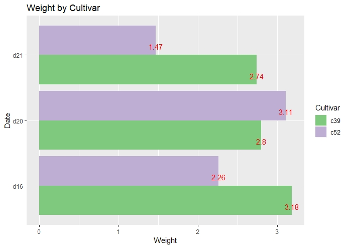
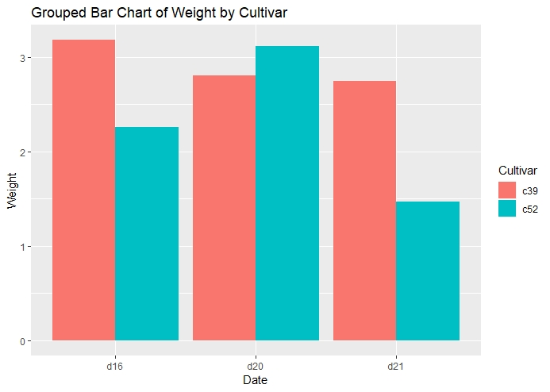
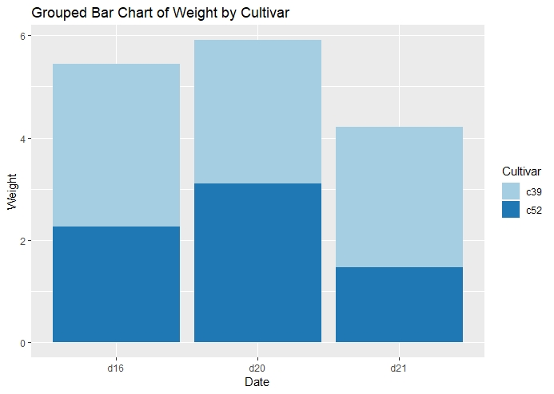
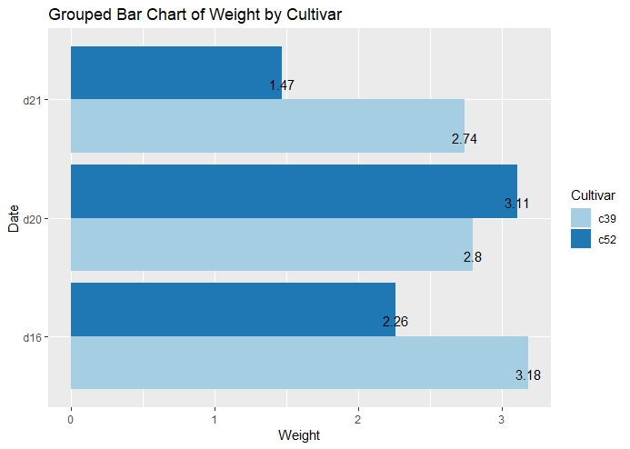

::: {dir="ltr" style="text-align: left;" trbidi="on"}
বেইজ R দিয়েও সহজেই দুই ধরনের বার চার্টই আঁকা যায়। তবে ggplot2 দিয়ে আকাঁ চার্টের দিকে তাকিয়ে থাকতে ইচ্ছে করবে। আজ আমরা নীচের বার চার্টটি আঁকব।

::: {.separator style="clear: both; text-align: center;"}

:::

এটাই আঁকব। তবে ধাপে ধাপে দেখা যাক।

ও আচ্ছা। এই লেখায় আমরা gcookbook প্যাকেজের ডেটা ব্যবহার করব। তাই, ভালো হয় প্যাকেজটি ইনস্টল ও লোড করে নিন।

> install.packages("gcookbook")
> library(gcookbook)

এই প্যাকেজের cabbage\_exp ডেটা ব্যবহার করব। আপনি [Rstudio](2018-02-install-r.html) ব্যবহার না করে থাকলে এই ডেটা লোড করে নিন। data(cabbage\_exp) কমান্ড দিয়ে। 

এবার আকাঁ শুরু করা যাক। 

> ggplot(cabbage\_exp,aes(x=Date, y=Weight, fill=Cultivar))+
>   geom\_bar(position = "dodge", stat = "identity")+
>   ggtitle("Grouped Bar Chart of Weight by Cultivar")

::: {.separator style="clear: both; text-align: center;"}

:::

এখানে position = "dodge" দেওয়াতে বারগুলো পাশাপাশি বসেছে। এটাই গ্রুপড বার চার্ট করার কমান্ড। স্ট্যাকড বার তৈরি করতে হলে এখানে দিতে হবে "stack"। আর stat = "identity" দিতে হয়েছে, কারণ cabbage\_exp ডেটায় weight এর মানগুলো সরাসরি দেওয়া আছে। এভাবে না থেকে ধরুন এভাবে থাকল, "Male", "Male", "Female", "Male", "Female"। এখান থেকে Rকে হিসবে করে নিতে হত কোন গ্রুপে কয়টা আছে। সেক্ষেত্রে আমরা দিতাম stat="count"। অবশ্য এই অপশনটা ডিফল্ট কাজ করে বলে কিছুই না দিলেও চলবে। 

এবার আমরা কিছু অপশন পাল্টে দেখি। 

-   আমরা গ্রুপড না করে স্ট্যাকড বার আঁকব। position = "stack"
-   অটো কালারে বদলে RColorBrewer প্যাকেজ দিয়ে কালার দেব। [আরও দেখুন এখানে](2019-04-r-ggplot2-rcolorbrewer.html)।

> ggplot(cabbage\_exp,aes(x=Date, y=Weight, fill=Cultivar))+
>   geom\_bar(position = "stack", stat = "identity")+
>   scale\_fill\_brewer(palette = "Paired")+
>   ggtitle("Grouped Bar Chart of Weight by Cultivar")

::: {.separator style="clear: both; text-align: center;"}

:::

এবার আমরা 

-   বারের সাথে প্রতি বারের মান দেখাব। 
-   আমরা বারগুলো খাড়া না রেখে অনুভূমিক করে দেব। এজন্য বাড়তি কোড: coord\_flip()
-   এক্ষেত্রে স্ট্যাকড এর চেয়ে গ্রুপড বার ভাল দেখায় বলে আমরা আবারও position="dodge" ব্যবহার করব। 

> ggplot(cabbage\_exp,aes(x=Date, y=Weight, fill=Cultivar))+
>   geom\_bar(position = "dodge", stat = "identity")+
>   scale\_fill\_brewer(palette = "Paired")+
>   geom\_text(aes(label=Weight), vjust=1.5, colour="black",
>             position=position\_dodge(0.9), size=4)+
>   coord\_flip()+
>   ggtitle("Grouped Bar Chart of Weight by Cultivar")

::: {.separator style="clear: both; text-align: center;"}

:::

আমরা পেয়ে গেলাম কাঙ্খিত চার্ট। সরল বার চার্ট আঁকার কৌশল [দেখে নিন এখানে](2019-04-r-ggplot2-rcolorbrewer.html)।

**পুনশ্চ**: dplyr বা magrittr প্যাকেজ লোড করা থাকলে ggplot(cabbage\_exp,aes অংশটুকুকে আরও সহজ করেও লেখা যায়।

cabbage\_exp %\>% ggplot(aes(...

%\>% কে বলা হই পাইপ অপারেটর। dplyr প্যাকেজে এটার ব্যবহার খুব দারুণ। 
:::
