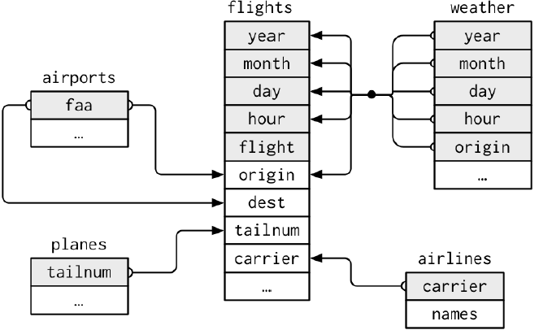
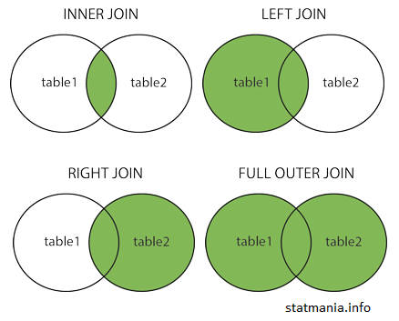
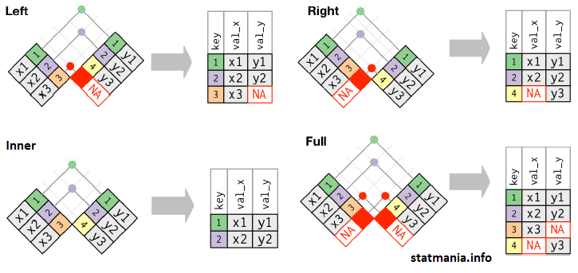

::: {dir="ltr" style="text-align: left;" trbidi="on"}
ডেটা নিয়ে কাজ করতে গেলেই অনিবার্যভাবে রিলেশনাল ডেটাবেজের ধারণা চলে আসবে। আমরা সাধারণত যেসব ডেটা নিয়ে কাজ করি তাতে সব ডেটা থাকে একই টেবিলে বা ডেটাফ্রেইমে। উল্লেখ্য, R-এ যেটাকে আমরা ডেটাফ্রেইম বলি, SQL এ সেটাকে টেবিল বলে। নীচে কয়েকটি টেবিলের কলাম বা ভ্যারিয়েবলগুলো দেখানো হলো। এগুলো R এর *nycflights13* প্যাকেজ থেকে নেওয়া।

  ---------------------------------------------------------------------------------------------------
                                   
   nycflights13 প্যাকেজের কয়েকটি ডেটাফ্রেইম বা টেবিল। সোর্সঃ [tidyverse](https://www.tidyverse.org/)
  ---------------------------------------------------------------------------------------------------

দেখুন, flights টেবিলের কলামগুলো হলো year, month, day, hour, origin, tailnum ইত্যাদি। প্রায় একই কলাম আছে weather টেবিলেও। আবার planes টেবিলে আছে tailnum, year ইত্যাদি কলাম। airlines টেবিলে আছে tailnum, names ইত্যাদি।

তবে flights টেবিলে names কলামটা নেই। চাইলে আমরা airlines থেকে names কলামটা flights টেবিলে নিয়ে আসতে পারি। এক টেবিলের কলামকে আরেক টেবিলে নিয়ে আসার এই প্রক্রিয়াই হলো রিলেশনাল কাজ। তবে অবশ্যই দুটো টেবিলকে লিঙ্ক করার জন্যে কমন একটা টেবিল কলাম থাকা চাই। এই কলামকে বলা হয় key। যেমন flights এবং arilines এর মধ্যে carrier কলাম হলো key।

খেয়াল করলে দেখবেন, অন্য টেবিলের মধ্যেও এমন key আছে।

এবার দেখা যাক, কাজটা আমরা কীভাবে করব। ডেটাবেজ ম্যানেজমেন্টের সবচেয়ে মৌলিক ল্যাংগুয়েজ হলো SQL। পুরো নাম Structured Query Language। এখানে রিলেশনাল টেবিল নিয়ে কাজ করার চারটি অপশন আছে।

-   Inner Join
-   Left Join
-   Right Join
-   Full Join

R-এও রিলেশনাল টেবিল নিয়ে কাজ করার সময় এই চারটি জয়েন নিয়ে কাজ করা হয়। তাই প্রথমে কোনটির কী কাজ সেটা দেখে নেই। কথাগুলো একটু কঠিন লাগতে পারে। তবে পরের উদাহরণ দেখলে পরিষ্কার হয়ে যাবে। 

-   Inner Join: দুটো টেবিলের শুধু কমন মানগুলো যে যে  সারি (row) তে আছে সেগুলো রিটার্ন করবে।  
-   Left Join: বাম পাশের টেবিলের সব সারি দেখাবে। ডান পাশের যে সারিগুলো বাম পাশের সাথে মিলে যাবে সেগুলো নিয়ে আসবে। 
-   Right Join: ডান পাশের টেবিলের সব সারি দেখাবে। বাম পাশের যে সারিগুলো ডান পাশের সাথে মিলে যাবে সেগুলো নিয়ে আসবে। 
-   Full Join: দুই টেবিল থেকেই সব সারি নিয়ে আসবে। মিল না পেলে missing value হিসেবে থাকবে। R এ যেটাকে NA হিসেবে দেখানো হয়। 

  ----------------------------------
   
            নানান রকম join
  ----------------------------------

এবার কিছুটা বাস্তব টেবিল থেকে যাক কোন জয়েন কী রেজাল্ট দেবে।

::: {.separator style="clear: both; text-align: center;"}

:::

এই ছবিটিকে এক মিনিট চোখ বড় বড় করে দেখলেই স্পষ্ট হয়ে যাবার কথা কোন জয়েন কী কাজ করে।

আমরা R এর ছোট্ট একটা উদাহরণ দেখি। উপরের টেবিলের মতো করেই আগে ডেটা বানিয়ে নিই। ডেটাফ্রেইম বানানোর জন্য আমরা সাধারণত data.frame ফাংশন ব্যবহার করি। তবে [tidy](https://tidyr.tidyverse.org/) ডেটার কনসেপ্টে থাকার জন্য এখানে আমরা tibble ফাংশন ব্যবহার করব। অবশ্যই dplyr প্যাকেজটি লোড করে নিতে হবে।

> x \<- tibble(key=1:3, val\_y=c("x1", "x2", "x3"))
> y \<- tibble(key=c(1,2,4), val\_y=c("y1", "y2", "y3"))
> x %\>% inner\_join(y, by="key")

বাকিগুলো একইভাবে নিজেই করে দেখুন। কোডগুলো কী হবে বুঝতেই পারছেন। left\_join, right\_join এবং full\_join।

এই কাজগুলো SQL দিয়ে করতে গেলে একটু ভিন্নভাবে কোড লিখতে হবে। আগ্রহী হলে দেখে আসুন [এখান থেকে](https://www.w3schools.com/sql/sql_join.asp)। 
:::
