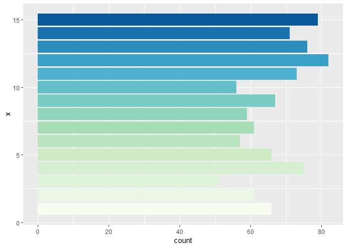
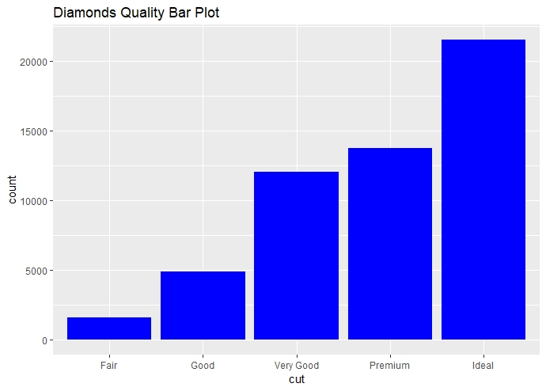
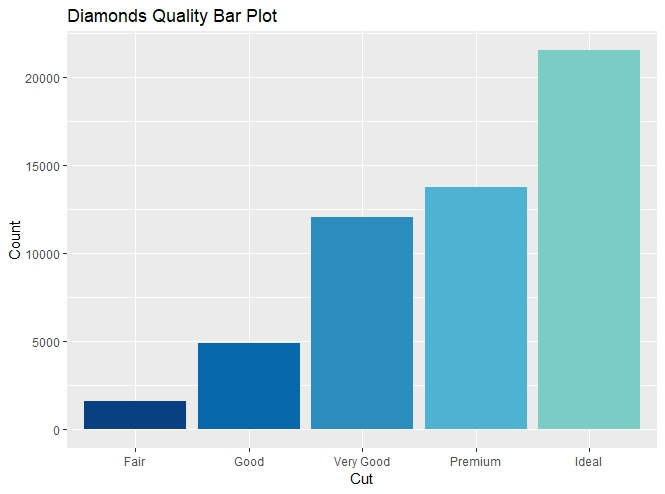

::: {dir="ltr" style="text-align: left;" trbidi="on"}
নান্দনিক গ্রাফের জন্য ggplot2 ব্যবহার না করলে জীবনটাই বৃথা। সাথে যদি RColorBrewer যুক্ত হয় তাহলে তো সোনায় সোহাগা। কথা কম বলে কাজে নেমে পড়ি।

  ----------------------------------
   
         এটাই আমরা শেষে দেখব 
  ----------------------------------

ইনস্টল করা না থাকলে install.packages("ggplot2") দিয়ে ও একইভাবে RColorBrewer ইনস্টল করে নিন। এবার প্যাকেজ দুটি লোড করে নেই। মনে রাখবেন, লোড করার সময় কোটেশন দিতে হবে না।

> library(ggplot2)
> library(RColorBrewer)

এবার এঁকে ফেলি। মনে রাখতে হবে, ggplot2 প্যাকেজ ভেক্টরের বদলে ডেটাফ্রেইম নিয়ে কাজ করে। এখানে আমরা ggplot2 এর বিল্ট-ইন ডেটাসেট diamonds ব্যবহার করব। প্রথমে আমরা RColorBrewer ছাড়া এঁকে দেখি। 

> ggplot(diamonds, aes(cut))+
>   geom\_bar(fill="blue")+
>   labs(title="Diamonds Quality Bar Plot")

::: {.separator style="clear: both; text-align: center;"}

:::

এখানে blue কালার দিলাম। এবার দেখা যাক RColorBrewer কীভাবে একে আরও আকর্ষণীয় করে।

> ggplot(diamonds, aes(cut))+
>   geom\_bar(fill=brewer.pal(n=9, name='GnBu')\[9:5\])+
>   labs(title="Diamonds Quality Bar Plot")

এখানে brewer.pal কীভাবে কাজ করে বুঝতে অসুবিধা হলে [এখান থেকে প্লট কালারিং এর উপায়গুলো দেখে নিন](2018-07-r-colors.html)। বর্ণিত ৯টি উপায়ের মধ্যে ৯ নম্বরটি দেখতে হবে। 

  ----------------------------------
   
        দুই প্যাকেজের সমন্বয় 
  ----------------------------------

তবে একটি সমস্যা হয় অনেক সময়। RColorBrewer এর কালারের ৩ সেট কম্বিনেশন আছে। পুরো লিস্ট [দেখতে পারেন এখানে](https://blogger.googleusercontent.com/img/b/R29vZ2xl/AVvXsEg0dEPzUwlc9o7lfVj8EsC5xNRgh5aj7n5j4b7vOVGnQtsXEcPuOeGQ76gw6lpH6roXfTqQ8PhoFBKdGmBXTCJ3mHLc9tT3g8_KyV-Pd_rm23kqMw72mLYddmweU56d42t1r1O7spJ1wbA/s1600/Rcolors.png)। এগুলোর মধ্যে সর্বোচ্চ ১২টি পর্যন্ত কালার আছে। আমাদের বার চার্টের বার আরও বেশি হয়ে গেলেই R-এ error দেখায়। 

এটার সমাধানও সোজা। আগে থেকে কালার বানিয়ে রেখে দিলে সুবিধা। 

> col \<- brewer.pal(9, "Spectral")

আপনি চাইল *Spectral* এর বদলে অন্য প্যালেটও দিতে পারেন। [লিঙ্কটা](https://blogger.googleusercontent.com/img/b/R29vZ2xl/AVvXsEg0dEPzUwlc9o7lfVj8EsC5xNRgh5aj7n5j4b7vOVGnQtsXEcPuOeGQ76gw6lpH6roXfTqQ8PhoFBKdGmBXTCJ3mHLc9tT3g8_KyV-Pd_rm23kqMw72mLYddmweU56d42t1r1O7spJ1wbA/s1600/Rcolors.png) থেকে দেখে নিলেই হলো। এবার অনেকটা আগের মতোই। শুধু একটি পার্থক্য। colorRampPalette ফাংশনের ভেতরে প্যালেটকে দিয়ে দিতে হবে। 

ও আচ্ছা। কালার যেহেতু ১২টার বেশি হলে সমস্যা হবে, তাই আগেই ১২টার বেশি বার হবে এমন একটি ডেটা বানিয়ে নেই। 

> df \<- data.frame(x=sample(15, 1000, replace = T))

এবার শুধু আঁকা বাকি। 

> ggplot(df, aes(x))+
>   geom\_bar(fill=colorRampPalette(col)(15))+
>   coord\_flip()

এটাই উপরে দেখানো গ্রাফটা। বিভিন্ন কালার কম্বিনেশন দিয়ে পাল্টে নিন চেহারা! আপনি চাইলেয়াগে থেকে না বানিয়ে রেখে একবারেও বসিয়ে দিতে পারেন। কেউ কিছু মনে করবে না।

> ggplot(df, aes(x))+
>   geom\_bar(fill=colorRampPalette(brewer.pal(8, "GnBu"))(15))+
>   coord\_flip()

সূত্রঃ
১। [R graph gallery](https://www.r-graph-gallery.com/40-rcolorbrewer-get-a-longer-palette/)
:::
