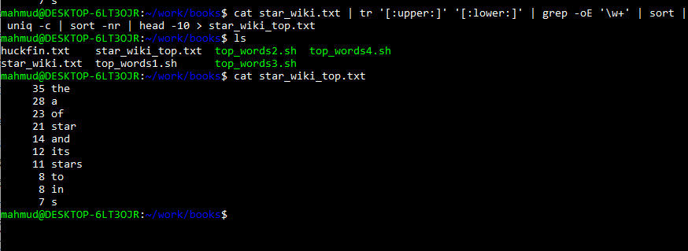

::: {dir="ltr" style="text-align: left;" trbidi="on"}
ডেটা সায়েন্সের জন্য লিনাক্স টার্মিনাল দারুণ এক জিনিস। এর আগে আমরা [tr কমান্ড](https://www.statmania.info/2019/05/linux-tr.html) নিয়ে বলেছিলাম। আজকে দেখব, সামান্য কয়েকটি কমান্ড এক সঙ্গে ব্যবহার করে কত দারুণ একটা কাজ করা যায়।

::: {.separator style="clear: both; text-align: center;"}
:::

::: {.separator style="clear: both; text-align: center;"}

:::

যাদের লিনাক্স নেই তারা এই মিনি টিউটোরিয়ালকে ফলো করতে WSL (উইন্ডোজ সাবসিস্টেম ফর লিনাক্স) [ব্যবহার করতে পারেন](https://www.youtube.com/watch?v=Cvrqmq9A3tA)। আমি নিজেও আসলে তাই করছি।

এখানে আমরা দেখব উইকিপিডিয়ার [Star](https://en.wikipedia.org/wiki/Star) আর্টিকেলের ভূমিকা অংশে কোন শব্দগুলো সবেচেয়ে বেশি বার আছে। এটা টেক্সট মাইনিং এর একেবারে প্রাথমিক একটা কাজ। আমরা ভবিষ্যতে দেখতে পারি, উইকপিডিয়ার সব আর্টিকেলের ভূমিকায় একই শব্দগুলোই বেশি থাকে কি না।

তাহলে কাজে নেমে পড়া যাক। মূল কাজে যাবার আগে আমরা টেক্সটটাকে একটা ফাইলে নিয়ে সেভ করে রাখি। লিনাক্সের ফাইল ম্যানেজিং আগে থেকেই পারলে নীচের কথাগুলো অবশ্য অতিরঞ্জন হবে।

-   তাহলে শুরুতে আমরা আর্টিকেলের টেক্সটটা কপি করে নেই। আমরা শুরু থেকে Contents সেকশনের আগ পর্যন্ত কপি করব। এই মুহূর্তে লাস্ট লাইনটা এ রকম: ...such as a star cluster or a galaxy। উইকপিডিয়া পরিবর্তনশীল বলে এটা হয়ত সব সময় নাও থাকতে পারে। 
-   এবার লিনাক্স টার্মিনালে আসি। একটা ফাইল বানাই। নাম দেই star\_wiki.txt। এটার জন্য কোড *touch star\_wiki.txt*
-   এবার এই ফাইলে টেক্সটখানা বসাতে হবে। তাহলে ইডিট মোডে যেতে টাইপ করি: *nano star\_wiki.txt*
-   এবার আগে কপি করা টেক্সটটুকু এখানে বসিয়ে দেই। এখানে Ctrl + V সবসময় কাজ করে না। তার চেয়ে বরং মাউসের রাইট ক্লিক করলেই পেস্ট হয়ে যায়। 
-   এবার Ctrol + O এবং এন্টার চেপে তারপর Ctrl + X চেপে বের হয়ে আসুন। 

আমাদের মূল কাজ আসলে এখনও হয়নি। তবে এবার হবে। আমরা যা করতে চাই তার জন্যে পুরো কমান্ড হলো:

> cat star\_wiki.txt \| tr '\[:upper:\]' '\[:lower:\]' \| grep -oE '\\w+' \| sort \| uniq -c \| sort -nr \| head -n 10

চাইলে পুরোটা রান করে দেখতে পারেন। তবে আমরা কাজটা করব ধাপে। প্রত্যেক লাইনে কী ঘটছে সেটা বুঝে বুঝে। 

উপরের কমান্ডে আমরা "\|" চিহ্নটা বেশ কয়েকবার ব্যবহার করেছি। লিনাক্স কমান্ড লাইনে একে বলে পাইপ কমান্ড। এটা দিয়ে একটা কাজের রেজাল্টকে আরেকটা কাজের ইনপুট হিসেবে ব্যবহার করা যায়। ব্যাপারটা R এর dplyr ও আরও ভাল করে বললে magrittr প্যাকেজের পাইপের সাথে মিল আছে। অবশ্য R এর পাইপ কমান্ড হলো %\>%। এর ব্যবহার দেখতে [এই লেখাটি দেখুন](https://www.statmania.info/2019/04/join.html)। 

তাহলে একে একে দেখা যাক, ওপরের পুরো কোডটা আসলে কী করল। 

-   *cat* কমান্ড কোনো ফাইলের টেক্সটগুলোকে টার্মিনালে প্রিন্ট করে। ফাইল জোড়া দিতেও এটা ব্যবহার করা যায়। তবে সেটা আমাদের আজকের আলোচনার অংশ নয়। তাহলে আপাতত শুধু রান করুন *cat star\_wiki.txt*। এটা আসলে টেক্সটটা দেখানো ছাড়া আর কিছুই করবে না। ফাইলটায় যেহেতু টেক্সট খুব বেশি নেই, তাই একে প্রিন্ট টার্মিনালে প্রিন্ট করতে অসুবিধা নেই। এবার পাইপ কমান্ড দিয়ে আমরা অ্যানালাইসিসের দিকে যাব। 
-   *tr* কমান্ডের কারিশমা নিয়ে [আমরা আগেই বলেছিলাম](https://www.statmania.info/2019/05/linux-tr.html)। টেক্সট কনভার্ট বা ডিলিট করতে এর ব্যবহার খুব বেশি। এখানে *tr '\[:upper:\]' '\[:lower:\]'* কমান্ড দিয়ে আমরা আমাদের ফাইলের সব লেখাকে ইংরেজি ছোট হাতের বানিয়ে নিলাম। তাহলে এবার কোড হলো-  

> cat star\_wiki.txt \| tr '\[:upper:\]' '\[:lower:\]'

-   এখনও টেক্সটটা আছে প্যারাগ্রাফ আকারে। অ্যানালাইসিসের সুবিদার্থে আমরা প্রতিটি শব্দকে আলাদা আলাদা লাইনে নিয়ে আসব। এ জন্যেই পাইপ দিয়ে পরের কমান্ডে চলে গেলাম। বাড়তি কোড লাগবে *grep -oE '\\w+'* । তাহলে সব মিলিয়ে হবে- 

> cat star\_wiki.txt \| tr '\[:upper:\]' '\[:lower:\]' \| grep -oE '\\w+' 

-   এবার আমরা শব্দগুলোকে আদ্যক্ষর অনুসারে সাজিয়ে নেব। এ জন্য লাগবে *sort* কমান্ড। এবার কোড হলো- 

> cat star\_wiki.txt \| tr '\[:upper:\]' '\[:lower:\]' \| grep -oE '\\w+' \| sort 

-   এখানে একাধিকবার থাকা শব্দগুলোকে একাধিকবারই দেখাচ্ছে। যেমন দেখুন উপরের দিকে অনেকগুলো a দেখা যাচ্ছে। নীচে আবার with আছে চারবার। আমরা এবার একটা শব্দকে একবারই শুধু রাখব। সাথে সেটা কয়বার ছিল সেই তথ্য নিয়ে আসব। এর জন্য কোড হলো *uniq -c*। c হলো count বা গণনার জন্যে। সব মিলিয়ে এবার-

> cat star\_wiki.txt \| tr '\[:upper:\]' '\[:lower:\]' \| grep -oE '\\w+' \| sort \| uniq -c 

-   এটা ভালোই হলো। কিন্তু কোন শব্দগুলো বেশি আছে সেটা সহজে বোঝা যাচ্ছে না। তাই আবার *sort* করা দরকার। যাতে বেশি ফ্রিকুয়েন্সির শব্দগুলো শুরুতে থাকে। এজন্য আমরা *sort -nr* ব্যবহার করব। এখানে n মানে হলো নিউমেরিক সর্ট। আর r মানে হলো রিভার্স সর্ট। এটা না করলে বেশি ফ্রিকুয়েন্সির শব্দ থাকবে শেষে। এবার তাহলে-  

> cat star\_wiki.txt \| tr '\[:upper:\]' '\[:lower:\]' \| grep -oE '\\w+' \| sort \| uniq -c \| sort -nr

-   মূল কাজ আসলে শেষ। কিন্তু সব শব্দের ফ্রিকুয়েন্সি দেখে কোনো লাভ নেই। আমরা দেখব কোন দশটি শব্দ সবচেয়ে বেশি আছে। *head -10*। অবশ্যই ১০ এর বদলে আপনি অন্য কিছি দিতেই পারেন। 
-   তাহলে ফাইনাল কমান্ড দাঁড়াল 

> cat star\_wiki.txt \| tr '\[:upper:\]' '\[:lower:\]' \| grep -oE '\\w+' \| sort \| uniq -c \| sort -nr \| head -10

::: {.separator style="clear: both; text-align: center;"}

:::

এবার আমরা পেয়ে গেলাম সবচেয়ে বেশি ব্যবহৃত শব্দগুলো। চাইলে এটাকে আমরা আলাদা ফাইলে সেভও করে নিতে পারি। সেজন্যে বাড়তি লিখতে হবে *\> star\_wiki\_top.txt*। 

কত সহজে কেল্লা ফতে হয়ে গেল! 

আগেই বলেছি, উইকিপিডিয়া পরিবর্তনশীল। তাই আপনার রেজাল্ট আমার রেজাল্টের সাথে নাও মিলতে পারে। তাতে কী এসে যায়? মূল বিষয়টা তো জানা হয়েই এল! 

হ্যাঁ, চাইলেই আপনি কাজটি R-এও করতে পারেন। কীভাবে জানতে এই [লেখাটি](https://www.datascienceatthecommandline.com/chapter-4-creating-reusable-command-line-tools.html) দেখুন। লেখাটিতে এই আমাদের আলোচিত কমান্ডগুলোর আরও অ্যাডভান্সড ব্যবহারও আলোচনা করা আছে। 

**সূত্র**:  Data Science at the Command Line নামের অসাধারণ বইটি। লেখক: Jeroen Janssens
:::
